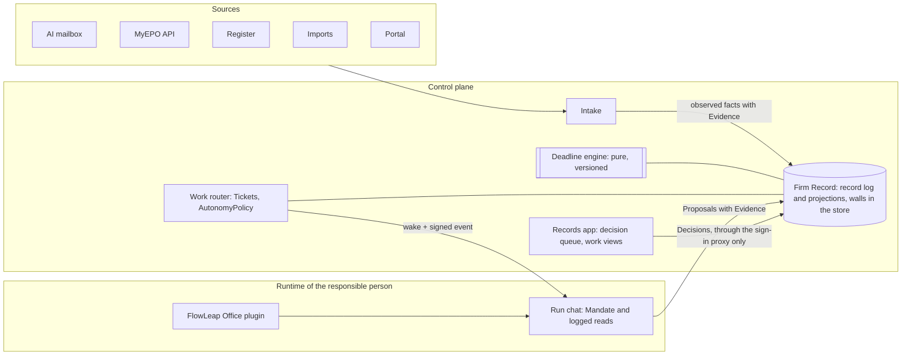
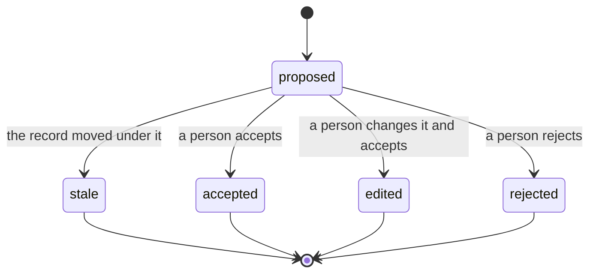
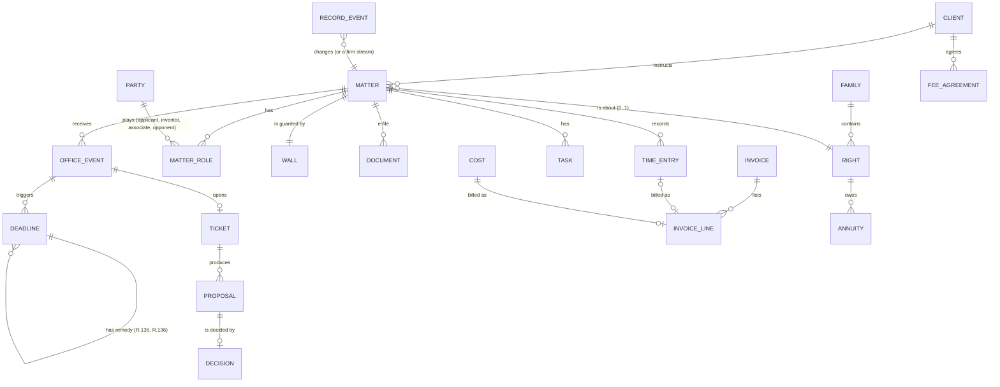
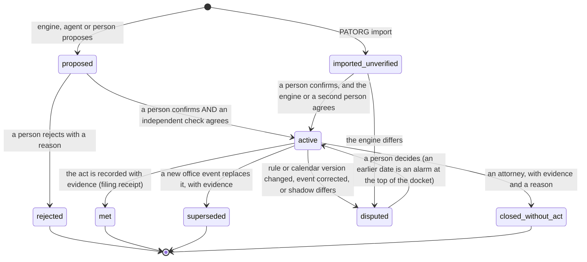

# FlowLeap Patent AI as the AI-native IP management system: design

Status: design of 2026-11-03, for the founder. [ADR 0002](adr/0002-system-of-record.md) records the founder's decision that FlowLeap becomes the firm's system of record; this document is the design that follows from it. Every other choice in this document is a proposal until the founder confirms it (section 12). It builds on [ADR 0001](adr/0001-self-hosted-firm-os.md), the [firm OS architecture](2026-10-26-firm-os-architecture.md), the [Knowledge Pool design](2026-10-22-knowledge-pool-design.md), the [v1 scope](2026-10-28-v1-scope.md), the [roadmap](2026-10-29-roadmap.md), the [docket agent study](2026-11-01-superagent-docket-agent-study.md), the [skills and plugins design](2026-11-02-skills-and-plugins-design.md), the augmented firm research (harness PR 212, `flowleap/docs/2026-11-03-augmented-firm-research.md`, below "the research") and the tickets #123, #135 to #138, #154, #119, #122 and #31.

Labels. Each claim has one label, as in the research:

- **[cited]**: a source states it, and the link or the file path is in the same paragraph.
- **[inferred]**: our conclusion from cited facts. A real firm or a test must confirm it.
- **[proposal]**: our design proposal. Sizes are estimates, not measurements.

Sizes: **S** up to 1 week, **M** 1 to 3 weeks, **L** more than 3 weeks, for one or two engineers who work with coding agents.

## Contents

- [Summary (one page)](#summary)
1. [AI-native principles and the architecture](#1-ai-native-principles-and-the-architecture)
2. [What changes, and what we start from](#2-what-changes-and-what-we-start-from)
3. [Module architecture](#3-module-architecture)
4. [The data model of the system of record](#4-the-data-model-of-the-system-of-record)
5. [The deadline engine](#5-the-deadline-engine)
6. [Event intake](#6-event-intake)
7. [Workflows as agents](#7-workflows-as-agents)
8. [Money: time, invoices, annuities](#8-money-time-invoices-annuities)
9. [Client portal and communication rules](#9-client-portal-and-communication-rules)
10. [Migration from PATORG](#10-migration-from-patorg)
11. [Security and compliance](#11-security-and-compliance)
12. [Roadmap](#12-roadmap)
13. [Risks and open questions](#13-risks-and-open-questions)
14. [Proposed tickets](#14-proposed-tickets)
15. [How this design was made](#15-how-this-design-was-made)

---

## Summary

**The decision.** FlowLeap Patent AI becomes the system of record of a German or European patent firm: matters, the docket, documents, letters, time, invoices, annuities and a client portal, plus the migration from PATORG [cited: [ADR 0002](adr/0002-system-of-record.md)]. An incumbent can add an AI chat to its old system. It cannot easily make its old system safe for agents to work in. That is our advantage, and the design must make it real [inferred].

**AI-native first.** Chapter 1 sets the founder's ten AI-native principles (the software does the work, people judge it) and shows the structure that enforces each one: the record log, the Proposal and Decision types, the source graph, the rules library, walls in the store, and typed autonomy levels [cited for the principles: the founder, 2026-11-03].

**The idea in one sentence.** The firm's record is one append-only log of record events, written by one service on the firm's host; agents in the attorneys' runtimes read the record and propose changes; people decide; tested rule code computes every deadline; and the log is at the same time the record, the audit trail and the evidence that the firm's deadline system "normally works well" [proposal; the phrase is from [EPO Guidelines E-VIII 3.2](https://www.epo.org/en/legal/guidelines-epc/2025/e_viii_3_2.html), cited].

**The five parts that make it AI-native** [proposal]:

1. **Firm Record**, a new control-plane service, the only writer of the record. Every change is a record event with an actor (a person, an agent on behalf of a person, an intake source, an import or a client), a reason and evidence. Relational tables are projections that the service updates in the same transaction, so reports and invoices use plain SQL.
2. **The deadline engine**, an open-source library of rules as tested code. Each rule names its legal source, a version and an effective date. Each computed date carries a trace of every step (delivery, period, closure day). A deadline is active only when a person confirmed it and an independent check agrees: the engine or a second person.
3. **Intake**: the "forward it to FlowLeap" mailbox, the MyEPO Mailbox API, the register watch, DPMA and client mail become office events, matched to a matter by code first and by a model only for free text.
4. **Workflows as agents**: an office event opens a Ticket with a fixed Mandate (#135 to #137); a method (skill) runs in the responsible attorney's runtime and prepares the work products (analysis, client letter, staff instruction, filing package, invoice lines) as proposals and drafts. A person decides on each.
5. **Walls and trust**: each matter has a wall from Entra groups, enforced by the Firm Record and never by the prompt. A decision request never passes through an agent's runtime.

**What we already have.** The Patent Agent with EPO, USPTO and PATSTAT data; 15 methods; the office action analysis and board; the register watch with Needs review; deliverables with an evidence ledger; one isolated runtime per attorney behind Entra; the model gateway with budgets; backups, restore, updates and the release gate [cited: [roadmap](2026-10-29-roadmap.md), research section 5]. What we do not have is any firm-wide record: no matter, deadline, client or invoice entity exists in the harness or the control plane [cited: explorer reports in section 15].

**Module order** (section 12):

| Phase | Goal | Size |
|---|---|---|
| R0 Record tracer | One matter and one deadline through every layer | M (2 weeks) |
| R1 Forward it to FlowLeap | The research's first slice, now writing office events and deadline proposals into the record, in docket observe mode | M to L (3 to 4 weeks) |
| R2 Docket you can trust | EP, PCT and DE rules; two-person confirmation; Records app; PATORG import and shadow difference report | L (6 to 8 weeks) |
| R3 Run the matter | Tasks and handovers, e-file, letters with communication rules, MyEPO source, morning brief | L (5 to 6 weeks) |
| R4 Money | Time, fee agreements, invoices with e-invoice, DATEV export, associate invoices | L (5 to 7 weeks) |
| R5 Switch | Cut-over checklist, full export, restore drill, DPMA intake. **After R5 a small or new firm can run without PATORG.** | M (3 to 4 weeks) |
| R6 to R8 | Annuities, client portal, matter memory and foreign rule packs | M to L each |

About 24 to 31 weeks to the switch line for a small team with agents [proposal; estimate, not a measurement]. The first production customers are new or small firms; the German pilot firm runs FlowLeap in shadow mode beside PATORG from R2 [proposal, decision F5].

**The founder decides** (section 12.4): the store (Postgres), where decisions are made (a Records app that the runtime cannot drive), the exact two-person rule, an open-source deadline rules repository, the first customer type, the pause of new desktop phases, the internal mail exception to ADR 0001 decision 21, the portal exposure, the billing policy for agent work, and who owns the MyEPO credentials.

---

## 1. AI-native principles and the architecture

### 1.1 The basic change

The founder approved these principles on 2026-11-03, with the words "we need to think very hard how to be AI native" and "we are gonna do it with good architecture" [cited: the founder, through the session that started this design]. **In old software, people operate the software. In AI-native software, the software does the work and people judge it.**

Two tests apply to every feature [cited: the same approval]:

- **(a)** If the AI is removed, does the feature still make sense in the same way? If yes, it is not AI-native.
- **(b)** Does a person still do work that the system could prepare?

### 1.2 The ten principles, each as structure

Each principle below names the structure that enforces it. A principle that lives only in prose or in a prompt is not enforced [proposal].

| # | Principle [cited: founder] | Structure that enforces it [proposal] | Where |
|---|---|---|---|
| 1 | **Events in, outcomes out, no data entry.** A fact that a person types and the system could read from a document is a bug | Every record field has a change class (section 4.3). A field of class `observed` or `decided` has no plain edit form: it changes by intake or by a decision on a proposal. Manual entry is a `correction` with a reason, and the firm sees the count of manual entries per field as a defect metric | 4.3, 6 |
| 2 | **The documents are the data.** Every structured fact (deadline, claim, citation, party) links back to its source: document, page and sentence. Source links are part of the data model (the founder's word for this is refused in this repository by the gate `verify-concrete-terms`, so this document says "source links" and "source graph") | The type `Evidence` (below). An `observed` or agent-`proposed` fact without at least one `Evidence` is refused by the Firm Record. The source graph is a projection: edges from each fact to its source spans and from each work product to the facts it used | 1.3, 4.2 |
| 3 | **Every AI output is a proposal with evidence.** The Proposal is a first-class object with a status (proposed, accepted, edited, rejected), the evidence and the decider. The main staff surface is a decision queue; Needs review is its first version | The `Proposal` and `Decision` types and their state machine (below). The decision queue is a projection of open proposals per person and role. Needs review (#137) becomes the queue's view in the runtime | 1.3, 3.5 |
| 4 | **Code where the law needs certainty, AI where understanding is needed.** The AI reads, classifies, extracts and writes; deterministic, tested code calculates deadlines and fees; a person confirms | The deadline engine and the fee tables are pure, versioned libraries (section 5, #153). The model has no tool that writes a date or an amount into an `active` deadline or an issued invoice; the types have no field for it | 5, 8 |
| 5 | **Autonomy is earned and measured.** Each task type in each firm has an acceptance rate; autonomy goes up in levels: observe, propose, act with review, act and report. Some acts are never autonomous, such as deleting a deadline. The firm sees the metrics | `AutonomyPolicy` per firm and task type (below), with a ceiling from a code table that no configuration can raise. The level changes only by a person's decision in the UI, never by a tool [cited for the UI-only switch: #137]. The acceptance rate is a query over decisions | 1.3, 7 |
| 6 | **The firm configures in words.** Firm and client rules are plain-language instructions that agents apply. There is no workflow builder | Firm rules, client rules and workflow rules are texts in the record, versioned, read by methods through a logged tool. Where code must act on a rule (which event starts which task type), the agent turns the words into a typed rule, a structure check refuses a faulty one, the UI shows it back in words, and it starts in observe | 7.1, 9.1 |
| 7 | **Every correction teaches.** Edits and rejections become firm memory and improve the methods; the per-firm memory is the moat | A decision with the status `edited` or `rejected` stores the difference and the reason. A nightly job turns them into proposals for firm memory (Knowledge Pool facts, client rules, style rules) and for method changes. A knowledge editor decides each; nothing changes by itself [cited for "never applies a change itself": #123] | 4.5, 7 |
| 8 | **Proactive by default.** Work happens on events and at night; the day starts with work done | Intake sources and routines start Tickets (sections 6, 7); the morning brief per role (section 12, R2 and R3) lists what was done overnight and what waits for a decision | 6, 7 |
| 9 | **Chat is one surface.** The agent is present in the matter view, in documents, in mail, in Teams and in the queue. Views can be generated when needed | The record tools work in every run, with the selection of the current view as context (section 3.5). Generated views are read-only work pages over projections, like the office action board [cited: #81]; they never add a write path | 3.5 |
| 10 | **The record of what the AI did is a legal asset.** Model-visible ⟺ logged gives defensibility | The Session log keeps what the model saw [cited: `docs/architecture.md`]; the record log keeps what was decided, with the `SessionRef` of each proposal; the hash chain makes both checkable (section 11) | 4.5, 11 |

### 1.3 The architecture



The structural parts [proposal]:

- **An append-only record log as the spine.** It follows the Session log: append-only, typed events, state derived by code, rebuildable projections [cited for the Session log: `docs/architecture.md`]. The record log is firm-wide; the Session logs stay per runtime. The two link by `SessionRef` on each proposal and by `recordSeq` in each logged read.
- **Proposal and Decision types with a state machine.**

```ts
type Evidence = { document: DocumentId; page: number; span: { start: number; end: number }; quote: string }
  | { recordEvent: RecordSeq }                      // a fact that rests on an earlier record fact
  | { officeResponse: { source: 'register' | 'myepo'; requestHash: string; retrievedAt: Instant } }
type Proposal<C extends Change> = { id: ProposalId; change: C; by: Actor; basedOn: RecordSeq
  evidence: [Evidence, ...Evidence[]]               // never empty
  ticket: TicketId | null; status: ProposalStatus<C> }
type ProposalStatus<C> =
  | { s: 'proposed' }
  | { s: 'accepted'; by: PersonId; at: Instant; check: CheckFor<C> }
  | { s: 'edited'; by: PersonId; at: Instant; final: C; diff: Diff; reason: string | null; check: CheckFor<C> }
  | { s: 'rejected'; by: PersonId; at: Instant; reason: string }
  | { s: 'stale'; reason: 'record-moved' }          // basedOn is older than a conflicting change; the proposer reads again
// CheckFor<C> is 'none' for a decided change, IndependentCheck for a guarded change (section 5.5), never optional for guarded
```



- **A source graph from facts to source spans.** Every fact and every work product carries `Evidence`. The Records app shows each fact with its highlighted sentence in the document; the graph answers "which facts rest on this letter?" when a letter is corrected or withdrawn.
- **The deadline engine as a pure, versioned rules library with golden tests** (section 5).
- **Walls in the storage layer, not in prompts.** The Firm Record sets the verified user (or the person an agent acts for) on each database transaction, and Postgres row-level security policies on every projection table filter by the matter wall. So a bug in a query of the service cannot return another matter's rows, and the prompt never carries scope [proposal; this needs decision F1 for Postgres].
- **Autonomy levels as typed policy.**

```ts
type AutonomyLevel = 'observe' | 'propose' | 'act-with-review' | 'act-and-report'
type TaskType = Branded<'TaskType'>                  // 'ep.r71-3.review', 'client-report.office-action', 'intake.match'
type AutonomyPolicy = { firm: FirmId; task: TaskType; level: AutonomyLevel; setBy: PersonId; at: Instant
  metrics: { decided: number; acceptedAsIs: number; edited: number; rejected: number; window: Days } }
// A code table gives each act its ceiling; configuration can lower a level, never raise it above the ceiling.
// Ceiling 'propose' (never autonomous): delete or close a deadline, confirm a deadline, send outside the firm,
// file at an office, pay, issue an invoice, let a right lapse, change a wall.
```

  The four levels map to the accept modes of #135: `observe` is observe; `propose` and `act-with-review` are auto with a decision before the result counts; `act-and-report` applies a decided-class change and reports it in the morning brief. The firm moves a task type up only with its measured acceptance rate in view [proposal].
- **Module seams on the harness plugin model.** Each runtime capability is a capability seam with its three roles [cited for the term: `docs/glossary.md`]: the record service definition, a provider that calls the Firm Record over the firm network, and consumers (the tools and the methods). The FlowLeap Office plugin is a second seam (section 3.6). Nothing in a runtime writes the record except through the propose seam.
- **Idempotent operations.** Every command to the Firm Record carries an idempotency key: the document hash for intake items, the source row hash for imports, matter plus day for Tickets [cited for Tickets: #136], and a client-made key for UI decisions. A retry after a crash converges to the same record. Outgoing acts (a reply mail, a provider instruction) go through an outbox with fixed ids [cited for the pattern: docket agent study section 4.3].
- **Schema versioning for durable records.** Each record event type has a version. A change that a reader cannot interpret safely adds a successor type and an upcaster, and never rewrites committed events; the database schema uses a monotonic `SCHEMA_VERSION` [cited for the repository rule: `AGENTS.md`, "Pre-stable APIs and released Session data"]. Projections are rebuilt after a migration and compared with the old ones.

### 1.4 Trade-offs and rejected alternatives

| Alternative | Why rejected | What we give up [inferred] |
|---|---|---|
| An AI layer on top of PATORG | The founder's decision: an incumbent can copy it [cited: ADR 0002] | A faster first sale to firms that keep PATORG |
| A plain table store with an audit table | Proposals and evidence become second-class; the audit table drifts from the data | Simpler code and tools that everyone knows |
| One event stream per matter (sketch B) | Gapless invoice numbers, unique file numbers and client merges cross matters | Independent matters that a firm could move one by one |
| The matter as a long-lived dsh Session | A Session belongs to one runtime and one person; walls and staff work need a shared, multi-user record [cited: ADR 0001 decision 3] | The harness's own log, viewer and replay for free |
| A git repository per matter | Docket queries and many writers at once are slow and complex | Diff and history tools |
| A workflow builder | Principle 6 | Exactness: words can be unclear. We pay for it with the structure check, the read-back and observe mode |
| A model that computes deadlines | Principle 4; the BGH and EPO duties [cited: section 5.5] | Coverage of countries without a rule pack (we use reported deadlines instead, section 5.6) |
| A shared multi-user runtime | ADR 0001 decision 3 [cited] | One process to run |

The cost of this architecture is more work before the first value: the Firm Record, the engine and the Records app come before any firm switches. The phases (section 12) put a usable slice at the end of each one to pay for that [proposal].

### 1.5 Each module against the principles

| Module (section 3.2) | (a) Same without AI? | (b) Work that a person still does | Principles that shape it [proposal] |
|---|---|---|---|
| 1 Firm Record | No: its core objects are proposals with evidence from agents and intake | None by design; manual corrections are counted as defects | 1, 2, 3, 10 |
| 2 Walls and roles | Partly: walls are needed in any system | Setting up a matter team: the agent proposes the team from the instruction mail and the client's past matters | 1, 3 |
| 3 Deadline engine | Yes, on purpose: principle 4 puts certainty in code. Its AI-native part is the input: the facts come from documents with evidence | Reading the period from a letter: the agent extracts it with the source sentence | 2, 4 |
| 4 Docket | No: deadlines arrive as proposals from events | Confirming: by design (principle 5 ceiling) | 3, 4, 5 |
| 5 Intake | No: matching and reading free text need understanding | The unmatched queue: the agent proposes a match with evidence | 1, 2, 8 |
| 6 Work router | No | Moving task types up in autonomy: by design, a person decides with the metrics | 5, 8 |
| 7 Methods and work products | No | Review of drafts: by design | 3, 7 |
| 8 Documents and Office files | Partly: an e-file is needed in any system; the agent files, names, links and drafts | Filing a document into a matter: proposed by intake | 1, 2, 3 |
| 9 Correspondence | No: drafts come from events and rules in words | Sending: by design (ADR 0001 decision 21) | 3, 6 |
| 10 Time and billing | Old style if people type time. Fix: measured review time and fixed-fee lines from work products are proposed; typed time is the fallback | Entering a fee agreement: the agent reads the signed agreement and proposes the fee lines with evidence | 1, 2, 3 |
| 11 Annuities | No: the keep-or-drop report and the instruction intake are agent work | Paying: by design | 3, 4, 8 |
| 12 Client portal | Partly: a portal is a view. AI-native part: the client sees prepared decisions with the firm's recommendation | none for the firm; the client decides | 3, 9 |
| 13 Migration | No: the agent proposes mappings and explains differences | Mapping review: by design | 2, 3 |
| 14 Matter memory | No | Approving memory: by design (a knowledge editor) | 7 |
| 15 Trust platform | Yes, on purpose: security is code | none | 10 |
| 16 Ways in | No: the agent is in every view, mail and Teams | none | 9 |

---

## 2. What changes, and what we start from

### 2.1 What changes

| Before (ADR 0001, research) | Now (ADR 0002) |
|---|---|
| No client and matter object model (decision 8) [cited: [ADR 0001](adr/0001-self-hosted-firm-os.md)] | The matter is the main object; chats, documents, deadlines, time and memory attach to it |
| PATORG keeps the docket; FlowLeap is a second check (research D4) | FlowLeap is the docket; PATORG is a migration source and a shadow comparison |
| Docketing connectors "not decided" | Not needed for the firm's own matters; connectors to client IP systems and renewal providers are plugins |
| Intake in the control plane "later", after #123 | Intake is the first firm-level service, in phase R1 |
| Phase D knowledge with its own cases (v1 scope OS-2) | The matter record is the case; knowledge attaches to it with the matter's wall |

### 2.2 What stays

- One isolated runtime per user, asleep when idle; no key in a runtime; models only through the gateway [cited: ADR 0001 decisions 3, 5, 6].
- Everything the agent does is a plugin; control-plane services are what plugins talk to [cited: ADR 0001 decision 20].
- Nothing leaves the firm without a person [cited: ADR 0001 decision 21].
- Model-visible ⟺ logged: anything that reaches a model must be reconstructable from the Session log [cited: [docs/architecture.md](../../docs/architecture.md)].
- Self-hosted only; the core calls no FlowLeap backend; paid data only as a plugin [cited: [ADR 0002](adr/0002-system-of-record.md) decision 8].

### 2.3 What the harness and the control plane give us

From three read-only explorations of this repository and `flowleap-os` on 2026-11-03 (section 15):

| Part | State | Where |
|---|---|---|
| Plugins, Session log, `SessionEventMap`, `deriveMessages()` | exists | `docs/architecture.md`, `packages/core/session` [cited] |
| Storage domains (zod KV tables, per process, no cross-table transactions, no indexes, no migration runner) | exists; fits per-user state only | `packages/storage/storage-domain` [cited] |
| Routines: register watch, run chat per run, Needs review, `schedule/admit` | exists | `packages/host/flowleap-routines/README.md` [cited] |
| Decisions, Tickets with a Mandate, stages, run limit | approved tickets #135 to #138 | [docket agent study](2026-11-01-superagent-docket-agent-study.md) [cited] |
| Deliverables, evidence ledger, office action work page (`<report>.work.json` with application, issued, deadline, objections) | exists | `packages/host/flowleap-deliverables` [cited] |
| Agent builder, skills, subagents, workflow scripts, user approval and questions, webhook runtime, jobs | exists | `packages/host/flowleap-agent-builder`, `packages/interaction`, `packages/experimental/webhook` [cited] |
| Control plane: spawner, Entra sign-in proxy, gateway with Postgres, budgets, console (`/admin/`), root applier, `change-log.jsonl`, restic backups, restore in 20 minutes, updater with rollback, release gate with the invariant register, tailnet, health timer, disk guard | exists | `flowleap-os` README [cited] |
| Vault (#31), egress proxy (#33), firm audit trail (#35), artifacts service, Knowledge Pool, token broker, Microsoft 365 plugin, MCP door, wake API | not built | `flowleap-os` README, ADR 0001 [cited] |
| Backup consistency | the runtime keeps running during a backup, so a file in write can be saved half written | `flowleap-os` README [cited] |

---

## 3. Module architecture

### 3.1 The system on one host

```
                 people: partner, attorney, trainee, formalities (PAFA), accounts, admin   clients (portal, phase R7)
                      │ browser / installed web app / phone (PWA)                              │ Entra guest + identity-aware gateway
                      ▼                                                                         ▼
 ┌──────────────────────────────────────────── firm host ──────────────────────────────────────────────────────────────┐
 │ SIGN-IN PROXY (Entra OIDC) in front of every page                                                                     │
 │                                                                                                                       │
 │ CONTROL PLANE (flowleap-os)                                                                                           │
 │  FIRM RECORD ──────── record log (append-only, hash chain) + projections; the only writer; walls; Records app /records/│
 │    ├─ deadline engine (library flowleap-deadlines: rules, calendars, traces)                                          │
 │    ├─ docket, matters, parties, documents index, tasks, decisions, time, invoices, annuities                          │
 │    └─ exports: DATEV, e-invoice, full open export                                                                      │
 │  INTAKE ───────────── sources (AI mailbox, MyEPO API, register, DPMA, imports) → office events → match → Ticket        │
 │  WORK ROUTER ──────── Ticket with Mandate → wake the responsible runtime → signed event → run chat                    │
 │  DOCUMENT STORE ───── content-hashed files per matter (the e-file); OCR text                                           │
 │  PORTAL (R7) ──────── read-only client view from projections; client instructions become record events                │
 │  existing: console, spawner, gateway, budgets, backup, updater, release gate, health; planned: vault, egress proxy,     │
 │            audit trail, token broker, artifacts, Knowledge Pool, MCP door                                              │
 │                                                                                                                       │
 │ RUNTIMES (this repository), one per user, isolated                                                                    │
 │  plugins: dsh-flowleap-record (read tools, propose tools, matter context), routines (Tickets, Decisions),             │
 │           deliverables, methods (skills), connectors, Microsoft 365 (drafts), budget                                   │
 └───────────────────────────────────────────────────────────────────────────────────────────────────────────────────────┘
       outbound only: models (gateway) · EPO, DPMA, WIPO · Microsoft Graph · renewal providers (plugins) · backup target
```

### 3.2 The modules

"Have" means that the part exists today; "planned" means an approved ticket; "new" means that no ticket exists.

| # | Module | Job | Owns | Agents use it by | People use it by | Harness and control-plane mapping | State |
|---|---|---|---|---|---|---|---|
| 1 | **Firm Record** | The system of record and its rules | The record log, projections, the firm sequences (file numbers, invoice numbers) | `record_read`, `record_search`, `record_propose` tools (plugin `dsh-flowleap-record`) | The Records app | New control-plane service; its log is the firm audit trail for record actions (part of #35) | new, L |
| 2 | **Walls and roles** | Who sees and who decides | Roles (Entra app roles), matter teams, screens, conflict checks | Filtered reads only; never sees another matter | Matter team page, conflict check | Entra groups and app roles, as the Knowledge Pool design [cited: [Knowledge Pool design](2026-10-22-knowledge-pool-design.md) section 4]; `FlowLeap.Administrator` and `FlowLeap.User` exist [cited: `flowleap-os` README] | partial, M |
| 3 | **Deadline engine** | Compute deadlines from events with legal sources | Rules, calendars, traces | `deadline_explain` (read) | Trace view beside each deadline | Pure library in a public repository; used by the Firm Record and by the runtime tool | new, L |
| 4 | **Docket** | The lifecycle of each deadline | Deadline states, confirmations, deletions with evidence, observe mode, difference reports | Proposes deadlines; never confirms | Docket list, confirm, close, delete with evidence | Part of the Firm Record; Needs review shows deadline proposals | new, M |
| 5 | **Intake** | Turn outside mail and office data into office events | Raw intake items, match decisions, the AI mailbox | Reads free text for a match proposal | Unmatched queue for the PAFA | New control-plane service; reuses the register reader (`ctx.flowleapRegister`) and #154 | new, L |
| 6 | **Work router and Tickets** | One event, one unit of work, one owner | Tickets, Mandates, Decisions, accept modes, stages | A run chat per Ticket with the Mandate in the logged run message | Needs review with stages; "Would start" | Routines plugin #135 to #138 [cited]; the wake API of ADR 0001 decision 27 | planned + new, M |
| 7 | **Methods and work products** | The substance of the work | Skills, templates, work product types | Skills from `flowleap-methods` and the firm library | Office action board, Word export | 15 methods, deliverables, board [cited: research section 5] | have, M to extend |
| 8 | **Documents and Office files** | The file of each right, and the Word and Excel files the firm sends | Content-hashed documents, versions, OCR text, source links, document proposals | `document_read` within the wall; the four FlowLeap Office tools (section 3.6) | Matter page, preview pane, upload, drag from Outlook | Document store in the control plane; the artifacts service design [cited: ADR 0001 decisions 9, 10]; the FlowLeap Office plugin on OfficeCLI [cited: PR 213] | new, M |
| 9 | **Correspondence** | Letters out and the firm's style | Templates, communication rules per client, outbound drafts | Drafts letters; reads the rules | Outlook Drafts, letter review | Microsoft 365 plugin and token broker (planned in ADR 0001 decision 21) | planned, L |
| 10 | **Time and billing** | Get paid | Time entries, fee agreements, cost lines, invoices, exports | Proposes time and invoice lines | Time sheet, invoice review, issue | Firm Record projections; DATEV and e-invoice export | new, L |
| 11 | **Annuities** | Keep rights alive or let them lapse on purpose | Annuity schedule, client instructions, payment orders | Prepares the keep-or-drop report | Instruction review, payment order | Rules in the engine; providers as plugins | new, M to L |
| 12 | **Client portal** | The client sees and instructs | Portal users, published views | none | Clients read and instruct | Separate container, read-only projection per client | new, L |
| 13 | **Migration** | Move a firm from PATORG | Import batches, mappings, shadow difference reports, cut-over record | Proposes mappings for unclear rows | Import review, difference report, checklist | Import adapters into the Firm Record | new, L |
| 14 | **Matter memory and knowledge** | "What did we argue in this family?" | Matter, client and firm tiers keyed by record ids | `knowledge_search` within walls | Ask in chat; facts with sources | Knowledge Pool, now with real matter ids [cited: ADR 0001 decision 11] | designed, L |
| 15 | **Trust platform** | Make the rest safe | Vault, egress proxy, audit trail, invariant register, consistent backups | none | Console | #31, #33, #35, release gate [cited] | partial, M to L |
| 16 | **Ways in** | Reach the work | none | none | Web app, phone, later Outlook add-in, MCP door | ADR 0001 decisions 19, 24 [cited] | have + planned |

### 3.3 Three rules for every module [proposal]

1. **One writer, many proposers.** Only the Firm Record writes the record. Every other part, an agent too, sends a proposal or an observed fact with its evidence.
2. **A decision never passes through an agent's process.** The Records app is served by the Firm Record behind the sign-in proxy, at its own path, as the console is at `/admin/` [cited for the console: `flowleap-os` README]. The runtime's web client can embed its pages, but the request to confirm, delete or issue goes from the browser through the sign-in proxy to the Firm Record. The runtime's credential has no decision scope. So a prompt injection in a chat can create a proposal, but it cannot confirm it [inferred from ADR 0001 decision 5, which uses the same reasoning for keys].
3. **The record is the context.** When a method needs matter facts, it reads them through a record tool. The tool result is in the Session log with the record position it reflects (section 4.5), so the Session log alone shows what the model saw, and the record log shows that it was true at that position.

### 3.4 Why one log with projections, and not a plain table store

We sketched two independent whole designs (section 15). Both chose an append-only log with projections, for these reasons [proposal]:

- The log is the audit trail, the deadline evidence and the source for shadow mode at once, so we do not build three things.
- Proposals and decisions are first-class events, which is what an AI-native record needs.
- A projection can be rebuilt after a bug fix, and the old projection compared with the new one.

The second sketch named the costs of a pure per-matter event store. The design answers each:

| Cost | Answer [proposal] |
|---|---|
| Reports, controlling and DATEV need SQL | Projections are relational tables in the same database, updated in the same transaction as the append |
| Gapless invoice numbers and unique file numbers cross matters | One firm-wide log and one database transaction, not one stream per matter |
| Read your own write (a confirmed deadline must show at once) | The projection update is synchronous with the append |
| GDPR erasure against an immutable log | Personal fields of a party are encrypted with a key per party; erasure deletes the key and appends `party/erased`. Records that the law requires the firm to keep stay (section 11) |
| Event schema changes over 20-year matters | Versioned event types with upcasters, the same discipline as the Session format migrations [cited: `packages/session/session-format-v*-to-v*`] |
| Small corrections feel slow | A field table in code gives each field a change class: a typo in an address is a direct correction by a person with a reason; a deadline is never one |
| One writer is one point of failure | Read-only mode from the last projection snapshot; the docket list can also be printed nightly as a PDF to the firm's own share (decision for the firm) |

### 3.5 Work views: the UI for people who process many items a day

**What PATORG users work in.** The agorum documentation shows PATORG 6.3 and 6.4 with demo data. Its text names the version (6.4 R101 and 6.3 R208), the "Firmenwechsel" step, "Feld-Info", the user administration window (`USERPSWD Benutzerverwaltung`) with "Start Datenpflege", and a configuration through a user variable (`CmisPreviewUrl`) that is built from an internal field (`VERBDATEI`); it asks the reader to coordinate the setup with Brügmann [cited: [agorum, detail view in PatOrg](https://www.agorum.com/documentation/detailansicht-in-patorg.html)]. Its screenshots show a Windows desktop application with a ribbon, a dense document grid (date, format, file number, title, category, short name, reason, person, a Windows path), and a preview pane with tabs for view, overview, preview, object information, notes, rights, follow-ups and audit [cited, secondary: the screenshots on the same page, as read by another session on 2026-11-03]. The lesson [inferred]: a PAFA processes many documents a day in a grid with a preview. A chat alone is too slow for that work.

**The design** [proposal]:

| Need | Design |
|---|---|
| **List speed** | Every work view is a grid over a projection, with server-side filter, sort and paging; the target is a filter result in less than 200 ms for 100,000 documents (to measure in R2). The grid keeps the user's columns, filters and groups per view |
| **Keyboard work** | `j` and `k` move, `Enter` opens, `a` accepts, `e` edits, `r` rejects, `x` selects, `/` searches, `g` then `d` opens the docket; every action has a key, and the key list is one `?` away |
| **Preview** | A pane beside the grid with tabs: the document with the source spans of its facts highlighted (principle 2), the facts and proposals that rest on it, the record history (the audit tab, from the record log), notes, tasks and follow-ups, and the wall (who can see it) |
| **Bulk actions** | Select many rows, then accept the proposed matches, assign to a person, file into a matter, set a follow-up, or mark as handled. A bulk action on a guarded change is refused: each deadline is confirmed one at a time, with its trace in view |
| **The decision queue** | The first screen for staff (principle 3): open proposals for this person and role, ranked by due date and risk, each with its evidence. Needs review (#137) is its first version in the runtime |
| **The agent in the view** | A side panel in every view runs the agent with the current selection as its context: "draft the client reports for these 12 letters", "why does this deadline differ from PATORG?". The selection reaches the model through a logged record read (principle 9, model-visible ⟺ logged) |
| **Generated views** | The agent can make a read-only work page for a question (for example, all oppositions with a hearing in the next six months), as the office action board is a work page today [cited: #81]. A generated view never adds a write path |

The work views are pages of the Records app, served by the Firm Record behind the sign-in proxy, and embedded in the runtime client, so decisions do not pass through a runtime (section 3.3).

**Self-service setup as an advantage.** PATORG's configuration uses internal field names and is coordinated with the vendor [cited: agorum page]. FlowLeap's setup is self-service [proposal]: the browser setup wizard and the resumable installer of ADR 0001 decision 15 [cited], firm and client rules in plain words (principle 6), firm templates that the administrator uploads, users and roles from Entra groups, and a guided import (section 10). A small firm can set up FlowLeap without a call to FlowLeap or to a vendor consultant [proposal; to prove with a new firm in R5].

### 3.6 The document module: FlowLeap Office on OfficeCLI

The founder decided that the document module makes Word and Excel files with OfficeCLI v1.0.160 (Apache-2.0, one binary), inside our own FlowLeap Office plugin [cited: the founder's decision of 2026-11-03 on the OfficeCLI evaluation, harness PR 213, `flowleap/docs/2026-11-03-officecli-evaluation.md`]. The evaluation found that OfficeCLI kept a firm template, wrote real tracked changes and made a correct claim chart with no network, but that the binary checks for updates, starts background processes, fetches `http(s)://` input values, and starts a headless browser on its diagram and HTML paths [cited: same evaluation, sections 1 and 6].

**The rules of the plugin** [cited: the founder's decision; the details from the evaluation, section 6]:

- The binary is pinned by version and SHA-256 in the firm image, with its notice files.
- The plugin sets `OFFICECLI_SKIP_UPDATE=1`, `OFFICECLI_NO_AUTO_INSTALL=1` and `OFFICECLI_NO_AUTO_RESIDENT=1` on every call, with its own home and state folders per runtime.
- It never uses `install`, `watch`, `mcp`, the HTML render, screenshots or non-native diagrams. No browser is in the image, and the office process runs with no network.
- It refuses every `http://` or `https://` value in tool input.
- It exposes only patent tools, never raw OfficeCLI: the reply letter on the firm template (`office_letter_from_template`), the claim amendment as Word tracked changes (`office_amend_claims`), the claim chart (`office_claim_chart`), and validate.
- The firm templates come from the administrator's template folder, never from the model.

**Known gaps and how the plugin covers them** [cited: evaluation, section 6]:

| Gap | Effect | Plugin answer |
|---|---|---|
| A deleted claim leaves an empty paragraph | After "accept all" an empty line stays where the claim was | The amendment tool also marks the paragraph mark as deleted, and its test checks the accepted text; the gap is reported upstream |
| An insertion has no `w:date` | Word shows the change without a date | The tool sets a date on each change; reported upstream |

**Documents in the record** [proposal]:

- **A document that an agent makes is a proposal.** The tool writes the file into the run's workspace and the deliverables plugin hands it on [cited for the hand-over: evaluation, section 6]. The run then proposes it to the matter's e-file as a `Proposal` of kind `document`, with its content hash. Until a person accepts it, it is a draft and the e-file shows it as one.
- **Source links.** The proposal carries `Evidence` for each fact the document uses: the record facts (by `recordSeq`), the office letter spans, and the evidence ledger of the deliverable [cited for the ledger: `packages/host/flowleap-deliverables`]. So the source graph (section 1.3) goes from a sentence in the client letter to the passage of the office letter that it answers.
- **Decision.** Accepted as is, edited (a new version, with the diff stored for principle 7) or rejected. Only an accepted version can be sent or filed by a person.

---

## 4. The data model of the system of record

### 4.1 The entities



| Entity | What it is | Key fields [proposal] |
|---|---|---|
| **Matter** (Akte) | The firm's unit of work and billing, with one file number (Aktenzeichen). One matter is about one right, or about no right (advice, opposition against a third party, FTO) | file number, client, responsible attorney, team, wall, type (prosecution, opposition, appeal, litigation support, advice, renewal only), state (open, closed, archived), language, instructions |
| **Family** | Rights that share a priority. FlowLeap keeps the firm's own family view and can compare it with the DOCDB family of the EPO data | priority claims, members |
| **Right** | One application or IP right at one office, with its legal status. The right type is a discriminated union | type (EP application, EP patent, unitary patent, PCT application, DE application, DE patent, DE utility model, national validation, other national), office, numbers, dates, stage |
| **Party** | A person or company that the firm knows | name, addresses, contact rules, language, encrypted personal fields |
| **Matter role** | What a party is on a matter | client, applicant, inventor, foreign associate, opponent, licensee, invoice recipient |
| **Client** | A party that instructs the firm; also the root of a client wall | communication rules (section 9), fee agreement, portal users, invoice settings |
| **Foreign associate** | A party role with country, service scope and instruction terms | countries, standard instructions, currency, invoice channel |
| **Document** | One file of the e-file, content-hashed | hash, type (office, client, associate, own, filing receipt), date the document bears, received at, source, OCR text, version of |
| **Office event** | A fact from an office: a communication, a register event, a due date, a filing receipt | office, code, date the document bears, received at, delivery mode, document, source, match state |
| **Deadline** | A period with its legal source and its status machine (section 5) | trigger, rule id and version, calendar versions, trace, due date, internal (Vorfrist) dates, state, remedies |
| **Ticket** | One unit of agent work for one matter event (#136) | matter, event, Mandate, policy version, accept mode, run chat, stage |
| **Task and handover** | One piece of work for a person, from a person or an agent | from, to, matter, instruction, due, acknowledged, done with evidence |
| **Proposal** | A change that someone asks for | change, proposer, based on record position, evidence, Ticket |
| **Decision and approval** | A person's answer to a proposal | status (proposed, accepted, edited, rejected, stale; section 1.3), by, the independent check when the change is guarded, reason |
| **Time entry** | Time that a person worked on a matter | person, matter, minutes, activity, billable, source (manual, measured review, agent work product), billing state |
| **Fee agreement** | How the firm charges a client | hourly rates per role, fixed fees per work type, official fee pass-through, associate cost markup, currency, invoice format |
| **Cost** | Money that the firm pays for a matter | official fee, associate invoice, translation; evidence document |
| **Invoice** | The bill to a client | number (only when issued), lines, totals, VAT, e-invoice file, state |
| **Annuity** | One renewal or annual fee of one right | right, year, due date, grace end, client instruction, payment route, payment evidence |
| **Evidence** | A link from a fact or a work product to its source: a span (document, page, characters, quote), an earlier record event, or an office response (section 1.3) | target, kind, span or reference |
| **Record event** | One append to the record log | sequence, previous hash, time, actor, type, payload, evidence, reason |

### 4.2 Type sketch

The sketch shows the main types with branded ids and discriminated unions. It is a design aid, not product code [proposal].

```ts
type MatterId = Branded<'MatterId'>; type RightId = Branded<'RightId'>; type FamilyId = Branded<'FamilyId'>
type PartyId = Branded<'PartyId'>; type PersonId = Branded<'EntraObjectId'>; type DocumentId = Branded<'DocumentSha256'>
type RecordSeq = Branded<'RecordSeq'>; type RuleId = Branded<'RuleId'>; type TicketId = Branded<'TicketId'>

// Who caused a record event. An agent always acts for a person and never decides.
type Actor =
  | { kind: 'person'; id: PersonId; role: Role }
  | { kind: 'agent'; onBehalfOf: PersonId; session: SessionRef; ticket: TicketId | null }
  | { kind: 'intake'; source: 'ai-mailbox' | 'myepo' | 'register' | 'dpma' | 'client-mail' }
  | { kind: 'import'; batch: ImportBatchId; sourceKey: string; sourceHash: string }
  | { kind: 'client'; portalUser: PortalUserId; client: PartyId }
type SessionRef = { sessionId: SessionId; toolCallId: ToolCallId }
type Role = 'partner' | 'attorney' | 'trainee' | 'formalities' | 'accounts' | 'administrator'

type Right =
  | { type: 'ep-application'; id: RightId; applicationNo: EpApplicationNo; filed: LocalDate; stage: EpStage }
  | { type: 'ep-patent'; id: RightId; publicationNo: EpPublicationNo; granted: LocalDate; validations: RightId[] }
  | { type: 'unitary-patent'; id: RightId; ep: RightId; registered: LocalDate }
  | { type: 'pct-application'; id: RightId; applicationNo: PctApplicationNo; filed: LocalDate; chapter: 'I' | 'II' }
  | { type: 'de-application' | 'de-patent' | 'de-utility-model'; id: RightId; aktenzeichen: DpmaFileNo; filed: LocalDate }
  | { type: 'national'; id: RightId; country: CountryCode; office: OfficeCode; number: string; via: PartyId /* associate */ }
  // merge-extensible: a new right type is a new member; readers fall through to a documented default

type DeadlineState =
  | { s: 'proposed'; by: Actor }
  | { s: 'rejected'; by: Actor; rejectedBy: PersonId; reason: string }
  | { s: 'active'; by: Actor; confirmedBy: PersonId; check: IndependentCheck }
  | { s: 'disputed'; current: ActiveDeadline; candidate: DeadlineCandidate; reason: 'rule-changed' | 'event-changed' | 'shadow-differs' }
  | { s: 'met'; act: RecordSeq; evidence: DocumentId; confirmedBy: PersonId }
  | { s: 'superseded'; successor: DeadlineId; evidence: DocumentId; confirmedBy: PersonId }
  | { s: 'closed-without-act'; by: AttorneyId; evidence: DocumentId; reason: string; secondPerson: PersonId | null }
  | { s: 'imported-unverified'; sourceKey: string }
type IndependentCheck =
  | { kind: 'engine'; rule: RuleRef; trace: TraceHash }         // the engine computed the same date
  | { kind: 'second-person'; by: PersonId }                     // for a reported or manual deadline
  | { kind: 'single-check'; reason: 'one-confirmer-firm' }   // E-VIII 3.2 small entity; listed in every brief
// Illegal states that the types and the Firm Record refuse:
// - 'active' without a person in confirmedBy; an agent can never appear there (PersonId, not Actor)
// - confirmedBy equal to the proposing person
// - 'closed-without-act' without an attorney and an evidence document
// - a second-person check by the same person as confirmedBy

type Invoice =
  | { s: 'draft'; client: PartyId; lines: InvoiceLine[] }
  | { s: 'issued'; number: InvoiceNo /* gapless firm sequence */; issuedBy: PersonId; eInvoice: DocumentId; lines: InvoiceLine[] }
  | { s: 'paid'; number: InvoiceNo; evidence: PaymentRef }
  | { s: 'cancelled'; number: InvoiceNo; creditNote: InvoiceNo; by: PersonId }

type Annuity = { right: RightId; year: number; due: LocalDate; graceEnd: LocalDate; rule: RuleRef
  instruction: { s: 'awaiting-client' } | { s: 'pay' | 'lapse'; by: Actor; clientEvidence: DocumentId }
  payment: { s: 'none' } | { s: 'ordered'; route: AnnuityRoute; ref: string; by: PersonId } | { s: 'paid'; evidence: DocumentId }
    | { s: 'lapsed'; by: PersonId; clientEvidence: DocumentId } }
```

### 4.3 Change classes

Each field of each projection has one change class in a table in code. The Firm Record refuses a change that its class does not allow [proposal]:

| Class | Who may apply it | Examples |
|---|---|---|
| **observed** | An intake source or an import, with its source document or response | An office event, a register status, an imported PATORG row |
| **correction** | One person, with a reason; no second person | A typo in an address, a phone number, a matter title |
| **decided** | A person decides on a proposal; the agent may propose | A match of a letter to a matter, a task, a time entry, an invoice line, a letter text |
| **guarded** | A person and an independent check (section 5.5) | A deadline becomes active, a deadline closes without its act, a deadline date changes |
| **issued** | A person with the role that the firm names; the act leaves the firm or binds money | Issue an invoice, order an annuity payment, mark a filing as sent |

### 4.4 Walls, confidentiality and conflicts

- **Wall.** Each matter has one wall: the client group (`client-<id>`), the matter team (`matter-<id>`) and screens (`screen-<id>`), as Entra groups. A screen beats a membership. The Firm Record resolves the groups of the user at each request and filters every read, search and export; a model never receives scope in a prompt [cited for the rule: [Knowledge Pool design](2026-10-22-knowledge-pool-design.md) section 4; applying it to the record: proposal].
- **Agent reads.** An agent reads as the person it acts for, so it sees what that person sees and no more. A run for a Ticket reads only the Ticket's matter, unless the Mandate names more (for example, the family) [proposal].
- **Conflict check.** When a matter is opened, the Firm Record checks the new parties (client, applicant, opponent) against all parties of the firm. It returns to the person only "no hit" or the hits on matters that the person may see, plus a count of hidden hits that the partner must clear. The check and its result are a record event [proposal].
- **Matter-level model policy.** A matter can carry the policy "local model only" from the client's rules (section 9). Its runs then use the Patent Agent Offline preset of ADR 0001 decision 7 [proposal; the preset is cited in ADR 0001].

### 4.5 How memory, knowledge and agents attach to a matter

- **Chats.** A run chat (Ticket) and an attorney's own chat can belong to a matter. The link is a record event, so the Records app lists the chats of a matter, and the runtime shows the matter in the chat header [proposal].
- **Reading the record is model-visible and logged.** `record_read` returns a small view (for example, the matter summary, the open deadlines, the last office events) plus `{ recordSeq, viewHash }`. The tool result is in the Session log [cited for tool results: `docs/subsystems/session.md`]. The record log keeps every earlier position, so an auditor can rebuild the same view at that `recordSeq` [proposal]. Views stay small on purpose; a full document is read with a separate tool, so Session logs do not grow with whole matter dumps (risk named by sketch A, section 15).
- **Matter instructions.** Per-matter standing instructions (the "instructions per matter" of the skills design Q4 [cited: [skills and plugins design](2026-11-02-skills-and-plugins-design.md)]) are a record field. A run reads them with `record_read`, so they enter the model only through a logged tool result [proposal].
- **Matter memory.** The Knowledge Pool's Matter and Client tiers now have real ids: a fact record names a `MatterId` or a client `PartyId`, and its audience is that wall. Decided work products (a filed response, a sent report) propose facts to the pool, as shared artifacts do in ADR 0001 decision 11 [cited for the pool; the link to the record: proposal]. The tiers stay off until the firm records its client consent policy [cited: Knowledge Pool design, ABA 512].
- **Accept rate.** Each Decision stores the outcome (as is, with edits, rejected), so the accept rate per method and per workflow of #123 is a SQL query over the projections [proposal; the metric is cited from #123].

---

## 5. The deadline engine

### 5.1 Principles [proposal]

1. **Rules are code with a legal source.** A rule is a small, pure, tested function plus its metadata. No model computes a date.
2. **The earliest safe date.** Where the law gives the party a benefit that depends on facts the engine cannot prove (late receipt, a disruption, the date when a cause of non-compliance ended), the engine computes the date without the benefit and shows the possible later date as a note for a person.
3. **Every date has a trace.** The trace lists each step with its rule and its source: delivery, start, period, end of month, closure day, remedy.
4. **Fail loud.** A missing calendar year, an unknown event code or a rule without a version for the trigger date stops the computation with a named error and a task for a person. It never guesses [cited for the repository rule "misconfiguration fails loud": `AGENTS.md`].
5. **Nothing changes in silence.** A new rule version or calendar never moves an active deadline. It opens a dispute that a person decides.

### 5.2 A rule and a computation

```ts
type Rule = {
  id: RuleId                         // 'ep.r71-3.grant-communication'
  version: number                    // a change of the law or of our reading is a new version; old versions stay
  legalSource: { cite: string; url: Url }[]   // 'Rule 71(3) EPC', 'Rule 131(4) EPC'
  effectiveFrom: LocalDate; effectiveTo: LocalDate | null   // chosen by the trigger date, not by today
  office: 'EPO' | 'WIPO' | 'DPMA' | 'national'
  trigger: EventCode[]               // the office event codes that start this rule
  reviewedBy: { attorney: string; date: LocalDate }         // a qualified attorney signed off this version
  compute(input: TriggerInput, cal: Calendars): Computation
}
type Computation =
  | { ok: true; due: LocalDate; trace: TraceStep[]; notes: Note[]; remedies: RuleId[] }
  | { ok: false; error: 'calendar-missing' | 'unknown-event' | 'period-not-read' | 'rule-not-effective'; detail: string }
type TraceStep = { op: 'delivery' | 'start' | 'add-period' | 'month-end' | 'closure-roll' | 'dislocation' | 'cap'
  from: LocalDate; to: LocalDate; cite: string }
type Calendar = { office: OfficeCode; year: number; closedDays: LocalDate[]; source: { cite: string; url: Url }
  dislocations: { from: LocalDate; to: LocalDate; source: Url }[] }
```

The library is a separate public repository, `flowleap-deadlines` [proposal, decision F4]. The Firm Record uses it to compute and check; the runtime tool `deadline_explain` uses the same version to explain a date to an attorney. A public repository lets firms, insurers and other attorneys read and test every rule, which supports trust and the [open-source plan](2026-10-29-roadmap.md) [inferred].

### 5.3 The common steps

| Step | EP | PCT | DE |
|---|---|---|---|
| Delivery | Since 1 November 2023 a document is deemed delivered on the date it bears; if it reaches the addressee more than seven days after that date, the period is extended by the excess days [cited: [OJ EPO 2023 A29](https://www.epo.org/en/legal/official-journal/2023/03/a29); [R.126](https://www.epo.org/en/legal/epc/2020/r126.html), [R.127](https://www.epo.org/en/legal/epc/2020/r127.html)]. The engine uses the date the document bears and shows the extension as a note when `receivedAt` is more than seven days later [proposal, principle 2] | The date of the document, with the seven-day rule of [R.80.6 PCT](https://www.wipo.int/en/web/pct-system/texts/rules/r80) [cited] | Electronic delivery through the DPMA mailbox counts on the fourth day after the document is available [cited: research section 2.2, DPMA consent flyer] |
| Start and period | Computation starts on the day after the event; years, months and weeks end on the day with the same number, or the last day of a shorter month [cited: [R.131](https://www.epo.org/en/legal/epc/2020/r131.html)]. Periods that the EPO sets are two to four months, up to six in special cases [cited: [R.132](https://www.epo.org/en/legal/epc/2020/r132.html)] | [R.80.1 to 80.3 PCT](https://www.wipo.int/en/web/pct-system/texts/rules/r80) [cited] | §§ 187, 188 BGB by analogy [inferred; to confirm with the pilot firm's practice] |
| Closure days | A period that ends on a day when a filing office is not open, or mail is not delivered, ends on the next day when all are open [cited: [R.134(1)](https://www.epo.org/en/legal/epc/2020/r134.html)]. The EPO publishes its closing days for each year: 2026 in [OJ EPO 2025 A40](https://www.epo.org/en/legal/official-journal/2025/06/a40), 2027 in [OJ EPO 2026 A30](https://www.epo.org/en/legal/official-journal/2026/06/a30) [cited]. Periods that ended during the closure of 24 December 2025 to 1 January 2026 moved to 2 January 2026 [cited: [EPO notice](https://www.epo.org/en/service-support/website-updates/epo-offices-closed-24-december-2025-1-january-2026)] | A period that ends on a non-working day of the office moves to the next working day [cited: [R.80.5 PCT](https://www.wipo.int/en/web/pct-system/texts/rules/r80)] | An end on a Saturday, Sunday or public holiday moves to the next working day [cited: [§ 193 BGB](https://www.gesetze-im-internet.de/bgb/__193.html)]. Which public holidays apply (those at the DPMA site in Munich, or others) is open (question P7) |
| Disruptions | A general dislocation of mail or electronic means in a Contracting State extends periods to the first day after it ends, for parties resident in that State or with a representative there, and for all parties when the State is the EPO's host State; the EPO publishes the dates [cited: R.134(2), (4)]. A person enters the published dislocation into the calendar with its source and the affected State, and the engine applies it only to matters that meet the condition. An exceptional event in the last ten days before a period ends (R.134(5)) needs evidence, so it is a note, never an automatic extension [proposal] | Excuse of delay for force majeure and general outages [cited: [R.82quater PCT](https://www.wipo.int/en/web/pct-system/texts/rules/r82quater)]; a note, never automatic [proposal] | none in v1 |

### 5.4 Rule set version 1

The first rule set covers the periods that a European prosecution practice meets every week [proposal; the list is our choice, the sources are cited]:

| Rule id (example) | Trigger | Period | Legal source |
|---|---|---|---|
| `ep.r132.specified-period` | Communication under Art. 94(3) and other communications that set a period | The months stated in the communication; the period is read from the document and shown for confirmation | [R.132](https://www.epo.org/en/legal/epc/2020/r132.html), [Guidelines E-VIII 1.2](https://www.epo.org/en/legal/guidelines-epc/2025/e_viii_1_2.html) |
| `ep.r70.examination-request` | Mention of the publication of the European search report | 6 months for the examination request and the reply to the search opinion | [R.70](https://www.epo.org/en/legal/epc/2020/r70.html), [R.70a](https://www.epo.org/en/legal/epc/2020/r70a.html) |
| `ep.r71-3.grant-communication` | Communication under Rule 71(3) | 4 months | [R.71](https://www.epo.org/en/legal/epc/2020/r71.html) |
| `ep.r161.euro-pct` | Communication under Rule 161 | 6 months | [R.161](https://www.epo.org/en/legal/epc/2020/r161.html) |
| `ep.r159.euro-pct-entry` | PCT priority or filing date | 31 months | [R.159](https://www.epo.org/en/legal/epc/2020/r159.html) |
| `ep.renewal` | Filing date | Last day of the month of each anniversary from year 3; six more months with a surcharge | [Art. 86](https://www.epo.org/en/legal/epc/2020/a86.html), [R.51](https://www.epo.org/en/legal/epc/2020/r51.html) |
| `ep.opposition-period` | Mention of the grant | 9 months | [Art. 99](https://www.epo.org/en/legal/epc/2020/a99.html) |
| `ep.appeal` | Notification of the decision | 2 months for the notice, 4 months for the grounds | [Art. 108](https://www.epo.org/en/legal/epc/2020/a108.html) |
| `ep.further-processing` | Communication of a loss of rights (R.112(1)) for a period that R.135(2) does not exclude | 2 months | [Art. 121](https://www.epo.org/en/legal/epc/2020/a121.html), [R.135](https://www.epo.org/en/legal/epc/2020/r135.html), [R.112](https://www.epo.org/en/legal/epc/2020/r112.html) |
| `ep.re-establishment` | Removal of the cause of non-compliance (a person enters it) | 2 months, at most 1 year after the missed period | [Art. 122](https://www.epo.org/en/legal/epc/2020/a122.html), [R.136](https://www.epo.org/en/legal/epc/2020/r136.html) |
| `up.request-unitary-effect` | Publication of the mention of the grant | 1 month | Rule 6 of the Rules relating to Unitary Patent Protection [cited, secondary: research section 2.3] |
| `pct.national-phase` | Priority date | 30 months (31 at the EPO and some other offices) | [Art. 22 PCT](https://www.wipo.int/en/web/pct-system/texts/articles/a22) |
| `pct.restoration-of-priority` | In the national phase: the Art. 22 or Art. 39 time limit, or receipt of an express request under Art. 23(2); before the receiving office: expiry of the priority period | 1 month in the national phase (R.49ter.2(b)(i)); 2 months before the receiving office (R.26bis.3(e)) | [R.49ter PCT](https://www.wipo.int/en/web/pct-system/texts/rules/r49ter) |
| `de.examination-request` | Filing date | 7 years | [§ 44 PatG](https://www.gesetze-im-internet.de/patg/__44.html) |
| `de.annual-fee` | Filing date | Annual fees from year 3; the surcharge period of the PatKostG | [§ 17 PatG](https://www.gesetze-im-internet.de/patg/__17.html), [§ 3(2) PatKostG](https://www.gesetze-im-internet.de/patkostg/__3.html) (due date), [§ 7 PatKostG](https://www.gesetze-im-internet.de/patkostg/__7.html) |
| `de.opposition` | Publication of the grant | 9 months | [§ 59 PatG](https://www.gesetze-im-internet.de/patg/__59.html) |
| `de.appeal` | Service of the decision | 1 month | [§ 73 PatG](https://www.gesetze-im-internet.de/patg/__73.html) |
| `de.weiterbehandlung` | Service of a decision that rejects the application because a period that the DPMA set was missed | 1 month | [§ 123a PatG](https://www.gesetze-im-internet.de/patg/__123a.html) |
| `de.wiedereinsetzung` | End of the hindrance (a person enters it) | 2 months, at most 1 year after the missed period; not for the periods that § 123(1) excludes | [§ 123 PatG](https://www.gesetze-im-internet.de/patg/__123.html) |

Each rule also defines the firm's internal dates (Vorfristen), for example two weeks and one week before the due date. The firm sets these as validated configuration, not the rule [proposal; the repository rule "no hardcoded tunables" is cited in `AGENTS.md`].

### 5.5 The lifecycle and the trust design



The trust design [proposal, from the founder's rules in [ADR 0002](adr/0002-system-of-record.md) decision 4]:

- **The AI only proposes.** An agent's credential can create a deadline proposal; the Firm Record refuses any other deadline change from it.
- **Two-person rule.** A deadline is active only with two independent sources, and one of them is always a person: a person confirms, and either the engine computed the same date from a rule, or a second person confirmed it. A deadline that the engine cannot compute (a reported foreign deadline, a manual entry, a period read from a letter that the engine could not parse) needs the second person. The confirmer is never the proposer. This follows the EPO's "independent, effective cross-check" [cited: [Guidelines E-VIII 3.2](https://www.epo.org/en/legal/guidelines-epc/2025/e_viii_3_2.html)] and the BGH's demand that staff cannot change or delete a deadline alone [cited, secondary: BGH X ZB 17/12, research section 2.3].
- **Small firms.** The Guidelines exempt small entities from the cross-check [cited: E-VIII 3.2]. In a firm with only one person who may confirm, that person can confirm a deadline that the engine cannot check without a second person; the record marks it `single-check`, and the morning brief lists every `single-check` deadline. The confirmer is still never the proposer: an agent or the intake proposes, the person confirms [proposal; recorded as an exception in ADR 0002 decision 4].
- **Every change is a record event** with the actor, the reason, the old and new values and the trace. There is no update in place.
- **Deletion needs an attorney and evidence.** "Closed without its act" needs a person with the attorney role, a reason from a list (client instruction to let the right lapse, the right was withdrawn, a duplicate entry) and an evidence document. The Records app shows the evidence beside the deadline before the attorney confirms. When the firm has a second person who may confirm, that person must approve the deletion too; a firm with one such person records `single-check` [proposal].
- **Rule changes.** When a new rule version or calendar arrives (for example, the closing days for 2027), the Firm Record recomputes every open deadline. Same date: nothing changes. Different date: the deadline becomes `disputed`; an earlier date is an alarm at the top of every docket view and in the morning brief of the responsible attorney and the partner [proposal, from sketch B].
- **Observe mode.** See section 5.7.

### 5.6 Foreign national deadlines

Version 1 computes EP, PCT and DE. Other countries come in two steps [proposal]:

1. **Reported deadlines (from R3).** A foreign associate states a deadline in a letter. The intake reads it and proposes a deadline of kind `reported`, with the letter as its source and the cited passage shown. The engine cannot check it, so the second person is always needed. Deleting or changing a reported deadline needs the attorney and the associate's letter as evidence, shown next to the original deadline. This is the case of BGH X ZB 17/12, where a misread associate letter deleted a validation deadline [cited, secondary].
2. **Rule packs per country (from R8).** A pack for one country (for example US, CN, JP, or the EP validation states) is the same kind of code, written with a local attorney who signs `reviewedBy`. When a pack exists, a reported deadline gets an engine check, and differences become disputes.

### 5.7 Observe mode and the difference report

A firm starts with the docket in observe mode [cited: ADR 0002 decision 4]. Docket observe mode is a firm-level state of the docket; it is not the autonomy level `observe` of a task type (section 1.3), which starts no run:

- The firm keeps its current docket (PATORG or a list) as the authority. FlowLeap imports it nightly (section 10), computes its own deadlines from the office events and the imported rights, and changes nothing that the firm relies on.
- The **difference report** pairs each external deadline with FlowLeap's by right, trigger and rule: `match`, `date-differs`, `only-external`, `only-flowleap`. Each difference shows both traces or sources. The partner and the PAFA get it in the morning brief [proposal].
- The firm leaves observe mode by a decision of the partner, recorded as a record event, per matter type or for the whole firm. A proposed criterion: four weeks with no unexplained difference, and every `only-flowleap` explained [proposal].

### 5.8 Test strategy

| Layer | What | Source of truth |
|---|---|---|
| Unit golden cases | One file per rule version: trigger, inputs, calendars, expected due date and trace | The text of the rule and the Guidelines on time limits, [E-VIII 1.4](https://www.epo.org/en/legal/guidelines-epc/2025/e_viii_1_4.html) (calculation), [E-VIII 2](https://www.epo.org/en/legal/guidelines-epc/2025/e_viii_2.html) (further processing), [E-VIII 3](https://www.epo.org/en/legal/guidelines-epc/2025/e_viii_3.html) (re-establishment) [cited] |
| Edge cases | Month ends (31 January plus one month), leap years, a closure day on the due date, a chain of closure days, the Christmas closure 2025 to 2 January 2026 [cited: EPO notice], seven-day late receipt, a trigger before and after a rule's effective date | R.131(4), R.134(1), OJ 2023 A29 [cited] |
| Property tests | The due date is never before the trigger plus the period; it never falls on a closure day; a later trigger never gives an earlier date; the trace replays to the same date | [proposal] |
| Real public files | About 200 EP applications from the public European Patent Register, which is open to inspection after publication [cited: [Art. 128(4) EPC](https://www.epo.org/en/legal/epc/2020/a128.html)]: Art. 94(3), R.71(3), R.161 communications and loss-of-rights communications, with the reply or further processing dates that the EPO accepted. For each reply that the EPO accepted as in time without further processing, the engine's due date, with the R.126(2) extension where it applies, is on or after the reply date; replies filed under R.135 are excluded. The trace must match the communication | EPO Register data through our connectors [inferred that the sample gives enough cases; to measure] |
| Third oracle | MyEPO due dates with term descriptions (#154) for the firm's own applications, compared nightly in observe mode | MyEPO API [cited: #154] |
| Shadow | The firm's own docket in observe mode (section 5.7) | The pilot firm |
| Gate | 100 % line and branch coverage on the rules package; mutation tests on each rule; the suite runs in the release gate; a rule version without `reviewedBy` cannot be released | [proposal; the coverage policy follows `docs/testing.md`] |

---

## 6. Event intake

### 6.1 Sources

| Source | How it arrives | Direction | Credentials | Phase |
|---|---|---|---|---|
| **"Forward it to FlowLeap" mailbox** (for example `ki@kanzlei.de`) | Microsoft Graph delta query on one mailbox; the latency is the poll interval [cited: research section 4] | Outbound only | An Entra app with Mail.Read and Mail.Send, scoped to that one mailbox by RBAC for Applications [cited: research section 4]; the secret in the vault (#31) | R1 |
| **Register watch** | The existing daily read of EP Register and USPTO events without a model [cited: routines README] | Outbound only | The firm's EPO OPS and USPTO keys | have; moves to a firm-level source in R1 |
| **MyEPO Mailbox API** | List and read Mailbox communications, due dates, due fees (#154) [cited] | Outbound only | OAuth client credentials of the firm's B2B account. The intake owns them, not a runtime (decision F10) | R3 |
| **DPMA** | No API found [cited: research section 6.3]. v1: a person forwards DPMA letters to the AI mailbox, or saves them into a watched folder [proposal] | Outbound only | none | R5 |
| **Client and associate mail** | Forwarded to the AI mailbox in v1. Later, one address per matter (`akte-2026-0123@kanzlei.de` through plus addressing) so that a Cc puts mail into the e-file [proposal] | Outbound only | as the AI mailbox | R1 (forward), R3 (matter address) |
| **Imports** | PATORG export files and other lists (section 10) | none | none | R2 |
| **Portal instructions** | A client's instruction in the portal (section 9) | from the portal container | portal user | R7 |

### 6.2 Matching to a file

Matching is code first and model second [proposal; the "code table first" rule is cited from the docket agent study section 4.2]:

1. **Exact keys.** The firm's file number in the subject or the letter ("Unser Zeichen", "Your ref."), the EP application or publication number, the PCT number, the DPMA Aktenzeichen. A key that maps to one matter is a match. The intake records the key and where it found it.
2. **Office data.** An EP number without a matter is looked up in the register; a known family member suggests the matter.
3. **Model.** Only for free text (a client mail without a number, an associate letter). The model returns a match proposal with the quoted evidence. A person in the formalities role decides it in the unmatched queue.
4. **Unmatched.** An item without a match goes to the unmatched queue of the formalities team, never to an agent. The queue shows the source document next to the proposed matter, so a wrong match is visible before anyone confirms a deadline on it (risk named by sketch A, section 15).

A mail with several letters gives one office event per letter. The intake deduplicates by the hash of the document, so a letter that arrives from the MyEPO API and from a forward is one event [proposal].

### 6.3 One event, from arrival to decision

```mermaid
sequenceDiagram
    autonumber
    participant PAFA as Frau Klein (formalities)
    participant MB as AI mailbox (Graph)
    participant IN as Intake (control plane)
    participant FR as Firm Record
    participant WR as Work router
    participant RT as Dr. Weber's runtime
    participant APP as Records app
    PAFA->>MB: forwards the R.71(3) communication of EP 3 xxx xxx
    IN->>MB: delta poll (outbound)
    IN->>FR: observed: office event (code R71(3), date it bears, document hash)
    FR->>FR: match by EP number to matter 2026-0123, engine computes 4 months with a trace
    FR->>FR: proposal: deadline 03.03.2027 (actor: intake, check: engine)
    FR->>WR: Ticket for matter 2026-0123 and the day, Mandate "analyse and draft, never file, send or pay"
    WR->>RT: wake the runtime, signed event, run chat with Mandate and event as a logged user/message
    RT->>FR: record_read (logged tool result with recordSeq)
    RT->>RT: method: Rule 71(3) review, client report letter, staff instruction
    RT->>FR: proposals: report letter draft, task for the PAFA, time entry, invoice line
    IN->>MB: reply in the thread to firm addresses only, with the drafts and the link
    PAFA->>APP: confirms the deadline (engine agrees, so one person is enough)
    Note over APP,FR: Dr. Weber reviews in the Records app: accepts the letter with edits and sends it from Outlook
    APP->>FR: decisions recorded; accept rate updated
```

- The run message holds the Mandate and the event as data, so the Session log alone rebuilds what the model saw [cited: #136].
- The intake replies only to firm addresses from a code allow-list (research decision D1). This is an exception to ADR 0001 decision 21 and needs the founder's decision (F7) [cited: research section 7.3].
- A run for a sleeping runtime needs the wake API (ADR 0001 decision 27, "later") [cited]. R1 builds it.
- When the autonomy level of the task type is `observe` (the accept mode `observe` of #135), steps 7 to 11 record a `would_accept` Decision only, with no model call [cited: #135]. In R1 the task types run at `propose`, so the drafts exist, while the docket stays in its observe mode (section 5.7).

---

## 7. Workflows as agents

### 7.1 From "no-code workflows" to agent methods

PATORG offers workflows without code that note deadlines, create files, and generate email, documents and invoices [cited: task brief, from patorg.com 2026-11-03]. In FlowLeap the same job has four parts [proposal]:

| Part | What it is | Who writes it | Where it lives |
|---|---|---|---|
| **Trigger** | A record event type plus conditions in a code table (for example: office event `R71(3)` on an EP right of a matter of type prosecution) | The firm administrator picks from a list; FlowLeap ships defaults | Firm Record configuration, versioned; its hash is the Policy version of #135 |
| **Method** | A skill that does the work: the Rule 71(3) review, the office action analysis, the client report | FlowLeap (`flowleap-methods`), the firm library, or an attorney's own skill [cited: [skills and plugins design](2026-11-02-skills-and-plugins-design.md)] | Skills |
| **Mandate** | Fixed text with the scope of the run: what it may read, what it may propose, and "never file, send or pay" | The workflow definition; never the model | The logged run message of the Ticket [cited: #136] |
| **Decision** | Who decides on each work product, with which change class (section 4.3) | The workflow definition | The Records app and Needs review |

There is no workflow builder (principle 6). A firm describes a new workflow in plain words in a chat ("when a summons arrives, prepare the hearing file and remind me two months before"). The words are the rule and stay in the record. Where code must act on them (which event starts which task type), the agent turns them into a typed trigger; a structure check names each fault in plain words and refuses a faulty one; the UI shows the trigger back in words; and the task type starts at the autonomy level `observe` [proposal; the same pattern as the skill check of the skills design Q9, cited]. A person moves it up a level on the page, with its acceptance rate in view, never by a tool [cited for the UI-only switch: #137].

### 7.2 The work products

| Work product | What the agent prepares | Change class of the result | Who decides | Existing part |
|---|---|---|---|---|
| **Analysis** | The office action analysis with objections, options and a recommendation, with the evidence ledger | decided | Responsible attorney | `recipe-office-action-response`, board (#46, #81) [cited] |
| **Client report** | A letter in the firm's style and the client's language, with the options and the date by which the firm needs instructions | decided; sending is the person's act | Responsible attorney | Report-letter method (research section 7.1) |
| **Staff instruction** | A task card for the PAFA: the documents, the forms, the fees from the fee table (#153), the period, the steps in Online Filing 2.0, and a "done" with the receipt | decided | Attorney instructs; PAFA acknowledges | Handover cards (research concept 6) |
| **Filing package** | The documents, the form data and the fee list, ready to upload to Online Filing 2.0 or DPMAdirektPro by a person | decided; filing is the person's act | Attorney approves; PAFA files | new |
| **Invoice line** | A fixed-fee line or a time line from the client's fee agreement, linked to the work product | decided, then issued with the invoice | Attorney or accounts | new (section 8) |
| **Deadline proposals** | The deadlines that follow from the event, and the internal dates | guarded | Section 5.5 | new |

### 7.3 How a run works in the harness [proposal]

1. The Work router creates or reuses the Ticket for the matter and the day (#136) and stores the Decision with the Policy version (#135).
2. In `auto`, it wakes the responsible attorney's runtime and posts a signed event to the webhook runtime, which opens the run chat [cited: the webhook runtime turns a verified event into a Session, `packages/experimental/webhook`]. The run message starts with the Mandate.
3. The method reads the matter through `record_read` and the documents through `document_read`, both logged tool results.
4. It writes its work products with `write_patent_results` (deliverables with the evidence ledger) and sends proposals with `record_propose`. Each proposal names the Session and the tool call.
5. The run chat gets the Needs review mark with its stage (#137); the Records app shows the proposals on the matter. The person's decisions are record events; the run's limit per runtime (#138) keeps an attorney's own chat responsive.

---

## 8. Money: time, invoices, annuities

### 8.1 Time

- **Manual time.** A timer and a day sheet per person, per matter, with activity codes. Each entry is a record event [proposal].
- **Measured review time.** The Records app and the runtime know when a person opens, edits and decides a work product. FlowLeap proposes a time entry ("review of the Rule 71(3) analysis, 18 minutes") that the person accepts, edits or rejects. It never records time without the person's decision [proposal].
- **Agent work is not attorney time.** An agent's run time is not billed as hours of a person. Agent work reaches the invoice as a fixed-fee item from the client's fee agreement (for example "report on the communication under Rule 71(3)"), or as part of the measured review time. The firm decides this policy (F9) [proposal; that hourly billing of machine time misleads clients is our inference].
- **Model cost per matter.** The gateway already records spend per attorney [cited: `flowleap-os` README]. A Ticket's runs carry the matter id, so the controlling view can show model cost per matter and per client [proposal; needs a matter tag on gateway calls].

### 8.2 Fee agreements and invoices

- **Fee agreement per client.** Hourly rates per role, fixed fees per work type, official fees passed through at cost, foreign associate costs with or without a markup, currency, payment terms, the invoice language and the e-invoice format [proposal].
- **Invoice flow.** Time entries, fixed-fee lines and costs become an invoice draft per matter or per client and period. Accounts or the attorney edits; a person with the right role issues it. Only at issue does the invoice get its number from one firm-wide gapless sequence, in the same database transaction as the record event [proposal; why one transaction: section 3.4].
- **E-invoices.** German businesses must be able to receive e-invoices since 1 January 2025; issuing them becomes mandatory for domestic B2B sales from 2027 for firms with more than EUR 800,000 turnover in the previous year, and from 2028 for all [cited, secondary: [IHK Stuttgart](https://www.ihk.de/stuttgart/fuer-unternehmen/recht-und-steuern/steuerrecht/steuermeldungen/e-rechnungen-5864496); the rule is in [§ 14 UStG](https://www.gesetze-im-internet.de/ustg_1980/__14.html)]. So FlowLeap issues each invoice as an EN 16931 e-invoice (XRechnung or ZUGFeRD) with a readable PDF [inferred from the cited duty; the formats are cited, secondary, in the same source]. Foreign clients get a PDF, or their own format where they ask for it.
- **Retention.** Accounting records are kept for ten years and booking vouchers, such as invoices, for eight years [cited: [§ 147(3) AO](https://www.gesetze-im-internet.de/ao_1977/__147.html)]. The Firm Record refuses a deletion of an issued invoice; a correction is a credit note [proposal].
- **DATEV export.** Most German firms give their bookkeeping to a tax adviser who uses DATEV [inferred]. FlowLeap writes a DATEV booking batch file (the DATEV format CSV) per period and the e-invoice files, which accounts uploads. It does not call a DATEV online service from the core, because the export file needs no backend [proposal; the exact DATEV format version is to check with DATEV's documentation].
- **Foreign associate invoices.** Associate invoices arrive by mail in many formats; PATORG reads them with ChatGPT [cited: research section 2.6]. FlowLeap's intake reads each one, matches it to the instruction that the firm sent (matter, country, service), and proposes cost lines with the original currency and amount. Accounts decides. Then the cost passes to the client's invoice under the fee agreement [proposal].

### 8.3 Annuities

- **The schedule.** The deadline engine computes each renewal or annual fee: EP renewal fees from year 3 until the grant [cited: Art. 86, R.51], national fees after validation (from the country rule packs or the renewal provider's data), DE annual fees [cited: § 17 PatG, § 7 PatKostG], unitary patent renewal fees [inferred; rule to add in R6].
- **Keep or drop.** For each fee due in the next months, the agent prepares a client report with the right's status, its family, its citations and the remaining term, and asks for an instruction. PATSTAT data comes through the paid FlowLeap Data plugin, when the firm installed it [cited for the data plugin rule: ADR 0002 decision 8]. The client answers by mail or in the portal; the answer is a record event with the client's evidence [proposal].
- **Payment routes** [proposal, decision F11]:
  - *Renewal provider.* Dennemeyer, Questel (Pavis) and CPA Global (Clarivate) handle renewals for many firms [cited, secondary for outsourcing: research section 2.4]. Each provider is a plugin that sends the firm's instructions and reads back confirmations and invoices. Whether each provider has an API that a firm can use, and on what terms, is open (question P10) [inferred; not checked].
  - *Direct payment.* For EP and DE fees the firm pays the office itself; FlowLeap prepares the payment list and the person pays. FlowLeap never pays [cited: ADR 0002 decision 6].
- **Lapse is a decision.** Letting a right lapse is a decided act with the client's instruction as evidence, and it marks the right's future annuities `lapsed` and their deadlines `closed-without-act`, with that evidence [proposal].

---

## 9. Client portal and communication rules

### 9.1 Communication rules per client

PATORG has per-client communication rules [cited: task brief]. In FlowLeap they are a structured part of the client record, which every method reads through `record_read`, so each rule that reaches a model is in the Session log [proposal]:

| Rule | Example |
|---|---|
| Language and form of address | German, formal; reports to the group IP department in English |
| Recipients | To the IP manager, Cc the inventor's manager; never to the inventor directly |
| Channel | Email with PDF; portal; the client's own IP system (a plugin later, for example Anaqua Connect [cited, secondary: research section 2.1]) |
| Reports | Which events get a report (all office actions; no report for a publication), and the content of each |
| Instructions | The date by which the firm needs instructions, for example four weeks before the due date |
| Authority | What the firm may do without asking (pay renewals up to year 10; never let a right lapse without written instruction) |
| AI use | The client's consent to AI on its matters, the allowed model providers, or "local model only" (section 4.4) [cited for the consent duty: epi guidelines, secondary, research section 2.3] |
| Invoices | Format (e-invoice, PDF), currency, a purchase order number, a cost cap per matter |

A rule that the agent breaks is visible: the Records app checks each draft against the rules before a person can accept it, for example "the recipient list differs from the client's rule" [proposal].

### 9.2 The portal

- **What the client sees.** Its portfolio (rights, status, families), deadlines that need its instruction, reports and letters that the firm released to the portal, invoices, and the annuity list with "keep" and "drop" [proposal].
- **What the client does.** Gives an instruction (keep or drop a right, approve a response, choose an option from a report), uploads a document, asks a question. Each act is a record event with the actor `client`; it becomes a task for the responsible attorney and never starts agent work by itself [proposal].
- **What it never does.** No chat with the agent, no draft that a person did not release, no data of another client.
- **How it runs.** A separate container that reads a projection of the record filtered to one client, and writes only client acts into the Firm Record through one narrow endpoint. It shares no process with the runtimes [proposal].
- **How clients reach it.** The host has no inbound access from the internet [cited: ADR 0001 decision 6]. The portal is published through the identity-aware gateway that ADR 0001 decision 23 allows for browser-only firms (Microsoft Entra Application Proxy, or Cloudflare Tunnel with Access), and client users sign in as Entra guest users (B2B) of the firm's tenant with MFA [proposal; whether the firm accepts this exposure is decision F8]. A firm that does not want any exposure sends the same views as PDF reports by mail.

---

## 10. Migration from PATORG

### 10.1 What to import

We know of no public PATORG API: none was found when the founder checked on 2026-11-01, and the research lists none [inferred]. The export path depends on the firm's set-up: on-premise or PatOrg Cloud, database access, report exports, or an export that Brügmann provides (question P1) [inferred].

| Data | Use in FlowLeap | Check after import |
|---|---|---|
| Files (Akten) with file number, type, responsible attorney, team, status | Matters | Count per type and per attorney; every open file has a responsible attorney |
| Rights: office, numbers, dates, stage, family links | Rights and families | Each EP and PCT number is looked up in the register; differences listed |
| Parties: clients, applicants, inventors, associates, addresses, contacts | Parties and roles | Duplicates proposed for merge; a person decides |
| Deadlines with their codes, due dates, internal dates, status, change history | Deadlines in state `imported-unverified`; the history is kept as imported record events | The engine recomputes each one (section 10.2) |
| Documents of the e-file | Documents, content-hashed, OCR text | Count and hash per file |
| Time entries, open invoices, invoice history, fee agreements | Time, invoices (issued invoices keep their numbers), fee agreements | Totals per client and per period equal the export |
| Annuity data and provider references | Annuities | Next due fees per right |
| Workflow and letter templates | Inputs for the firm's workflow definitions and letter templates (not executed) | A person reviews each |

Each row becomes a record event with the actor `import`, the source key and the hash of the source row. An import that runs again with the same hash appends nothing [proposal; the same idempotency rule as sketch B].

### 10.2 Shadow mode

For a period that the firm chooses (we propose at least two months, so that most four-month periods meet a new office event), both systems run [proposal]:

```
 PATORG (the authority) ──nightly export──► FlowLeap import ──► record (imported, unverified)
                                                                     │
 office events (AI mailbox, register, MyEPO) ──────────────────────► engine computes its own deadlines
                                                                     │
                                                       difference report (morning brief of the partner and PAFA)
                                                       match · date-differs · only-PATORG · only-FlowLeap
```

- Every `date-differs` shows both dates and FlowLeap's trace; the PAFA explains it (a firm practice, an import error, an engine error, a PATORG error).
- Every `only-FlowLeap` is a possible missed deadline in the current docket, and goes to the partner at once.
- The register comparison adds a third view: events in the EP Register for which neither system has a deadline (the research's register nudge, concept 3) [cited: research section 6.3].
- The engine and import errors that shadow mode finds become golden test cases (section 5.8).

### 10.3 Cut-over checklist

The firm's partner signs the checklist in the Records app; each item is a record event [proposal]:

1. The last nightly import is complete, and its totals equal PATORG's reports (files, open deadlines, open invoices, parties).
2. The difference report has no open item; each explained difference has its reason.
3. Every open deadline is `active` (two-person rule met) or explicitly carried as reported.
4. The AI mailbox, the register watch and, when available, the MyEPO source run and have matched every item of the last two weeks.
5. Each user signed in, has a role and sees the right matters (a wall test with a screened user).
6. A restore of the firm host from the backup was done this week, with the record's hash chain verified.
7. The invoice sequence continues from PATORG's last number; the DATEV export of the last period equals the tax adviser's figures.
8. Staff training is done; the firm's written deadline instructions name FlowLeap.
9. PATORG is set to read-only for an agreed period, and its final export is archived with the firm's backup.
10. The partner signs. From this record event, FlowLeap is the firm's docket.

A firm can also move matter group by matter group (for example, new matters first), because the cut-over is a record event per matter [cited for the idea: sketch B, section 15].

---

## 11. Security and compliance

| Topic | Design | Label |
|---|---|---|
| **Self-hosted** | The record, the documents and the backups live only on the firm's host and the firm's backup target. No FlowLeap service holds or sees them. Support access stays a per-incident channel that the administrator opens [cited: ADR 0001 decision 15] | cited + proposal |
| **Professional secrecy** | § 203 StGB names the Patentanwalt [cited: [§ 203 StGB](https://www.gesetze-im-internet.de/stgb/__203.html)]. A service provider may see client secrets only when necessary and under the conditions of [§ 39c PAO](https://www.gesetze-im-internet.de/patanwo/__39c.html) [cited]. The self-hosted host removes FlowLeap as a provider of client data; the firm's model provider stays one, so the firm needs that contract, and a matter can be set to "local model only" [inferred: research section 2.3; the setting: proposal] | cited + inferred |
| **GDPR** | The firm is the controller. Personal fields of a party are encrypted with a key per party, so an erasure deletes the key and appends `party/erased`; records that a law requires the firm to keep (invoices, § 147 AO) stay until their period ends, and the erasure waits for them. Each export and each portal view is logged. A data protection impact assessment template comes with the install documents [proposal] | proposal |
| **Walls** | Section 4.4. A security invariant: "a user without the matter's group, or with its screen, gets no row, no search hit and no count of that matter" [proposal] | proposal |
| **Audit trail** | The record log is hash-chained: each event stores the hash of the previous one, and the nightly check and every restore verify the chain. Reads of a matter by a person or an agent are logged in an access log. The firm audit trail of ADR 0001 decision 14 (#35) records the other firm actions [proposal; #35 cited] | proposal |
| **Agents cannot decide** | The runtime's record credential has the scopes `read` and `propose`. Decisions need the user's sign-in session at the Records app. A security invariant with a test: "a decision request with a runtime credential is refused" [proposal; pattern of ADR 0001 decision 5] | proposal |
| **Key vault** | Intake secrets (the Graph app secret, the MyEPO client secret) and the record service's signing key live in the vault (#31), never in a runtime [cited: #31]. So #31 comes before R1 goes to a firm [proposal] | cited + proposal |
| **Backup and restore** | The current backup is not consistent while a runtime writes [cited: `flowleap-os` README]. The record database is dumped consistently (a database dump, not a file copy) before restic runs, and a restore rebuilds the projections and verifies the hash chain. The monthly restore test of ADR 0001 decision 17 includes a docket comparison before and after [proposal] | cited + proposal |
| **Per-attorney runtime** | Stays as ADR 0001 decision 3 [cited]. Formalities and accounts staff get runtimes too, with roles that limit their tools [proposal] | cited + proposal |
| **Availability** | One host [cited: ADR 0001 decision 17]. If the Firm Record is down, the Records app shows the last projection read-only, and the nightly docket PDF on the firm's share is the paper fallback [proposal] | proposal |
| **Invariant register** | New rows: `record.single-writer`, `record.agent-cannot-decide`, `docket.two-person`, `docket.delete-needs-attorney-and-evidence`, `record.wall-filters-reads`, `record.hash-chain-verified-on-restore`, `intake.reply-firm-addresses-only`. Each names its test, and the release gate fails without it [cited for the register: ADR 0001 decision 26; the rows: proposal] | proposal |

---

## 12. Roadmap

### 12.1 The phases

The phases are tracer bullets: each one ends in a thing a firm can use and that proves the next layer [proposal]. Sizes are for one or two engineers with coding agents, as estimates.

| Phase | Goal | Modules (section 3.2) | Work | Size | Depends on |
|---|---|---|---|---|---|
| **R0 Record tracer** | One matter and one deadline through every layer | 1, 3, 4 | Firm Record with the log, the hash chain, two projections (matter, deadline); `record_read` in the runtime with a logged `recordSeq`; the Records app with one page and one confirm; `flowleap-deadlines` with R.131, R.134, the 2026 calendar and R.71(3); one recorded-session snapshot | M (2 weeks) | ADR 0002 |
| **R1 Forward it to FlowLeap** | The research's first slice, writing into the record, in observe mode | 5, 6, 7, 15 | AI mailbox intake; match by code; office events; deadline proposals; Ticket with Mandate (#135, #136); wake API; reply to firm addresses; report-letter method; FlowLeap Office plugin with the letter tool and validate; vault (#31) for the intake secrets | M to L (3 to 4 weeks) | R0, #31 |
| **R2 Docket you can trust** | A firm can run FlowLeap's docket beside PATORG and trust its differences | 2, 3, 4, 13 | Rule set v1 for EP, PCT and DE (section 5.4); two-person confirmation; deletion with evidence; disputes; Records app docket views; walls from Entra groups; PATORG import v0 from the pilot's export; nightly shadow difference report; morning brief for the partner and the PAFA; invariant rows | L (6 to 8 weeks) | R1; the pilot's export (P1) |
| **R3 Run the matter** | Daily work happens in FlowLeap | 6, 7, 8, 9, 5 | Tasks and handover cards; the e-file; letter templates, communication rules and Outlook drafts (Microsoft 365 plugin and token broker); the claim amendment and claim chart tools; the work views with keyboard and bulk actions; MyEPO Mailbox source (#154, reshaped); matter addresses; morning brief for every role; Needs review stages (#137); run limit (#138) | L (5 to 6 weeks) | R2 |
| **R4 Money** | The firm bills from FlowLeap | 10 | Time entries with measured review time; fee agreements; invoices with the gapless sequence and e-invoices; DATEV export; associate invoice intake; model cost per matter | L (5 to 7 weeks) | R3 |
| **R5 Switch** | A firm can leave PATORG | 13, 15, 5 | Cut-over checklist; the full open export; restore drill with the hash chain; consistent database backup; DPMA intake; the firm's written deadline instructions template | M (3 to 4 weeks) | R4 |
| **R6 Annuities** | Renewals without a second system | 11 | Annuity schedule; keep-or-drop reports; first renewal provider plugin or direct payment lists | M to L (3 to 4 weeks) | R5 |
| **R7 Client portal** | Clients see and instruct | 12, 9 | Portal container; guest sign-in; client instructions as record events | L (4 to 6 weeks) | R5; decision F8 |
| **R8 Memory and the world** | "What did we argue in this family?" and other countries | 14, 3 | Knowledge Pool tiers keyed by matter; reported deadlines get country rule packs; the MCP door (#77) on the record | L | R5 |

**The switch line is after R5.** Then a new or small firm can work without PATORG: docket, e-file, letters, time and invoices, with the import and a signed cut-over. Annuities can stay with the firm's renewal provider's own portal until R6; the portal is not needed to switch [proposal]. Total to the switch line: about 24 to 31 weeks [proposal; an estimate].

### 12.2 The first customer

| Type | For | Against | Recommendation [proposal] |
|---|---|---|---|
| New firms and spin-outs (1 to 5 attorneys) | No migration; no habit to change; the small-entity rule of E-VIII 3.2 [cited]; they need a docket from day one and pay little for PATORG today | Few matters, so less proof for larger firms | **First production customers**, from R5 (or from R2 with a parallel paper docket) |
| Small established firms (5 to 15) | Real volume; one partner decides | Migration effort; trust in a new docket | Second wave, after two new firms run |
| Firms at the end of a PATORG contract | A date that forces a decision | They need everything at once, including annuities and the portal | From R7 |
| The German pilot firm | Real work, real PATORG data, real questions | It keeps PATORG | **Shadow mode from R2**: it gets the difference report, the AI mailbox and the morning brief; it switches when it chooses |

### 12.3 Fit with the existing roadmap

| Existing phase | What changes [proposal] |
|---|---|
| **A. Close the loop** (dashboard data #60, board data #81, skill pack on the firm) | Finish it; the dashboard's "Coming up" panel reads the docket from R0 on |
| **B. Pilot-ready administration** (#34, #89, #84, #70, #79, #48, stable gate) | Keep it; it runs beside R0 and R1. #48 (parallel wake) joins the wake API of R1 |
| **C. Trust** (#31 vault, #33 web gate, #35 audit trail, #38) | #31 moves before R1 goes to a firm; #35 becomes "the record log plus the firm actions"; #33 stays before the MCP door |
| **D. Firm knowledge** (#71, Knowledge v1) | The "cases" of Knowledge v1 are now the matters of the record; the rest moves to R8. #71 (firm skills library) stays, because firm workflows need it |
| **E. Ways in** (#77 MCP door, #75, #76) | The MCP door comes after R5 and serves the record with the same walls; the phone PWA gets the morning brief and the confirm cards (confirm stays in the Records app pages) |
| **D0, D1, D2 desktop** | The free desktop stays the way in for solo attorneys, but its new phases (D2) wait until the switch line, because the firm OS is now the product (decision F6) |

### 12.4 Decisions for the founder

| # | Decision | Recommendation [proposal] |
|---|---|---|
| F1 | The store of the Firm Record | **Postgres**, one database owned only by the Firm Record, because the record needs transactions across matters, SQL reports and DATEV exports, and the stack already runs Postgres for the gateway. This uses the "Postgres later, behind the same interfaces" of ADR 0001 decision 20 [cited] now |
| F2 | Where people decide | **The Records app** served by the Firm Record behind the sign-in proxy; runtime pages may embed it, but decisions never pass through a runtime |
| F3 | The exact two-person rule | A person plus an independent check (the engine or a second person); a second person always for reported and manual deadlines; an attorney with evidence and a second person for every deletion; the `single-check` exception only for a firm with one person who may confirm |
| F4 | Open-source deadline rules | **Yes**: a public `flowleap-deadlines` repository with rules, calendars and golden cases, each version signed off by a qualified attorney |
| F5 | The first customer type | New and small firms in production; the pilot firm in shadow mode from R2 |
| F6 | The desktop | Keep D0 and D1; pause D2 until the switch line |
| F7 | Internal mail and the mailbox permission | Allow the AI mailbox to reply to firm addresses only (an amendment of ADR 0001 decision 21), with an application permission scoped to one mailbox by RBAC for Applications (research D1, D2) |
| F8 | The client portal exposure | Through the identity-aware gateway of ADR 0001 decision 23 with Entra guest users; PDF reports for a firm that refuses exposure |
| F9 | Agent work on invoices | Never as hours; as fixed-fee items or as the person's measured review time |
| F10 | MyEPO credentials | Owned by the intake in the control plane, not by a runtime card; #154 changes so that its read tools serve the record's data to the runtime |
| F11 | Annuity payment route | Provider plugins first for firms that use a provider; direct payment lists for the others |
| F12 | The name | "Firm Record" for the service and "Records" in the UI (Akten in German) |

---

## 13. Risks and open questions

### 13.1 Risks

| Risk | Effect | Mitigation [proposal] |
|---|---|---|
| A deadline error in our engine | A lost right, a claim against the firm and against us | Observe and shadow first; two independent sources per deadline; the earliest safe date; public rules and golden cases; the firm's insurer informed; contract terms that state that the firm's attorneys stay responsible [inferred: the legal duty stays with the attorney, research section 2.3] |
| Scope too large for a small team | Nothing is finished | Tracer phases; the switch line after R5; annuities and the portal after it; agents write code against the rule tests |
| No PATORG export | No migration for the pilot | Ask the pilot firm and Brügmann early (P1); fallback: rebuild EP and PCT rights and their events from the public register and MyEPO, and import the rest from reports |
| Wrong match of a letter to a matter | A correct deadline on the wrong matter | Code keys first; the source document next to every match; unmatched items go to a person; matching accuracy is a pilot measure |
| Law and calendar changes every year | Stale rules | Each calendar has an effective year and fails loud when missing; a yearly release task for the EPO closing days and fee changes |
| Trust adoption | Staff keep a paper docket | The difference report shows value before any switch; the morning brief puts the docket in their inbox |
| One host | A stopped host stops the docket | Read-only mode, the nightly docket PDF, the 2 to 4 hour restore target [cited: ADR 0001 decision 17] |
| E-invoice and DATEV details | Rejected invoices or bookings | Validate each e-invoice against EN 16931 in tests; confirm the DATEV format with the pilot's tax adviser |

### 13.2 Questions for the founder

1. Do you accept decisions F1 to F12?
2. Do you accept that the desktop's D2 waits until the switch line (F6)?
3. Do you want the deadline rules public from the first commit (F4), or after the pilot's shadow period?
4. Which first firm types will you approach for production use, and when?
5. Do you accept a contract term that the firm's attorneys stay responsible for each deadline, and do you want a liability insurance for FlowLeap?

### 13.3 Questions for the pilot firm

| # | Question |
|---|---|
| P1 | Which PATORG version and set-up do you use (on-premise or PatOrg Cloud)? Which exports can you make (database access, reports, CSV), and does your contract allow an export for migration? When does your PATORG contract end? |
| P2 | Who opens the EPO Mailbox and the DPMA mailbox each day? Do you use the MyEPO API? |
| P3 | Does your IT allow one shared mailbox with an app permission scoped to it? |
| P4 | How do you do the second check of deadlines today? Who may change or delete a deadline? Is it a written instruction? |
| P5 | Would your professional liability insurer accept a software check as part of the independent cross-check of E-VIII 3.2? |
| P6 | Which internal dates (Vorfristen) do you use per deadline type? |
| P7 | For DPMA periods, which public holidays do you apply when a period ends (Munich, the firm's seat, or both)? |
| P8 | Which fee agreements do you use (hourly, fixed fees per work type, caps)? Which invoice formats do your clients ask for? Do you use DATEV through a tax adviser? |
| P9 | How do you instruct and track foreign associates, and how do their deadlines reach your docket? |
| P10 | Do you outsource annuities? To which provider, and does it give you an interface? |
| P11 | Do your clients want a portal? Would they accept a guest account in your Microsoft 365 tenant? |
| P12 | Which matters need ethical walls today, and where are they recorded? |
| P13 | How long do you keep the Handakten and the e-file after a matter ends? |
| P14 | Which client rules exist on AI use, model providers and local models? |

---

## 14. Proposed tickets

Tracer bullets first. Not filed; the founder approves the list first. "os" is `flowleap-os`, "harness" is `flowleap-harness`, "deadlines" is the new public `flowleap-deadlines` repository, "methods" is `flowleap-methods`.

| Id | Title | Repo | Phase | Size | Done when |
|---|---|---|---|---|---|
| T1 | Firm Record tracer: the record log with a hash chain, a matter projection, one `matter/opened` event, the service behind the sign-in proxy | os | R0 | M | A matter opened in the Records app is a record event; the chain verifies; a restart and a restore keep it; one invariant row (`record.single-writer`) with its test |
| T2 | `record_read` in the runtime (plugin `dsh-flowleap-record`): the matter view with `recordSeq`, read-only; until T12 it admits only the matter team that T1 records | harness | R0 | S | The tool result in the Session log names the `recordSeq`; a rebuild of the view at that position gives the same hash; one recorded-session snapshot |
| T3 | Deadline library tracer: Rule and Calendar types, R.131, R.134(1), the 2026 EPO closing days (OJ 2025 A40), the rule `ep.r71-3.grant-communication`, golden cases incl. the closure of 24 December 2025 to 1 January 2026 | deadlines | R0 | S | Golden cases pass; a missing calendar year fails with `calendar-missing`; 100 % coverage |
| T4 | One deadline end to end: a proposed deadline from an office event, confirmed in the Records app, with the two-person rule and the runtime credential refused | os, harness | R0 | M | The confirmer can not be the proposer; a confirm with a runtime credential is refused (invariant `record.agent-cannot-decide`); the docket shows the trace |
| T5 | AI mailbox intake: Graph delta polling of one mailbox, attachments to the document store, match by code keys, office events, the unmatched queue | os | R1 | M | A forwarded R.71(3) letter becomes one office event on the right matter; a letter without a key goes to the unmatched queue with the document shown |
| T6 | Wake API and signed run event: the Work router wakes the responsible runtime and opens the Ticket's run chat through the webhook runtime | os, harness | R1 | M | A sleeping runtime wakes and runs the Ticket; the run message starts with the Mandate (#136); a repeat does not open a second chat |
| T7 | Reply composer: one reply in the thread to firm addresses only, with the drafts and the Records link | os | R1 | S | A reply to an outside address is refused by code (invariant `intake.reply-firm-addresses-only`) |
| T8 | Report-letter method for office events, with the independent Opus review of the new skill | methods | R1 | S | The method passes its live checks on three public EP files |
| T9 | Rule set v1 for EP (section 5.4) with golden cases and the public-file sample | deadlines | R2 | L | Every EP rule has golden cases and `reviewedBy`; for each reply in the 200-file sample that the EPO accepted as in time without further processing, the engine's due date (with the R.126(2) extension) is on or after the reply date |
| T10 | Rule set v1 for PCT and DE (section 5.4) | deadlines | R2 | M | As T9; the DPMA fourth-day delivery rule included; the DE holiday question (P7) answered and encoded |
| T11 | Docket lifecycle: disputes on rule changes, deletion with attorney and evidence, internal dates as configuration | os | R2 | M | The invariants `docket.two-person` and `docket.delete-needs-attorney-and-evidence` have passing tests in the release gate |
| T12 | Walls from Entra groups for the record, with screens and the conflict check | os | R2 | M | A screened user gets no row, hit or count (invariant `record.wall-filters-reads`) |
| T13 | PATORG import v0 from the pilot's export, with staging, mapping review and idempotent import events | os | R2 | L | A second import of the same export appends nothing; the totals equal PATORG's reports |
| T14 | Shadow difference report and the morning brief for the partner and the PAFA | os | R2 | M | The report lists match, date-differs, only-PATORG and only-FlowLeap with traces; the brief is one mail per person per day |
| T15 | Records app: matter list, matter page, docket views, confirm and decline, embedded in the runtime client | os, harness | R2 | M | Live evidence with the `verify` skill; copy in the 8 UI languages |
| T16 | Tasks and handover cards with roles for formalities and accounts | os, harness | R3 | M | An attorney's one-line instruction becomes a card; the PAFA's "done" records the receipt |
| T17 | E-file: the document store per matter, versions, OCR text, `document_read` | os, harness | R3 | M | A document is read only within its wall; the hash matches after a restore |
| T18 | Letters: templates, client communication rules, check of drafts against the rules, Outlook drafts through the Microsoft 365 plugin and the token broker | harness, os | R3 | L | A draft to a recipient outside the client's rule is flagged before acceptance; the draft lands in the attorney's Drafts |
| T19 | MyEPO Mailbox source in the intake, with the credentials in the vault (reshapes #154) | os, harness | R3 | M | On the EPO sandbox a Mailbox communication becomes an office event; due dates feed the third oracle |
| T20 | Time entries, measured review time, model cost per matter | os, harness | R4 | M | A review in the Records app proposes a time entry that the person decides |
| T21 | Fee agreements, invoices, the gapless sequence, EN 16931 e-invoices | os | R4 | L | Each issued invoice validates against EN 16931; numbers have no gap after a crash test |
| T22 | DATEV export | os | R4 | S to M | The pilot's tax adviser imports one period without errors |
| T23 | Foreign associate invoice intake to cost lines | os | R4 | M | An associate invoice is matched to its instruction and proposed as a cost line |
| T24 | Consistent backup of the record database and a restore drill with the hash chain | os | R5 | S | The restore test verifies the chain and compares the docket before and after |
| T25 | Cut-over checklist and the full open export | os | R5 | M | The checklist items are record events; the export reimports into an empty Firm Record with the same projections |
| T26 | DPMA intake (forward and watched folder) | os | R5 | M | A DPMA letter becomes an office event, and T10's delivery rule gives its deemed delivery date |
| T27 | Annuity schedule, keep-or-drop report, and the provider plugin interface | os, harness | R6 | L | The schedule for a sample portfolio equals the provider's list |
| T28 | Client portal v1 | os | R7 | L | A guest user sees only the client's data and gives one instruction that becomes a task |
| T29 | Reported foreign deadlines from associate letters | os, harness | R3 | M | A reported deadline needs the second person; its deletion shows the associate's letter |
| T30 | Matter memory: the Knowledge Pool tiers keyed by the record | os | R8 | L | A fact on one matter is not found from another client's matter |
| T31 | FlowLeap Office plugin on OfficeCLI: the pinned binary, the fixed environment, URL refusal, no network, the letter tool and validate; then the amendment tool (with the paragraph-mark deletion and `w:date`) and the claim chart tool | harness | R1, R3 | M | The four tools pass the evaluation's checks on the firm image with no network; a `https://` value is refused; a deleted claim leaves no empty paragraph after accept |
| T32 | Work views: grid, preview pane with source spans, keyboard actions, bulk actions, the agent side panel with the selection as a logged read | os, harness | R2, R3 | M | A filter on 100,000 documents returns in under 200 ms; a bulk confirm of deadlines is refused; live evidence with the `verify` skill |

Changes to existing tickets [proposal]: #154 changes per F10; #35 adds "the record log covers the record actions"; #123 is answered by sections 4 and 7 and can close when T1 to T4 land; #135 to #138 stay and become the Work router's base.

---

## 15. How this design was made

- Three read-only explorations on 2026-11-03: the harness packages (plugins, Session log, storage, routines, deliverables, interaction, credentials); the `flowleap-os` control plane (containers, stores, backups, console, gate); and the tickets #123, #135 to #137, #154, #119, #122 and #31. Their findings are in sections 2.3 and 3.
- Two independent design sketches on two models, each asked for one whole architecture. Sketch A (a firm ledger with proposals and decisions, a pure rule library, and a two-person state machine in the types) and sketch B (one hash-chained stream per matter with projections, explicitly asked to avoid a plain table store). Both chose an append-only log with projections. Sketch B named the costs of a pure event store; section 3.4 answers each with one firm-wide log and relational projections in one database transaction.
- Legal sources were opened on 2026-11-03: R.126, R.131, R.134, R.135 EPC; the EPO closing days 2026 and 2027; PCT R.80 and R.82quater; §§ 123, 123a PatG; § 147 AO. The other links were checked to resolve. Secondary sources are marked.
- One independent review by a separate agent checked the legal periods against the linked sources, the diagrams and the internal consistency; its 15 findings were fixed (for example R.49ter, R.70, the R.134(2) residence condition and the public-file test).
- Later inputs from the session that started this design: the founder's AI-native principles (chapter 1), the founder's decision on OfficeCLI (section 3.6, PR 213), and the PATORG screenshots on the agorum page (section 3.5).
- We did not use the test firm, made no model call on firm data, and wrote no product code.
