# Add client for large clients

**Status:** draft for the founder's approval, 2026-11-09. This sheet changes [the Add client design](2026-11-08-add-client.md) so that Add client gives complete and correct results for a client of any size. It changes the data reads, the counts, the conflict check and the recording. It keeps the flow, the roles, the record facts and the mockups, except where this sheet says so. [The client model](2026-11-09-client-model.md), approved on 2026-11-09, removes the build job, the dated files and the reference file, so this sheet covers only what Add client reads and records. An independent review checked a first draft against the code of PR 362 and with live EP Register queries; this version includes its findings.

## Contents

- [The problem](#the-problem)
- [The EPO limits](#the-epo-limits)
- [The change: start from the firm's docket](#the-change-start-from-the-firms-docket)
- [The firm docket](#the-firm-docket)
- [The flow after the change](#the-flow-after-the-change)
- [The conflict check](#the-conflict-check)
- [Recording](#recording)
- [Cost](#cost)
- [Confidentiality](#confidentiality)
- [Settings](#settings)
- [What the build changes](#what-the-build-changes)
- [Open points that the build measures](#open-points-that-the-build-measures)
- [Decisions for the founder](#decisions-for-the-founder)

## The problem

The founder tested Add client with "Siemens" on 2026-11-09. Step 1 proposed 7 names with "506 applications", and "Siemens Aktiengesellschaft 474". The founder read these numbers as totals. They are counts in a sample:

- Every read stops at `maxRegisterRows` rows (default 500). For `pa="Siemens Aktiengesellschaft"` the EP Register gives `total: 10000`, which is the OPS cap; the real count is higher.
- The EP Register gives the rows in no date order. The first row is EP 01 951 415, filed in 2001. So the 500 rows are an arbitrary sample, not the newest applications.
- The review reads the group with the same cap and finds only the firm's matters that are in the sample. The review header says "at least", but the count of the firm's matters ("None of the {total}") has no note that it can be incomplete. For a large client, the most important number on the page is wrong.
- The conflict check reads the same sample, so it can miss a conflict.
- An uncached name search for "Robert Bosch GmbH" had no answer after 71 s.

The design reads the client's portfolio and looks for the firm in it. That works for a client with a few hundred EP applications. It cannot work for a client with more than 10,000.

## The EPO limits

Measured on 2026-11-09 through the EP Register search (EPO OPS):

| Limit | Value | Evidence |
|---|---|---|
| Rows on one page | 100 | the existing code (`MAX_PAGE_ROWS`) |
| The last row that one query can read | 2,000 | range `2000-2000` answers; range `2001-2001` answers `CLIENT.InvalidQuery` |
| The count of one query | stops at 10,000 | `pa="Siemens Aktiengesellschaft"` and `re=` of two large firms all give `total: 10000` |
| Date slices | by year, month and date range | for one large firm: `pd within "2025"` 1,467; `pd within "202501"` 102; `pd>=20250101 and pd<=20250331` 324. For a larger firm: `pd within "2025"` 3,358, `pd within "202503"` 246 |
| The `re=` index | searches the representative name and its address lines | `re=` with a street and number gives 63 rows of the firms at that address. Persons are stored surname first: `re="<First> <Surname>"` gives 0, and the stored name is `<Surname>, <First>`. A firm name with `&` gives 0 rows; the same name without `&` gives 10,000 |

This corrects the approved design: it says "10,000 a query", but one query can read only 2,000 rows. `maxRegisterRows` accepts values up to 10,000, and any value over 2,000 fails at row 2,001, which the page shows as "unreachable".

So a complete read of any query is possible: split it into date slices until each slice has at most 2,000 rows, and read each slice in pages of 100.

## The change: start from the firm's docket

The firm's matters for a client are a part of the firm's own EP docket. The docket has a known size, and it is the same for every client. So FlowLeap reads it one time, keeps it current, and matches each client's names against it on the firm's computer.

1. **The firm's matters for a client** are the docket rows whose applicant matches a ticked name. They are complete for every client size, and they need no client query.
2. **Step 1 shows two counts for each name:** **At your firm** (exact, from the docket) and **Matching EP applications** (the `total` of a `pa=` count query, "10,000+" at the cap). A count query counts every applicant that contains the words of the name, and an application with two ticked names counts for each, so the page never adds these counts into a group total.
3. **The rest of the client's portfolio is not a list.** The review and the client page show the count of the group's applications at other firms: one `or` count query for each 4 ticked names, minus the firm's count. With more than 4 names the page says "at least", because two queries can count one application twice. A search field finds any of them by number or title, so **This is ours** (founder decision 5) works on every application. There is no reference file.
4. **The docket also shows the firm view.** It knows every applicant of the firm's EP matters, so a later step can list "applicants in your docket that are not clients yet". This sheet does not build that list.

## The firm docket

**What it reads.** One `re=` query for each entry of the firm identity, split into date slices, with every row checked again on the firm's computer:

- **Terms.** Firm names and addresses become normalized words without `&` and punctuation (`re="Muster Partner"` for "Muster & Partner"). Representatives become `"Surname, First"`. Each address line is its own query, because the register often names a person and puts the firm in the address lines.
- **The row check.** `re=` matches words anywhere in the representative and its address, so it finds other firms too (the surname of a partner also finds a person of that name at a different firm). Every row must pass `isFirm`. `isFirm` also matches the firm names against the address lines. A row that matches only by its address is marked "matched by address only" in the review, because two firms can share an address; a person can untick it.
- **Slices.** A query over 2,000 rows splits by year, then by month, then by date range. A slice that is still over 2,000 rows on one day fails loudly with its query. When the total of a query is under 10,000, the sum of its slices must be equal to the total; if not, the read is `partial` and the page names the missing count.
- **Rows without an EP publication.** The `pd` slices possibly miss register rows that have no EP publication. The build measures this (see [Open points](#open-points-that-the-build-measures)).

**What it keeps.** The rows on the firm's computer, one as-of time for each slice, and the firm identity that it was read for. The page shows the oldest slice time as the as-of time of the docket.

**The current representative only.** The docket has only the applications where the register names the firm now. The second run and **Check for new matters** read the register record of each recorded application that is not in the docket, and say "the register no longer names your firm" for it, as the approved design requires.

**States.**

```mermaid
stateDiagram-v2
    [*] --> no_identity
    no_identity --> reading: the firm identity is saved
    reading --> ready: every slice read and checked
    reading --> partial: some slices failed or the sum check failed
    reading --> failed: no slice could be read
    reading --> interrupted: the Host stopped
    interrupted --> reading: the Host starts again, and reads only the unread slices
    partial --> reading: Try again reads only the failed slices
    failed --> reading: Try again
    ready --> stale: older than docketRefreshAge
    stale --> reading: the scheduled refresh, or Check for new matters when older than docketCheckAge
    reading --> reading: the firm identity changes; the old rows are dropped
    ready --> reading: the firm identity changes; the old rows are dropped
    partial --> reading: the firm identity changes; the old rows are dropped
    stale --> reading: the firm identity changes; the old rows are dropped
    failed --> reading: the firm identity changes
    ready --> no_identity: the firm identity is cleared
```

| State | What Add client shows |
|---|---|
| `no_identity` | As today: the firm's matters cannot be found until the firm identity is set; a link to the setting |
| `reading`, `interrupted` | "Reading your firm's EP docket: 14 of 40 slices, 1,820 rows". Step 1 can start; the count **At your firm** waits |
| `ready` | The count **At your firm** with the as-of time of the docket |
| `stale` | As `ready`, with **Read again** |
| `partial` | The count **At your firm** marked "incomplete", which slices failed, and **Try again** `R`. Add client is possible |
| `failed` | "FlowLeap could not read your firm's EP docket", the reason, and **Try again** `R`. It never shows "No EP matters at your firm yet" in this state |

## The flow after the change

| Step | What the person does | What FlowLeap does |
|---|---|---|
| 1. Find | Types a company name | Shows the matching applicant names from the docket, each with **At your firm** and **Matching EP applications**. It also shows names from a register sample of `findSampleRows` rows and says that this part can be incomplete |
| 2. Confirm the group | Unticks a name that is not part of the client | No change |
| 3. See the matters | Reads "1,132 EP matters at your firm" | Takes the firm's matters from the docket. Shows the count at other firms and the search field |
| 4. Conflict check | No change for the person | Reads as in [The conflict check](#the-conflict-check). **Add client** as **Client** waits until the check is complete; **Watch** does not wait |
| 5. Decide | No change | No change |
| 6. Record | Keeps the page open until the records are written | Writes the client record and the application index in batches, as in [Recording](#recording). There is no build job |
| 7. Open | Opens the client page | The client page shows the application list ([the client model](2026-11-09-client-model.md)) |

A company with no matters at the firm still goes through step 1. The page then says "No EP matters at your firm yet", but only when the docket is `ready` or `stale`.

## The conflict check

The approved check has two halves. Both must be complete for every group size.

1. **The group opposed a client of the firm.** `op=` queries for the group's names, with date slices when a query is over 2,000 rows. This half sends only the group's names.
2. **A client of the firm opposed the group.** Today the review finds this in the rows of the whole group portfolio. A large group has too many rows. Instead, FlowLeap keeps an **opponent index** next to the docket: the `op=` rows for the names of the firm's recorded clients, read in date slices and refreshed with the docket. The check then looks for the group's applications in that index on the firm's computer.

The opponent index sends the names of the firm's clients to the EP Register. Each of these names already went to the EP Register under the firm's own EPO account when the firm added that client, so the EPO learns nothing new. See [Confidentiality](#confidentiality).

## Recording

Today the browser sends two record commands for each matter, one after the other ("Recording 4 of 32"). For 1,132 matters that is more than 2,264 commands. A record command is a person's act, so it stays in the browser. A new batch command `client/applications-recorded` records up to 100 applications and their roles in one command, with one idempotency key for each batch and one fact for each application inside it. 1,132 matters then need 12 commands. The page asks the person to keep it open until the records are written.

One request limiter serves the docket read, the opponent index and the live reads of the pages, because they all use the firm's one EPO account.

## Cost

| Read | Requests (estimate) | When |
|---|---|---|
| Docket of a small firm (about 850 rows for one representative) | for each identity entry: 1 count and 9 pages | at the first read and at each refresh |
| Docket of a large firm (3,000 or more rows a year) | for each identity entry and year: about 12 monthly counts and 35 pages | at the first read and at each refresh |
| Opponent index | for each client name: 1 count and usually 1 page | with the docket |
| Find, step 1 | 1 count for each name, at most `findNameLimit` | each Add client |
| Count at other firms | 1 count for each 4 ticked names | each Add client |

A query for each identity entry reads some rows again; the docket keeps one row for each application. Add client itself needs no read for each matter, because the client model makes no files at Add client. The build PR replaces these estimates with measured values and sets `opsRequestsPerMinute` from them.

## Confidentiality

The EP Register reads use the firm's own EPO OPS account (the `epo-ops` connector credentials). So the EPO already connects every query to the firm, including each `pa=<client>` query of Add client.

- **The docket read** sends the firm's names, addresses and representative names to the EP Register. The approved design says that FlowLeap never sends the firm identity; this sheet changes that rule. The EPO publishes these names on every record of the firm and already knows the account holder, so the queries tell it nothing new.
- **The opponent index** sends the names of the firm's clients, which Add client already sent under the same account.
- **No query has a client name and the firm's names together.** A query `pa=<client> and re=<firm>` would be fast. Under the firm's own account it would tell the EPO nothing new either, but it needs reads for each client and gives no firm view, so this sheet does not use it. The row with 1,132 matters in [The EPO limits](#the-epo-limits) came from one such query, run once as a test.
- **The docket read starts when the firm identity is saved**, not at the first Add client, so the firm's queries and a client's queries do not go out in the same minutes.

The page text "FlowLeap sends only this name to the patent data plugin" stays true for Add client. The docket read gets its own line in the firm identity setting and on its progress: "FlowLeap sends your firm's names to the EP Register, through your firm's EPO account, to read your EP docket. It sends no client name."

## Settings

Validated `Config` fields of `ui-flowleap-folder`, so a firm can change them in cordis.yml:

| Field | Meaning | Proposed default |
|---|---|---|
| `docketRefreshAge` | The age after which the docket is `stale` and the scheduled refresh reads it again | 7 days |
| `docketCheckAge` | The age over which **Check for new matters** reads the docket again first | 1 day |
| `registerSliceRows` | The most rows of one date slice | 2,000 (the EPO limit; a lower value is allowed) |
| `findNameLimit` | The most names that step 1 counts | 20 |
| `findSampleRows` | The rows of the register sample in step 1 (replaces `maxRegisterRows`) | 500, at most 2,000 |
| `recordBatchSize` | The most applications in one `client/applications-recorded` command | 100 |
| `opsRequestsPerMinute` | The highest request rate of all register reads together | measured in the build |

## What the build changes

All changes are FlowLeap plugin code, except one new record command in flowleap-os.

- **`flowleap-connectors`:** `countRegister(query)` reads the `total` of a 1-row page. `readAllRegister(query)` splits a query into date slices of at most `registerSliceRows` rows, reads them all and checks the sum. `family()` accepts the publication number from a docket row. The shared request limiter.
- **`ui-flowleap-folder`:** the docket store, the opponent index and their states and route; query terms from the firm identity; `isFirm` also on address lines; `find` and `review` read the docket and the counts; the search field; the batched recording; the corrected limit of `maxRegisterRows`/`findSampleRows`.
- **flowleap-os:** the batch command `client/applications-recorded`.
- **Tests:** recorded or fake register pages for a total of 10,000, a query over 2,000 rows, a slice over 2,000 rows on one day, a failed slice, a sum mismatch, a docket refresh, an identity change, a row matched by address only, and a conflict through the opponent index. A live proof with Siemens on the dev loop shows the counts, the time of each step and the firm's matters.

## Open points that the build measures

1. Whether the `pd` slices include register rows that have no EP publication. If not, the docket also slices by another date field, or reads those rows with a separate query.
2. The real request count and time of the docket read and the opponent index, and the OPS quota use.
3. The most `re=` terms that one query accepts, so that the docket can combine identity entries in one query.

## Decisions for the founder

1. **Read the firm docket with the firm's names**, and change the approved rule "FlowLeap never sends the firm identity". Recommended: yes. The EPO already knows the account holder, and the docket makes the firm's matters complete for every client.
2. **The opponent index with the names of the firm's clients.** Recommended: yes. Without it, the conflict check of a large group must read the whole group portfolio, which is more than 100 page reads for Siemens.
3. **A batch record command in flowleap-os.** Recommended: yes. 2,264 single commands from an open browser page are too slow and too fragile.
4. **The docket refresh.** Recommended: a scheduled refresh every 7 days, and at each **Check for new matters** when the docket is older than 1 day.
