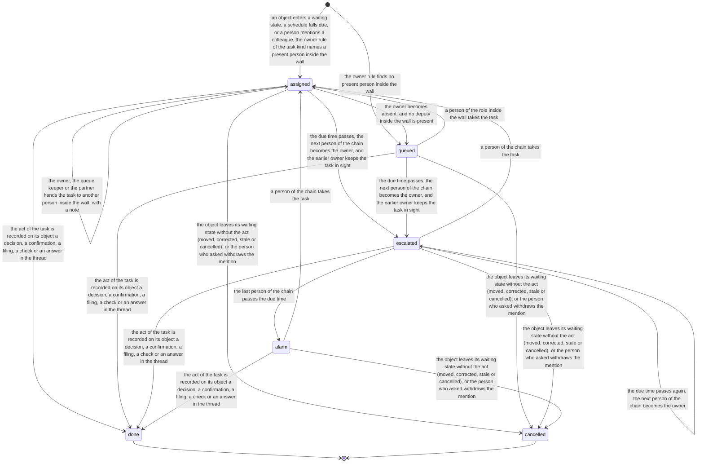
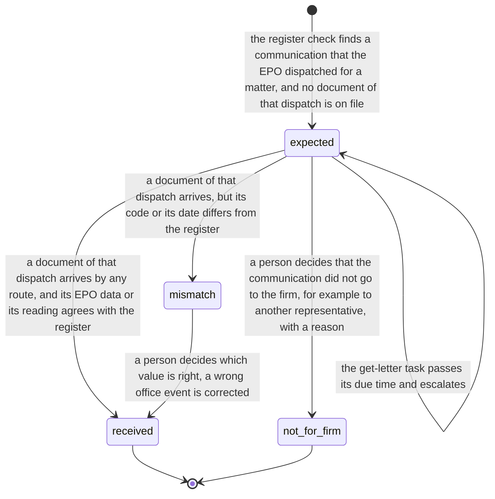

# Process 0: the connected flow

**Status:** draft for the founder's approval, 2026-11-06. The founder answered three decision rounds on 2026-11-06 ([the decisions](#14-founder-decisions-2026-11-06)). No build starts before the founder approves this sheet, and every screen then goes through the mockup gate of the [design language](../../../.agents/skills/flowleap-design-language/SKILL.md).

**Starts when** an office communication exists for a matter of the firm, a schedule falls due, or a person mentions a colleague. **Ends when** every task that the item opened is done or cancelled. **Record objects:** the task, the comment, and the expected communication. Method: [the atlas README](README.md#the-method-for-every-phase).

**Goal.** The founder's words of 2026-11-06, after the QA day: "Let's go back to the drawing board so each matter has a global dossier." Later the same day: "There is no real-time collaboration between all actors including the agent", and "The AI-native system should work systematically, in a predictable way." The QA log of that day (`flowleap/qa/2026-11-06-matters-qa.md` in the coordinator's checkout) has 50 findings. Its main finding (38) is that the chain breaks where a letter should reach its matter, and that the product has no layer for persons: no names, no "what waits for me", no named next step, and no search. Sheets 01 to 05 describe the objects. This sheet connects them: every state that waits for a person opens a named task for a named person, the matter dossier and "My work" are two views of the same tasks, and letters reach FlowLeap without a person who forwards them.

## Contents

- [The value moment](#the-value-moment)
- [Value and plumbing](#value-and-plumbing)
- [1. The process today](#1-the-process-today)
- [2. Actors, roles and a day in each role](#2-actors-roles-and-a-day-in-each-role)
- [3. The task model](#3-the-task-model)
- [4. Two views of the same tasks](#4-two-views-of-the-same-tasks)
- [5. Collaboration: comments, mentions and the agent](#5-collaboration-comments-mentions-and-the-agent)
- [6. How a letter reaches its matter](#6-how-a-letter-reaches-its-matter)
- [7. The agent and the matter](#7-the-agent-and-the-matter)
- [8. Identity](#8-identity)
- [9. What stays with a person](#9-what-stays-with-a-person)
- [10. Firm variation points](#10-firm-variation-points)
- [11. AI-native redesign and the count](#11-ai-native-redesign-and-the-count)
- [12. Map to the code](#12-map-to-the-code)
- [13. QA findings that this sheet resolves](#13-qa-findings-that-this-sheet-resolves)
- [14. Founder decisions (2026-11-06)](#14-founder-decisions-2026-11-06)
- [15. Open questions and tests](#15-open-questions-and-tests)

## The value moment

Every part of this sheet serves one scenario. It is the acceptance test of phase R1.5 (decision Q1): it must run end to end on the seed firm before R1.5 is done. The persons are the seed firm's: Sabine Wolf (formalities), Jonas Weber (responsible attorney), Lena Hoffmann (co-attorney), Dr. Martin Krüger (partner). The matter is SF-2021-0011 (WAGO, EP21755382).

| Time | What happens | Who acts |
|---|---|---|
| 08:00 | The EPO makes a Rule 71(3) communication available in the firm's MyEPO Mailbox. This is the legal service of the letter (fact 0.1) | EPO |
| 08:05 | The intake fetches it through the MyEPO API. The EPO data names the firm reference SF-2021-0011, the application number EP21755382 and the document code `2004C`. Both keys name one matter, so the document is filed without a person (decision Q21). The document code and the model's reading of the page agree, so the office event is recorded (two readers, README decision F1). The engine computes the deadline with its trace | System |
| 08:05 | The Firm Record opens the task **Confirm the deadline** for Sabine, due the same working day. Sabine gets an immediate notice in Outlook: "Confirm the R71(3) deadline on SF-2021-0011 (WAGO), due 2 Jan. [Open]" | System |
| 08:05 | The Ticket opens, and the agent starts at once in Jonas's runtime. The run does not wait for the confirmation ([README](README.md#one-flow)) | System, agent |
| 08:20 | Sabine opens the link. The decision page shows the page image, the EPO data and the trace. She confirms. Her task is done, and the dossier shows "Confirmed by Sabine Wolf, 08:20" | Sabine |
| 08:25 | The run ends. Jonas gets one notice: "R71(3) on SF-2021-0011 (WAGO), due 2 Jan, confirmed by Sabine Wolf. I checked the text for grant, drafted the client report and the fee instruction for Sabine. [Review] [Ask FlowLeap] [Hand over to Lena]". The task **Review the work** is first in his My work | System, agent |
| 09:10 | Jonas reads the drafts. On the report he writes the comment "@FlowLeap make it shorter and ask WAGO whether they want to amend the claims". The agent works in his runtime and answers in the same thread with a new draft | Jonas, agent |
| 09:20 | Jonas records his decision on the work page: the report and the fee instruction accepted, and his check of the deadline. He sends the report from Outlook. The instruction becomes the task **Pay the grant fees** for Sabine | Jonas |
| Next day 07:30 | The register check finds the R71(3) dispatch in the EPO Register and the letter on file: no gap | System |

PATORG imports the letter, recognises the file number and can propose the deadline (sheet 01, fact 1.8; sheet 02, fact 2.10). It does not deliver a worked letter, it has no colleague that a person can mention on a deadline, and it does not check the register for a letter that never arrived.

**The fallback: a person forwards the letter.** A letter that no automatic route brings (associate mail, client mail, a DPMA document that a person exported) still comes by the AI mailbox of R1. Sabine is in her own Outlook. She uses Forward on the mail that holds the PDF, or she makes a new mail with the PDF attached, and she sends it to the firm's AI mailbox, a normal mailbox of the firm's own Microsoft 365 (for example `akten@` the firm's domain; the `mailbox` field of the mailbox settings, `docs/operate/mailbox.md` of flowleap-os). She needs no subject and no text. Within about a minute the mailbox reads the mail (a Graph delta query), accepts it only when the sender is a firm address that Exchange marked as internal, and stores each PDF attachment. Within 2 minutes Sabine gets a receipt reply in the same Outlook thread: "Received. Filed on SF-2021-0011 (WAGO). Confirm the R71(3) deadline, due 2 Jan: [Open]", or, when the letter waits for a person, why it waits and a link to the task (decision on the receipt, 2026-11-06). In R1 the only reply came after the attorney decided the report, so the forwarder did not know where the letter went.

## Value and plumbing

The founder's words of 2026-11-06: "The UI seems just like a modern version of what PATORG already has. I see no usefulness yet." This table marks each part of the product. **Plumbing** is needed, but PATORG already has it, so it is not the reason to buy FlowLeap. **Value** is what PATORG cannot give. R1.5 builds the value path first, as a tracer on the value moment, and only the plumbing that the path touches (decision Q5).

| Part | Kind | Why |
|---|---|---|
| Matter list and matter fields, the e-file, filing | Plumbing | PATORG has files and the e-file (cross-check section 2.1) |
| The docket and the deadline engine | Plumbing | PATORG computes and keeps deadlines; FlowLeap's trace and legal sources are better, but a firm does not switch for them |
| Search, sign-in, names, walls, audit | Plumbing | Every system of record has them |
| Letters that arrive by themselves and are filed and read with the EPO's own data | Value | PATORG imports the Mailbox, but a person still sorts, sets the type and marks it handled (sheet 01, fact 1.13) |
| The daily register check against what arrived | Value | No incumbent checks the Register for a letter that never arrived [INFERRED from the cross-check: no such feature listed] |
| The letter that arrives already worked: analysis, client report, staff instruction | Value | The office action report is attorney time on every substantive action (research section 2.7) |
| The agent as a colleague that a person mentions on any object | Value | PATORG's AI reads letters and invoices; it is not a participant (research section 2.6) |
| Mentions and asks that become tasks with an owner, a due time and an escalation | Value | Today "did you see my mail?" lives in Outlook and in people's heads (research section 2.5) |
| One task model with a named owner from arrival to decision | Value | The EPO Mailbox has no assignment (sheet 01, fact 1.5); the BGH found deadlines that showed in nobody's list (fact 0.14) |
| The second, independent reader of the code and the date | Value | README decision F1 |
| The dossier that holds the letters, the agent's work and the conversation in one place | Value | The handover today has no tool of its own (research section 2.5) |

## 1. The process today

Facts that this sheet adds to sheets 01 to 05. The research notes are the four studies of 2026-11-06 behind this sheet; each fact below names its primary source.

| # | Fact | Label and source |
|---|---|---|
| 0.1 | An EPO document is delivered on the date it is made available in the Mailbox. From 1 April 2027 the EPO notifies through the MyEPO Mailbox, and on paper only in exceptions | SOURCED: [OJ EPO 2026 A20](https://www.epo.org/en/legal/official-journal/2026/03/a20), [OJ EPO 2026 A40](https://www.epo.org/en/legal/official-journal/2026/09/a40), [OJ EPO 2026 A27](https://www.epo.org/en/legal/official-journal/2026/04/a27.html) |
| 0.2 | The MyEPO API lets an IP management system download Mailbox communications, documents and data. The firm's MyEPO administrator gets OAuth client credentials for the company account from EPO support. The guide names no certification step | SOURCED: [MyEPO feature guide, APIs for IP management systems](https://link.epo.org/web/understand-our-services/exchange-data-with-us-using-an-api/en-myepo-feature-guide-apis-for-exchanging-information-with-ip-management-systems.pdf) |
| 0.3 | Each Mailbox communication in the API has the application number, the user reference, the document code, the dispatch date and a download link. The document codes are public; `2004C` is the communication under Rule 71(3) | SOURCED: [MyEPO API documentation](https://api.apps.epo.org/documentation/api-docs/latest), [EPO document codes](https://api.apps.epo.org/dev-portal/document-codes) |
| 0.4 | Since 29 April 2024 many Mailbox communications download as text-based PDF, not all | SOURCED: [MyEPO release notes](https://www.epo.org/en/applying/myepo-services/interact/release-notes) |
| 0.5 | The MyEPO e-mail alert is a courtesy service with no legal effect. Register Alert sends a notice with a link when the EPO codes an event | SOURCED: [OJ EPO 2022 A51](https://www.epo.org/en/legal/official-journal/2022/05/a51.html), [EPO monitoring services](https://epo.org/en/searching-for-patents/helpful-resources/patent-knowledge-news/monitoring-services-european-patent). That neither carries the document is INFERRED; no EPO page lists the content |
| 0.6 | OPS gives register data per application (bibliographic data, procedural steps, events) and no service for the documents of the public file. An outgoing communication shows in the Register the day after dispatch | SOURCED: [OPS v3.2 documentation 1.3.20](https://link.epo.org/web/searching-for-patents/data/en-ops-v3.2-documentation-version-1.3.20.pdf), [EPO Register FAQ](https://www.epo.org/en/service-support/faq/searching-patents/european-patent-register-and-federated-register/european-4) |
| 0.7 | The DPMA serves electronically by making a document available for retrieval; the e-mail is a notice only. A person retrieves the document with the Windows client DPMAdirektPro and a software certificate. We found no official DPMA interface for automatic retrieval | SOURCED: [DPMAdirektPro administrator manual](https://www.dpma.de/docs/service/dpmadirekt/dpmadirektproadministratorhandbuch.pdf), [§ 5 ERVDPMAV 2026](https://www.gesetze-im-internet.de/ervdpmav_2026/__5.html). "No interface" is INFERRED from its absence |
| 0.8 | WIPO sends PCT notifications by e-mail to the address in Box II or IV of the request. ePCT offers "e-mail with a PDF attachment" or "e-mail with a link"; the link needs the WIPO Account sign-in | SOURCED: [PCT Applicant's Guide](https://pctlegal.wipo.int/eGuide/view-doc.xhtml?doc-code=pctip&doc-lang=en&doc-type=guide), [PCT circular C. PCT 1693](https://www.wipo.int/documents/d/pct-system/docs-en-circulars-2025-1693.pdf) |
| 0.9 | Microsoft 365 supports a scanner that sends scans as mail; the scanner authenticates to the firm's tenant | SOURCED: [Microsoft, multifunction devices and Microsoft 365](https://learn.microsoft.com/en-us/exchange/mail-flow-best-practices/how-to-set-up-a-multifunction-device-or-application-to-send-email-using-microsoft-365-or-office-365) |
| 0.10 | RBAC for Applications scopes an application's mail permission to a set of mailboxes. Exchange writes its own authentication result (SPF, DKIM, DMARC, composite authentication) into the headers of received mail | SOURCED: [RBAC for Applications](https://learn.microsoft.com/en-us/exchange/permissions-exo/application-rbac), [anti-spam message headers](https://learn.microsoft.com/en-us/defender-office-365/message-headers-eop-mdo) |
| 0.11 | The BGH requires general instructions so that staff never change or delete a calendar deadline on their own. Trained, reliable and supervised staff may handle routine deadlines with sample checks; the BGH does not ask for a second person on each entry | SOURCED: [BGH X ZB 17/12](https://www.bundesgerichtshof.de/SharedDocs/Entscheidungen/DE/Zivilsenate/X_ZS/2012/X_ZB__17-12.pdf?__blob=publicationFile&v=1) |
| 0.12 | The deadline steps follow without delay after the document arrives; the calendar entry comes before the note "done" in the file | SOURCED: [BGH I ZB 31/16](https://www.bundesgerichtshof.de/SharedDocs/Entscheidungen/DE/Zivilsenate/I_ZS/2016/I_ZB__31-16.pdf?__blob=publicationFile&v=1), [BGH II ZB 13/12](https://www.bundesgerichtshof.de/SharedDocs/Entscheidungen/DE/Zivilsenate/II_ZS/2012/II_ZB__13-12.pdf?__blob=publicationFile&v=1) |
| 0.13 | Staff mark a deadline done only after the act is done, and a named person checks the calendar at the end of each day. A calendar that hides items marked done too early is defective | SOURCED: [BGH X ZB 17/12](https://www.bundesgerichtshof.de/SharedDocs/Entscheidungen/DE/Zivilsenate/X_ZS/2012/X_ZB__17-12.pdf?__blob=publicationFile&v=1) Rn. 11, [BGH IV ZB 17/00](https://www.bundesgerichtshof.de/SharedDocs/Entscheidungen/DE/Zivilsenate/IV_ZS/2000/IV_ZB__17-00.pdf?__blob=publicationFile&v=1) |
| 0.14 | An e-file must show who holds it. When the file comes to the attorney, the attorney must check its open deadlines. In one case the attorney changed, and the deadline stayed with the former attorney and showed in no list | SOURCED: [BGH IX ZB 17/18](https://www.bundesgerichtshof.de/SharedDocs/Entscheidungen/DE/Zivilsenate/IX_ZS/2018/IX_ZB__17-18.pdf?__blob=publicationFile&v=1), [BGH XII ZB 483/21](https://www.bundesgerichtshof.de/SharedDocs/Entscheidungen/DE/Zivilsenate/XII_ZS/2021/XII_ZB_483-21.pdf?__blob=publicationFile&v=1) |
| 0.15 | A Vorfrist of about one week makes the file come back in time; it is not a deadline. Real deadlines must stand out from ordinary follow-ups (Wiedervorlagen) | SOURCED: [BGH VI ZB 53/22](https://www.bundesgerichtshof.de/SharedDocs/Entscheidungen/DE/Zivilsenate/VI_ZS/2022/VI_ZB__53-22.pdf?__blob=publicationFile&v=1), [BGH IX ZB 13/19](https://www.bundesgerichtshof.de/SharedDocs/Entscheidungen/DE/Zivilsenate/IX_ZS/2019/IX_ZB__13-19.pdf?__blob=publicationFile&v=1) |
| 0.16 | An electronic calendar must be as safe to check as a paper one; the firm controls each entry and looks for processing errors of the software | SOURCED: [BGH III ZB 96/18](https://www.bundesgerichtshof.de/SharedDocs/Entscheidungen/DE/Zivilsenate/III_ZS/2018/III_ZB__96-18.pdf?__blob=publicationFile&v=1), [BGH X ZB 2/20](https://www.bundesgerichtshof.de/SharedDocs/Entscheidungen/DE/Zivilsenate/X_ZS/2020/X_ZB___2-20.pdf?__blob=publicationFile&v=1), [BGH III ZB 82/23](https://www.bundesgerichtshof.de/SharedDocs/Entscheidungen/DE/Zivilsenate/III_ZS/2023/III_ZB__82-23.pdf?__blob=publicationFile&v=1) |
| 0.17 | For re-establishment the EPO asks for a cross-check that is independent of the person who keeps the deadlines | SOURCED (headnote): [T 1962/08](https://www.epo.org/de/boards-of-appeal/decisions/t081962du1) |
| 0.18 | The Handakte gives an orderly picture of the work and is kept six years, also in electronic form (§ 44 PAO); the professional rules allow an e-file; an absence of more than two weeks needs a deputy (§ 46 PAO) | SOURCED: [PAO](https://www.gesetze-im-internet.de/patanwo/BJNR005570966.html), [BOPA 2014 § 12](https://www.patentanwalt.de//files/pak/pdf/pa/berufsordnung/14_03_Berufsordnung.pdf) |
| 0.19 | A Teams activity feed notice needs no bot and no inbound endpoint: the host calls Graph with the permission that the Teams app gets when it is installed. A click on it opens a tab of a Teams app, not a plain web address. On mobile, only allow-listed apps show | SOURCED: [Send activity feed notifications](https://learn.microsoft.com/en-us/graph/teams-send-activityfeednotifications), [deep links](https://learn.microsoft.com/en-us/microsoftteams/platform/concepts/build-and-test/deep-link-application) |
| 0.20 | A Teams bot, card buttons with `Action.Execute`, and Outlook actionable messages need an endpoint that Microsoft reaches from the internet. An application cannot post a chat message as itself outside migration | SOURCED: [Bot Service settings](https://learn.microsoft.com/en-us/azure/bot-service/bot-service-manage-settings), [Universal Actions](https://learn.microsoft.com/en-us/microsoftteams/platform/task-modules-and-cards/cards/universal-actions-for-adaptive-cards/overview), [actionable message cards](https://learn.microsoft.com/en-us/outlook/actionable-messages/adaptive-card), [post chat messages](https://learn.microsoft.com/en-us/graph/api/chat-post-messages) |
| 0.21 | The proxy's `/oauth2/sign_out` removes only its own cookies. Entra ends its session only when the browser goes to its sign-out address with a registered `post_logout_redirect_uri`. The account picker is the OIDC value `prompt=select_account` | SOURCED: [oauth2-proxy endpoints](https://oauth2-proxy.github.io/oauth2-proxy/features/endpoints), [oauth2-proxy alpha config](https://oauth2-proxy.github.io/oauth2-proxy/configuration/alpha-config), [Entra OIDC](https://learn.microsoft.com/en-us/entra/identity-platform/v2-protocols-oidc) |
| 0.22 | All Incognito windows of one Chrome share one session until the last one closes; Edge clears InPrivate data only when all InPrivate windows close | SOURCED: [Chrome Help](https://support.google.com/chrome/answer/95464), [Microsoft Edge privacy](https://support.microsoft.com/en-us/microsoft-edge/microsoft-edge-browsing-data-and-privacy-bb8174ba-9d73-dcf2-9b4a-c582b4e640dd) |
| 0.23 | Graph lists the persons assigned to an application with their display names; the Entra object ID of the token is the Graph user id. SCIM to an app on the firm's own host needs a provisioning agent or an inbound endpoint | SOURCED: [appRoleAssignedTo](https://learn.microsoft.com/en-us/graph/api/serviceprincipal-list-approleassignedto?view=graph-rest-1.0), [group members](https://learn.microsoft.com/en-us/graph/api/group-list-members?view=graph-rest-1.0), [on-premises SCIM](https://learn.microsoft.com/en-us/entra/identity/app-provisioning/on-premises-scim-provisioning) |
| 0.24 | The EPO uses an OCR model developed with Mistral AI for patent documents since March 2026 | SOURCED: [EPO press release](https://www.epo.org/en/news-events/press-centre/press-release/2026/1362048). Mistral's accuracy figures are vendor claims |
| 0.25 | OCRmyPDF (MPL-2.0) adds a text layer and leaves pages with text alone; its documents say that it is not safe against malicious PDFs. Tesseract and its data are Apache-2.0. Both were the local alternative that the founder rejected (decision Q22) | SOURCED: [OCRmyPDF](https://github.com/ocrmypdf/OCRmyPDF) |
| 0.27 | § 203 StGB names the Patentanwalt (Abs. 1 Nr. 3). A professional may disclose secrets to other persons who take part in the professional work, "soweit dies für die Inanspruchnahme der Tätigkeit der sonstigen mitwirkenden Personen erforderlich ist" (Abs. 3). The professional is punishable when the professional did not see to it that such a person "zur Geheimhaltung verpflichtet wurde", and that person discloses a secret without authority (Abs. 4 Nr. 1) | SOURCED: [§ 203 StGB](https://www.gesetze-im-internet.de/stgb/__203.html) |
| 0.28 | § 39c PAO: the patent attorney selects a service provider with care and ends the work at once when the duties are not ensured (Abs. 2). The contract is in text form; it binds the provider to secrecy with a warning of the criminal consequences, limits its knowledge to what the contract needs, and says whether it may use subcontractors, who are bound in text form too (Abs. 3). A service abroad needs comparable protection (Abs. 4). A service that serves one specific mandate needs the client's consent (Abs. 5). Data protection law applies in addition (Abs. 8) | SOURCED: [§ 39c PAO](https://www.gesetze-im-internet.de/patanwo/__39c.html) |
| 0.26 | The PATORG screens of personal task lists are not public | INFERRED from their absence on [patorg.com](https://www.patorg.com/de/features/productivity) and the agorum pages; question Q0.7 |

**What the sources leave open.** No source shows a written deadline instruction (Büroanweisung) or a weekly deadline list in a patent firm. The BGH forbids staff to delete a deadline on their own judgment, but it does not say that only an attorney may delete one. No vendor publishes how a German firm assigns letters to persons.

## 2. Actors, roles and a day in each role

| Actor | Role in this process |
|---|---|
| Formalities person (PAFA, Fristenabteilung) | Named on each matter (decision Q7). Owns the letter tasks, the deadline confirmations, the missing letters and the fee and filing instructions of that matter |
| Responsible attorney | Owns the work decisions, the disputes, the follow-ups (Vorfristen) and the work by hand of the matter; answers mentions |
| Co-attorney, deputy | Takes a task by hand-over or by the deputy rule (`ticket.deputies`, § 46 PAO) |
| Partner | Owns `assign-person`; last person of most escalation chains; sees the Firm tab (decision Q10) |
| Administrator | Owns `fix-message`; gets every alarm |
| Assistant (`mayConfirmDeadlines: false`) | Takes letter tasks; cannot own `confirm-deadline` |
| FlowLeap (the agent) | A participant that a person mentions; works in the runtime of the person who mentions it or for whom the Ticket runs; proposes, never decides |
| Firm Record | Opens, routes, escalates and closes tasks in the same transaction as the object's step; the one writer |
| Intake | Fetches from the MyEPO API, the AI mailbox, the scan mailbox and the Fristen mailbox; reads; files on two keys |
| Register check | Compares the EPO Register with what arrived, every working day |
| Notifier | Sends the notices and the morning brief through the outbox (sheet 05), and later the Teams activity feed |

**A day of Sabine Wolf (formalities).** [INFERRED from facts 0.11 to 0.15 and research section 2.4; the pilot corrects it]

1. 07:30. The morning brief in Outlook: "4 letters arrived overnight, 3 filed, 1 waits for you; 2 deadlines to confirm; 1 letter missing from the Register (SF-2024-0007)".
2. She opens FlowLeap. The first screen is **My work** (decision Q6), grouped by due time: overdue, today, later. Each row names the matter, the client, the task and why it waits. Real deadlines show apart from follow-ups (fact 0.15).
3. She confirms the deadlines first, because the entry comes first (fact 0.12). Each opens the decision page with the page image and the trace.
4. She files the letter that waits: a paper scan from the mailroom. The intake proposed SF-2023-0042 (Renishaw) from the mail subject; she checks the page image, files it, and enters the code and the date. The confirmation then goes to Lena Hoffmann, the other person of that team who may confirm, because Sabine decided the code.
5. She takes **Get the missing letter**: she checks MyEPO and finds that the EPO sent it to the previous representative. She records "did not go to the firm" with the reason.
6. During the day, notices arrive for mentions ("@Sabine is the fee paid?") and for instructions from attorneys.
7. 16:00. **Check the deadlines due today** (fact 0.13): FlowLeap lists each deadline due today whose act is not recorded. She checks each one and records the check.

**A day of Jonas Weber (attorney).** [INFERRED]

1. 07:30. The morning brief: "2 letters were worked overnight and wait for your review; 1 answer is due today; 1 Vorfrist on SF-2024-0007".
2. My work shows **Review the work** first, each with the deadline, its state and who confirmed it. He decides the work on the work page and records his check of the deadline (fact 0.14).
3. He asks FlowLeap on an object ("@FlowLeap compare the cited D1 with claim 1") or a colleague ("@Lena can you take the response?"). A hand-over moves the task to Lena with a note, and the dossier shows who holds it.
4. The follow-up task of a Vorfrist brings the matter back before the deadline. He opens the dossier, which shows all open deadlines of the matter, whoever owns them.

**A day of Dr. Martin Krüger (partner).** [INFERRED]

1. 07:30. The morning brief: alarms by person, open tasks by person, the register gaps, and the spend.
2. My work holds his own tasks: **Assign a person** when nobody is present, and the alarms of the chains that end with him.
3. The **Firm** tab: for matters inside his walls, every open task with its owner; for matters behind a screen, only a count per person ("1 alarm, responsible: Jonas Weber"), never the client or the title. He can reassign such a task to a person inside that wall (decision Q10).
4. He owns the firm's written deadline instructions, and the settings of this sheet are their typed form (README, sheet 02 actors).

## 3. The task model

**The rules.** Each rule follows from the facts or from a founder decision.

- **One owner, always.** A task has exactly one owner at every time, a named person. A task in the role queue names its queue keeper, the first person of its chain, so nothing waits without a named person (founder input for round 3). A change of the matter's responsible attorney or formalities person moves every open task of that role in the same transaction (fact 0.14).
- **A task opens and closes with its object.** The Firm Record opens a task in the same transaction in which an object enters a waiting state, and closes it in the transaction in which the object leaves it. A person never closes a task with a "done" button; the act on the object closes it (fact 0.13). The kinds `day-check` and `answer` close with their own act: the recorded check, and the answer in the thread.
- **The decision stays on the object.** A task carries no decision. It names the object, the act, the owner and the due time. The decision bar of the object's page decides (README decision F2, product rule 6).
- **Two times.** A task has its own due time (when the person must act) and shows the legal date of its deadline when it has one. The list ranks by the earlier of the two.
- **Escalation is the chain of the kind.** When the due time passes, the next person of the chain becomes the owner, and the earlier owner keeps the task in sight. After the last person, the task is an alarm: an immediate notice to every person of the chain and to the administrator, and a line in each morning brief until a person acts.

The state machine of one task:

<!-- atlas:task -->
It has **6 states and 17 transitions**, plus the start.

| From | To | Event | Actor | Evidence in the record log |
|---|---|---|---|---|
| start | `assigned` | An object enters a waiting state, a schedule falls due, or a person mentions a colleague; the owner rule of the task kind names a present person inside the wall | Firm Record | Object and state, task kind, owner rule, owner, due time |
| start | `queued` | The owner rule finds no present person inside the wall | Firm Record | Owner rule, absence entries, wall check, the queue keeper |
| `queued` | `assigned` | A person of the role inside the wall takes the task | person | The person, time |
| `assigned` | `assigned` | The owner, the queue keeper or the partner hands the task to another person inside the wall, with a note | person | Old and new owner, note, wall check |
| `assigned` | `queued` | The owner becomes absent, and no deputy inside the wall is present | Firm Record | Absence entry, wall check |
| `assigned`, `queued` | `escalated` | The due time passes; the next person of the chain becomes the owner, and the earlier owner keeps the task in sight | Firm Record | Time, chain step, new owner |
| `escalated` | `escalated` | The due time passes again; the next person of the chain becomes the owner | Firm Record | Time, chain step, new owner |
| `escalated` | `alarm` | The last person of the chain passes the due time | Firm Record | Time; every person of the chain and the administrator |
| `escalated`, `alarm` | `assigned` | A person of the chain takes the task | person | The person, time |
| `assigned`, `queued`, `escalated`, `alarm` | `done` | The act of the task is recorded on its object: a decision, a confirmation, a filing, a check or an answer in the thread | person | The object event that the act wrote |
| `assigned`, `queued`, `escalated`, `alarm` | `cancelled` | The object leaves its waiting state without the act (moved, corrected, stale or cancelled), or the person who asked withdraws the mention | Firm Record or person | The object event, or the withdrawal |

End states: `done`, `cancelled`.


<!-- /atlas:task -->

**The mapping.** Every state of sheets 01 to 05 and of the expected communication below that waits for a person opens one task kind. `check/check.mjs` fails when a state that waits for a person has no entry here, so a new waiting state cannot ship without its task. The table is generated from `tasks` and `taskKinds` in [`check/machines.mjs`](check/machines.mjs).

<!-- atlas:task-map -->
| Machine | State | Task | Owner | Due | Escalation | Closes when |
|---|---|---|---|---|---|---|
| intake | `unreadable` | **File this letter** (`file-letter`) | The formalities person of the proposed matter; with no matter, the first present person of the intake queue | `intake.decideWithin` | `intake.escalation` | The document is filed, replaced, a duplicate or not relevant |
| intake | `kind_proposed` | **File this letter** (`file-letter`) | The formalities person of the proposed matter; with no matter, the first present person of the intake queue | `intake.decideWithin` | `intake.escalation` | The document is filed, replaced, a duplicate or not relevant |
| intake | `duplicate_proposed` | **File this letter** (`file-letter`) | The formalities person of the proposed matter; with no matter, the first present person of the intake queue | `intake.decideWithin` | `intake.escalation` | The document is filed, replaced, a duplicate or not relevant |
| intake | `match_proposed` | **File this letter** (`file-letter`) | The formalities person of the proposed matter; with no matter, the first present person of the intake queue | `intake.decideWithin` | `intake.escalation` | The document is filed, replaced, a duplicate or not relevant |
| intake | `ambiguous` | **File this letter** (`file-letter`) | The formalities person of the proposed matter; with no matter, the first present person of the intake queue | `intake.decideWithin` | `intake.escalation` | The document is filed, replaced, a duplicate or not relevant |
| intake | `unmatched` | **File this letter** (`file-letter`) | The formalities person of the proposed matter; with no matter, the first present person of the intake queue | `intake.decideWithin` | `intake.escalation` | The document is filed, replaced, a duplicate or not relevant |
| deadline | `awaiting_code` | **Enter the office event** (`enter-office-event`) | The person who filed the scan; opens only for a filed scan with no reading, because the readers move every other letter | `intake.decideWithin` | `intake.escalation` | The code and the date are recorded, or an attorney decides that there is no event |
| deadline | `code_proposed` | **Check the office event** (`decide-office-event`) | The formalities person of the matter | `deadline.confirmWithin` | `deadline.escalation` | The code and the date are decided, or an attorney decides that there is no event |
| deadline | `engine_refused` | **Enter the due date** (`enter-date`) | The formalities person of the matter | `deadline.confirmWithin` | `deadline.escalation` | A date is entered or computed |
| deadline | `deadline_proposed` | **Confirm the deadline** (`confirm-deadline`) | The formalities person of the matter, unless that person proposed the date or decided its code; then the next person of `deadline.confirmerRoles` inside the wall | `deadline.confirmWithin` | `deadline.escalation` | The deadline is active, rejected or stale |
| deadline | `manual_proposed` | **Confirm the deadline** (`confirm-deadline`) | The formalities person of the matter, unless that person proposed the date or decided its code; then the next person of `deadline.confirmerRoles` inside the wall | `deadline.confirmWithin` | `deadline.escalation` | The deadline is active, rejected or stale |
| deadline | `disputed` | **Decide the disputed deadline** (`decide-dispute`) | The responsible attorney | `deadline.confirmWithin` | `deadline.escalation` | The deadline is active again, or closed without its act |
| deadline | `active` | no task: A person changes an active deadline only by a correction; the follow-up and end-of-day check tasks run on it | | | | |
| ticket | `opened` | no task: The system works; a person only cancels it by a correction of the document or the event | | | | |
| ticket | `routed` | no task: The system works; a person only cancels it by a correction of the document or the event | | | | |
| ticket | `waking` | no task: The system works; a person only cancels it by a correction of the document or the event | | | | |
| ticket | `running` | no task: The system works; a person only cancels it by a correction of the document or the event | | | | |
| ticket | `no_person` | **Assign a person** (`assign-person`) | The first present person of `ticket.noPersonChain` | `ticket.assignWithin` | `ticket.noPersonChain` | The Ticket is routed |
| ticket | `run_failed` | **Start the work again or take it by hand** (`restart-run`) | The routed attorney | `ticket.assignWithin` | `ticket.deputies`, then `ticket.noPersonChain` | The run starts again, or the attorney takes the work by hand |
| ticket | `proposals_ready` | **Review the work** (`decide-work`) | The routed attorney (the responsible attorney or the deputy) | `ticket.decideBy` | `ticket.deputies`, then `ticket.noPersonChain` | The Ticket is decided or cancelled |
| ticket | `by_hand` | **Do this work by hand** (`work-by-hand`) | The routed attorney | The first internal date of the deadline | `deadline.escalation` | The attorney records the work as done, with its document |
| report | `proposed` | **Review the work** (`decide-work`) | The routed attorney (the responsible attorney or the deputy) | `ticket.decideBy` | `ticket.deputies`, then `ticket.noPersonChain` | The Ticket is decided or cancelled |
| report | `flagged` | **Review the work** (`decide-work`) | The routed attorney (the responsible attorney or the deputy) | `ticket.decideBy` | `ticket.deputies`, then `ticket.noPersonChain` | The Ticket is decided or cancelled |
| report | `approved` | **Send the client report** (`send-report`) | The person of `report.approver` | `report.sendReminder` | The approver, then the responsible attorney | The report is sent or withdrawn |
| report | `send_unconfirmed` | **Send the client report** (`send-report`) | The person of `report.approver` | `report.sendReminder` | The approver, then the responsible attorney | The report is sent or withdrawn |
| outbox | `refused` | **Fix the message** (`fix-message`) | The administrator | `tasks.adminWithin` | The administrator, then the partner | The administrator records what was done |
| outbox | `dead` | **Fix the message** (`fix-message`) | The administrator | `tasks.adminWithin` | The administrator, then the partner | The administrator records what was done |
| arrival | `expected` | **Get the missing letter** (`get-letter`) | The formalities person of the matter | `register.getWithin` | `deadline.escalation` | The letter is received, or a person decides that it did not go to the firm |
| arrival | `mismatch` | **Check the letter against the Register** (`decide-arrival`) | The formalities person of the matter | `deadline.confirmWithin` | `deadline.escalation` | A person decides which value is right |
| schedule | | **Follow up the deadline** (`follow-up`) | The responsible attorney | Each internal date (Vorfrist) of an active deadline | `deadline.escalation` | The act of the deadline is recorded, or the next internal date comes |
| schedule | | **Check the deadlines due today** (`day-check`) | The person of `tasks.dayCheck.person` | `tasks.dayCheck.at` on each working day | The partner | The person records the check of each deadline due that day |
| mention | | **Answer** (`answer`) | The person who is mentioned | `tasks.answerWithin`, or the time the asker sets | The asker, then the responsible attorney | The person answers in the thread, or does the act that was asked |
<!-- /atlas:task-map -->

One object has at most one open task of each kind. The proposed report of a Ticket is part of the Ticket's work, so it shares the Ticket's **Review the work** task instead of opening a second one.

**Owner rules.** "The formalities person of the matter" is a new matter field (decision Q7); a matter without it opens `assign-person` for the partner at the first task. "Present" means no absence entry for that time; an absent owner's task goes to the deputy of `ticket.deputies` inside the wall, else to the queue. The wall applies to every owner: no rule ever picks a person outside the matter's wall (product rule 8).

**The expected communication.** The register check makes one expected communication for each communication that the EPO Register shows as dispatched for a matter and that is not on file (decision Q18). It opens **Get the missing letter** for the matter's formalities person, due the same working day. When the register data gives an event code with a rule, the register check also records the office event from the register data with the mark "letter not received", and the engine proposes the deadline (decision Q19). That deadline still needs a person's confirmation, and the Ticket opens only when the letter is filed, so the attorney never decides work without the letter.

<!-- atlas:arrival -->
It has **4 states and 5 transitions**, plus the start.

| From | To | Event | Actor | Evidence in the record log |
|---|---|---|---|---|
| start | `expected` | The register check finds a communication that the EPO dispatched for a matter, and no document of that dispatch is on file | register check | OPS register event, dispatch date, matter, response hash |
| `expected` | `received` | A document of that dispatch arrives by any route, and its EPO data or its reading agrees with the register | intake | Document hash, the fields that agree |
| `expected` | `mismatch` | A document of that dispatch arrives, but its code or its date differs from the register | intake | Both values |
| `mismatch` | `received` | A person decides which value is right; a wrong office event is corrected | person | The Decision; the correction event |
| `expected` | `not_for_firm` | A person decides that the communication did not go to the firm, for example to another representative, with a reason | person | Reason, evidence document |
| `expected` | `expected` | The get-letter task passes its due time and escalates | Firm Record | Time, escalation step |

End states: `received`, `not_for_firm`.


<!-- /atlas:arrival -->

## 4. Two views of the same tasks

The task lives once, in the record, on its object. **My work** is the projection of the open tasks by owner. **The dossier** is the projection of everything by matter. A notice is a projection to a person's mail or Teams. No view keeps its own copy, so the two views cannot disagree.

| What | Lives in | Shows in My work | Shows in the dossier | Why there |
|---|---|---|---|---|
| A task | The record, on its object | Yes, for its owner; "Waiting on others" for the person who asked or proposed | Yes, every open task of the matter with its owner | The BGH wants every open deadline visible to the attorney who holds the file (fact 0.14) |
| A letter (document) | The e-file of the matter | Only as the object of a task | Yes, with its state; a letter in the Intake that the intake proposed for this matter shows as "proposed" (finding 27) | The Akte keeps every document (fact 0.18) |
| An office event and its deadline | The record | As the object of a task | Yes, with the trace and who confirmed it | |
| A comment and a mention | The record, on its object | A mention opens `answer` | Yes, in the object's thread and in the timeline | The conversation is part of the Akte (decision Q2) |
| The agent's work (Ticket, proposals, drafts) | The record; the transcript in the owner's runtime | `decide-work` | A card per run and per chat, with its work products (decision Q12) | |
| Reports and replies | The record (the sent copy is a document) | `send-report` | Yes | |
| The activity | The record log | No | One timeline in plain words and the person's time zone; raw event names only in Audit (finding 13, product rule 4) | |

**The dossier (Akte).** One page per matter, in this order: the header (file number, client, short title, the application number linked to the EPO Register, the matter state, the responsible attorney, the formalities person, the team); **What waits**: every open task of the matter with its owner and due time, and the one next step at the top (findings 22, 28); the deadlines with their states; the timeline of letters, office events, deadline steps, tasks, comments, agent work, reports and replies; the e-file; the chats of the matter (decision Q12). A person mentions FlowLeap or a colleague on any of these objects.

**My work.** The first screen of every role (decision Q6). The groups: **Overdue**, **Today**, **Asked of me** (mentions), **Later**, and **Waiting on others** (tasks that the person asked for or proposed, owned by someone else). Each row: the status, the task words, the matter key and client, the legal date when there is one, and the owner of the next step. A row opens the object's decision page. The partner has the second tab **Firm** (section 2). The old agent dashboard moves under the agent; its cards that repeat the same facts go away (findings 2, 4, 5).

**Search.** One search (`/` and ⌘K) finds matters by file number, title, client, application number and person, and letters and tasks, inside the person's walls (finding 15). It is plumbing.

## 5. Collaboration: comments, mentions and the agent

- **Comments** are record events on their object: a matter, a letter, a deadline, a task or a work product (decision Q2). The author edits a comment for 15 minutes, and each edit is a version; later the author adds a correction. Only the administrator removes a comment, with a reason such as personal data, and the record keeps the removal (decision Q16).
- **A mention of a person** opens `answer` for that person, inside the wall only. A person outside the wall cannot be mentioned (product rule 8).
- **A mention of FlowLeap** starts the agent on that object, in the runtime of the person who mentions it, under that person's budget. Every signed-in person has a runtime (os README, "One runtime per attorney"), so a formalities person can mention FlowLeap too. The agent reads what that person may see and answers in the thread with proposals (decision Q3).
- **The agent mentions a person** only with the notices that the process rules send, or as a proposal that the person it acts for sends with one click (decision Q3).
- **A reply to a notice mail** becomes a comment on its object. A reply that starts with "@FlowLeap" becomes a request to the agent for the sender. The intake accepts it only from a sender inside the wall, authenticated as internal, and reads only the new text. A reply never decides (decision Q15).
- **Notices** (decision Q13): immediate for a mention, a hand-over, a worked letter, a task due today and an alarm; every other task waits in My work and in the morning brief at 07:30. FlowLeap groups the notices of one object into one message. A person can mute a kind, but not an alarm.

**The surfaces** (decision Q4, facts 0.19 and 0.20). The record is the one source of truth, and a person decides only in the Records app (README decision F2). A button in a notice opens the decision with its evidence. A non-decision act (take, hand over, ask FlowLeap, comment) runs from the message where the surface can do it without an endpoint that the internet reaches.

| Surface | Public inbound endpoint | Person acts in it | Phase |
|---|---|---|---|
| FlowLeap app: My work, the dossier, comments | No | Yes, all acts and every decision | R1.5 |
| Outlook mail from the AI mailbox, with links; reply as a comment | No | Comment and ask FlowLeap by reply; links open the app | R1.5 |
| Teams activity feed with a FlowLeap tab | No | The tab is the app | After the test of Q0.3 (decision Q14) |
| Teams channel through a Workflows webhook | No | No; notices only | Not planned |
| Teams bot with card buttons, Outlook actionable messages | Yes | Yes | Rejected: they need an inbound endpoint (fact 0.20) |

## 6. How a letter reaches its matter

The principle of the founder's round-3 input: automatic by default, people only at the decision points. The rule of ADR 0002 decision 8 holds: the core calls no FlowLeap backend. Every route below talks only to the EPO, to WIPO and to the firm's own Microsoft 365, with the firm's own credentials; never around an office sign-in or a second factor.

| Route | Carries the document | Without a person | Proven | Unknown | Decision |
|---|---|---|---|---|---|
| **MyEPO API** | Yes, the served document (fact 0.1) | Yes | Facts 0.2, 0.3; the intake owns the credentials (README decision F10) | The request limits; whether every communication of a real firm carries its reference | The main EPO route, from R3 (#154) into R1.5; read only, FlowLeap never marks a letter handled in MyEPO (Q17) |
| **Scan-to-email** from the mailroom scanner into the AI mailbox | Yes, as a scan | Yes; the mailroom puts the paper into the scanner | Fact 0.9; an authenticated scanner's mail counts as internal, so the R1 rule accepts it [INFERRED] | The pilot's scanner | R1.5 (Q17) |
| **Fristen mailbox** (`fristen@`) for WIPO and other office mail | Yes for WIPO with the PDF attachment method (fact 0.8) | Yes | Fact 0.10 | Whether Graph returns the authentication headers for a shared mailbox; whether WIPO attaches every form | After a test with one real WIPO mail (Q17). A new narrow sender rule: the From on an allow list of office domains and Exchange's own `dmarc=pass` and `compauth=pass`. A forwarded copy loses that result, so the office sends to `fristen@` directly |
| **Forward** to the AI mailbox | Yes | No | R1 | | The fallback (the value moment) |
| **DPMA** | Only after a person retrieves it (fact 0.7) | Not possible today | | An official DPMA interface | Paper post through the scanner, or a person exports it and forwards it |
| **EPO alerts, Register Alert** | No (fact 0.5) | — | | Their exact content | A trigger at most; not a route |
| **EPO public file documents** through any connector | — | Not possible in the core | OPS has no document service; the Register refuses scripted reads (fact 0.6) | | Not a route. The register data is the register check |

**Filing.** A MyEPO communication files without a person when its user reference is the matter's file number and its application number is the matter's application number (decision Q21). Every other case stays `person-confirms` (README, R1 settings). A key from the mail subject or the file name is only a proposal, because the forwarder types it (decision Q8).

**Reading.** For a MyEPO communication, reader 1 is the EPO's own document code and dispatch date, and reader 2 is the model on the page image. For a scan, reader 1 is the OCR text and its code rules, and reader 2 stays a model of another vendor on the page image, so the two readers stay independent. The OCR is Mistral's OCR service with the firm's own Mistral key (decision Q22, fact 0.24). The founder's words: "They need to accept Mistral OCR, it's more accurate and it's an EU company." The key lives in the firm's key store with the model provider keys, and the intake calls Mistral through the firm's model gateway (ADR 0001 decision 5), so no FlowLeap backend sees the letter. The OCR reading counts as a reader only after it passes a test on the 18 seed scans. Until then, and in a firm that turns OCR off (`intake.ocr: 'off'`), a scan goes to a person for the hand entry, as in R1.

**The hand entry.** A person files a scan with the page image in view, then enters the code and the date. The engine computes the deadline, and the rule "the person who decided the code cannot confirm its deadline" (`docket.code-decider-not-confirmer`) gives the second person (decision Q8). This closes #325 and finding 44.

**What the firm accepts at setup.** Mistral OCR is a firm setting that the firm accepts at setup, under the same terms as its model provider: the letter already goes to the model provider for reading, because reader 2 of R1 sends the image of page 1 to a cloud model. At intake the matter is not known yet, so FlowLeap cannot read the client's AI wishes before it reads the letter. The firm needs:

- **A contract with Mistral under § 39c PAO** (fact 0.28): in text form, with the duty of secrecy and the warning of the criminal consequences, knowledge limited to what the OCR needs, and the rule for subcontractors. Without it the firm is punishable under § 203 Abs. 4 Nr. 1 StGB when the provider discloses a secret (fact 0.27). The disclosure itself is allowed only as far as the OCR needs it (§ 203 Abs. 3 StGB), so the intake sends only the document, never other matter data.
- **A data-processing agreement under Art. 28 GDPR** with Mistral [INFERRED; Art. 28 was not read for this sheet; § 39c Abs. 8 PAO keeps data protection law in force].
- **The record of the provider in `firm.modelProviders`** with the date of the contract (sheet 03). The setup refuses Mistral OCR without it.

The intake OCR serves every matter of the firm, not one specific mandate, so the client consent of § 39c Abs. 5 PAO does not apply to it [INFERRED from the wording of Abs. 5; question Q0.9]. Mistral is an EU company, so the protection abroad of Abs. 4 does not apply [INFERRED].

**The register check** (decision Q18). Every working day at `register.checkAt`, for each open matter with an EP application number, the Firm Record reads the register events and procedural steps through EPO OPS with the firm's own OPS key (the office tools already use it, ADR 0019; the free limit is 4 GB a week) and compares the dispatched communications with the documents on file. It also runs when the MyEPO API works: it is the independent second source, like the end-of-day check. A gap is an expected communication (section 3).

**Changes to sheets 01 to 03.** This sheet amends the transition tables, and `check/check.mjs --write` writes them into the sheets:

- Sheet 01: the start step names the four routes and their sender checks; `unreadable` gets the step to `matched` by a person with the page image in view; the exact-key step to `matched` also files a MyEPO communication on its two keys.
- Sheet 02: `awaiting_code` gets the hand entry to `recorded`; a second start records the office event from the register data with the mark "letter not received".
- Sheet 03: a recorded office event opens its Ticket only when its letter is filed.

## 7. The agent and the matter

- **A chat belongs to a matter** when it starts from the dossier or from a mention of FlowLeap on an object of that matter. Free chats stay; when a free chat reads a matter, it asks once "Attach to SF-…?" (decision Q11). The link is a record event (design section 4.5).
- **What the agent reads.** A matter chat reads its matter and that matter's family. A free chat reads the person's My work and the matters that the person names, inside the wall. Each read is a logged `record_read` with its `recordSeq` (design section 4.5), so "What waits for me?" (finding 45) works and a short question does not load whole matters (finding 47).
- **How its work shows.** In the dossier: one card per run and per chat with the title, the owner, the time, the state, and its work products and proposals; the agent's answer to a mention is a comment in the thread. Only the owner opens the transcript, and a deputy who takes over a run (decision Q12). In My work: the proposals of a run are one `decide-work` task; a mention of a person that the agent proposes waits as a proposal for the person it acts for.
- **Out of scope here:** finding 45 (`record_read` answers `not_configured` on the firm) is a configuration fault of the firm patch, fixed elsewhere; this sheet assumes that the agent can read the record.

## 8. Identity

- **Names before a first sign-in.** The control plane reads, with the firm's existing Entra application, the persons assigned to the FlowLeap app and their display names (`appRoleAssignedTo`), and the members of the wall groups (`GroupMember.ReadBasic.All`), once a day and at each sign-in (fact 0.23). The Entra object ID is the person id that the record already uses. This needs one admin consent at install. SCIM is rejected: it needs a Windows agent or an inbound endpoint. "Unnamed person" goes away (finding 25). A display name changes the hash of a rebuilt view, as the os README already states for R2.
- **The account menu.** The sidebar shows the person's name, role and **Sign out** (finding 1).
- **Sign-out and the next person** (decision Q9, facts 0.21 and 0.22). Sign out always ends the FlowLeap session, and the next sign-in always shows the Microsoft account picker (`prompt=select_account` in the proxy's `loginURLParameters`). The firm setting `signin.signOutMicrosoft: true` also sends the browser to the Entra sign-out address, which ends the Microsoft session in that browser, Outlook on the web included. Two limits stay: all private windows of one browser share one session (finding 39), and on a PC joined to Entra the account picker can sign the Windows user in again without a password. So a shared PC needs one Windows account per person; FlowLeap cannot solve this.

## 9. What stays with a person

From the BGH research (facts 0.11 to 0.17) and decision Q20. The firm's rule is stricter than the BGH asks: the BGH asks for sample checks, the firm has a second check on every deadline (README decision F1 on F3).

| Step | Who | Source |
|---|---|---|
| Receive, store, read, match, file on two EPO keys or one exact key under `file-without-person` | System | Decisions Q17, Q21 |
| Record the office event when the two readers agree; compute the deadline | System | README decision F1; ADR 0002 decision 4 |
| Route, wake the agent, draft, remind, escalate, check the register | System | Sheets 03, 05; decision Q18 |
| Confirm each deadline, with the engine or a second person as the independent check | Person | F3; fact 0.17 |
| Change or delete a deadline, or close it without its act | Attorney, never staff on their own judgment | Fact 0.11; ADR 0002 decision 4 |
| Check the deadlines due today | A named person (`tasks.dayCheck.person`); FlowLeap prepares the list | Fact 0.13 |
| Check the open deadlines when the work reaches the attorney | The attorney, recorded with the decision | Fact 0.14; sheet 03 |
| Every decision on a work product, and every send | Person | ADR 0002 decisions 3 and 6 |
| Mark a deadline met | R2: FlowLeap proposes it from the filing receipt, and a person confirms it | Fact 0.13 |

## 10. Firm variation points

The task kinds use the due times and the chains that sheets 01 to 05 already define; each fact has one home. These settings are new.

| Setting | Type | Default | Why firms differ |
|---|---|---|---|
| `matter.formalitiesPerson` | a person, per matter (a record field, not a setting) | none; `assign-person` until set | Firms pair formalities staff with attorneys or clients [INFERRED] |
| `intake.sources` | list of `'myepo-api' \| 'ai-mailbox' \| 'scan-mailbox' \| 'fristen-mailbox'` | `['ai-mailbox']`; each other source after its setup | What the firm has set up |
| `intake.officeSenders` | list of sender domains, validated at load | the EPO, WIPO and DPMA domains | The narrow sender rule of the Fristen mailbox |
| `intake.ocr` | `'mistral' \| 'off'` | `'mistral'`, accepted at setup with the contract of section 6; the setup refuses it without the provider in `firm.modelProviders` | A firm that turns OCR off sends every scan to a person (decision Q22) |
| `register.checkAt` | time of day | 07:00, before the morning brief | Firm practice |
| `register.getWithin` | duration | the same working day | Fact 0.12 |
| `tasks.dayCheck.person` and `tasks.dayCheck.at` | a person and a time | none, so the firm must set it; 16:00 | Fact 0.13 |
| `tasks.answerWithin` | duration | 1 working day | Firm practice |
| `tasks.adminWithin` | duration | 1 working day | Operations |
| `notify.briefAt` | time of day | 07:30 | Firm practice |
| `notify.immediate` | list of kinds | mention, hand-over, worked letter, due today, alarm | Decision Q13; a person mutes a kind, never the alarm |
| `notify.teams` | boolean | `false` until the test of Q0.3 passes | Decision Q14 |
| `signin.signOutMicrosoft` | boolean | `false` | Shared PCs (decision Q9) |

## 11. AI-native redesign and the count

**What disappears.** Downloading the letter from MyEPO, forwarding it, sorting it, picking the matter, setting the document type, marking it handled; asking "who has this?" and "did you see my mail?"; the weekly hunt for a letter that never came.

**What becomes a proposal with evidence.** The match of a scan from its subject or file name; the office event of a scan read by OCR; the deadline from the register data before the letter arrives; the agent's answer to a mention; the agent's proposed ask of a colleague.

**What stays with a person, and why.** Section 9.

**The count** (counting rule in the [README](README.md#the-method-for-every-phase)), formalities steps for a typical EPO letter:

| | Old way (PATORG) | R1 (observe mode) | R1.5, MyEPO API |
|---|---|---|---|
| Manual steps | 5 (sheet 01) | 6 (sheet 01) | 1 in FlowLeap: confirm the deadline. While the PATORG docket is in observe mode, its PATORG steps stay until the cut-over, as in sheet 01 |
| Extra steps, exception | 1 to 3 | 1 | A scan: file it, enter the code and the date (2), and a second person confirms (1). A missing letter: 1 |
| Person-to-person hand-offs | 1 | 0 | 0 |

The attorney's count stays that of sheet 03 (4 decisions), and the attorney's ask of a colleague becomes a tracked task instead of an e-mail. The old counts are INFERRED and the pilot measures them.

## 12. Map to the code

**What exists.** The Firm Record's log, walls and persons projection (display names nullable since schema 5, filled only by the proxy header, People service #227); the intake and outbox of the mailbox process; `record_read`; the Records views; the office tools with the firm's OPS key (ADR 0019); the Mistral connector with `baseUrl` (`packages/host/flowleap-connectors`).

**What is new.** The task, the comment and the expected communication as record objects; the matter field `formalitiesPerson`; the MyEPO, scan and Fristen sources of the intake; the register check; the Graph name sync; the notifier and the morning brief; My work, the dossier, the Firm tab and search in the client; the proxy's `loginURLParameters` and sign-out address.

New record events: `task/opened`, `task/queued`, `task/taken`, `task/handed-over`, `task/escalated`, `task/alarmed`, `task/done`, `task/cancelled`, `comment/added`, `comment/edited`, `comment/corrected`, `comment/removed`, `chat/attached`, `arrival/expected`, `arrival/received`, `arrival/mismatch`, `arrival/not-for-firm`, `person/profile-synced`. A new actor kind, `register`, for the register check; a new persisted actor kind needs the persistence-type acknowledgement of [AGENTS.md](../../../AGENTS.md).

```ts
type TaskId = Branded<'TaskId'>; type TaskKind = keyof typeof taskKinds
type TaskObject =
  | { kind: 'document'; document: DocumentSha256 } | { kind: 'deadline'; deadline: DeadlineId } | { kind: 'ticket'; ticket: TicketId }
  | { kind: 'report'; report: ReportId } | { kind: 'message'; message: OutboxId } | { kind: 'arrival'; arrival: ArrivalId }
  | { kind: 'comment'; comment: CommentId } | { kind: 'schedule'; deadline: DeadlineId; date: IsoDate } | { kind: 'firm-day'; date: IsoDate }
type Owner = { person: PersonId; via: 'owner-rule' | 'deputy' | 'taken' | 'handed-over' | 'escalated' }
// One owner in every live state; a queued task names its keeper, so no live task is without a person.
type Task =
  | { s: 'assigned' | 'escalated' | 'alarm'; id: TaskId; kind: TaskKind; object: TaskObject; matter: MatterId | null; owner: Owner; due: IsoTime; chainStep: number }
  | { s: 'queued'; id: TaskId; kind: TaskKind; object: TaskObject; matter: MatterId | null; keeper: PersonId; role: FirmRole; due: IsoTime; chainStep: number }
  | { s: 'done'; id: TaskId; by: PersonId; act: RecordSeq }
  | { s: 'cancelled'; id: TaskId; cause: RecordSeq }
type Comment = { id: CommentId; object: TaskObject; author: PersonId; text: string; mentions: (PersonId | 'flowleap')[]; versions: RecordSeq[]; removed: { by: AdminId; reason: string } | null }
```

**Invariants for the release gate:** `task.one-open-per-waiting-state` (each object in a waiting state has exactly one open task of its kind), `task.owner-inside-wall`, `task.closes-with-object` (no `task/done` without an object event of its act, except `day-check` and `answer`), `task.moves-with-role` (a change of the responsible attorney or the formalities person moves every open task of that role in the same transaction), `comment.mention-inside-wall`, `intake.subject-key-is-proposal`, `intake.myepo-two-keys`, `register.gap-opens-task`.

## 13. QA findings that this sheet resolves

| Part | Findings |
|---|---|
| The value moment and the task model | 38 (main), 20, 22, 28, 31 |
| My work, the first screen | 2, 4, 5, 7 |
| The dossier | 6 (one place for office letters and their work; the register-watch board becomes the register check and the dossier), 13, 27, 30 |
| Collaboration | 22, 31 ("Ask … to confirm"), 47 |
| A letter reaches its matter | 8 (the row names the office, the application number and the route), 9 (the page image is part of every letter decision), 10, 11, 12, 44, #325 |
| The agent and the matter | 45 (assumed fixed), 47 |
| Identity | 1, 25, 39 |
| Search | 15 |

**Out of scope.** The UI tickets of design review 4 (#296 to #320) and findings 14, 16 to 18, 21, 23, 24, 29, 33, 35 to 37, which the mockups of R1.5 meet under the design language; the copy faults 34, 41, 43, 50 and #328; the seed data 19 and 26 (#294); the configuration and runtime faults 3, 45, 48 and 49; #324, #326 (the 2027 calendar) and #327; the R2 docket ("deadline met", Vorfristen beyond the follow-up task); automatic DPMA retrieval; building Teams before its test; money, the client portal and the Knowledge Pool.

## 14. Founder decisions (2026-11-06)

| # | Decision |
|---|---|
| Q1 | The value moment above is the acceptance test of R1.5; the letter arrives by itself, and the forward is the fallback |
| Q2 | Comments and mentions are record events on their object; a mention opens a task with a due time and an escalation |
| Q3 | Any person mentions FlowLeap on any object; the agent acts for that person and answers with proposals; it mentions persons only through process notices or a proposal that the person sends |
| Q4 | Both surfaces: the record is the truth; Outlook mail now, the Teams activity feed after its test; a reply is a comment; F2 stays (buttons open the decision) |
| Q5 | Value path first, as a tracer, in a new phase R1.5 before R2; every part is marked value or plumbing |
| Q6 | My work is the first screen of every role; the partner has the Firm tab |
| Q7 | A named person first, then the role queue, then the chain; each matter names its formalities person |
| Q8 | A person files a scan with the page image; subject and file-name keys are proposals only; the hand entry of the code and the date, with the second person |
| Q9 | Sign out ends the FlowLeap session and the next sign-in shows the account picker; ending the Microsoft session too is a firm setting |
| Q10 | The partner sees full tasks inside the partner's walls and counts per person outside, and can reassign inside that wall |
| Q11 | A chat belongs to a matter when it starts from the dossier or a mention; a matter chat reads its matter and family; a free chat reads My work and named matters |
| Q12 | The team sees one card per chat; only the owner and a deputy who takes over a run open the transcript |
| Q13 | Immediate notices for a mention, a hand-over, a worked letter, a task due today and an alarm; the rest in My work and the morning brief |
| Q14 | R1.5 sends Outlook mail only; the Teams tab is tested on the test tenant in R1.5 |
| Q15 | A reply to a notice mail is a comment, or an "@FlowLeap" request; never a decision |
| Q16 | A comment is editable for 15 minutes as versions, then corrected; only the administrator removes one, with a reason |
| Receipt | The receipt reply in the same Outlook thread within 2 minutes |
| Q17 | The MyEPO API and scan-to-email in R1.5; the Fristen mailbox after a test; the forward as the fallback |
| Q18 | The daily register check with the firm's own OPS key, also when the MyEPO API works |
| Q19 | A register gap also proposes the deadline from the register data, marked "letter not received" |
| Q20 | The split of section 9 |
| Q21 | A MyEPO communication files without a person when its reference and its application number name the same matter |
| Q22 | Mistral's OCR service with the firm's own Mistral key, through the firm's key store and model gateway, accepted at setup under the provider contract (§ 39c PAO, § 203 StGB, a data-processing agreement); it counts after the seed test; a firm switch turns OCR off, and then a scan goes to a person |

## 15. Open questions and tests

- **Q0.1 (test, R1.5)** On the EPO sandbox and then on the pilot's MyEPO account: does every communication carry the firm's user reference, and what are the request limits?
- **Q0.2 (test)** On the test tenant: does Graph return `Authentication-Results` and the AuthAs header for mail in a shared mailbox, and does a WIPO PDF mail attach every form?
- **Q0.3 (test, R1.5)** On the test tenant: does a FlowLeap tab on a private host render in Teams on the desktop, on the web and on a phone on the tailnet, and does a custom firm app show feed items on mobile?
- **Q0.4 (test)** Mistral OCR on the 18 seed scans: the reading of the code, the date and the application number.
- **Q0.9 (for the firm's counsel)** Does the firm agree that intake OCR is a service for the firm, not for one specific mandate, so that § 39c Abs. 5 PAO asks for no client consent? Do Mistral's standard terms meet § 39c Abs. 3 PAO, or does the firm need an addendum?
- **Q0.5 (pilot)** Who is the formalities person of each matter today, and who does the end-of-day check?
- **Q0.6 (pilot)** Does your firm have a written deadline instruction (Büroanweisung), and does it allow staff to confirm a deadline alone?
- **Q0.7 (pilot)** Which PATORG lists do your people work from each morning, and what do they show?
- **Q0.8 (acceptance)** The seed firm has no MyEPO account. The value moment runs on the EPO sandbox if it serves the seed applications, else through the forward with the same steps after the arrival.
