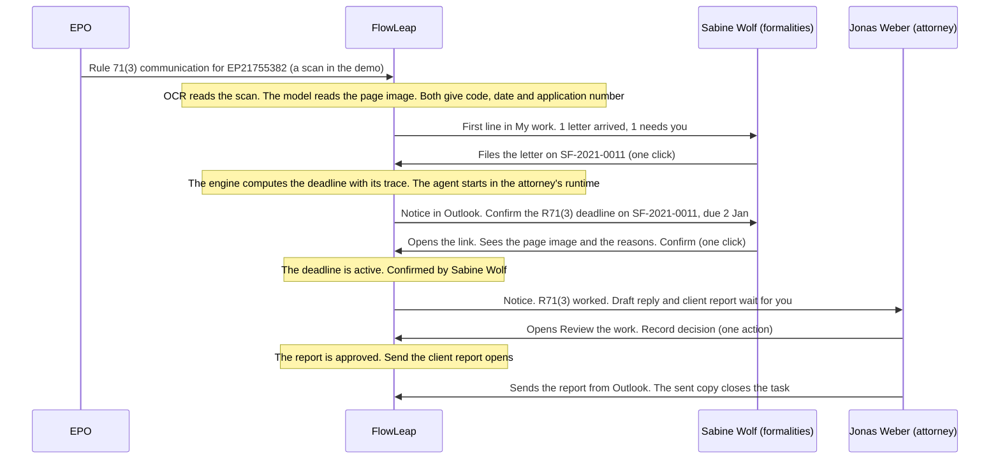
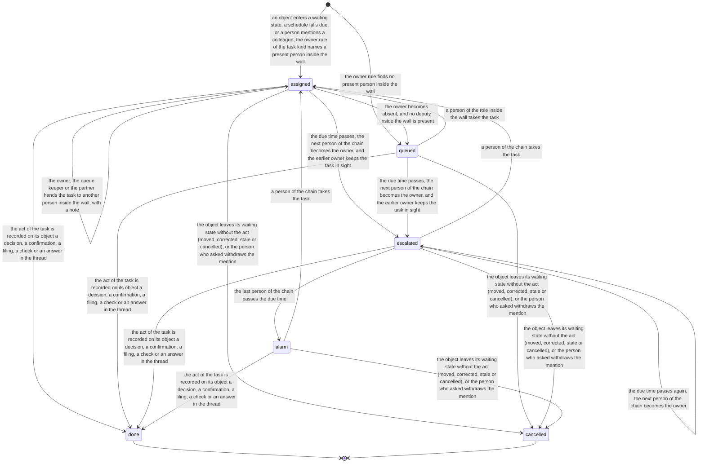
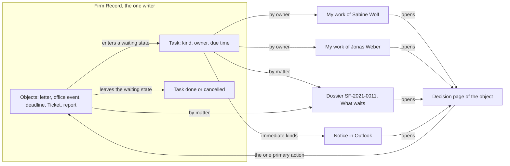

# Process 0: the connected flow

**Status:** draft for the founder's approval, 2026-11-06. The founder answered three decision rounds on 2026-11-06 ([the decisions](#11-founder-decisions-2026-11-06)) and then narrowed this sheet to the first demo. No build starts before the founder approves this sheet, and every screen then goes through the mockup gate of the [design language](../../../.agents/skills/flowleap-design-language/SKILL.md).

**Starts when** an office letter for a matter of the firm arrives, or a schedule falls due. **Ends when** every task that the item opened is done or cancelled. **Record object:** the task. Method: [the atlas README](README.md#the-method-for-every-phase).

**Goal.** The founder's words of 2026-11-06, after the QA day: "Let's go back to the drawing board so each matter has a global dossier." Later the same day: "The AI-native system should work systematically, in a predictable way." The QA log of that day (`flowleap/qa/2026-11-06-matters-qa.md` in the coordinator's checkout) has 50 findings. Its main finding (38) is that the chain breaks where a letter should reach its matter, and that the product has no layer for persons: no names, no "what waits for me", no named next step, and no search. This sheet connects sheets 01 to 05: every state that waits for a person opens a named task for a named person, and My work and the matter dossier are two views of the same tasks.

**The scope: the first demo** (founder, 2026-11-06). Two roles, the formalities person and the attorney, on the seed firm. One bar: a new user opens FlowLeap, or the Outlook notice, and knows at once what to do. In scope:

1. The first screen shows one line of what waits for me, for example "2 letters arrived, 1 needs you".
2. The letter arrives by itself, OCR reads it, the matter is found, and the deadline is computed with its reasons.
3. The person who confirms is named and confirms in one click from a notice.
4. The attorney sees the draft reply and the client report with one clear action.
5. Real names, sign-out, search for a matter, and seed dates that make sense today.

Everything else is one line under [Later](#10-later).

## Contents

- [The value moment](#the-value-moment)
- [Value and plumbing](#value-and-plumbing)
- [1. The process today](#1-the-process-today)
- [2. The two roles and their day](#2-the-two-roles-and-their-day)
- [3. The task model](#3-the-task-model)
- [4. Two views of the same tasks](#4-two-views-of-the-same-tasks)
- [5. The demo path, step by step](#5-the-demo-path-step-by-step)
- [6. Names, sign-out and search](#6-names-sign-out-and-search)
- [7. What stays with a person](#7-what-stays-with-a-person)
- [8. Firm variation points](#8-firm-variation-points)
- [9. Map to the code](#9-map-to-the-code)
- [10. Later](#10-later)
- [11. Founder decisions (2026-11-06)](#11-founder-decisions-2026-11-06)
- [12. QA findings that the demo resolves](#12-qa-findings-that-the-demo-resolves)
- [13. Open questions and tests](#13-open-questions-and-tests)

## The value moment

The first demo is this scenario on the seed firm. It is the acceptance test of phase R1.5 (decision Q1). The persons are the seed firm's: Sabine Wolf (formalities) and Jonas Weber (responsible attorney); Lena Hoffmann is the other person of the team who may confirm. The matter is SF-2021-0011 (WAGO, EP21755382).

In production the main EPO route is the MyEPO API (decision Q17, [Later](#10-later)). The seed firm has no MyEPO account, and its letters are scans, so the demo letter arrives through the scan mailbox: a test script plays the office scanner and sends the scan of the Rule 71(3) communication to the AI mailbox of the test tenant. No person forwards it.



| Time | What happens | Who acts |
|---|---|---|
| 08:00 | The scan of the Rule 71(3) communication arrives in the AI mailbox from the scan mailbox | System |
| 08:02 | The intake runs OCR on the scan (decision Q22). Reader 1 reads the code, the date and the application number from the OCR text; reader 2, a model of another vendor, reads them from the page image. They agree, so the reading is checked (README decision F1). The application number is an exact key of SF-2021-0011, so the match is proposed, and the task **File this letter** opens for Sabine (`intake.exactKeyFiles: person-confirms`, README) | System |
| 08:03 | Sabine's first screen shows "1 letter arrived, 1 needs you". She opens it, sees the page image and the key, and files it with one click. The office event is recorded, the engine computes the deadline with its trace, and **Confirm the deadline** opens for Sabine, due today. The Ticket opens, and the agent starts in Jonas's runtime; the run does not wait for the confirmation ([README](README.md#one-flow)) | Sabine, system |
| 08:04 | Sabine gets the notice in Outlook and opens it. The decision page shows the due date, the rule, each step of the computation, and the page image with the quoted code and date. **Confirm** is the one primary action. The dossier shows "Confirmed by Sabine Wolf" | Sabine |
| 08:25 | The run ends. Jonas gets one notice: "R71(3) on SF-2021-0011 (WAGO), due 2 Jan, confirmed by Sabine Wolf. Draft reply and client report wait for you. [Review]". His first screen shows "1 letter worked, 1 needs you" | System |
| 09:10 | Jonas opens **Review the work**: the draft reply, the client report with a quote for each statement, and the deadline with its state. **Record decision** is the one primary action; it records his decision on each draft and his check of the deadline | Jonas |
| 09:20 | Jonas sends the report from Outlook with the AI mailbox in Bcc. The sent copy closes **Send the client report** (sheet 04) | Jonas |

If the two readers disagree, the reading is a proposal, and Sabine checks the code and the date (**Check the office event**). Then she may not confirm the deadline, because she decided the code (`docket.code-decider-not-confirmer`), and **Confirm the deadline** goes to Lena Hoffmann by name. If OCR is off or has not passed its test, Sabine enters the code and the date from the page image, and Lena confirms (decision Q8).

PATORG imports the letter, recognises the file number and can propose the deadline (sheet 01, fact 1.8; sheet 02, fact 2.10). It does not deliver a worked letter with a draft reply and a client report, and it does not tell each person in one line what waits for them.

## Value and plumbing

The founder's words of 2026-11-06: "The UI seems just like a modern version of what PATORG already has." **Plumbing** is needed, but PATORG already has it. **Value** is what PATORG cannot give. The demo builds the value path first and only the plumbing that the path touches (decision Q5).

| Part of the demo | Kind | Why |
|---|---|---|
| The letter that arrives by itself and is read by two independent readers | Value | In PATORG a person still sorts, sets the type and marks it handled (sheet 01, fact 1.13) |
| The letter that arrives already worked: draft reply and client report | Value | The office action report is attorney time on every substantive action (research section 2.7) |
| One line of what waits for me, and a named owner for every waiting step | Value | The EPO Mailbox has no assignment (sheet 01, fact 1.5); the BGH found a deadline that showed in nobody's list (fact 0.11) |
| The deadline with its reasons: rule, trace, quoted code and date | Plumbing with value | PATORG computes deadlines; the trace and the quotes make a one-click confirmation safe |
| Matter list, e-file, filing, search, names, sign-out, walls | Plumbing | Every system of record has them |

## 1. The process today

Facts that the demo rests on, in addition to sheets 01 to 05. Each fact names its primary source.

| # | Fact | Label and source |
|---|---|---|
| 0.1 | An EPO document is delivered on the date it is made available in the Mailbox. From 1 April 2027 the EPO notifies through the MyEPO Mailbox, and on paper only in exceptions | SOURCED: [OJ EPO 2026 A20](https://www.epo.org/en/legal/official-journal/2026/03/a20), [OJ EPO 2026 A40](https://www.epo.org/en/legal/official-journal/2026/09/a40), [OJ EPO 2026 A27](https://www.epo.org/en/legal/official-journal/2026/04/a27.html) |
| 0.2 | The MyEPO API lets an IP management system download Mailbox communications with their application number, user reference, document code and dispatch date; the firm's MyEPO administrator gets its credentials from EPO support | SOURCED: [MyEPO feature guide, APIs](https://link.epo.org/web/understand-our-services/exchange-data-with-us-using-an-api/en-myepo-feature-guide-apis-for-exchanging-information-with-ip-management-systems.pdf), [MyEPO API documentation](https://api.apps.epo.org/documentation/api-docs/latest) |
| 0.3 | Microsoft 365 supports a scanner that sends scans as mail; the scanner authenticates to the firm's tenant | SOURCED: [Microsoft, multifunction devices and Microsoft 365](https://learn.microsoft.com/en-us/exchange/mail-flow-best-practices/how-to-set-up-a-multifunction-device-or-application-to-send-email-using-microsoft-365-or-office-365) |
| 0.4 | The EPO uses an OCR model developed with Mistral AI for patent documents since March 2026 | SOURCED: [EPO press release](https://www.epo.org/en/news-events/press-centre/press-release/2026/1362048). Mistral's accuracy figures are vendor claims |
| 0.5 | § 203 StGB names the Patentanwalt (Abs. 1 Nr. 3). A professional may disclose secrets to other persons who take part in the work only "soweit dies für die Inanspruchnahme der Tätigkeit der sonstigen mitwirkenden Personen erforderlich ist" (Abs. 3). The professional is punishable when the professional did not see to it that such a person "zur Geheimhaltung verpflichtet wurde", and that person discloses a secret without authority (Abs. 4 Nr. 1) | SOURCED: [§ 203 StGB](https://www.gesetze-im-internet.de/stgb/__203.html) |
| 0.6 | § 39c PAO: the patent attorney selects a service provider with care (Abs. 2). The contract is in text form; it binds the provider to secrecy with a warning of the criminal consequences, limits its knowledge to what the contract needs, and says whether it may use subcontractors (Abs. 3). A service abroad needs comparable protection (Abs. 4). A service for one specific mandate needs the client's consent (Abs. 5). Data protection law applies in addition (Abs. 8) | SOURCED: [§ 39c PAO](https://www.gesetze-im-internet.de/patanwo/__39c.html) |
| 0.7 | The BGH requires general instructions so that staff never change or delete a calendar deadline on their own. Trained, reliable and supervised staff may handle routine deadlines with sample checks; the BGH does not ask for a second person on each entry | SOURCED: [BGH X ZB 17/12](https://www.bundesgerichtshof.de/SharedDocs/Entscheidungen/DE/Zivilsenate/X_ZS/2012/X_ZB__17-12.pdf?__blob=publicationFile&v=1) |
| 0.8 | The deadline steps follow without delay after the document arrives; the calendar entry comes before the note "done" in the file | SOURCED: [BGH I ZB 31/16](https://www.bundesgerichtshof.de/SharedDocs/Entscheidungen/DE/Zivilsenate/I_ZS/2016/I_ZB__31-16.pdf?__blob=publicationFile&v=1), [BGH II ZB 13/12](https://www.bundesgerichtshof.de/SharedDocs/Entscheidungen/DE/Zivilsenate/II_ZS/2012/II_ZB__13-12.pdf?__blob=publicationFile&v=1) |
| 0.9 | Staff mark a deadline done only after the act is done, and a named person checks the calendar at the end of each day | SOURCED: [BGH X ZB 17/12](https://www.bundesgerichtshof.de/SharedDocs/Entscheidungen/DE/Zivilsenate/X_ZS/2012/X_ZB__17-12.pdf?__blob=publicationFile&v=1) Rn. 11, [BGH IV ZB 17/00](https://www.bundesgerichtshof.de/SharedDocs/Entscheidungen/DE/Zivilsenate/IV_ZS/2000/IV_ZB__17-00.pdf?__blob=publicationFile&v=1) |
| 0.10 | An electronic calendar must be as safe to check as a paper one; the firm controls each entry and looks for processing errors of the software | SOURCED: [BGH III ZB 96/18](https://www.bundesgerichtshof.de/SharedDocs/Entscheidungen/DE/Zivilsenate/III_ZS/2018/III_ZB__96-18.pdf?__blob=publicationFile&v=1), [BGH III ZB 82/23](https://www.bundesgerichtshof.de/SharedDocs/Entscheidungen/DE/Zivilsenate/III_ZS/2023/III_ZB__82-23.pdf?__blob=publicationFile&v=1) |
| 0.11 | An e-file must show who holds it. When the file comes to the attorney, the attorney must check its open deadlines. In one case the attorney changed, and the deadline stayed with the former attorney and showed in no list | SOURCED: [BGH IX ZB 17/18](https://www.bundesgerichtshof.de/SharedDocs/Entscheidungen/DE/Zivilsenate/IX_ZS/2018/IX_ZB__17-18.pdf?__blob=publicationFile&v=1), [BGH XII ZB 483/21](https://www.bundesgerichtshof.de/SharedDocs/Entscheidungen/DE/Zivilsenate/XII_ZS/2021/XII_ZB_483-21.pdf?__blob=publicationFile&v=1) |
| 0.12 | Real deadlines must stand out from ordinary follow-ups (Wiedervorlagen) | SOURCED: [BGH IX ZB 13/19](https://www.bundesgerichtshof.de/SharedDocs/Entscheidungen/DE/Zivilsenate/IX_ZS/2019/IX_ZB__13-19.pdf?__blob=publicationFile&v=1) |
| 0.13 | For re-establishment the EPO asks for a cross-check that is independent of the person who keeps the deadlines | SOURCED (headnote): [T 1962/08](https://www.epo.org/de/boards-of-appeal/decisions/t081962du1) |
| 0.14 | The proxy's `/oauth2/sign_out` removes only its own cookies. The account picker is the OIDC value `prompt=select_account`, which the proxy sends from its `loginURLParameters` | SOURCED: [oauth2-proxy endpoints](https://oauth2-proxy.github.io/oauth2-proxy/features/endpoints), [oauth2-proxy alpha config](https://oauth2-proxy.github.io/oauth2-proxy/configuration/alpha-config), [Entra OIDC](https://learn.microsoft.com/en-us/entra/identity-platform/v2-protocols-oidc) |
| 0.15 | All Incognito windows of one Chrome share one session until the last one closes; Edge clears InPrivate data only when all InPrivate windows close | SOURCED: [Chrome Help](https://support.google.com/chrome/answer/95464), [Microsoft Edge privacy](https://support.microsoft.com/en-us/microsoft-edge/microsoft-edge-browsing-data-and-privacy-bb8174ba-9d73-dcf2-9b4a-c582b4e640dd) |
| 0.16 | Graph lists the persons assigned to an application with their display names; the Entra object ID of the token is the Graph user id | SOURCED: [appRoleAssignedTo](https://learn.microsoft.com/en-us/graph/api/serviceprincipal-list-approleassignedto?view=graph-rest-1.0), [group members](https://learn.microsoft.com/en-us/graph/api/group-list-members?view=graph-rest-1.0) |

## 2. The two roles and their day

| Actor | Role in the demo |
|---|---|
| Formalities person (PAFA) | Named on each matter (decision Q7). Owns the letter tasks and the deadline confirmations of that matter |
| Responsible attorney | Owns the review of the work and the send of the client report; checks the deadline when the work reaches them (fact 0.11) |
| Firm Record | Opens, routes and closes tasks in the same transaction as the object's step; the one writer |
| Intake | Reads the AI mailbox, runs OCR, reads with two readers, proposes the matter |
| Agent | Works the letter in the attorney's runtime; proposes, never decides |
| Notifier | Sends the notices through the outbox of sheet 05 |

**A morning of Sabine Wolf (formalities).** [INFERRED from facts 0.7 to 0.12 and research section 2.4; the pilot corrects it]

1. She opens FlowLeap. The first screen is **My work** (decision Q6). Its first line says "2 letters arrived, 1 needs you". Under it, her tasks by due time: overdue, today, later. Real deadlines show apart from follow-ups (fact 0.12).
2. She files the letter that needs her: the page image, the proposed matter and the key that found it are on one page, and **File** is the one primary action.
3. She confirms the deadlines, because the entry comes first (fact 0.8). Each opens from the notice or from My work, with the reasons in view, and **Confirm** is the one primary action.

**A morning of Jonas Weber (attorney).** [INFERRED]

1. He opens FlowLeap or the notice. The first line says "1 letter worked, 1 needs you".
2. **Review the work** shows the deadline with its state and who confirmed it, the draft reply and the client report. **Record decision** is the one primary action.
3. He sends the report from Outlook. The dossier shows all open deadlines of the matter, whoever owns them (fact 0.11).

## 3. The task model

**The rules.**

- **One owner, always.** A task has exactly one owner at every time, a named person. A task in the role queue names its queue keeper, the first person of its chain, so nothing waits without a named person. A change of the matter's responsible attorney or formalities person moves every open task of that role in the same transaction (fact 0.11).
- **A task opens and closes with its object.** The Firm Record opens a task in the same transaction in which an object enters a waiting state, and closes it in the transaction in which the object leaves it. A person never closes a task with a "done" button; the act on the object closes it (fact 0.9).
- **The decision stays on the object.** A task carries no decision. It names the object, the act, the owner and the due time; the decision bar of the object's page decides (README decision F2, product rule 6).
- **Two times.** A task has its own due time and shows the legal date of its deadline when it has one. The list ranks by the earlier of the two.
- **Escalation is the chain of the kind.** When the due time passes, the next person of the chain becomes the owner, and the earlier owner keeps the task in sight. After the last person, the task is an alarm.

The state machine of one task:

<!-- atlas:task -->
It has **6 states and 17 transitions**, plus the start.

| From | To | Event | Actor | Evidence in the record log |
|---|---|---|---|---|
| start | `assigned` | An object enters a waiting state, a schedule falls due, or a person mentions a colleague; the owner rule of the task kind names a present person inside the wall | Firm Record | Object and state, task kind, owner rule, owner, due time |
| start | `queued` | The owner rule finds no present person inside the wall | Firm Record | Owner rule, absence entries, wall check, the queue keeper |
| `queued` | `assigned` | A person of the role inside the wall takes the task | person | The person, time |
| `assigned` | `assigned` | The owner, the queue keeper or the partner hands the task to another person inside the wall, with a note | person | Old and new owner, note, wall check |
| `assigned` | `queued` | The owner becomes absent, and no deputy inside the wall is present | Firm Record | Absence entry, wall check |
| `assigned`, `queued` | `escalated` | The due time passes; the next person of the chain becomes the owner, and the earlier owner keeps the task in sight | Firm Record | Time, chain step, new owner |
| `escalated` | `escalated` | The due time passes again; the next person of the chain becomes the owner | Firm Record | Time, chain step, new owner |
| `escalated` | `alarm` | The last person of the chain passes the due time | Firm Record | Time; every person of the chain and the administrator |
| `escalated`, `alarm` | `assigned` | A person of the chain takes the task | person | The person, time |
| `assigned`, `queued`, `escalated`, `alarm` | `done` | The act of the task is recorded on its object: a decision, a confirmation, a filing, a check or an answer in the thread | person | The object event that the act wrote |
| `assigned`, `queued`, `escalated`, `alarm` | `cancelled` | The object leaves its waiting state without the act (moved, corrected, stale or cancelled), or the person who asked withdraws the mention | Firm Record or person | The object event, or the withdrawal |

End states: `done`, `cancelled`.


<!-- /atlas:task -->

**The mapping.** Every state of sheets 01 to 05 that waits for a person opens one task kind. `check/check.mjs` fails when a state that waits for a person has no entry here, so a new waiting state cannot ship without its task. The table is generated from `tasks` and `taskKinds` in [`check/machines.mjs`](check/machines.mjs); the column "First demo" marks the kinds that the demo uses.

<!-- atlas:task-map -->
| Machine | State | Task | First demo | Owner | Due | Escalation | Closes when |
|---|---|---|---|---|---|---|---|
| intake | `unreadable` | **File this letter** (`file-letter`) | Yes | The formalities person of the proposed matter; with no matter, the first present person of the intake queue | `intake.decideWithin` | `intake.escalation` | The document is filed, replaced, a duplicate or not relevant |
| intake | `kind_proposed` | **File this letter** (`file-letter`) | Yes | The formalities person of the proposed matter; with no matter, the first present person of the intake queue | `intake.decideWithin` | `intake.escalation` | The document is filed, replaced, a duplicate or not relevant |
| intake | `duplicate_proposed` | **File this letter** (`file-letter`) | Yes | The formalities person of the proposed matter; with no matter, the first present person of the intake queue | `intake.decideWithin` | `intake.escalation` | The document is filed, replaced, a duplicate or not relevant |
| intake | `match_proposed` | **File this letter** (`file-letter`) | Yes | The formalities person of the proposed matter; with no matter, the first present person of the intake queue | `intake.decideWithin` | `intake.escalation` | The document is filed, replaced, a duplicate or not relevant |
| intake | `ambiguous` | **File this letter** (`file-letter`) | Yes | The formalities person of the proposed matter; with no matter, the first present person of the intake queue | `intake.decideWithin` | `intake.escalation` | The document is filed, replaced, a duplicate or not relevant |
| intake | `unmatched` | **File this letter** (`file-letter`) | Yes | The formalities person of the proposed matter; with no matter, the first present person of the intake queue | `intake.decideWithin` | `intake.escalation` | The document is filed, replaced, a duplicate or not relevant |
| deadline | `awaiting_code` | **Enter the office event** (`enter-office-event`) | Yes | The person who filed the scan; opens only for a filed scan with no reading, because the readers move every other letter | `intake.decideWithin` | `intake.escalation` | The code and the date are recorded, or an attorney decides that there is no event |
| deadline | `code_proposed` | **Check the office event** (`decide-office-event`) | Yes | The formalities person of the matter | `deadline.confirmWithin` | `deadline.escalation` | The code and the date are decided, or an attorney decides that there is no event |
| deadline | `engine_refused` | **Enter the due date** (`enter-date`) | Yes | The formalities person of the matter | `deadline.confirmWithin` | `deadline.escalation` | A date is entered or computed |
| deadline | `deadline_proposed` | **Confirm the deadline** (`confirm-deadline`) | Yes | The formalities person of the matter, unless that person proposed the date or decided its code; then the next person of `deadline.confirmerRoles` inside the wall | `deadline.confirmWithin` | `deadline.escalation` | The deadline is active, rejected or stale |
| deadline | `manual_proposed` | **Confirm the deadline** (`confirm-deadline`) | Yes | The formalities person of the matter, unless that person proposed the date or decided its code; then the next person of `deadline.confirmerRoles` inside the wall | `deadline.confirmWithin` | `deadline.escalation` | The deadline is active, rejected or stale |
| deadline | `disputed` | **Decide the disputed deadline** (`decide-dispute`) | Later | The responsible attorney | `deadline.confirmWithin` | `deadline.escalation` | The deadline is active again, or closed without its act |
| deadline | `active` | no task: A person changes an active deadline only by a correction; the follow-up and end-of-day check tasks run on it | | | | | |
| ticket | `opened` | no task: The system works; a person only cancels it by a correction of the document or the event | | | | | |
| ticket | `routed` | no task: The system works; a person only cancels it by a correction of the document or the event | | | | | |
| ticket | `waking` | no task: The system works; a person only cancels it by a correction of the document or the event | | | | | |
| ticket | `running` | no task: The system works; a person only cancels it by a correction of the document or the event | | | | | |
| ticket | `no_person` | **Assign a person** (`assign-person`) | Later | The first present person of `ticket.noPersonChain` | `ticket.assignWithin` | `ticket.noPersonChain` | The Ticket is routed |
| ticket | `run_failed` | **Start the work again or take it by hand** (`restart-run`) | Yes | The routed attorney | `ticket.assignWithin` | `ticket.deputies`, then `ticket.noPersonChain` | The run starts again, or the attorney takes the work by hand |
| ticket | `proposals_ready` | **Review the work** (`decide-work`) | Yes | The routed attorney (the responsible attorney or the deputy) | `ticket.decideBy` | `ticket.deputies`, then `ticket.noPersonChain` | The Ticket is decided or cancelled |
| ticket | `by_hand` | **Do this work by hand** (`work-by-hand`) | Later | The routed attorney | The first internal date of the deadline | `deadline.escalation` | The attorney records the work as done, with its document |
| report | `proposed` | **Review the work** (`decide-work`) | Yes | The routed attorney (the responsible attorney or the deputy) | `ticket.decideBy` | `ticket.deputies`, then `ticket.noPersonChain` | The Ticket is decided or cancelled |
| report | `flagged` | **Review the work** (`decide-work`) | Yes | The routed attorney (the responsible attorney or the deputy) | `ticket.decideBy` | `ticket.deputies`, then `ticket.noPersonChain` | The Ticket is decided or cancelled |
| report | `approved` | **Send the client report** (`send-report`) | Yes | The person of `report.approver` | `report.sendReminder` | The approver, then the responsible attorney | The report is sent or withdrawn |
| report | `send_unconfirmed` | **Send the client report** (`send-report`) | Yes | The person of `report.approver` | `report.sendReminder` | The approver, then the responsible attorney | The report is sent or withdrawn |
| outbox | `refused` | **Fix the message** (`fix-message`) | Later | The administrator | `tasks.adminWithin` | The administrator, then the partner | The administrator records what was done |
| outbox | `dead` | **Fix the message** (`fix-message`) | Later | The administrator | `tasks.adminWithin` | The administrator, then the partner | The administrator records what was done |
| schedule | | **Follow up the deadline** (`follow-up`) | Later | The responsible attorney | Each internal date (Vorfrist) of an active deadline | `deadline.escalation` | The act of the deadline is recorded, or the next internal date comes |
| schedule | | **Check the deadlines due today** (`day-check`) | Later | The person of `tasks.dayCheck.person` | `tasks.dayCheck.at` on each working day | The partner | The person records the check of each deadline due that day |
| mention | | **Answer** (`answer`) | Later | The person who is mentioned | `tasks.answerWithin`, or the time the asker sets | The asker, then the responsible attorney | The person answers in the thread, or does the act that was asked |
<!-- /atlas:task-map -->

One object has at most one open task of each kind. The proposed report of a Ticket is part of the Ticket's work, so it shares the Ticket's **Review the work** task instead of opening a second one.

**Owner rules.** "The formalities person of the matter" is a new matter field (decision Q7). "Present" means no absence entry for that time; an absent owner's task goes to the deputy of `ticket.deputies` inside the wall, else to the queue. No rule ever picks a person outside the matter's wall (product rule 8).

## 4. Two views of the same tasks

The task lives once, in the record, on its object. **My work** is the projection of the open tasks by owner. **The dossier** is the projection of everything by matter. A notice is a projection to a person's Outlook. No view keeps its own copy, so the views cannot disagree.



**My work.** The first screen of both roles (decision Q6). Its first line counts what arrived and what needs me: "2 letters arrived, 1 needs you". The groups: **Overdue**, **Today**, **Later**. Each row: the status, the task words, the matter key and client, the legal date when there is one, and why it waits. A row opens the decision page of its object. The old agent dashboard moves under the agent (findings 2, 4, 5).

**The dossier (Akte).** One page per matter: the header (file number, client, short title, the application number linked to the EPO Register, the responsible attorney, the formalities person); **What waits**, every open task of the matter with its owner and due time, with the one next step at the top (findings 22, 28); the deadlines with their states and who confirmed them; the e-file, including a letter in the Intake that the intake proposed for this matter (finding 27); the activity in plain words.

## 5. The demo path, step by step

**Arrival.** The scan arrives in the AI mailbox from the scan mailbox (fact 0.3). An authenticated scanner's mail counts as internal, so the R1 sender rule accepts it [INFERRED; test Q0.2]. The forward of R1 stays the fallback.

**OCR and the two readers.** The intake runs Mistral's OCR service with the firm's own Mistral key (decision Q22, fact 0.4). The founder's words: "They need to accept Mistral OCR, it's more accurate and it's an EU company." The key lives in the firm's key store with the model provider keys, and the intake calls Mistral through the firm's model gateway (ADR 0001 decision 5), so no FlowLeap backend sees the letter. Reader 1 reads the code, the date and the application number from the OCR text; reader 2 stays a model of another vendor on the page image, so the readers stay independent. The OCR reading counts as a reader only after it passes a test on the 18 seed scans. Until then, and in a firm that turns OCR off (`intake.ocr: 'off'`), a scan goes to a person for the hand entry (decision Q8).

**What the firm accepts at setup.** Mistral OCR is a firm setting that the firm accepts at setup, under the same terms as its model provider: reader 2 of R1 already sends the page image to a cloud model. The firm needs:

- **A contract with Mistral under § 39c PAO** (fact 0.6): in text form, with the duty of secrecy and the warning of the criminal consequences, knowledge limited to what the OCR needs, and the rule for subcontractors. Without it the firm is punishable under § 203 Abs. 4 Nr. 1 StGB when the provider discloses a secret (fact 0.5). The disclosure is allowed only as far as the OCR needs it (§ 203 Abs. 3 StGB), so the intake sends only the document.
- **A data-processing agreement under Art. 28 GDPR** with Mistral [INFERRED; Art. 28 was not read for this sheet; § 39c Abs. 8 PAO keeps data protection law in force].
- **The record of the provider in `firm.modelProviders`** with the date of the contract (sheet 03). The setup refuses Mistral OCR without it.

The intake OCR serves every matter of the firm, not one specific mandate, so the client consent of § 39c Abs. 5 PAO does not apply to it [INFERRED from the wording of Abs. 5; question Q0.4]. Mistral is an EU company, so Abs. 4 does not apply [INFERRED].

**The matter is found.** The application number from an office form field is an exact key (`intake.keyFields`, sheet 01). In R1 a person confirms each exact-key match (`intake.exactKeyFiles: person-confirms`), so the demo files with one click by Sabine. A key from the mail subject or the file name is only a proposal (decision Q8).

**The deadline with its reasons.** The engine computes the date with its trace (sheet 02). The decision page shows the due date, the rule and its legal source, each step of the computation, and the page image with the quoted code and date. The seed deadlines must make sense on the demo day (finding 19): the demo uses a seed letter whose period is still open on that day, and the deadline engine needs the calendar of the year in which the period ends (#326).

**The named confirmer, one click from a notice.** **Confirm the deadline** goes to the formalities person of the matter, or, when that person decided the code, to the next person of `deadline.confirmerRoles` inside the wall, by name. The notice is sent at once because the task is due today (decision Q13). It names the matter, the client, the deadline and the due date, and its link opens the decision page with **Confirm** as the one primary action. The decision is made on that page, never in the mail (README decision F2).

**The attorney's one action.** When the run ends, **Review the work** opens for the routed attorney, and the notice says what waits. The work page shows the draft reply, the client report with a quote for each statement, and the deadline with its state and who confirmed it. **Record decision** is the one primary action (sheet 03, the Records README). After approval, **Send the client report** waits until the sent copy arrives (sheet 04).

**Changes to sheets 01 and 02.** This sheet amends their transition tables, and `check/check.mjs --write` writes them into the sheets. Sheet 01: the start step names the routes and their sender checks; `unreadable` gets the step to `matched` by a person with the page image in view; a MyEPO communication files on its two EPO keys (decision Q21, used when the MyEPO route comes). Sheet 02: `awaiting_code` gets the hand entry to `recorded`.

## 6. Names, sign-out and search

- **Real names.** The control plane reads, with the firm's existing Entra application, the persons assigned to the FlowLeap app and their display names, and the members of the wall groups, once a day and at each sign-in (fact 0.16). The Entra object ID is the person id that the record already uses. "Unnamed person" goes away (finding 25). The seed firm's users get their names this way on the test tenant.
- **The account menu.** The sidebar shows the person's name and role and **Sign out** (finding 1).
- **Sign-out and the next person** (decision Q9). Sign out ends the FlowLeap session, and the next sign-in always shows the Microsoft account picker (fact 0.14). On one PC, all private windows of one browser share one session (fact 0.15, finding 39), so a demo with two persons uses two browser profiles.
- **Search.** One search (`/` and ⌘K) finds a matter by file number, title, client, application number or person, inside the person's walls (finding 15).

## 7. What stays with a person

From the BGH research (facts 0.7 to 0.13) and decision Q20. The firm's rule is stricter than the BGH asks: the BGH asks for sample checks, the firm has an independent check on every deadline (README decision F1 on F3).

| Step | Who | Source |
|---|---|---|
| Receive, store, OCR, read, propose the matter | System | Decisions Q17, Q22 |
| File on an exact key | A person in R1 (`person-confirms`) | README, R1 settings |
| Record the office event when the two readers agree; compute the deadline | System | README decision F1; ADR 0002 decision 4 |
| Confirm each deadline, with the engine or a second person as the independent check | Person | F3; fact 0.13 |
| Change or delete a deadline, or close it without its act | Attorney, never staff on their own judgment | Fact 0.7; ADR 0002 decision 4 |
| Check the open deadlines when the work reaches the attorney | The attorney, recorded with the decision | Fact 0.11; sheet 03 |
| Every decision on a work product, and every send | Person | ADR 0002 decisions 3 and 6 |

## 8. Firm variation points

The task kinds use the due times and the chains that sheets 01 to 05 already define; each fact has one home. These settings are new in the demo.

| Setting | Type | Default | Why firms differ |
|---|---|---|---|
| `matter.formalitiesPerson` | a person, per matter (a record field, not a setting) | none; `assign-person` until set | Firms pair formalities staff with attorneys or clients [INFERRED] |
| `intake.sources` | list of `'ai-mailbox' \| 'scan-mailbox'` (more routes later) | `['ai-mailbox']` | What the firm has set up |
| `intake.ocr` | `'mistral' \| 'off'` | `'mistral'`, accepted at setup with the contract of section 5; the setup refuses it without the provider in `firm.modelProviders` | A firm that turns OCR off sends every scan to a person (decision Q22) |
| `notify.immediate` | list of task kinds | the kinds due today and **Review the work** | Decision Q13 |

## 9. Map to the code

**What exists.** The Firm Record's log, walls and persons projection (display names nullable since schema 5, filled only by the proxy header, People service #227); the intake and outbox of the mailbox process; the Records views (the deadline page with its trace, the work page with the decision bar); the Mistral connector of the runtime with its `baseUrl` (`packages/host/flowleap-connectors`).

**What is new.** The task as a record object; the matter field `formalitiesPerson`; the scan source and the OCR step of the intake; the Graph name sync; the notices of the immediate kinds; My work with its first line, the dossier's What waits, and search in the client; the proxy's `loginURLParameters` and the account menu.

New record events: `task/opened`, `task/queued`, `task/taken`, `task/handed-over`, `task/escalated`, `task/alarmed`, `task/done`, `task/cancelled`, `person/profile-synced`.

```ts
type TaskId = Branded<'TaskId'>; type TaskKind = keyof typeof taskKinds
type TaskObject =
  | { kind: 'document'; document: DocumentSha256 } | { kind: 'deadline'; deadline: DeadlineId } | { kind: 'ticket'; ticket: TicketId }
  | { kind: 'report'; report: ReportId } | { kind: 'message'; message: OutboxId } | { kind: 'schedule'; deadline: DeadlineId; date: IsoDate }
type Owner = { person: PersonId; via: 'owner-rule' | 'deputy' | 'taken' | 'handed-over' | 'escalated' }
// One owner in every live state; a queued task names its keeper, so no live task is without a person.
type Task =
  | { s: 'assigned' | 'escalated' | 'alarm'; id: TaskId; kind: TaskKind; object: TaskObject; matter: MatterId | null; owner: Owner; due: IsoTime; chainStep: number }
  | { s: 'queued'; id: TaskId; kind: TaskKind; object: TaskObject; matter: MatterId | null; keeper: PersonId; role: FirmRole; due: IsoTime; chainStep: number }
  | { s: 'done'; id: TaskId; by: PersonId; act: RecordSeq }
  | { s: 'cancelled'; id: TaskId; cause: RecordSeq }
```

**Invariants for the release gate:** `task.one-open-per-waiting-state`, `task.owner-inside-wall`, `task.closes-with-object` (no `task/done` without an object event of its act), `task.moves-with-role`, `intake.subject-key-is-proposal`.

## 10. Later

Each part below is decided or designed, but it is not in the first demo. The full design of 2026-11-06 is in commit 5e3dc62c3b of this PR.

- **MyEPO API** as the main EPO route, filing on the two EPO keys and reading with the EPO document code (decisions Q17, Q21).
- **The Fristen mailbox** for WIPO and other office mail, with a narrow sender rule, after a test with one real WIPO mail (Q17).
- **The daily register check** against the EPO Register with the firm's own OPS key, and the deadline proposed from the register data before the letter arrives (Q18, Q19).
- **Comments, mentions and @FlowLeap on any object**, and a reply to a notice mail as a comment (Q2, Q3, Q15, Q16).
- **The Teams activity feed**, after a test of a FlowLeap tab on a private host (Q4, Q14).
- **The partner's Firm tab** and the partner's tasks (Q10).
- **The morning brief** and the rule for muting notices (Q13).
- **The receipt reply** to a forwarder within 2 minutes.
- **Chats on the matter**: a chat that belongs to its matter, and its card in the dossier (Q11, Q12).
- **Ending the Microsoft session at sign-out** as a firm setting (Q9).
- **The end-of-day check task** and the follow-up tasks of the Vorfristen (Q20; fact 0.9).
- **DPMA letters**: no person-free route exists today; paper through the scanner, or a person's export.

## 11. Founder decisions (2026-11-06)

| # | Decision | In the demo |
|---|---|---|
| Scope | The first demo: two roles, the five points of the scope, one bar; the rest later | Yes |
| Q1 | The value moment is the acceptance test of R1.5; the letter arrives by itself, and the forward is the fallback | Yes |
| Q2 | Comments and mentions are record events on their object; a mention opens a task | Later |
| Q3 | Any person mentions FlowLeap on any object; the agent acts for that person and answers with proposals | Later |
| Q4 | The record is the truth; Outlook now, Teams after its test; buttons open the decision (F2 stays) | Outlook only |
| Q5 | Value path first, as a tracer, in a new phase R1.5 before R2 | Yes |
| Q6 | My work is the first screen of every role | Yes |
| Q7 | A named person first, then the role queue, then the chain; each matter names its formalities person | Yes |
| Q8 | A person files a scan with the page image; subject and file-name keys are proposals only; the hand entry with the second person | Yes, as the fallback |
| Q9 | Sign out ends the FlowLeap session, and the next sign-in shows the account picker; ending the Microsoft session is a firm setting | The picker; the setting later |
| Q10 | The partner sees full tasks inside the partner's walls and counts outside | Later |
| Q11 | A chat belongs to a matter when it starts from the dossier or a mention | Later |
| Q12 | The team sees one card per chat; the transcript stays with its owner | Later |
| Q13 | Immediate notices for the kinds due today and the worked letter; the rest in My work and the morning brief | The immediate notices |
| Q14 | R1.5 sends Outlook mail only; the Teams tab is tested | Outlook only |
| Q15 | A reply to a notice mail is a comment, never a decision | Later |
| Q16 | A comment is editable for 15 minutes; only the administrator removes one | Later |
| Receipt | The receipt reply in the same Outlook thread within 2 minutes | Later |
| Q17 | The MyEPO API and scan-to-email; the Fristen mailbox after a test; the forward as the fallback | The scan route |
| Q18 | The daily register check with the firm's own OPS key | Later |
| Q19 | A register gap also proposes the deadline | Later |
| Q20 | The split of section 7 | Yes |
| Q21 | A MyEPO communication files without a person when its reference and its application number name the same matter | Later |
| Q22 | Mistral's OCR service with the firm's own key, accepted at setup under the provider contract; a firm switch turns it off | Yes |

## 12. QA findings that the demo resolves

| Scope point | Findings |
|---|---|
| 1. One line of what waits for me | 2, 4, 5, 7, 20, 22, 28, 38 |
| 2. The letter arrives, OCR reads it, the matter is found, the deadline has its reasons | 8, 9, 10, 11, 27, 44, #325 |
| 3. The named confirmer, one click from a notice | 22, 31 |
| 4. The attorney's one action | 28, 38 |
| 5. Names, sign-out, search, seed dates | 1, 15, 19, 25, 39, #326 |

**Out of scope.** The UI tickets of design review 4 (#296 to #320) and findings 14, 16 to 18, 21, 23, 24, 29, 33, 35 to 37, which the mockups meet under the design language; the copy faults 34, 41, 43, 50 and #328; the seed application number (26, #294); the configuration and runtime faults 3, 45, 48 and 49; #324 and #327; finding 6 (the register-watch board), finding 12 (the forwarder), finding 13 (the audit) and finding 47 (chats on the matter), which belong to the later parts.

## 13. Open questions and tests

- **Q0.1 (test)** Mistral OCR on the 18 seed scans: the reading of the code, the date and the application number.
- **Q0.2 (test, demo setup)** On the test tenant: a scan mailbox that sends to the AI mailbox, and whether its mail counts as internal.
- **Q0.3 (demo setup)** Which seed letter has a period that is still open on the demo day, and does the engine have the calendar of its end year (#326)?
- **Q0.4 (for the firm's counsel)** Is intake OCR a service for the firm, not for one specific mandate, so that § 39c Abs. 5 PAO asks for no client consent? Do Mistral's standard terms meet § 39c Abs. 3 PAO, or does the firm need an addendum?
- **Q0.5 (pilot)** Who is the formalities person of each matter today?
- **Q0.6 (pilot)** Does your firm have a written deadline instruction (Büroanweisung), and does it allow staff to confirm a deadline alone?
