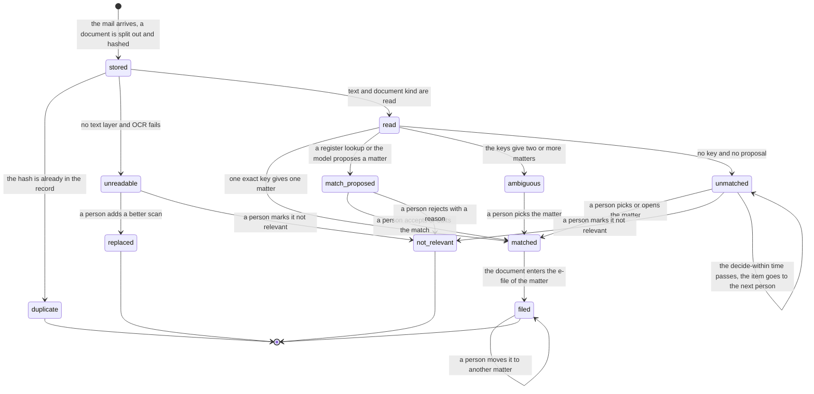

# Process 1: office letter intake

**Starts when** a mail arrives in the AI mailbox. **Ends when** each document of the mail is filed on one matter, is a duplicate, or is not relevant. **Record object:** the document. **Ticket:** [#220](https://github.com/flowleap-ai/flowleap-harness/issues/220). Method: [the atlas README](README.md#the-method-for-every-phase).

## 1. The process today

| # | Fact | Label and source |
|---|---|---|
| 1.1 | The EPO notifies electronically through an activated Mailbox, which a user reaches by signing in to MyEPO. A document reaches its destination on the date it is made available in the Mailbox (Art. 2(2)), and no paper copy is sent in parallel (Art. 2(5)) | SOURCED: [OJ EPO 2026 A20](https://www.epo.org/en/legal/official-journal/2026/03/a20) |
| 1.2 | Under Rule 127(2) EPC an electronic document is deemed delivered on the date it bears; when it reaches the addressee more than seven days after that date, a period ends later by the excess days | SOURCED: [R.127 EPC](https://www.epo.org/en/legal/epc/2020/r127.html); [OJ EPO 2023 A29](https://www.epo.org/en/legal/official-journal/2023/03/a29), cited in the design section 5.3 |
| 1.3 | When a representative is appointed, the EPO addresses notifications to that representative | SOURCED: [R.130(1) EPC](https://www.epo.org/en/legal/epc/2020/r130.html) |
| 1.4 | The EPO email alerts on new Mailbox documents had no legal effect: "Users may not invoke the omission of an alert" (Art. 5(3)) | SOURCED: [OJ EPO 2023 A49](https://www.epo.org/en/legal/official-journal/2023/05/a49). The 2026 decision (fact 1.1) does not mention alerts, so their current status is INFERRED to be unchanged |
| 1.5 | The EPO Mailbox is company-wide, with folders and a "handled" mark, and has no assignment to a person | SOURCED (secondary): the research section 2.2 and 2.5, from the MyEPO feature guide |
| 1.6 | The DPMA serves under the Verwaltungszustellungsgesetz with the changes of § 127 PatG | SOURCED: [§ 127 PatG](https://www.gesetze-im-internet.de/patg/__127.html) |
| 1.7 | A DPMA document provided in the electronic mailbox counts as served on the fourth day after provision, also when the email notice is lost; the firm must check its mailbox regularly. The form refers to § 5(2) ERVDPMAV "n.V." (new version) "from its entry into force" | SOURCED: [DPMA consent form](https://dpma.de/docs/dpma/veroeffentlichungen/flyer/dpmadirektpro_einwilligung.pdf). Whether that version is in force on 2026-11-04 is open (question Q1.5) |
| 1.8 | PATORG imports incoming EPO documents by itself and recognises the file numbers named in incoming emails | SOURCED: [PATORG productivity](https://www.patorg.com/de/features/productivity), quoted in the [cross-check](../2026-11-03-patorg-feature-crosscheck.md) P24, P27 |
| 1.9 | PATORG has add-ins for Outlook, Chrome and Edge to import mail and documents into files | SOURCED: the same page, cross-check P26 |
| 1.10 | The PAFA's training covers deadline calculation and monitoring, and correspondence with offices, clients and foreign associates | SOURCED (secondary): research section 2.1, from the [BIBB certificate supplement](https://www.bibb.de/dienst/berufesuche/de/index_berufesuche.php/certificate_supplement/en/patentanwaltsfachangestellter_e.pdf) and the [ReNoPat-AusbV](https://www.gesetze-im-internet.de/renopatausbv_2015/BJNR149000014.html) |
| 1.11 | Graph delta query tracks one mail folder at a time; a round ends with a `@odata.deltaLink` that the next round starts from | SOURCED: [Microsoft Graph delta query for messages](https://learn.microsoft.com/en-us/graph/delta-query-messages) |
| 1.12 | RBAC for Applications scopes an app's Mail.Read and Mail.Send to a set of mailboxes. An unscoped grant in Entra ID is added to the scoped grant, so it must be removed, and a permission change can take 30 minutes to 2 hours to apply | SOURCED: [RBAC for Applications in Exchange Online](https://learn.microsoft.com/en-us/exchange/permissions-exo/application-rbac) |
| 1.13 | The PATORG way, step by step, for an EPO letter: the PAFA opens the import list or the Mailbox, checks or picks the matter, sets the document type, marks the letter handled, and forwards it to the attorney with a short note | INFERRED from facts 1.5, 1.8 and the research section 2.4 |
| 1.14 | Post that arrives on paper is scanned and stamped with the date of receipt before it is filed | INFERRED; no source found. Question Q1.4 |

**What the sources leave open.** We found no public source on how a German firm handles a letter that has no file number, two file numbers, or the wrong file number. We found no PATORG documentation on its match accuracy (the research, section 2.6, found no vendor that publishes it).

## 2. Actors and roles

| Actor | Role in this process |
|---|---|
| PAFA (formalities) | Forwards letters to the AI mailbox; decides every match that is not an exact key; adds a better scan; marks a document not relevant |
| Attorney | Forwards client and associate mail; may decide a match on own matters |
| Partner | Last person in the escalation chain of an undecided item |
| Associate, client | Send mail that a firm member forwards. They never write to the AI mailbox directly in R1 |
| Intake (system) | Polls the mailbox, splits and hashes documents, reads text and keys, matches by exact key |
| Agent | Proposes a match for free text, with the quoted evidence. It never decides |
| Firm Record | Appends each event; refuses a match that a person did not decide when the class is `decided` |

## 3. State machine

The machine is per document, not per mail, because one mail can carry several letters for several matters (design section 6.2). It has **11 states and 17 transitions**, plus the start.

| From | To | Event | Actor | Evidence in the record log |
|---|---|---|---|---|
| start | `stored` | The mail arrives; a document is split out and hashed | intake | Graph message id, sender, document SHA-256 |
| `stored` | `duplicate` | The hash is already in the record | intake | Hash, the earlier document |
| `stored` | `unreadable` | No text layer and OCR fails | intake | OCR result and its confidence |
| `stored` | `read` | Text and document kind are read | intake | Kind with its span (office letter, associate letter, client mail, other) |
| `unreadable` | `replaced` | A person adds a better scan | person | Hash of the new document |
| `unreadable` | `not_relevant` | A person marks it not relevant | person | Reason |
| `read` | `matched` | One exact key gives one matter | intake | Key, its span and its kind (file number, EP number, PCT number, DPMA Aktenzeichen) |
| `read` | `match_proposed` | A register lookup or the model proposes a matter | intake or agent | Register response, or quoted span and SessionRef |
| `read` | `ambiguous` | The keys give two or more matters | intake | Each key with its span and its matter |
| `read` | `unmatched` | No key and no proposal | intake | The keys searched |
| `match_proposed` | `matched` | A person accepts or edits the match | person | The proposal and the Decision |
| `ambiguous` | `matched` | A person picks the matter | person | The candidates and the Decision |
| `unmatched` | `matched` | A person picks or opens the matter | person | Reason; `matter/opened` when new |
| `match_proposed` | `not_relevant` | A person rejects with a reason | person | Reason |
| `unmatched` | `not_relevant` | A person marks it not relevant | person | Reason |
| `unmatched` | `unmatched` | The decide-within time passes; the item goes to the next person | Firm Record | Time, escalation step |
| `matched` | `filed` | The document enters the e-file of the matter | Firm Record | Match evidence |
| `filed` | `filed` | A person moves it to another matter (correction) | person | Reason, old and new matter |

End states: `duplicate`, `replaced`, `not_relevant`, `filed`. The move of a filed document is a correction on `filed`; it starts the `stale` and `disputed` paths of [sheet 2](02-office-event-to-deadline.md) and the `cancelled` path of [sheet 3](03-notify-and-run.md).



**Error and timeout paths.**

- **No matter found:** `unmatched`, to the formalities queue, never to an agent (design section 6.2).
- **Two matches:** `ambiguous`. Two keys that point to two matters are a fact, so the item shows both keys with their spans. This case is common when one letter names a parent and a divisional application [INFERRED].
- **Wrong matter:** a correction on `filed`. It needs a reason, it keeps the old match in the log, and the deadlines and runs that rest on it move to `stale`, `disputed` or `cancelled`.
- **Unreadable scan:** `unreadable`, with a task for the person who forwarded it.
- **Missed decision:** the decide-within time escalates `unmatched` to the next person in the chain. The same rule applies to `match_proposed` and `ambiguous`; the chart shows it once.
- **Mail from outside the firm:** in R1 the AI mailbox accepts mail only from firm addresses. A mail from another sender is stored, gets no reply, and goes to the formalities queue [INFERRED from F7 and design section 6.3; question Q1.3].
- **The same letter forwarded twice:** the second document is a `duplicate`. Its forwarder gets a short message with the link to the first result ([sheet 5](05-firm-internal-message.md)).

## 4. Firm variation points

| Setting | Type | Default | Why firms differ |
|---|---|---|---|
| `intake.exactKeyFiles` | `'file-without-person' \| 'person-confirms'` | `'file-without-person'` | Some firms want a person to see each letter before it is filed (four eyes on intake) [INFERRED] |
| `intake.keyKinds` | ordered list of `'file-number' \| 'ep-number' \| 'pct-number' \| 'dpma-file-number' \| 'client-reference'` | all, in this order | The firm file-number pattern and the use of client references differ |
| `intake.fileNumberPattern` | regular expression, validated at load | none; the firm must set it | Each firm has its own Aktenzeichen format |
| `intake.decideWithin` | duration | 4 working hours | Same-day intake is safe practice since periods run from the document date (research section 2.3) [INFERRED] |
| `intake.escalation` | ordered list of roles or persons | `['formalities', 'partner']` | Firm size and roles |
| `intake.acceptFrom` | `'firm-addresses'` | `'firm-addresses'` | Fixed in R1 (F7); a matter address per matter comes in R3 (design section 6.1) |
| `intake.unreadableTo` | `'forwarder' \| 'formalities'` | `'forwarder'` | Who rescans |

## 5. AI-native redesign

**What disappears.** Opening the Mailbox or the import list to sort letters, picking the matter for a letter with a key, setting the document type, and the note "bitte prüfen" with the forward. The intake reads them from the document (design principle 1).

**What becomes a proposal with evidence.** A match for free text (client or associate mail without a number) is a proposal with the quoted span; a person decides it (principle 3).

**What stays with a person, and why.** Every match that is not one exact key, because a wrong match puts a correct deadline on the wrong matter (design section 13.1) and the source document must be in view when a person decides (design section 6.2). The move of a filed document, because it changes the basis of deadlines (change class `decided`, with a reason).

**The count** (counting rule in the [README](README.md#the-method-for-every-phase)):

| | Old way (PATORG with Mailbox import) | New way (R1, forward to the AI mailbox) |
|---|---|---|
| Manual steps, typical letter | 5: open the import list, check or pick the matter, set the document type, mark handled, forward to the attorney with a note | 1: forward to the AI mailbox (with MyEPO in R3: 0) |
| Extra steps, exception | 1 to 3: search the matter, ask a colleague, rescan | 1: decide the item in the queue, with the proposal and the document in view |
| Person-to-person hand-offs | 1: PAFA to attorney | 0: the result reaches the attorney from the system ([sheet 5](05-firm-internal-message.md)) |

The old count is INFERRED (fact 1.13). In R1 the PAFA still forwards, because the MyEPO source comes in R3 (#154).

## 6. Map to the code

**What exists in R0** (`lib/record/` of flowleap-os, `main`): the record log with the hash chain and the idempotency key per command; `matter/opened`; `office-event/recorded` with `fileNumber`, `code`, `documentDate`, `receivedAt`, written by a person, with an empty evidence list. There is no document, no intake actor and no match state.

**What is new:** the actor kind `intake` (design section 4.2); the document with its hash and its source; the record events below; the unmatched queue in the Records app. `office-event/recorded` is written by a person in R0, and `EVENT_TYPES` binds each event type to one actor kind, so R1 adds a successor type, `office-event/recorded` version 2 with the intake actor and required evidence, and keeps version 1 readable (repository rule on released data, [AGENTS.md](../../../AGENTS.md)).

```ts
type DocumentSha256 = Branded<'DocumentSha256'>; type MatterId = Branded<'MatterId'>
type Span = { page: number; start: number; end: number; quote: string }
type MatchKey = { kind: 'file-number' | 'ep-number' | 'pct-number' | 'dpma-file-number' | 'client-reference'; value: string; span: Span }
type DocumentKind = 'office-letter' | 'associate-letter' | 'client-mail' | 'other'

type IntakeDocument =
  | { s: 'stored'; hash: DocumentSha256; mail: GraphMessageId; from: FirmAddress }
  | { s: 'duplicate'; hash: DocumentSha256; first: RecordSeq }
  | { s: 'unreadable'; hash: DocumentSha256; ocr: { confidence: number } }
  | { s: 'replaced'; by: DocumentSha256; person: PersonId }
  | { s: 'read'; hash: DocumentSha256; kind: DocumentKind; kindSpan: Span }
  | { s: 'match_proposed'; hash: DocumentSha256; proposal: ProposalId; matter: MatterId }
  | { s: 'ambiguous'; hash: DocumentSha256; candidates: [MatchCandidate, MatchCandidate, ...MatchCandidate[]] }
  | { s: 'unmatched'; hash: DocumentSha256; searched: MatchKey['kind'][]; escalation: number }
  | { s: 'matched'; hash: DocumentSha256; matter: MatterId; by: { key: MatchKey } | { decision: RecordSeq } }
  | { s: 'filed'; hash: DocumentSha256; matter: MatterId; moves: RecordSeq[] }
  | { s: 'not_relevant'; hash: DocumentSha256; person: PersonId; reason: string }
type MatchCandidate = { matter: MatterId; key: MatchKey }

// One command per transition; a command names the only state it leaves, so a wrong order does not compile.
type IntakeCommand =
  | { c: 'read'; from: Extract<IntakeDocument, { s: 'stored' }>; kind: DocumentKind; kindSpan: Span }
  | { c: 'match-exact'; from: Extract<IntakeDocument, { s: 'read' }>; key: MatchKey }
  | { c: 'decide-match'; from: Extract<IntakeDocument, { s: 'match_proposed' | 'ambiguous' | 'unmatched' }>; matter: MatterId; by: PersonId }
  | { c: 'move'; from: Extract<IntakeDocument, { s: 'filed' }>; to: MatterId; by: PersonId; reason: string }
```

New record events: `document/stored`, `document/duplicate`, `document/unreadable`, `document/read`, `document/match-proposed`, `document/matched`, `document/filed`, `document/moved`, `document/not-relevant`. The invariants for the release gate: `intake.exact-key-only-auto` (only one exact key files without a person), `intake.no-agent-decides-match`, `intake.duplicate-by-hash`.

## 7. Open questions for the pilot attorney

- **Q1.1** May a letter with one exact key be filed without a person, or does a PAFA see every letter first?
- **Q1.2** Which keys do you trust: your file number, the EP number, the client's reference? Which file-number format do you use?
- **Q1.3** Do clients and associates ever write to a shared firm address that the AI mailbox could read, or do they always write to a person who forwards?
- **Q1.4** How do you handle paper post today: who scans, and which date do you stamp?
- **Q1.5** Is the DPMA electronic mailbox with the fourth-day rule (fact 1.7) in use in your firm, and since when?
- **Q1.6** How often does a letter name two of your matters (for example a parent and a divisional), and who decides then?
