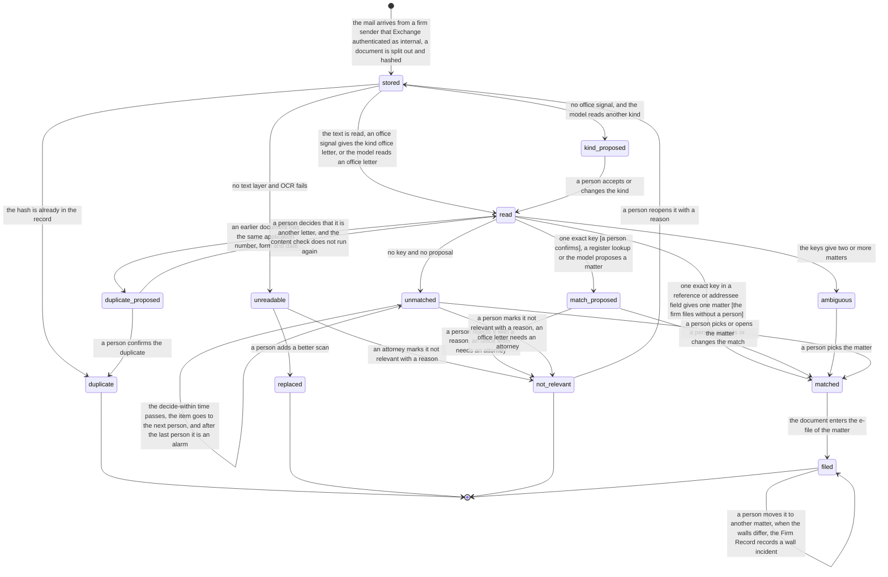

# Process 1: office letter intake

**Starts when** a mail arrives in the AI mailbox. **Ends when** each document of the mail is filed on one matter, is a duplicate, or is not relevant. **Record object:** the document. **Ticket:** [#220](https://github.com/flowleap-ai/flowleap-harness/issues/220). Method: [the atlas README](README.md#the-method-for-every-phase).

## 1. The process today

| # | Fact | Label and source |
|---|---|---|
| 1.1 | The EPO notifies electronically through an activated Mailbox, which a user reaches by signing in to MyEPO. A document reaches its destination on the date it is made available in the Mailbox (Art. 2(2)), and no paper copy is sent in parallel (Art. 2(5)) | SOURCED: [OJ EPO 2026 A20](https://www.epo.org/en/legal/official-journal/2026/03/a20) |
| 1.2 | Under Rule 127(2) EPC an electronic document is deemed delivered on the date it bears. Only if the EPO establishes that it reached the addressee more than seven days after that date does a period end later by the excess days | SOURCED: [R.127 EPC](https://www.epo.org/en/legal/epc/2020/r127.html); [OJ EPO 2023 A29](https://www.epo.org/en/legal/official-journal/2023/03/a29), cited in the design section 5.3 |
| 1.3 | When a representative is appointed, the EPO addresses notifications to that representative | SOURCED: [R.130(1) EPC](https://www.epo.org/en/legal/epc/2020/r130.html) |
| 1.4 | The EPO email alerts on new Mailbox documents are a courtesy service for information only; a missed alert has no effect on a notification or a period (Art. 6(3)). That decision replaced OJ EPO 2023 A49 from 1 November 2023 (Art. 11) | SOURCED: [OJ EPO 2023 A89](https://www.epo.org/en/legal/official-journal/2023/10/a89). The 2026 decision (fact 1.1) and the 2024 decision that it replaces (OJ EPO 2024 A20) have no article on alerts, so their current status is INFERRED to be unchanged. The advice holds: do not rely on alerts |
| 1.5 | The EPO Mailbox is company-wide: each Mailbox user sees the same folders, and a communication leaves the "Not handled" folder when one user marks it handled. The guide names no assignment of a communication to a person | SOURCED: [MyEPO feature guide, handling Mailbox communications](https://link.epo.org/web/myepo-services/interact/en-myepo-feature-guide-handling-mailbox-communications.pdf), read in a search extract. "No assignment" is INFERRED from its absence in the guide |
| 1.6 | The DPMA serves under the Verwaltungszustellungsgesetz with the changes of § 127 PatG | SOURCED: [§ 127 PatG](https://www.gesetze-im-internet.de/patg/__127.html) |
| 1.7 | The DPMA serves a document electronically by making it available for retrieval, only with the consent of the party. The document counts as served "am vierten Tag nach der Bereitstellung zum Abruf" (§ 5(2)). This ERVDPMAV 2026 (BGBl. 2026 I Nr. 50) is in force since 1 March 2026 | SOURCED: [§ 5 ERVDPMAV 2026](https://www.gesetze-im-internet.de/ervdpmav_2026/__5.html); the [DPMA consent form](https://dpma.de/docs/dpma/veroeffentlichungen/flyer/dpmadirektpro_einwilligung.pdf) says that the firm must check its mailbox regularly. The date of entry into force is SOURCED (secondary) from a search extract |
| 1.8 | PATORG imports incoming EPO documents by itself and recognises the file numbers named in incoming emails | SOURCED: [PATORG productivity](https://www.patorg.com/de/features/productivity), quoted in the [cross-check](../2026-11-03-patorg-feature-crosscheck.md) P24, P27 |
| 1.9 | PATORG has add-ins for Outlook, Chrome and Edge to import mail and documents into files | SOURCED: the same page, cross-check P26 |
| 1.10 | The PAFA's training covers deadline calculation and monitoring, and correspondence with offices, clients and foreign associates | SOURCED (secondary): research section 2.1, from the [BIBB certificate supplement](https://www.bibb.de/dienst/berufesuche/de/index_berufesuche.php/certificate_supplement/en/patentanwaltsfachangestellter_e.pdf) and the [ReNoPat-AusbV](https://www.gesetze-im-internet.de/renopatausbv_2015/BJNR149000014.html) |
| 1.11 | Graph delta query tracks one mail folder at a time; a round ends with a `@odata.deltaLink` that the next round starts from | SOURCED: [Microsoft Graph delta query for messages](https://learn.microsoft.com/en-us/graph/delta-query-messages) |
| 1.12 | RBAC for Applications scopes an app's Mail.Read and Mail.Send to a set of mailboxes. An unscoped grant in Entra ID is added to the scoped grant, so it must be removed, and a permission change can take 30 minutes to 2 hours to apply | SOURCED: [RBAC for Applications in Exchange Online](https://learn.microsoft.com/en-us/exchange/permissions-exo/application-rbac) |
| 1.13 | The PATORG way, step by step, for an EPO letter: the PAFA opens the import list or the Mailbox, checks or picks the matter, sets the document type, marks the letter handled, and forwards it to the attorney with a short note | INFERRED from facts 1.5, 1.8 and the research section 2.4 |
| 1.14 | Post that arrives on paper is scanned and stamped with the date of receipt before it is filed | INFERRED; no source found. Question Q1.4 |
| 1.15 | The From header of a mail can be set by the sender. Exchange marks a mail that it authenticated inside the organization in its own headers | INFERRED from the SMTP rules and the Exchange header names; no Microsoft page was read for this sheet. Question Q1.10 |

**What the sources leave open.** We found no public source on how a German firm handles a letter that has no file number, two file numbers, or the wrong file number. We found no PATORG documentation on its match accuracy (the research, section 2.6, found no vendor that publishes it).

## 2. Actors and roles

| Actor | Role in this process |
|---|---|
| PAFA (formalities) | Forwards letters to the AI mailbox; decides every match that is not an exact key (and, by default in R1, each exact-key match); decides a document kind and a content duplicate; adds a better scan; marks a document that is not an office letter not relevant |
| Attorney | Forwards client and associate mail; may decide a match on own matters; marks an office letter not relevant, with a reason |
| Partner | Last person in the escalation chain of an undecided item; decides what follows a wall incident |
| Associate, client | Send mail that a firm member forwards. They never write to the AI mailbox directly in R1 |
| Intake (system) | Polls the mailbox, splits and hashes documents, reads text and keys, matches by exact key |
| Agent | Proposes a match for free text and a document kind when no office signal exists, with the quoted evidence. It never decides |
| Firm Record | Appends each event; refuses a match that a person did not decide when the class is `decided`; refuses "not relevant" on an office letter without an attorney; records a wall incident when a moved document was readable outside its new wall |

## 3. State machine

The machine is per document, not per mail, because one mail can carry several letters for several matters (design section 6.2).

<!-- atlas:intake -->
It has **13 states and 23 transitions**, plus the start.

| From | To | Event | Actor | Evidence in the record log |
|---|---|---|---|---|
| start | `stored` | The mail arrives from a firm sender that Exchange authenticated as internal; a document is split out and hashed | intake | Immutable Graph message id, sender, authentication result, document SHA-256 |
| `stored` | `duplicate` | The hash is already in the record | intake | Hash, the earlier document |
| `stored` | `unreadable` | No text layer and OCR fails | intake | OCR result and its confidence |
| `stored` | `read` | The text is read; an office signal gives the kind office letter, or the model reads an office letter | intake or agent | Kind, its source (form number, office sender, office name) and its span |
| `stored` | `kind_proposed` | No office signal, and the model reads another kind | agent | Kind (associate letter, client mail, other) with its span, SessionRef |
| `kind_proposed` | `read` | A person accepts or changes the kind | person | The proposal and the Decision |
| `unreadable` | `replaced` | A person adds a better scan | person | Hash of the new document |
| `unreadable` | `not_relevant` | An attorney marks it not relevant with a reason | person (attorney) | Reason; the second person when the firm asks for one |
| `read` | `duplicate_proposed` | An earlier document has the same application number, form and date | intake | Both documents and the fields that agree |
| `duplicate_proposed` | `duplicate` | A person confirms the duplicate | person | The Decision |
| `duplicate_proposed` | `read` | A person decides that it is another letter, and the content check does not run again | person | The Decision and its reason |
| `read` | `matched` | One exact key in a reference or addressee field gives one matter [the firm files without a person] | intake | Key, its field and its span |
| `read` | `match_proposed` | One exact key [a person confirms], a register lookup or the model proposes a matter | intake or agent | Key and span, register response, or quoted span and SessionRef |
| `read` | `ambiguous` | The keys give two or more matters | intake | Each key with its field, its span and its matter |
| `read` | `unmatched` | No key and no proposal | intake | The fields searched |
| `match_proposed` | `matched` | A person accepts or changes the match | person | The proposal and the Decision |
| `ambiguous` | `matched` | A person picks the matter | person | The candidates and the Decision |
| `unmatched` | `matched` | A person picks or opens the matter | person | Reason; `matter/opened` when new |
| `match_proposed` | `not_relevant` | A person rejects it with a reason; an office letter needs an attorney | person (attorney for an office letter) | Reason; the second person when the firm asks for one |
| `unmatched` | `not_relevant` | A person marks it not relevant with a reason; an office letter needs an attorney | person (attorney for an office letter) | Reason; the second person when the firm asks for one |
| `unmatched` | `unmatched` | The decide-within time passes; the item goes to the next person, and after the last person it is an alarm | Firm Record | Time, escalation step |
| `matched` | `filed` | The document enters the e-file of the matter | Firm Record | Match evidence |
| `filed` | `filed` | A person moves it to another matter; when the walls differ, the Firm Record records a wall incident | person | Reason, old and new matter, the wall incident |
| `not_relevant` | `stored` | A person reopens it with a reason | person | Reason |

End states: `duplicate`, `replaced`, `not_relevant`, `filed`. Declared corrections out of an end state: `not_relevant` to `stored`.


<!-- /atlas:intake -->

The move of a filed document is a correction on `filed`; it starts the `stale` and `disputed` paths of [sheet 2](02-office-event-to-deadline.md) and the `cancelled` path of [sheet 3](03-notify-and-run.md). The reopen of a `not_relevant` document is a correction with a reason; the log keeps the first decision.

**Error and timeout paths.**

- **No matter found:** `unmatched`, to the formalities queue, never to an agent (design section 6.2).
- **Two matches:** `ambiguous`. Two keys that point to two matters are a fact, so the item shows both keys with their spans. This case is common when one letter names a parent and a divisional application [INFERRED].
- **A number in the body text:** a letter cites EP numbers of prior art, and an associate letter can name the matter number of another client. So an exact key comes only from a reference, addressee or subject field, or from the application-number field of an office form (setting `intake.keyFields`). A number in the body text can support a proposal, never an exact match, because a wrong exact match files a letter inside the wall of another client [INFERRED from design section 4.4 and question Q1.9].
- **Wrong matter:** a correction on `filed`. It needs a reason, it keeps the old match in the log, and the deadlines and runs that rest on it move to `stale`, `disputed` or `cancelled`. When persons or runs could read the document under the old matter but the new matter's wall does not admit them, the Firm Record records `wall/incident-recorded` with those persons and runs, and the partner decides what follows (ADR 0002 decision 7).
- **Not an office letter:** a code signal (an office sender, an EPO Form number, an office name in the letterhead) always gives the kind office letter. The model can raise a document to office letter, but it never lowers one: without a signal, a kind other than office letter is `kind_proposed`, and a person decides it.
- **Not relevant:** for an office letter, or for an unreadable document whose kind is unknown, "not relevant" means that no deadline follows from it. So it needs an attorney and a reason, like the deletion of a deadline (ADR 0002 decision 4; BGH X ZB 17/12, fact 2.6 of [sheet 2](02-office-event-to-deadline.md)). A firm can ask for a second person too (setting `intake.notRelevantCheck`).
- **Unreadable scan:** `unreadable`, with a task for the person who forwarded it.
- **Missed decision:** the decide-within time escalates `unmatched` to the next person in the chain. The same rule applies to `kind_proposed`, `duplicate_proposed`, `match_proposed` and `ambiguous`; the chart shows it once. After the last person in the chain, the item is an alarm in the morning brief of each person in the chain and of the administrator, every working day until a person decides it.
- **Mail from outside the firm:** in R1 the AI mailbox accepts mail only from firm addresses. The From header can be set by any sender (fact 1.15), so the intake also needs the Exchange result that the mail was authenticated inside the organization. A mail without it is stored, gets no reply, and goes to the formalities queue [INFERRED from F7 and design section 6.3; questions Q1.3 and Q1.10].
- **The same letter forwarded twice:** the second document is a `duplicate` by its hash. Its forwarder gets a short message with the link to the first result ([sheet 5](05-firm-internal-message.md)). A rescan or a print of the same letter has another hash, so the intake compares the application number, the form and the date of the letter too; a match there is `duplicate_proposed`, and a person decides it. A `duplicate` by hash has the same bytes as the first document, so a correction applies to the first document, not to the duplicate.

**Who reads a letter before it is filed** (founder decision of 2026-11-06, [#324](https://github.com/flowleap-ai/flowleap-harness/issues/324)). Before a document is `filed`, no matter's wall applies to it, so the Firm Record applies this rule to every read of it: the intake list and card, its text, its bytes and its readings.

- Only the person who forwarded its mail and the intake persons (setting `intake.persons`) read it. The team of a proposed matter does not read it until it is filed. No agent reads it.
- When the intake proposes a matter for it (`match_proposed`, and each matter of `ambiguous`), a person who is screened from that matter does not read it. This applies to the intake persons and to the forwarder too. With no proposed matter, every intake person reads it.
- A person who cannot read a document cannot decide it: no match and no "not relevant".
- After `filed`, the wall of its matter applies.
- A wrong proposal can hide a letter from a person who may read it. The letter never leaks to a person outside the rule.
- The screen of a matter is the list of persons that the wall keeps out of the matter, also when a client group admits them (design section 4.4). In R1 the Firm Record keeps the screen of each matter. A person of the matter's team records the whole list with a reason (`matter/screen-recorded`), and no screened person can be in the team. From R2, the walls come from Entra groups ([#227](https://github.com/flowleap-ai/flowleap-harness/issues/227)), and the screens and `intake.persons` move there.

## 4. Firm variation points

| Setting | Type | Default | Why firms differ |
|---|---|---|---|
| `intake.exactKeyFiles` | `'person-confirms' \| 'file-without-person'` | `'person-confirms'` in R1 | Design section 4.3 puts a letter-to-matter match in the class `decided`. Filing without a person saves one step per letter, but a wrong exact match is a wall breach. R1 measures the exact-key accuracy; the founder and the pilot firm decide the switch (question Q1.1) |
| `intake.keyFields` | ordered list of `'our-reference' \| 'your-reference' \| 'addressee' \| 'subject' \| 'office-form-application-number'` | all, in this order | Where each sender puts the reference (question Q1.9) |
| `intake.keyKinds` | ordered list of `'file-number' \| 'ep-number' \| 'pct-number' \| 'dpma-file-number' \| 'client-reference'` | all, in this order | The firm file-number pattern and the use of client references differ |
| `intake.fileNumberPattern` | regular expression, validated at load | none; the firm must set it | Each firm has its own Aktenzeichen format |
| `intake.officeSignals` | list of sender domains and form-number patterns, validated at load | the EPO, WIPO and DPMA sender domains and the EPO Form number pattern | Firms that also work with other offices add theirs |
| `intake.notRelevantCheck` | `'attorney' \| 'attorney-and-second-person'` | `'attorney'` | A firm with a written four-eyes rule for deadline deletions (question Q1.7) |
| `intake.decideWithin` | duration | 4 working hours | Same-day intake is safe practice since periods run from the document date (research section 2.3) [INFERRED] |
| `intake.escalation` | ordered list of roles or persons | `['formalities', 'partner']` | Firm size and roles. After the last entry the item is an alarm, not a silent wait |
| `intake.acceptFrom` | `'firm-addresses-authenticated'` | `'firm-addresses-authenticated'` | Fixed in R1 (F7); a matter address per matter comes in R3 (design section 6.1) |
| `intake.unreadableTo` | `'forwarder' \| 'formalities'` | `'forwarder'` | Who rescans |
| `intake.persons` | list of Entra object ids, validated at load | none: the firm must set it. A missing or empty list stops the Firm Record, and nothing falls back to the whole firm | Who works the intake queue and reads letters before they are filed. From R2 it is an Entra group ([#227](https://github.com/flowleap-ai/flowleap-harness/issues/227)) |

The rule "the model never lowers a kind" and the content-duplicate fields (application number, form, date) are not settings. They protect the deadline, so a firm cannot turn them off.

## 5. AI-native redesign

**What disappears.** After the cut-over: opening the Mailbox or the import list to sort letters, picking the matter for a letter with a key, setting the document type, marking the letter handled, and the note "bitte prüfen" with the forward. The intake reads them from the document (design principle 1). In R1 the firm keeps its PATORG docket (observe mode), so these PATORG steps stay for the PAFA in R1.

**What becomes a proposal with evidence.** A match for free text (client or associate mail without a number), the kind of a document without an office signal, and a content duplicate. Each is a proposal with the quoted span; a person decides it (principle 3).

**What stays with a person, and why.** Every match that is not one exact key, because a wrong match puts a correct deadline on the wrong matter (design section 13.1) and the source document must be in view when a person decides (design section 6.2). In R1, by default, the exact-key match too, until the pilot shows its accuracy. "Not relevant" on an office letter stays with an attorney, because it means that no deadline follows (fact 2.6 of sheet 2). The move of a filed document, because it changes the basis of deadlines (change class `decided`, with a reason).

**The count** (counting rule in the [README](README.md#the-method-for-every-phase)):

| | Old way (PATORG) | R1 (observe mode) | After cut-over |
|---|---|---|---|
| Manual steps, typical EPO letter | 5: open the Mailbox or the import list, check or pick the matter, set the document type, mark handled, forward to the attorney with a note | 6: open the Mailbox, check or pick the matter in PATORG, set the document type in PATORG, mark handled, forward to the AI mailbox, confirm the FlowLeap match. 5 with `file-without-person` | 1: confirm the exact-key match (MyEPO source of R3, #154). 0 with `file-without-person` |
| Extra steps, exception | 1 to 3: search the matter, ask a colleague, rescan | The old exception steps in PATORG, plus 1: decide the item in the FlowLeap queue | 1: decide the item in the queue (kind, match, duplicate, or not relevant), with the proposal and the document in view |
| Person-to-person hand-offs | 1: PAFA to attorney | 0: the result reaches the attorney from the system ([sheet 5](05-firm-internal-message.md)) | 0 |

The old count is INFERRED (fact 1.13). In R1 the PAFA has one step more per letter than today, because PATORG stays the docket and FlowLeap observes beside it. The gain of R1 is on the attorney side ([sheet 3](03-notify-and-run.md)) and in the measured exact-key accuracy that the cut-over needs. The pilot must measure the minutes (question Q1.8).

## 6. Map to the code

**What exists in R0** (`lib/record/` of flowleap-os, `main`): the record log with the hash chain and the idempotency key per command; `matter/opened`; `office-event/recorded` with `fileNumber`, `code`, `documentDate` and the optional `receivedAt`, written by a person, with an empty evidence list. `EVENT_TYPES` in `log.mjs` binds each event type to one payload version and one actor kind (`person` or `engine`). There is no document, no intake actor and no match state.

**What is new:** the actor kind `intake` (design section 4.2); the document with its hash and its source; the record events below; the queue in the Records app. The office event that the intake reads is a new event type, `office-event/observed`, with the actor `intake` and required evidence ([sheet 2](02-office-event-to-deadline.md)). R0's `office-event/recorded` stays the type for an event that a person records. The new actor kind changes a persisted type, so the change needs the persistence-type acknowledgement of [AGENTS.md](../../../AGENTS.md).

```ts
type DocumentSha256 = Branded<'DocumentSha256'>; type MatterId = Branded<'MatterId'>; type AttorneyId = Branded<'AttorneyId'>
type Span = { page: number; start: number; end: number; quote: string }
type KeyField = 'our-reference' | 'your-reference' | 'addressee' | 'subject' | 'office-form-application-number'
// A MatchKey exists only for a key in a KeyField; a number in the body text is a CitedNumber and can only support a proposal.
type MatchKey = { kind: 'file-number' | 'ep-number' | 'pct-number' | 'dpma-file-number' | 'client-reference'; field: KeyField; value: string; span: Span }
type DocumentKind = 'office-letter' | 'associate-letter' | 'client-mail' | 'other'
type KindSource = { kind: 'office-signal'; signal: 'sender' | 'form-number' | 'office-name'; span: Span } | { kind: 'model'; span: Span; session: SessionRef } | { kind: 'decided'; decision: RecordSeq }

type IntakeDocument =
  | { s: 'stored'; hash: DocumentSha256; mail: ImmutableGraphMessageId; from: FirmAddress; auth: 'internal' }
  | { s: 'duplicate'; hash: DocumentSha256; first: RecordSeq; by: 'hash' | { decision: RecordSeq } }
  | { s: 'unreadable'; hash: DocumentSha256; ocr: { confidence: number } }
  | { s: 'replaced'; by: DocumentSha256; person: PersonId }
  | { s: 'kind_proposed'; hash: DocumentSha256; proposal: ProposalId; kind: Exclude<DocumentKind, 'office-letter'>; span: Span }
  | { s: 'read'; hash: DocumentSha256; kind: DocumentKind; source: KindSource }
  | { s: 'duplicate_proposed'; hash: DocumentSha256; earlier: DocumentSha256; fields: ['application-number', 'form', 'date'] }
  | { s: 'match_proposed'; hash: DocumentSha256; proposal: ProposalId; matter: MatterId }
  | { s: 'ambiguous'; hash: DocumentSha256; candidates: [MatchCandidate, MatchCandidate, ...MatchCandidate[]] }
  | { s: 'unmatched'; hash: DocumentSha256; searched: KeyField[]; escalation: number }
  | { s: 'matched'; hash: DocumentSha256; matter: MatterId; by: { key: MatchKey } | { decision: RecordSeq } }
  | { s: 'filed'; hash: DocumentSha256; matter: MatterId; moves: RecordSeq[] }
  | NotRelevant
type NotRelevant =
  | { s: 'not_relevant'; hash: DocumentSha256; kind: 'office-letter' | 'unknown'; by: AttorneyId; second: PersonId | null; reason: string }
  | { s: 'not_relevant'; hash: DocumentSha256; kind: Exclude<DocumentKind, 'office-letter'>; by: PersonId; reason: string }
type MatchCandidate = { matter: MatterId; key: MatchKey }

// One command per transition; a command names the only state it leaves, so a wrong order does not compile.
type IntakeCommand =
  | { c: 'read'; from: Extract<IntakeDocument, { s: 'stored' }>; kind: DocumentKind; source: KindSource }
  | { c: 'decide-kind'; from: Extract<IntakeDocument, { s: 'kind_proposed' }>; kind: DocumentKind; by: PersonId }
  | { c: 'match-exact'; from: Extract<IntakeDocument, { s: 'read' }>; key: MatchKey }
  | { c: 'decide-match'; from: Extract<IntakeDocument, { s: 'match_proposed' | 'ambiguous' | 'unmatched' }>; matter: MatterId; by: PersonId }
  | { c: 'move'; from: Extract<IntakeDocument, { s: 'filed' }>; to: MatterId; by: PersonId; reason: string }
  | { c: 'reopen'; from: NotRelevant; by: PersonId; reason: string }
```

New record events: `document/stored`, `document/duplicate`, `document/duplicate-proposed`, `document/unreadable`, `document/kind-proposed`, `document/read`, `document/match-proposed`, `document/matched`, `document/filed`, `document/moved`, `document/not-relevant`, `document/reopened`, `wall/incident-recorded`, `matter/screen-recorded`. The invariants for the release gate: `intake.unfiled-letter-readers`, `intake.exact-key-only-from-key-fields`, `intake.no-agent-decides-match`, `intake.model-never-lowers-kind`, `intake.not-relevant-office-letter-needs-attorney`, `intake.duplicate-by-hash`.

## 7. Open questions for the pilot attorney

- **Q1.1** May a letter with one exact key be filed without a person, or does a PAFA see every letter first? After how many weeks of measured accuracy would you let FlowLeap file it without a person?
- **Q1.2** Which keys do you trust: your file number, the EP number, the client's reference? Which file-number format do you use?
- **Q1.3** Do clients and associates ever write to a shared firm address that the AI mailbox could read, or do they always write to a person who forwards?
- **Q1.4** How do you handle paper post today: who scans, and which date do you stamp?
- **Q1.5** Has your firm given the DPMA its consent to electronic service under the ERVDPMAV 2026 (fact 1.7)? Since when, and who checks the DPMA mailbox?
- **Q1.6** How often does a letter name two of your matters (for example a parent and a divisional), and who decides then?
- **Q1.7** Do you have a written deadline-control instruction (Büroanweisung)? Who may mark an office letter "not relevant" today, and does a second person check it?
- **Q1.8** Who marks letters "handled" in MyEPO today? In R1, would the PAFA do the PATORG import and the forward to the AI mailbox both? Can we measure the minutes per letter before and during R1?
- **Q1.9** Where does your reference appear in EPO, DPMA and associate letters? Do letters cite numbers of your other matters, or of other clients' matters?
- **Q1.10** (for the firm's IT administrator) Does your Exchange Online mark internal, authenticated mail in a header that the AI mailbox can read through Graph?
