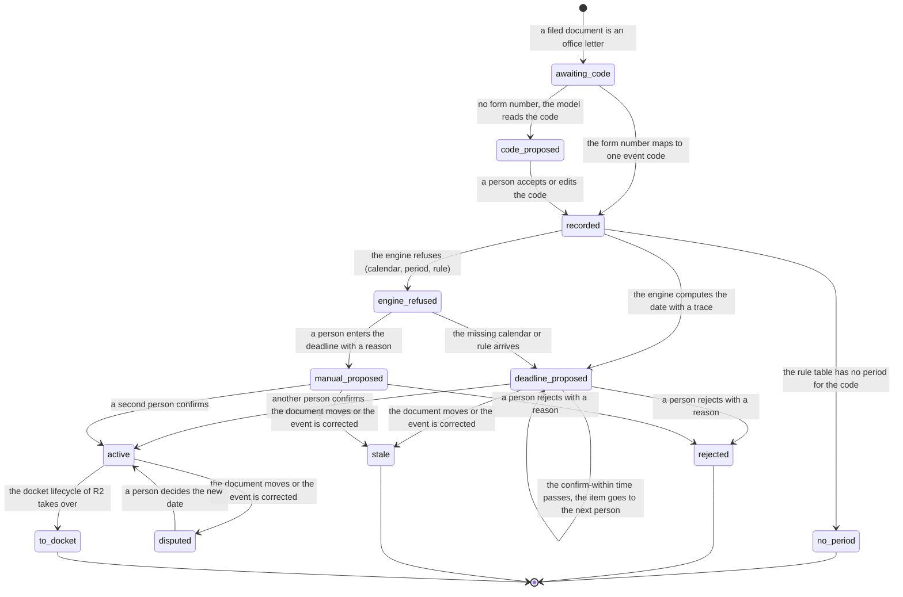

# Process 2: office event to deadline

**Starts when** a filed document is an office letter. **Ends when** the deadline is active and the docket lifecycle of R2 takes it over, or the deadline is rejected or stale, or the event has no period. **Record objects:** the office event and its deadline proposal. **Tickets:** [#220](https://github.com/flowleap-ai/flowleap-harness/issues/220), with #219 (R0 confirm). Method: [the atlas README](README.md#the-method-for-every-phase).

## 1. The process today

| # | Fact | Label and source |
|---|---|---|
| 2.1 | An electronic EPO document is deemed delivered on the date it bears. When it reaches the addressee more than seven days later, the period ends later by the excess days | SOURCED: [R.127 EPC](https://www.epo.org/en/legal/epc/2020/r127.html); [OJ EPO 2023 A29](https://www.epo.org/en/legal/official-journal/2023/03/a29), cited in the design section 5.3 |
| 2.2 | For the seven-day extension, the relevant date is the date the document is made available in the Mailbox | SOURCED: [OJ EPO 2026 A20](https://www.epo.org/en/legal/official-journal/2026/03/a20), Art. 2(2) |
| 2.3 | A forwarded PDF shows the date the document bears, but not the date it was made available in the Mailbox | INFERRED from facts 2.1 and 2.2. So the engine computes from the date the document bears and shows a possible extension only as a note (design section 5.1, "the earliest safe date") |
| 2.4 | Periods start on the day after the event; months end on the day with the same number or on the last day of a shorter month. Periods that the EPO sets are two to four months, up to six in special cases. A Rule 71(3) communication sets four months | SOURCED: [R.131](https://www.epo.org/en/legal/epc/2020/r131.html), [R.132](https://www.epo.org/en/legal/epc/2020/r132.html), [R.71](https://www.epo.org/en/legal/epc/2020/r71.html), cited in the design section 5.3 and 5.4 |
| 2.5 | For re-establishment, the EPO asks for a deadline system that normally works well, with "an independent, effective cross-check mechanism". Relatively small entities are exempt from the cross-check. Assistants who note deadlines must be "carefully selected, duly instructed and periodically supervised" | SOURCED: [Guidelines E-VIII 3.2](https://www.epo.org/en/legal/guidelines-epc/2025/e_viii_3_2.html) |
| 2.6 | The BGH applies the deadline-monitoring principles to patent validation deadlines. A general instruction to raise problems with the attorney was too vague, because it did not say when staff must present the file to the attorney, so the deletion of a deadline was left to staff | SOURCED (secondary, search extract; full text not read): [BGH X ZB 17/12](https://rewis.io/urteile/urteil/q3z-29-10-2013-x-zb-1712/) |
| 2.7 | A deadline may be struck from the calendar only after the person in charge of the check has verified it against the file or the finished filing | SOURCED (secondary, search extract of the headnote): [BGH II ZB 10/11](https://rewis.io/urteile/urteil/pk7-27-03-2012-ii-zb-1011/). This is a Rechtsanwalt case; that it applies to Patentanwälte is INFERRED |
| 2.8 | The patent attorney answers for the conduct of non-member assistants and must supervise them | SOURCED: [epi Code of Conduct](https://www.epo.org/en/legal/official-journal/2025/06/a42), Art. 3(d), 3(e) |
| 2.9 | We found no section of the PAO that sets a deadline-control duty; the duty comes from the case law on re-establishment (facts 2.5 to 2.7) | INFERRED from a search of the [PAO](https://www.gesetze-im-internet.de/patanwo/) and the research section 2.3. The BRAO does not apply to Patentanwälte [INFERRED] |
| 2.10 | PATORG lets the firm define deadline rules by conditions and computes the dates. Its AI reads deadline text in documents, compares it with the docket, and can docket | SOURCED: [PATORG impress-service](https://www.patorg.com/de/features/impress-service) and [PATORG AI](https://www.patorg.com/de/features/ai), cross-check P14, P16 |
| 2.11 | The PAFA reads the letter, picks the deadline type, enters the dates and the internal dates (Vorfristen), and a second person or the partner checks; only an attorney may delete | INFERRED from the research section 2.4 (workflow "Deadlines and docketing") and facts 2.5 to 2.7 |
| 2.12 | Each EPO communication carries an EPO Form number that names its type (for example the Form of a Rule 71(3) communication) | INFERRED from public EPO file documents; no EPO page that lists the form numbers was read for this sheet. Question Q2.6 |
| 2.13 | A DPMA document in the electronic mailbox counts as served on the fourth day after provision | SOURCED: [DPMA consent form](https://dpma.de/docs/dpma/veroeffentlichungen/flyer/dpmadirektpro_einwilligung.pdf). The DE rules come in R2 (#225) |

## 2. Actors and roles

| Actor | Role in this process |
|---|---|
| Intake (system) | Reads the form number and maps it to an event code |
| Agent | Proposes the event code when there is no form number, and the period when the letter sets one, with the quoted span |
| Deadline engine | Computes the due date with a trace from the code and the document date; refuses with a named error; never guesses (design section 5.1) |
| PAFA (formalities) | Confirms or rejects a deadline proposal; enters a manual deadline when the engine refuses |
| Second person (PAFA, attorney or partner) | Confirms a manual deadline; never the person who entered it |
| Attorney | Decides a dispute; confirms when the firm lets attorneys confirm |
| Partner | Last person in the escalation chain; owns the firm's written deadline instructions (research section 2.1) |
| Firm Record | Refuses a confirm by the proposer, a confirm without a check, and any deadline change by an agent credential (ADR 0002 decision 3) |

## 3. State machine

The machine joins the office event and its deadline proposal, because in R1 one office event gives at most one engine proposal per rule, and the proposal cannot exist without the event. It has **12 states and 18 transitions**, plus the start.

| From | To | Event | Actor | Evidence in the record log |
|---|---|---|---|---|
| start | `awaiting_code` | A filed document is an office letter | intake | Document kind with its span |
| `awaiting_code` | `recorded` | The form number maps to one event code | intake | Form number span, code table version |
| `awaiting_code` | `code_proposed` | No form number; the model reads the code | agent | Quoted span, SessionRef |
| `code_proposed` | `recorded` | A person accepts or edits the code | person | Proposal and Decision |
| `recorded` | `no_period` | The rule table has no period for the code | engine | Rule table version |
| `recorded` | `deadline_proposed` | The engine computes the date with a trace | engine | Trace, trace hash, document-date span |
| `recorded` | `engine_refused` | The engine refuses: calendar missing, unknown event, period not read, rule not effective | engine | Named error |
| `engine_refused` | `deadline_proposed` | The missing calendar or rule arrives | engine | Trace |
| `engine_refused` | `manual_proposed` | A person enters the deadline with a reason | person | Reason, date span |
| `deadline_proposed` | `active` | Another person confirms and the engine agrees | person | Engine check (rule, trace hash) |
| `manual_proposed` | `active` | A second person confirms | person | Second-person check |
| `deadline_proposed` | `deadline_proposed` | The confirm-within time passes; the item goes to the next person | Firm Record | Time, escalation step |
| `deadline_proposed` | `rejected` | A person rejects with a reason | person | Reason |
| `manual_proposed` | `rejected` | A person rejects with a reason | person | Reason |
| `deadline_proposed` | `stale` | The document moves or the event is corrected | person | Correction event |
| `manual_proposed` | `stale` | The document moves or the event is corrected | person | Correction event |
| `active` | `disputed` | The document moves or the event is corrected | person | Correction event |
| `disputed` | `active` | A person decides the new date | person | Both traces |
| `active` | `to_docket` | The docket lifecycle of R2 takes over (met, superseded, closed without its act) | Firm Record | none |

End states: `no_period`, `rejected`, `stale`, `to_docket`.



**The check covers the computation, not the reading.** In R0 the confirm recomputes the date from the stored code and document date and compares the trace hash (`lib/record/deadlines.mjs`). That check is independent of the arithmetic, but not of the reading: a wrong code or a wrong document date gives the same wrong date twice. So the person who confirms is the check of the reading, and the Records app must show the code span and the date span of the letter beside the proposal. A firm can ask for a second person when the model read the code (setting `deadline.readingCheck`) [INFERRED from the R0 code and fact 2.5].

**Error and timeout paths.**

- **Unknown event or no rule:** `engine_refused` with the named error, and a task for a person; never a guessed date (design section 5.1).
- **Period read from the letter:** for a specified period (R.132), the agent reads the months with the span. If it cannot, the engine refuses with `period-not-read`.
- **Wrong matter or wrong date after a decision:** `stale` before the confirm, `disputed` after it. An earlier new date is an alarm at the top of the docket (design section 5.5).
- **Missed confirmation:** the confirm-within time escalates to the next person; at the first internal date the item is an alarm in the morning brief of the responsible attorney and the partner [INFERRED from design section 5.5].
- **Docket observe mode:** in R1 the firm's docket stays the authority (ADR 0002 decision 4). `active` in FlowLeap changes nothing that the firm relies on; the difference report of R2 compares it.

## 4. Firm variation points

| Setting | Type | Default | Why firms differ |
|---|---|---|---|
| `deadline.confirmerRoles` | list of roles | `['formalities', 'attorney', 'partner']` | Some firms let only the PAFA team confirm; some only attorneys (question Q2.1) |
| `deadline.checkPolicy` | `'engine-or-second-person' \| 'always-second-person'` | `'engine-or-second-person'` (F3) | Firms with a written four-eyes rule for every entry |
| `deadline.readingCheck` | `'confirmer-sees-spans' \| 'second-person-when-model-read'` | `'confirmer-sees-spans'` | The risk of a misread code (section 3) |
| `deadline.confirmWithin` | duration | 1 working day | Firm practice; same-day intake (research section 2.3) [INFERRED] |
| `deadline.escalation` | ordered list of roles or persons | `['formalities', 'responsible-attorney', 'partner']` | Firm size |
| `deadline.internalDates` | list of offsets per rule id | 2 weeks and 1 week before the due date (design section 5.4 example) | Each firm sets its Vorfristen (question P6 of the design) |
| `deadline.singleCheck` | derived, not a setting | true only when the firm has one person who may confirm | E-VIII 3.2 small entity (fact 2.5); recorded as `single-check` and listed in every brief |

## 5. AI-native redesign

**What disappears.** Typing the document date, picking the deadline type, computing the date and the internal dates. The intake reads the code and the date with their spans, and the engine computes (design principles 1 and 4).

**What becomes a proposal with evidence.** The event code when there is no form number, the period of a specified-period letter, and the deadline with its trace (principle 3).

**What stays with a person, and why.** The confirmation, because the law puts the deadline system on the attorney and asks for an effective cross-check (facts 2.5, 2.8), and ADR 0002 decision 4 says the AI only proposes. The manual deadline, because the engine cannot check it, so a second person must. The dispute, because a new date can be earlier.

**The count:**

| | Old way (PATORG) | New way (R1) |
|---|---|---|
| Manual steps, typical letter | 5: read the letter for the type, pick the deadline type, enter the dates, check (second person), tell the attorney | 1: confirm with the spans and the trace in view |
| Extra steps, exception | 1 to 2: compute by hand for an unusual letter, ask the attorney | 2: enter a manual deadline with a reason, and a second person confirms |
| Person-to-person hand-offs | 2: PAFA to checker, checker to attorney | 0: the proposal reaches the confirmer from the system; the attorney sees it in the run result |

The old count is INFERRED (fact 2.11).

## 6. Map to the code

**What exists in R0** (`lib/record/` of flowleap-os, `main`): `office-event/recorded` (person actor), `deadline/proposed` (engine actor, acting for the person who recorded the event), `deadline/confirmed`, `deadline/rejected`; the deadline states `proposed`, `active`, `rejected`; the refusals `confirmer-is-proposer`, `engine-missing`, `engine-check-failed`, `not-proposed`; one rule, `ep.r71-3.grant-communication`.

**What is new:** the code states (`awaiting_code`, `code_proposed`, `recorded`, `no_period`), `engine_refused`, `manual_proposed` with the second-person check, `stale`, `disputed`, the escalation event, and the spans as evidence. In R0 the proposer of an engine deadline is the person who recorded the event; in R1 the intake records it, so the rule "the confirmer is never the proposer" needs a new reading: an intake or engine proposal may be confirmed by any person with the role, and a manual proposal never by the person who entered it.

```ts
type EventCode = Branded<'EventCode'>   // 'EPO:R71(3)'
type CodeSource = { kind: 'form-number'; span: Span; table: CodeTableVersion } | { kind: 'decided'; proposal: ProposalId; decision: RecordSeq }
type OfficeEvent =
  | { s: 'awaiting_code'; document: DocumentSha256; matter: MatterId }
  | { s: 'code_proposed'; document: DocumentSha256; matter: MatterId; proposal: ProposalId; code: EventCode; span: Span }
  | { s: 'recorded'; document: DocumentSha256; matter: MatterId; code: EventCode; codeSource: CodeSource; documentDate: LocalDate; dateSpan: Span }
  | { s: 'no_period'; event: RecordSeq; rules: RuleTableVersion }

type EngineError = 'calendar-missing' | 'unknown-event' | 'period-not-read' | 'rule-not-effective'
type DeadlineCandidate =
  | { s: 'deadline_proposed'; event: RecordSeq; rule: RuleRef; due: LocalDate; trace: TraceHash; escalation: number }
  | { s: 'engine_refused'; event: RecordSeq; error: EngineError }
  | { s: 'manual_proposed'; event: RecordSeq; due: LocalDate; enteredBy: PersonId; reason: string; span: Span }
  | { s: 'active'; event: RecordSeq; due: LocalDate; confirmedBy: PersonId; check: R1Check }
  | { s: 'disputed'; current: RecordSeq; candidate: LocalDate; reason: 'event-changed' | 'document-moved' }
  | { s: 'rejected'; by: PersonId; reason: string }
  | { s: 'stale'; reason: 'event-changed' | 'document-moved' }
type R1Check =
  | { kind: 'engine'; rule: RuleRef; trace: TraceHash }
  | { kind: 'second-person'; by: PersonId }       // the Firm Record refuses by === enteredBy
  | { kind: 'single-check'; reason: 'one-confirmer-firm' }

// The confirm command takes only a proposal state; an agent credential has no PersonId, so it cannot confirm.
type Confirm =
  | { c: 'confirm'; from: Extract<DeadlineCandidate, { s: 'deadline_proposed' }>; by: PersonId; recompute: TraceHash }
  | { c: 'confirm'; from: Extract<DeadlineCandidate, { s: 'manual_proposed' }>; by: PersonId }
```

New record events: `office-event/code-proposed`, `office-event/recorded` version 2, `office-event/no-period`, `deadline/engine-refused`, `deadline/manual-proposed`, `deadline/escalated`, `deadline/stale`, `deadline/disputed`, `deadline/dispute-decided`. Invariants: `docket.two-person` (exists in design), `docket.manual-needs-second-person`, `docket.agent-cannot-decide` (R0 `record.agent-cannot-decide`).

## 7. Open questions for the pilot attorney

- **Q2.1** Who may confirm a deadline in your firm: the PAFA team, attorneys, or both? Is it a written instruction (facts 2.6, 2.7)?
- **Q2.2** Is the engine's computation an acceptable "independent cross-check" (fact 2.5), when a person confirms the reading of the code and the date? Would your insurer accept it (design question P5)?
- **Q2.3** Within which time must a new deadline be confirmed, and who is next when the first person does not act?
- **Q2.4** Which letters set a period that is not in the rule (for example a specified period under R.132), and how do you read it today?
- **Q2.5** In R1 your PATORG docket stays the authority. Do you want FlowLeap's confirm step during this phase, or only the proposal and a difference in the morning brief?
- **Q2.6** Do you rely on the EPO Form number to know the type of a letter? Which letters have none?
