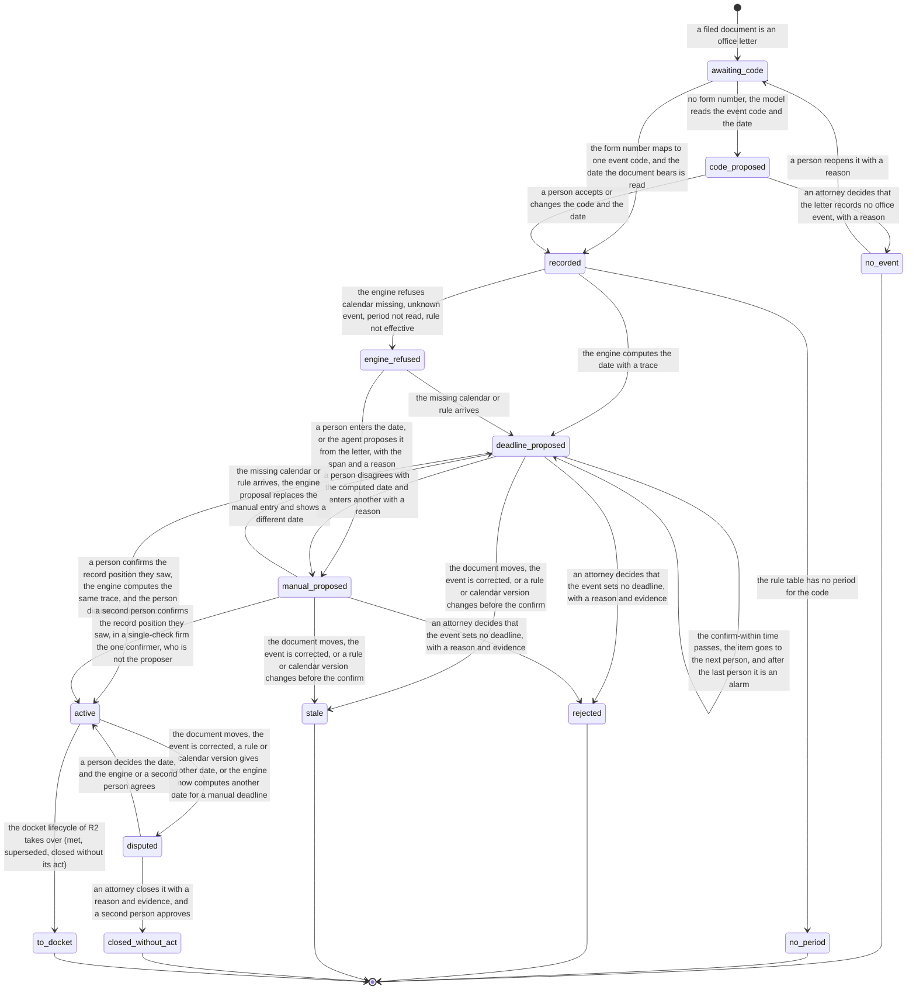

# Process 2: office event to deadline

**Starts when** a filed document is an office letter. **Ends when** the deadline is active and the docket lifecycle of R2 takes it over; or an attorney decides that the letter records no event, that the event sets no deadline, or that a disputed deadline closes without its act; or the deadline is stale; or the event has no period. **Record objects:** the office event and its deadline proposal. **Tickets:** [#220](https://github.com/flowleap-ai/flowleap-harness/issues/220), with #219 (R0 confirm). Method: [the atlas README](README.md#the-method-for-every-phase).

## 1. The process today

| # | Fact | Label and source |
|---|---|---|
| 2.1 | An electronic EPO document is deemed delivered on the date it bears. Only if the EPO establishes that it reached the addressee more than seven days later does the period end later by the excess days | SOURCED: [R.127 EPC](https://www.epo.org/en/legal/epc/2020/r127.html); [OJ EPO 2023 A29](https://www.epo.org/en/legal/official-journal/2023/03/a29), cited in the design section 5.3 |
| 2.2 | For the seven-day extension, the relevant date is the date the document is made available in the Mailbox | SOURCED: [OJ EPO 2026 A20](https://www.epo.org/en/legal/official-journal/2026/03/a20), Art. 2(2) |
| 2.3 | A forwarded PDF shows the date the document bears, but not the date it was made available in the Mailbox | INFERRED from facts 2.1 and 2.2. So the engine computes from the date the document bears and shows a possible extension only as a note (design section 5.1, "the earliest safe date") |
| 2.4 | Periods start on the day after the event; months end on the day with the same number or on the last day of a shorter month. Periods that the EPO sets are two to four months, up to six in special cases. A Rule 71(3) communication sets four months | SOURCED: [R.131](https://www.epo.org/en/legal/epc/2020/r131.html), [R.132](https://www.epo.org/en/legal/epc/2020/r132.html), [R.71](https://www.epo.org/en/legal/epc/2020/r71.html), cited in the design section 5.3 and 5.4 |
| 2.5 | For re-establishment, the EPO asks for a deadline system that normally works well, with "an independent, effective cross-check mechanism". Relatively small entities are exempt from the cross-check. Assistants who note deadlines must be "carefully selected, duly instructed and periodically supervised" | SOURCED: [Guidelines E-VIII 3.2](https://www.epo.org/en/legal/guidelines-epc/2025/e_viii_3_2.html) |
| 2.6 | The BGH applies the deadline-monitoring principles to the validation deadlines of a patent attorney's firm. A general instruction to raise problems with the attorney was too vague, because it did not say when staff must present the file to the attorney, so the deletion of a deadline was left to staff | SOURCED (secondary, search extract and the dejure.org summary; full text not read): [BGH X ZB 17/12](https://dejure.org/2013,34661) |
| 2.7 | A deadline may be struck from the calendar only after the person in charge of the check has verified it against the file or the finished filing | SOURCED (secondary, search extract of the headnote): [BGH II ZB 10/11](https://dejure.org/2012,9669). This is a Rechtsanwalt case; that it applies to Patentanwälte is INFERRED |
| 2.8 | The patent attorney answers for the conduct of non-member assistants and must supervise them | SOURCED: [epi Code of Conduct](https://www.epo.org/en/legal/official-journal/2025/06/a42), Art. 3(d), 3(e) |
| 2.9 | We found no section of the PAO that sets a deadline-control duty; the duty comes from the case law on re-establishment (facts 2.5 to 2.7, 2.14) | INFERRED from a search of the [PAO](https://www.gesetze-im-internet.de/patanwo/) and the research section 2.3. The Berufsordnung der Patentanwälte of the Patentanwaltskammer was not read, so this fact is open (question Q2.9). The BRAO does not apply to Patentanwälte [INFERRED] |
| 2.10 | PATORG lets the firm define deadline rules by conditions and computes the dates. Its AI page names, under "Fristen ermitteln und gegenprüfen", three things: AI searches documents for deadline-setting information, "Abgleich mit notierten Fristen und gegebenenfalls Fristnotierung". The page does not say whether a person confirms that entry | SOURCED: [PATORG impress-service](https://www.patorg.com/de/features/impress-service) and [PATORG AI](https://www.patorg.com/de/features/ai), read on 2026-11-04, cross-check P14, P16. The pages name no PATORG version |
| 2.11 | The PAFA reads the letter, picks the deadline type, enters the dates and the internal dates (Vorfristen), and a second person or the partner checks; only an attorney may delete | INFERRED from the research section 2.4 (workflow "Deadlines and docketing") and facts 2.5 to 2.7 |
| 2.12 | Each EPO communication carries an EPO Form number that names its type (for example the Form of a Rule 71(3) communication) | INFERRED from public EPO file documents; no EPO page that lists the form numbers was read for this sheet. Question Q2.6 |
| 2.13 | A DPMA document served electronically, with the party's consent, counts as served on the fourth day after it is made available for retrieval | SOURCED: [§ 5 ERVDPMAV 2026](https://www.gesetze-im-internet.de/ervdpmav_2026/__5.html), in force since 1 March 2026 (fact 1.7 of [sheet 1](01-office-letter-intake.md)). The DE rules come in R2 (#225) |
| 2.14 | The lawyer must check the noted deadline when the file is presented for the act that the deadline requires, at the latest | SOURCED (secondary, search extracts of the headnotes): [BGH VI ZB 63/19](https://dejure.org/2020,20092), [BGH II ZB 10/09](https://dejure.org/2010,981). These are Rechtsanwalt cases; X ZB 17/12 (fact 2.6) applies the same principles to a patent attorney's firm, so that they apply to Patentanwälte before the offices is INFERRED |
| 2.15 | In special cases the EPO extends a period that it set, on a request filed before the period expires | SOURCED: [R.132(2) EPC](https://www.epo.org/en/legal/epc/2020/r132.html). Further processing (R.135) is the remedy after a missed period; both are attorney acts, outside R1 |

## 2. Actors and roles

| Actor | Role in this process |
|---|---|
| Intake (system) | Reads the form number and maps it to an event code |
| Agent | Proposes the event code when there is no form number, and the period when the letter sets one, with the quoted span |
| Deadline engine | Computes the due date with a trace from the code and the document date; refuses with a named error; never guesses (design section 5.1) |
| PAFA (formalities) | Confirms a deadline proposal; enters a manual deadline when the engine refuses or the computed date is wrong; in R1 also keeps the PATORG docket |
| Second person (PAFA, attorney or partner) | Confirms a manual deadline; never the person who entered it |
| Attorney | Decides that a letter records no event, that an event sets no deadline, or that a disputed deadline closes without its act, each with a reason and evidence; decides a dispute; confirms when the firm lets attorneys confirm; checks the deadline when the worked letter reaches them ([sheet 3](03-notify-and-run.md)) |
| Partner | Last person in the escalation chain; owns the firm's written deadline instructions (research section 2.1) |
| Firm Record | Refuses a confirm by the proposer, by the person who decided a model-read code, on an older record position than the current one, or without a check; refuses a reject, a "no event" or a close by a person without the attorney role; refuses any deadline change by an agent credential (ADR 0002 decision 3) |

## 3. State machine

The machine joins the office event and its deadline proposal, because in R1 one office event gives at most one engine proposal per rule, and the proposal cannot exist without the event.

<!-- atlas:deadline -->
It has **14 states and 23 transitions**, plus the start.

| From | To | Event | Actor | Evidence in the record log |
|---|---|---|---|---|
| start | `awaiting_code` | A filed document is an office letter | intake | Document kind with its source and span |
| `awaiting_code` | `recorded` | The form number maps to one event code, and the date the document bears is read | intake | Form-number span, date span, code table version (`office-event/observed`) |
| `awaiting_code` | `code_proposed` | No form number; the model reads the event code and the date | agent | Quoted spans, SessionRef |
| `code_proposed` | `recorded` | A person accepts or changes the code and the date | person | The proposal and the Decision (`office-event/recorded`) |
| `code_proposed` | `no_event` | An attorney decides that the letter records no office event, with a reason | person (attorney) | Reason, the document |
| `no_event` | `awaiting_code` | A person reopens it with a reason | person | Reason |
| `recorded` | `no_period` | The rule table has no period for the code | engine | Rule table version |
| `recorded` | `deadline_proposed` | The engine computes the date with a trace | engine | Trace, trace hash, date span |
| `recorded` | `engine_refused` | The engine refuses: calendar missing, unknown event, period not read, rule not effective | engine | Named error |
| `engine_refused` | `deadline_proposed` | The missing calendar or rule arrives | engine | Trace, rule or calendar version |
| `engine_refused` | `manual_proposed` | A person enters the date, or the agent proposes it from the letter, with the span and a reason | person or agent | Reason, date span; SessionRef for the agent |
| `deadline_proposed` | `manual_proposed` | A person disagrees with the computed date and enters another with a reason | person | Reason, date span, the trace |
| `manual_proposed` | `deadline_proposed` | The missing calendar or rule arrives; the engine proposal replaces the manual entry and shows a different date | engine | Trace, the manual entry |
| `deadline_proposed` | `active` | A person confirms the record position they saw, the engine computes the same trace, and the person did not decide the code | person | Seen seq, engine check (rule, trace hash) |
| `manual_proposed` | `active` | A second person confirms the record position they saw; in a single-check firm the one confirmer, who is not the proposer | person | Seen seq, second-person check or `single-check` |
| `deadline_proposed` | `deadline_proposed` | The confirm-within time passes; the item goes to the next person, and after the last person it is an alarm | Firm Record | Time, escalation step |
| `deadline_proposed` | `rejected` | An attorney decides that the event sets no deadline, with a reason and evidence | person (attorney) | Reason, evidence document |
| `manual_proposed` | `rejected` | An attorney decides that the event sets no deadline, with a reason and evidence | person (attorney) | Reason, evidence document |
| `deadline_proposed` | `stale` | The document moves, the event is corrected, or a rule or calendar version changes before the confirm | person or Firm Record | Correction event or version |
| `manual_proposed` | `stale` | The document moves, the event is corrected, or a rule or calendar version changes before the confirm | person or Firm Record | Correction event or version |
| `active` | `disputed` | The document moves, the event is corrected, a rule or calendar version gives another date, or the engine now computes another date for a manual deadline | person or Firm Record | Correction event or version, both traces |
| `disputed` | `active` | A person decides the date, and the engine or a second person agrees | person | Both traces, seen seq, the check |
| `disputed` | `closed_without_act` | An attorney closes it with a reason and evidence, and a second person approves | person (attorney) | Reason from the list, evidence document, approval or `single-check` |
| `active` | `to_docket` | The docket lifecycle of R2 takes over (met, superseded, closed without its act) | Firm Record | The next docket event |

End states: `no_event`, `no_period`, `rejected`, `stale`, `closed_without_act`, `to_docket`. Declared corrections out of an end state: `no_event` to `awaiting_code`.


<!-- /atlas:deadline -->

**The check covers the computation, not the reading.** In R0 the confirm recomputes the date from the stored code and document date and compares the trace hash (`decideDeadline` in `lib/record/commands.mjs`, `decide` in `lib/record/deadlines.mjs`). That check is independent of the arithmetic, but not of the reading: a wrong code or a wrong document date gives the same wrong date twice. In this sheet two rules close part of the gap. The Records app shows the code span and the date span of the letter beside the proposal, and when the model read the code, the person who decided the code cannot also confirm the deadline. The full answer is a design decision on F3 for the founder, written in the [README](README.md#founder-decision-the-independent-check-of-the-reading-f1-on-f3) as a decision to take, not as a done change.

**What the person saw.** A confirm and a dispute decision carry the record position (seq) that the person saw. The Firm Record refuses the decision when the deadline or its office event changed after that seq (`record-moved`). R0 already serializes the commands with `pg_advisory_xact_lock` (`store.mjs`), but nothing in R0 proves which position the person saw.

**Error and timeout paths.**

- **Unknown event or no rule:** `engine_refused` with the named error, and a task for a person; never a guessed date (design section 5.1).
- **Period read from the letter:** for a specified period (R.132), the agent reads the months with the span. If it cannot, the engine refuses with `period-not-read`.
- **Computed date looks wrong:** a person enters another date with a reason (`manual_proposed`), and a second person confirms it. A single "reject" by one person does not remove the deadline: only an attorney with a reason and evidence decides that the event sets no deadline (fact 2.6). R0 lets one person reject with a reason; R1 tightens this.
- **Rule or calendar arrives after a manual deadline:** before the confirm, the engine proposal replaces the manual entry, and the item shows both dates. After the confirm, a different date makes the deadline `disputed`. The same date adds the engine check, with no state change. So one event never has two deadlines for one rule.
- **Wrong matter, wrong date, or a new rule or calendar after a decision:** `stale` before the confirm, `disputed` after it. An earlier new date is an alarm at the top of the docket (design section 5.5). A disputed deadline leaves only through a guarded decision: a person decides the date and the engine or a second person agrees, or an attorney closes it with evidence and a second person approves.
- **Single-check firm:** the one person who may confirm cannot confirm their own manual entry. A PAFA who may not confirm, or the agent, proposes the date from the letter with its span, and the one confirmer confirms; the record marks `single-check`.
- **Missed confirmation:** the confirm-within time escalates to the next person; at the first internal date the item is an alarm in the morning brief of the responsible attorney and the partner. After the last person in the chain the alarm repeats each working day [INFERRED from design section 5.5].
- **Extension on request (R.132(2)) or further processing (R.135):** the attorney files the request; FlowLeap does not track the request in R1. The EPO's answer is a new office letter. It comes in through [sheet 1](01-office-letter-intake.md) and, from R2, supersedes the deadline (design section 5.5, `superseded`) [INFERRED; question Q2.8].
- **Docket observe mode:** in R1 the firm's docket stays the authority (ADR 0002 decision 4). `active` in FlowLeap changes nothing that the firm relies on; the difference report of R2 compares it.

## 4. Firm variation points

| Setting | Type | Default | Why firms differ |
|---|---|---|---|
| `deadline.confirmerRoles` | list of roles | `['formalities', 'attorney', 'partner']` | Some firms let only the PAFA team confirm; some only attorneys (question Q2.1) |
| `deadline.checkPolicy` | `'engine-or-second-person' \| 'always-second-person'` | `'engine-or-second-person'` (F3) | Firms with a written four-eyes rule for every entry |
| `deadline.readingCheck` | `'confirmer-sees-spans' \| 'second-person-when-model-read'` | `'confirmer-sees-spans'`; the rule "code decider is not the confirmer" applies in both | The risk of a misread code. A third value waits for the founder decision on F1 ([README](README.md#founder-decision-the-independent-check-of-the-reading-f1-on-f3)) |
| `deadline.observeModeConfirm` | `'confirm' \| 'difference-only'` | `'confirm'` | In R1 PATORG stays the docket, so a FlowLeap confirm is a step with no legal effect. `'confirm'` gives the pilot the evidence for F3; `'difference-only'` saves the step (question Q2.5) |
| `deadline.confirmWithin` | duration | 1 working day | Firm practice; same-day intake (research section 2.3) [INFERRED] |
| `deadline.escalation` | ordered list of roles or persons | `['formalities', 'responsible-attorney', 'partner']` | Firm size. After the last entry the item is a daily alarm |
| `deadline.internalDates` | list of offsets per rule id | 2 weeks and 1 week before the due date (design section 5.4 example) | Each firm sets its Vorfristen (question P6 of the design) |
| `deadline.singleCheck` | derived, not a setting | true only when the firm has one person who may confirm | E-VIII 3.2 small entity (fact 2.5); recorded as `single-check` and listed in every brief |

## 5. AI-native redesign

**What disappears.** After the cut-over: typing the document date, picking the deadline type, computing the date and the internal dates. The intake reads the code and the date with their spans, and the engine computes (design principles 1 and 4). In R1 these PATORG steps stay, because PATORG stays the docket.

**What becomes a proposal with evidence.** The event code when there is no form number, the period of a specified-period letter, a date that the agent reads when the engine refuses, and the deadline with its trace (principle 3).

**What stays with a person, and why.** The confirmation, because the law puts the deadline system on the attorney and asks for an effective cross-check (facts 2.5, 2.8), and ADR 0002 decision 4 says the AI only proposes. The manual deadline, because the engine cannot check it, so a second person must. Every decision that leaves an office event without a deadline (no event, no deadline, closed without its act), because only an attorney may let a deadline go (facts 2.6, 2.7). The dispute, because a new date can be earlier.

**The count:**

| | Old way (PATORG) | R1 (observe mode) | After cut-over |
|---|---|---|---|
| Manual steps, typical letter | 3: pick the deadline type, enter the date the letter bears (PATORG computes the dates and the internal dates), a second person checks. 2 with the PATORG AI: accept or correct the found deadline, a second person checks | 4: the 3 PATORG steps, and confirm in FlowLeap with the spans and the trace in view. 3 with `difference-only` | 1: confirm with the spans and the trace in view |
| Extra steps, exception | 1 to 2: compute by hand for an unusual letter, ask the attorney | The old exception steps in PATORG, plus 2: enter a manual deadline with a reason, and a second person confirms | 2: enter a manual deadline with a reason (or accept the agent's date), and a second person confirms |
| Person-to-person hand-offs | 1: PAFA to checker | 1: PAFA to checker in PATORG; 0 in FlowLeap | 0: the proposal reaches the confirmer from the system |

The old count is INFERRED (fact 2.11) for PATORG as its public pages describe it on 2026-11-04 (fact 2.10); whether the pilot firm uses the PATORG AI is question Q2.10. The attorney's own check of the deadline is a step of [sheet 3](03-notify-and-run.md) in every column, because the BGH puts it on the attorney (fact 2.14).

## 6. Map to the code

**What exists in R0** (`lib/record/` of flowleap-os, `main`): `office-event/recorded` (person actor) with the optional `receivedAt`; `deadline/proposed` (engine actor, acting for the person who recorded the event); `deadline/confirmed`; `deadline/rejected` (one person with a reason); the deadline states `proposed`, `active`, `rejected`; the refusals `confirmer-is-proposer`, `engine-missing`, `engine-check-failed`, `not-proposed`; one rule, `ep.r71-3.grant-communication`.

**What is new:** the code states (`awaiting_code`, `code_proposed`, `recorded`, `no_event`, `no_period`), `engine_refused`, `manual_proposed` with the second-person check, `stale`, `disputed`, `closed_without_act`, the escalation event, the seen seq, and the spans as evidence. The intake writes a new event type, `office-event/observed`, with the actor kind `intake`; the design calls the intake's office event `observed` (design section 6.3), and `EVENT_TYPES` binds one actor kind to each type, so a new type is the fit, not a version 2 of `office-event/recorded`. When a person decides a model-read code, the event is R0's `office-event/recorded`, now with the proposal as evidence. The engine actor then acts for the intake or for that person, so `EngineActor.onBehalfOf` widens to `PersonActor | IntakeActor`; this changes a persisted type and needs the acknowledgement of [AGENTS.md](../../../AGENTS.md). The rule "the confirmer is never the proposer" gets a new reading: an intake or engine proposal may be confirmed by any person with the role except the person who decided its model-read code, and a manual proposal never by the person who entered it.

```ts
type EventCode = Branded<'EventCode'>   // 'EPO:R71(3)'
type CodeSource =
  | { kind: 'form-number'; span: Span; table: CodeTableVersion }               // office-event/observed, actor intake
  | { kind: 'decided'; proposal: ProposalId; decision: RecordSeq; by: PersonId } // office-event/recorded, actor person
type OfficeEvent =
  | { s: 'awaiting_code'; document: DocumentSha256; matter: MatterId }
  | { s: 'code_proposed'; document: DocumentSha256; matter: MatterId; proposal: ProposalId; code: EventCode; span: Span }
  | { s: 'recorded'; document: DocumentSha256; matter: MatterId; code: EventCode; codeSource: CodeSource; documentDate: LocalDate; dateSpan: Span; receivedAt: LocalDate | null }
  | { s: 'no_event'; document: DocumentSha256; by: AttorneyId; reason: string }
  | { s: 'no_period'; event: RecordSeq; rules: RuleTableVersion }

type EngineError = 'calendar-missing' | 'unknown-event' | 'period-not-read' | 'rule-not-effective'
type DeadlineCandidate =
  | { s: 'deadline_proposed'; event: RecordSeq; rule: RuleRef; due: LocalDate; trace: TraceHash; escalation: number }
  | { s: 'engine_refused'; event: RecordSeq; error: EngineError }
  | { s: 'manual_proposed'; event: RecordSeq; due: LocalDate; proposedBy: PersonId | { agent: SessionRef }; reason: string; span: Span }
  | { s: 'active'; event: RecordSeq; due: LocalDate; confirmedBy: PersonId; seen: RecordSeq; check: R1Check }
  | { s: 'disputed'; current: RecordSeq; candidate: LocalDate | null; reason: 'event-changed' | 'document-moved' | 'rule-version' | 'calendar-version' | 'engine-differs' }
  | { s: 'rejected'; by: AttorneyId; reason: string; evidence: DocumentSha256 }
  | { s: 'closed_without_act'; by: AttorneyId; reason: 'client-instruction' | 'right-withdrawn' | 'duplicate-entry'; evidence: DocumentSha256; approval: PersonId | 'single-check' }
  | { s: 'stale'; reason: 'event-changed' | 'document-moved' | 'rule-version' | 'calendar-version' }
type R1Check =
  | { kind: 'engine'; rule: RuleRef; trace: TraceHash }
  | { kind: 'second-person'; by: PersonId }       // the Firm Record refuses by === the proposer
  | { kind: 'single-check'; reason: 'one-confirmer-firm' }

// The confirm command takes only a proposal state and the seq the person saw; an agent credential has no PersonId, so it cannot confirm.
// The Firm Record refuses by === codeSource.by when the code was decided, and seen < the last seq of the deadline or its event.
type Confirm =
  | { c: 'confirm'; from: Extract<DeadlineCandidate, { s: 'deadline_proposed' }>; by: PersonId; seen: RecordSeq; recompute: TraceHash }
  | { c: 'confirm'; from: Extract<DeadlineCandidate, { s: 'manual_proposed' }>; by: PersonId; seen: RecordSeq }
type EndWithoutDeadline =
  | { c: 'reject'; from: Extract<DeadlineCandidate, { s: 'deadline_proposed' | 'manual_proposed' }>; by: AttorneyId; reason: string; evidence: DocumentSha256 }
  | { c: 'close'; from: Extract<DeadlineCandidate, { s: 'disputed' }>; by: AttorneyId; reason: 'client-instruction' | 'right-withdrawn' | 'duplicate-entry'; evidence: DocumentSha256; seen: RecordSeq }
```

New record events: `office-event/observed`, `office-event/code-proposed`, `office-event/no-event`, `office-event/reopened`, `office-event/no-period`, `deadline/engine-refused`, `deadline/manual-proposed`, `deadline/escalated`, `deadline/stale`, `deadline/disputed`, `deadline/dispute-decided`, `deadline/closed-without-act`. Invariants: `docket.two-person` (exists in design), `docket.manual-needs-second-person`, `docket.code-decider-not-confirmer`, `docket.confirm-names-seen-seq`, `docket.no-deadline-needs-attorney`, `docket.agent-cannot-decide` (R0 `record.agent-cannot-decide`).

## 7. Open questions for the pilot attorney

- **Q2.1** Who may confirm a deadline in your firm: the PAFA team, attorneys, or both? Is it a written instruction (facts 2.6, 2.7)?
- **Q2.2** Is the engine's computation an acceptable "independent cross-check" (fact 2.5), when a person confirms the reading of the code and the date? Would your insurer accept it (design question P5)?
- **Q2.3** Within which time must a new deadline be confirmed, and who is next when the first person does not act?
- **Q2.4** Which letters set a period that is not in the rule (for example a specified period under R.132), and how do you read it today?
- **Q2.5** In R1 your PATORG docket stays the authority. Do you want FlowLeap's confirm step during this phase, or only the proposal and a difference in the morning brief?
- **Q2.6** Do you rely on the EPO Form number to know the type of a letter? Which letters have none?
- **Q2.7** Does the attorney check the deadline when the worked letter reaches them, and how is that recorded today (fact 2.14)?
- **Q2.8** Who handles a request for an extension under R.132(2) or for further processing today, and where is the pending request noted?
- **Q2.9** Does the Berufsordnung der Patentanwälte, or your own Büroanweisung, set rules for deadline control that this sheet must follow?
- **Q2.10** Do you use the PATORG AI for deadlines? Does it enter a deadline without a person?
