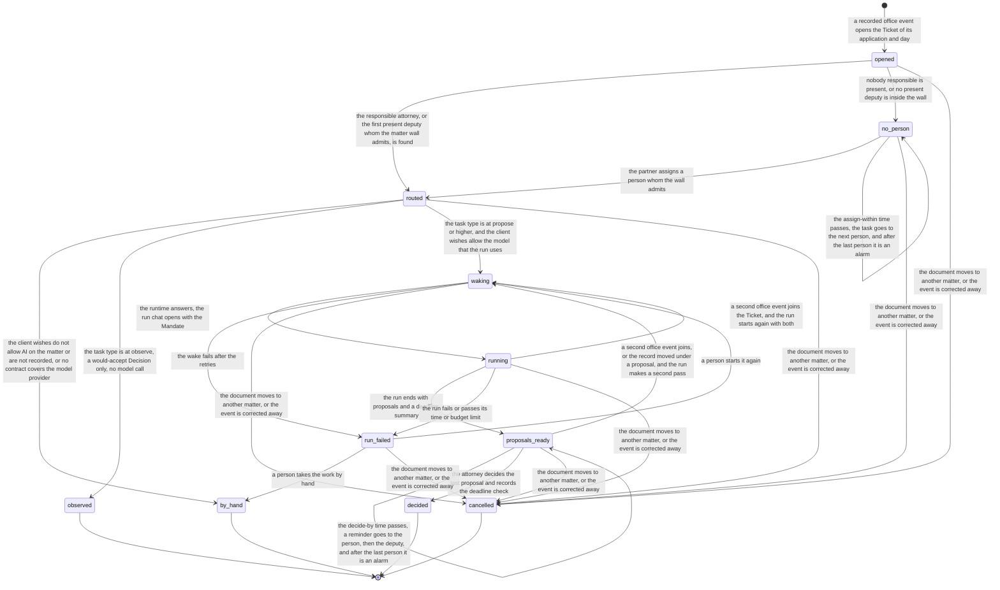

# Process 3: notify and run

**Starts when** an office event is recorded on a matter. **Ends when** every proposal of the run is decided, the task type is at observe, the Ticket is cancelled, or a person takes the work by hand. **Record object:** the Ticket. **Tickets:** [#221](https://github.com/flowleap-ai/flowleap-harness/issues/221), with #135 to #138. Method: [the atlas README](README.md#the-method-for-every-phase).

## 1. The process today

| # | Fact | Label and source |
|---|---|---|
| 3.1 | In the PATORG way the attorney gets the letter from the PAFA by forward or in the file, reads it, opens the file, gathers the last claims and the cited documents, and writes an instruction to the PAFA | INFERRED from the research section 2.4 (workflow "Incoming office action") and section 2.5 |
| 3.2 | The handover between staff and attorneys has no tool of its own; "who has this letter" lives in mails, a docket entry and people's heads | INFERRED in the research section 2.5, from the absence of assignment in the EPO Mailbox (SOURCED there) |
| 3.3 | PATORG workflows can include almost every manual action as a step | SOURCED: [PATORG productivity](https://www.patorg.com/de/features/productivity), cross-check P69 |
| 3.4 | PATORG names cover for short-term absence of staff as a feature | SOURCED: [PATORG flexibility](https://www.patorg.com/de/features/flexibility), cross-check P19. How it works is not documented in public [INFERRED] |
| 3.5 | Assistants must be carefully selected, duly instructed and periodically supervised; the attorney answers for their conduct | SOURCED: [Guidelines E-VIII 3.2](https://www.epo.org/en/legal/guidelines-epc/2025/e_viii_3_2.html); [epi Code](https://www.epo.org/en/legal/official-journal/2025/06/a42) Art. 3(e) |
| 3.6 | Every hour between the arrival and the first look is response time lost, because the period runs from the document date | INFERRED in the research section 2.7, from R.127(2) (SOURCED there) |
| 3.7 | The run message holds the Mandate and the event as data, so the Session log alone rebuilds what the model saw | SOURCED: ticket #136 and design section 6.3 |
| 3.8 | An agent reads as the person it acts for, so it sees what that person sees | SOURCED: design section 4.4 (a proposal there), ADR 0002 decision 7 |
| 3.9 | The research says the run uses the sender's runtime (concept 1). The design's sequence uses the responsible attorney's runtime (section 6.3) | SOURCED: [research](../2026-11-03-augmented-firm-research.md) concept 1; [design](../2026-11-03-ai-native-ipms-design.md) section 6.3. The sources disagree; this sheet picks the responsible attorney, see section 4 and question Q3.1 |

## 2. Actors and roles

| Actor | Role in this process |
|---|---|
| Responsible attorney | The person the run acts for; decides the proposals; gets the notice |
| Deputy | Acts for the responsible attorney during an absence; gets the run and the notice |
| Partner | Assigns a person when nobody responsible is present |
| PAFA | Gets the staff instruction as a proposal (a task card from R3, #231) |
| Trainee (Patentanwaltskandidat) | May be the responsible person on a draft; a supervising attorney decides (question Q3.4) |
| Work router (system) | Opens the Ticket, routes it, wakes the runtime |
| Runtime and agent | Run the method under the Mandate; propose; never decide, file, send or pay |
| Firm Record | Holds the Ticket, the routing and the proposals; refuses a second Ticket for the same matter and day |

## 3. State machine

<!-- atlas:ticket -->
It has **11 states and 24 transitions**, plus the start.

| From | To | Event | Actor | Evidence in the record log |
|---|---|---|---|---|
| start | `opened` | A recorded office event opens the Ticket of its application and day | Work router | Office event seq; key application, day and pass |
| `opened` | `routed` | The responsible attorney, or the first present deputy whom the matter wall admits, is found | Work router | Matter, wall check, the absence entry used |
| `opened` | `no_person` | Nobody responsible is present, or no present deputy is inside the wall | Work router | Matter, absence entries, wall check |
| `no_person` | `routed` | The partner assigns a person whom the wall admits | person | Assignment, wall check |
| `no_person` | `no_person` | The assign-within time passes; the task goes to the next person, and after the last person it is an alarm | Firm Record | Time, escalation step |
| `routed` | `by_hand` | The client wishes do not allow AI on the matter or are not recorded, or no contract covers the model provider | Work router | Client rule seq or its absence, the provider contract record |
| `routed` | `observed` | The task type is at observe; a would-accept Decision only, no model call | Work router | Policy version |
| `routed` | `waking` | The task type is at propose or higher, and the client wishes allow the model that the run uses | Work router | Policy version, client rule seq, model |
| `waking` | `running` | The runtime answers; the run chat opens with the Mandate | runtime | SessionRef |
| `waking` | `run_failed` | The wake fails after the retries | Work router | Error |
| `running` | `proposals_ready` | The run ends with proposals and a deadline summary | agent | SessionRef per proposal; deadline, state and trace read |
| `running` | `run_failed` | The run fails or passes its time or budget limit | runtime | Error, SessionRef |
| `running` | `waking` | A second office event joins the Ticket, and the run starts again with both | Work router | The joining event seq |
| `run_failed` | `waking` | A person starts it again | person | Reason |
| `run_failed` | `by_hand` | A person takes the work by hand | person | Reason |
| `proposals_ready` | `waking` | A second office event joins, or the record moved under a proposal, and the run makes a second pass | Work router | The joining event seq or the newer seq |
| `proposals_ready` | `proposals_ready` | The decide-by time passes; a reminder goes to the person, then the deputy, and after the last person it is an alarm | Firm Record | Time, escalation step |
| `proposals_ready` | `decided` | The attorney decides the last proposal and records the deadline check | person | Decisions; the deadline seen (date, state, trace, seq) |
| `opened`, `no_person`, `routed`, `waking`, `running`, `run_failed`, `proposals_ready` | `cancelled` | The document moves to another matter, or the event is corrected away | person | Correction event; open proposals become stale |

End states: `observed`, `by_hand`, `decided`, `cancelled`.


<!-- /atlas:ticket -->

A cancelled Ticket leaves its run chat in the Session log; the move opens a new Ticket on the right matter through [sheet 1](01-office-letter-intake.md).

**The notice.** Entering `routed` sends a short notice to the routed person, and entering `proposals_ready` sends the reply to the forwarder and the result to the routed person. Both are messages of [sheet 5](05-firm-internal-message.md). The run chat also gets the Needs review mark (#137).

**Error and timeout paths.**

- **Second letter on the same day:** the Ticket already exists for the matter and day (#136), so the event joins it; no second run chat opens [SOURCED: #221 acceptance criteria].
- **Nobody present:** `no_person`, with a task for the partner.
- **Wake or run failure:** `run_failed`, with a task for the routed person; a person starts again or works by hand. The attorney's own chat stays responsive (#138).
- **No decision:** the decide-by time sends a reminder to the routed person, then to the deputy. The decide-by time comes from the first internal date of the deadline [INFERRED].
- **Wrong matter:** the move cancels the Ticket before or during the run. A move after `proposals_ready` makes each open proposal `stale` (shared Proposal machine, [README](README.md#the-shared-states)).

## 4. Firm variation points

| Setting | Type | Default | Why firms differ |
|---|---|---|---|
| `ticket.runFor` | `'responsible-attorney' \| 'forwarder'` | `'responsible-attorney'` | The sources disagree (fact 3.9). The responsible attorney's wall and memory fit the matter; a PAFA forwarder may have no runtime [INFERRED] |
| `ticket.deputies` | map person to ordered list of persons | none; an absent person without a deputy gives `no_person`, a task for the partner | Each firm sets its cover rules (fact 3.4) |
| `ticket.absenceSource` | `'records-app' \| 'outlook-automatic-replies'` | `'records-app'` | Firms keep absences in different places; reading Outlook needs the Microsoft 365 plugin (R3) |
| `ticket.autonomy` | per task type: `'observe' \| 'propose' \| 'act-with-review' \| 'act-and-report'` | `'propose'` for the R1 task types (design section 6.3) | A firm moves a task type up with its acceptance rate in view (principle 5) |
| `ticket.decideBy` | offset from the first internal date, or a duration | 2 working days | Firm practice |
| `ticket.traineeSupervisor` | map trainee to attorney | none; required when a trainee is responsible | The PAO training rules put the trainee under a patent attorney (research section 2.1, [§ 7 PAO](https://www.gesetze-im-internet.de/patanwo/__7.html)) |
| `ticket.mandate` | fixed text per task type | "analyse and draft, never file, send or pay" (#136) | Not a firm setting in R1; listed so that nobody adds one |

## 5. AI-native redesign

**What disappears.** The forward "bitte prüfen", opening the file, gathering the last claims and the cited documents, and starting the analysis by hand. The event starts the work (principle 8), and the run reads the record and the documents through logged tools (principle 10).

**What becomes a proposal with evidence.** The analysis, the report letter ([sheet 4](04-report-to-the-client.md)), the staff instruction, and the time entry; each names its Session and tool call (design section 7.3).

**What stays with a person, and why.** Each decision on a proposal, because the agent never decides (ADR 0002 decision 3) and the attorney answers for the work (fact 3.5). The routing exception (`no_person`), because only the partner may give a matter to another attorney. Starting a failed run again, because a repeat costs model budget and may need a changed instruction.

**The count:**

| | Old way (PATORG) | New way (R1) |
|---|---|---|
| Manual steps, typical letter | 4 before the substantive work: open the forward, open the file, gather the documents, write the instruction to the PAFA | 1: open the result and decide each proposal there (each Decision is one act; the analysis is reviewed, not written) |
| Extra steps, exception | 1: find who covers an absent colleague | 1: the partner assigns a person; or 1: start a failed run again |
| Person-to-person hand-offs | 2: PAFA to attorney, attorney to PAFA (instruction) | 1: the attorney's decision on the staff instruction reaches the PAFA |

The old count is INFERRED (fact 3.1).

## 6. Map to the code

**What exists:** in the harness, the webhook runtime that turns a verified event into a Session (`packages/experimental/webhook`, cited in the design section 7.3), Needs review, and the routines; in flowleap-os, no Ticket and no wake API. The R0 Firm Record has no Ticket table.

**What is new:** the Ticket record object, the routing with deputies, the wake API (#221), and the Decision of #135 with its Policy version.

```ts
type TicketId = Branded<'TicketId'>; type PolicyVersion = Branded<'PolicyVersion'>
type Routed = { person: PersonId; as: 'responsible' | 'deputy' | 'assigned'; absence: RecordSeq | null }
type Ticket =
  | { s: 'opened'; id: TicketId; matter: MatterId; day: LocalDate; events: [RecordSeq, ...RecordSeq[]] }
  | { s: 'no_person'; id: TicketId; absences: RecordSeq[] }
  | { s: 'routed'; id: TicketId; to: Routed; policy: PolicyVersion }
  | { s: 'observed'; id: TicketId; wouldAccept: RecordSeq }
  | { s: 'waking'; id: TicketId; to: Routed; attempt: number }
  | { s: 'running'; id: TicketId; to: Routed; session: SessionRef }
  | { s: 'run_failed'; id: TicketId; to: Routed; error: 'wake-failed' | 'run-error' | 'time-limit' | 'budget-limit'; session: SessionRef | null }
  | { s: 'proposals_ready'; id: TicketId; to: Routed; proposals: [ProposalId, ...ProposalId[]]; reminders: number }
  | { s: 'decided'; id: TicketId; decisions: RecordSeq[] }
  | { s: 'cancelled'; id: TicketId; move: RecordSeq }
  | { s: 'failed'; id: TicketId; by: PersonId; reason: string }
// proposals is non-empty: a run that ends with no proposal is a run_failed with 'run-error', not proposals_ready.
```

New record events: `ticket/opened`, `ticket/event-joined`, `ticket/routed`, `ticket/no-person`, `ticket/assigned`, `ticket/observed`, `ticket/wake-started`, `ticket/run-started`, `ticket/run-failed`, `ticket/proposals-ready`, `ticket/reminded`, `ticket/decided`, `ticket/cancelled`, `ticket/taken-by-hand`. Invariants: `ticket.one-per-matter-and-day`, `ticket.run-reads-as-routed-person`, `ticket.mandate-first-in-run-message`.

## 7. Open questions for the pilot attorney

- **Q3.1** When a PAFA forwards a letter, whose agent should work on it: the responsible attorney's or the PAFA's? (fact 3.9)
- **Q3.2** How do you record absences and deputies today: in PATORG, in Outlook, or by habit?
- **Q3.3** By when must the attorney look at the worked letter, and who is reminded next?
- **Q3.4** When a trainee is responsible for a matter, who decides the trainee's proposals?
- **Q3.5** Which letters do you want worked by the agent in R1, and which only filed?
