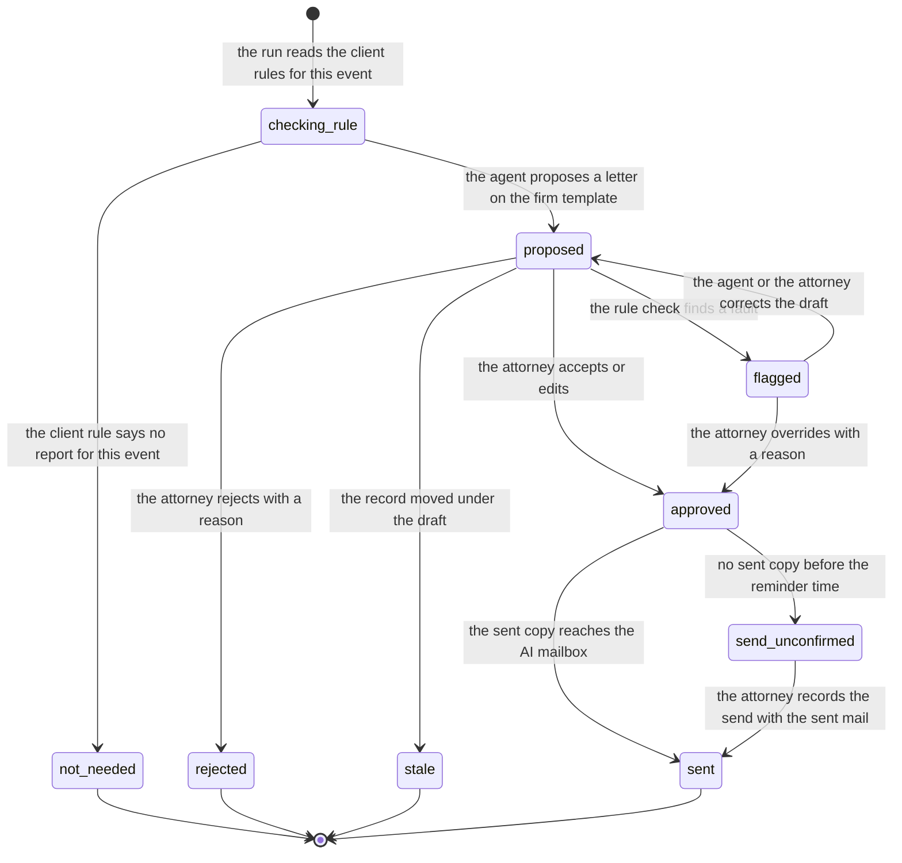

# Process 4: report to the client

**Starts when** the run reads the client rules for the office event. **Ends when** the report is sent, is not needed, is rejected, or is stale. **Record object:** the report proposal. **Tickets:** [#223](https://github.com/flowleap-ai/flowleap-harness/issues/223), with #217 (letter tool) and #233 (client rules and Outlook drafts, R3). Method: [the atlas README](README.md#the-method-for-every-phase).

## 1. The process today

| # | Fact | Label and source |
|---|---|---|
| 4.1 | A European patent attorney must "keep Clients informed of the status of their cases" | SOURCED: [epi Code of Conduct](https://www.epo.org/en/legal/official-journal/2025/06/a42), Art. 4(a) |
| 4.2 | When a representative is appointed, the EPO notifies the representative, not the applicant | SOURCED: [R.130(1) EPC](https://www.epo.org/en/legal/epc/2020/r130.html). So the client learns of an office letter only through the firm [INFERRED] |
| 4.3 | Routine reports (receipt, search report, publication, grant, fees due) are templates that staff fill and an attorney signs; the office action report is attorney time | INFERRED in the research section 2.4 (workflow "Client reporting and invoicing") |
| 4.4 | PATORG lets the firm set for each client which kind of communication goes to which person | SOURCED: [PATORG for law firms](https://www.patorg.com/de/for-who/for-law-firms), cross-check P11 |
| 4.5 | PATORG makes documents and mails from Word, Excel and Outlook templates in all languages | SOURCED: [PATORG impress-service](https://www.patorg.com/de/features/impress-service), cross-check P29 |
| 4.6 | PATORG reminds the people who must act, in time and per person | SOURCED: the same page, cross-check P40 |
| 4.7 | Patent attorneys must keep client matters confidential, and staff are bound in writing | SOURCED (secondary): research section 2.3, from [§ 39a PAO](https://www.gesetze-im-internet.de/patanwo/__39a.html) |
| 4.8 | The epi guidelines on generative AI (16 November 2024) keep the member responsible for all output and ask for client permission for AI on client work | SOURCED (secondary): research section 2.3, from a summary of the epi guidelines |
| 4.9 | Nothing leaves the firm without a person: client letters are drafts until a named person sends them | SOURCED: [ADR 0002](../adr/0002-system-of-record.md) decision 6 |
| 4.10 | The client often answers near the end of a four-month period, and the firm chases instructions | INFERRED in the research section 2.4 |
| 4.11 | The PATORG way, step by step: the attorney writes or dictates the report; staff format it on the firm template; the attorney corrects and signs; staff send it and file the copy; staff note the date by which instructions are due | INFERRED from facts 4.3, 4.5, 4.6 |

## 2. Actors and roles

| Actor | Role in this process |
|---|---|
| Agent | Reads the client rules, drafts the report on the firm template with a span for each statement about the letter |
| Firm Record | Checks the draft against the client rules before a person can accept it (design section 9.1) |
| Responsible attorney | Accepts, edits or rejects; sends from Outlook; may override a rule flag with a reason |
| Supervising attorney | Decides when a trainee is responsible |
| Secretary or PAFA | In the old way formats and sends; in the new way no step in R1 |
| Client (in-house IP team) | Reads the report and gives instructions; the instruction comes back through [sheet 1](01-office-letter-intake.md) |
| Intake (system) | Sees the sent copy when the attorney puts the AI mailbox in Bcc, and records the send |

## 3. State machine

It has **9 states and 11 transitions**, plus the start.

| From | To | Event | Actor | Evidence in the record log |
|---|---|---|---|---|
| start | `checking_rule` | The run reads the client rules for this event | agent | `record_read` seq of the client rules |
| `checking_rule` | `not_needed` | The client rule says no report for this event | agent | Rule text and its seq |
| `checking_rule` | `proposed` | The agent proposes a letter on the firm template | agent | Spans per statement, template version, SessionRef |
| `proposed` | `flagged` | The rule check finds a fault (recipient, language, instruction date, AI-use rule) | Firm Record | The rule and the field |
| `flagged` | `proposed` | The agent or the attorney corrects the draft | agent or person | Diff |
| `proposed` | `approved` | The attorney accepts or edits | person | Final document hash, diff |
| `flagged` | `approved` | The attorney overrides with a reason | person | Reason |
| `proposed` | `rejected` | The attorney rejects with a reason | person | Reason (feeds firm memory, principle 7) |
| `proposed` | `stale` | The record moved under the draft (a deadline changed, the document moved) | Firm Record | The newer seq |
| `approved` | `sent` | The sent copy reaches the AI mailbox | intake | Sent mail, hash match with the approved document |
| `approved` | `send_unconfirmed` | No sent copy before the reminder time | Firm Record | Time |
| `send_unconfirmed` | `sent` | The attorney records the send with the sent mail | person | Sent mail |

End states: `not_needed`, `rejected`, `stale`, `sent`. A `stale` draft does not come back: the run proposes a new one on the newer record.



**How FlowLeap knows that the report was sent.** In R1 the attorney sends from Outlook (ADR 0001 decision 21), so FlowLeap does not see the send. The AI mailbox may read only its own mailbox (fact 1.12 of [sheet 1](01-office-letter-intake.md)), not the attorney's Sent Items. Two ways remain: the attorney puts the AI mailbox in Bcc, and the intake matches the attachment hash to the approved document; or the attorney records the send in the Records app. This sheet uses the Bcc as the typical path and the manual record as the exception [INFERRED; question Q4.3].

**Error and timeout paths.**

- **Rule fault:** `flagged`; acceptance is blocked until the draft is corrected or the attorney overrides with a reason (design section 9.1).
- **Record moved:** `stale`, for example when the deadline that the report names becomes `disputed` ([sheet 2](02-office-event-to-deadline.md)).
- **Approved but not sent:** `send_unconfirmed` after the reminder time, with a reminder to the attorney.
- **Client does not instruct:** outside R1. The instruction date in the report is a record fact, and the reminder before it comes with the instruction tracking of R3 (#233) [INFERRED].
- **Sent copy differs from the approved document:** the hash does not match, so the intake files the sent copy as a document and the attorney records the send by hand; the record keeps both hashes [INFERRED].

## 4. Firm variation points

The client rules of design section 9.1 are the main variation. In R1 they are plain-language texts in the record that the run reads through `record_read` (principle 6); the typed check of #233 comes in R3.

| Setting | Type | Default | Why firms differ |
|---|---|---|---|
| `client.reportEvents` | per client: list of event codes, or `'all-office-actions'` | `'all-office-actions'`, no report for a publication (design section 9.1 example) | Clients want different reports |
| `client.language` and `client.address` | per client: language code, formal or informal | the firm language, formal | Group IP departments often want English (design section 9.1) |
| `client.recipients` | per client: list of contacts and roles | the client's IP contact | "Never to the inventor directly" and similar rules |
| `client.instructionLead` | per client: duration before the due date | 4 weeks (design section 9.1 example) | Client practice |
| `client.aiUse` | per client: `'allowed' \| 'local-model-only' \| 'not-allowed'` | `'not-allowed'` until the firm records its consent policy | Fact 4.8; design section 4.4 |
| `report.approver` | `'responsible-attorney' \| 'partner'` | `'responsible-attorney'`; the supervising attorney for a trainee | Some firms have a partner sign every client letter |
| `report.template` | per firm and language: template document | none; the firm must load it | House style (#217) |
| `report.sendProof` | `'bcc-ai-mailbox' \| 'records-app'` | `'bcc-ai-mailbox'` | Firm habit (question Q4.3) |
| `report.sendReminder` | duration after approval | 1 working day | Firm practice |

When `client.aiUse` is `'not-allowed'`, the run does not draft the report and the state is `not_needed` with that rule as evidence. The attorney writes the report as today [INFERRED from fact 4.8].

## 5. AI-native redesign

**What disappears.** Writing the first draft, formatting it on the template, checking the recipients and the language by hand, filing the sent copy, and noting the instruction date (principles 1 and 8).

**What becomes a proposal with evidence.** The whole letter, with a span for each statement about the office letter (#223), the recipients from the client rule, and the instruction date from the deadline and the client rule.

**What stays with a person, and why.** The approval and the send, because nothing leaves the firm without a person (fact 4.9) and the attorney stays responsible for AI output (fact 4.8). The override of a rule flag, because a rule can be wrong for one case, and the reason teaches (principle 7).

**The count:**

| | Old way (PATORG) | New way (R1) |
|---|---|---|
| Manual steps, typical report | 6: write or dictate, format on the template, correct and sign, send, file the copy, note the instruction date | 2: review and approve (edit if needed), send from Outlook with the AI mailbox in Bcc |
| Extra steps, exception | 1: rewrite after a client rule is found broken | 1: correct or override a flag with a reason; or 1: record the send by hand |
| Person-to-person hand-offs | 3: attorney to secretary, secretary to attorney, secretary to client | 1: attorney to client |

The old count is INFERRED (fact 4.11). The attorney's minutes on the report, before and after, are a pilot measure (research section 7.1).

## 6. Map to the code

**What exists:** in R0, nothing for reports. In the harness, the deliverables with the evidence ledger, and the FlowLeap Office plugin work of #217 (`office_letter_from_template`, named in #223).

**What is new:** the report proposal kind, the rule check, the send proof by Bcc, and the record events below. The report is a Proposal of the shared machine ([README](README.md#the-shared-states)); this sheet adds `flagged`, `approved` (the shared `accepted` and `edited` joined, because both lead to the send), `send_unconfirmed` and `sent`.

```ts
type ReportStatement = { text: string; evidence: [Evidence, ...Evidence[]] }   // each statement about the letter has a source
type RuleFlag = { rule: RecordSeq; field: 'recipients' | 'language' | 'instruction-date' | 'ai-use'; detail: string }
type Report =
  | { s: 'checking_rule'; ticket: TicketId; rules: RecordSeq }
  | { s: 'not_needed'; ticket: TicketId; rule: RecordSeq }
  | { s: 'proposed'; proposal: ProposalId; document: DocumentSha256; statements: ReportStatement[]; recipients: ContactId[]; instructBy: LocalDate; basedOn: RecordSeq }
  | { s: 'flagged'; proposal: ProposalId; flags: [RuleFlag, ...RuleFlag[]] }
  | { s: 'approved'; proposal: ProposalId; final: DocumentSha256; by: PersonId; override: { flags: RuleFlag[]; reason: string } | null }
  | { s: 'send_unconfirmed'; proposal: ProposalId; final: DocumentSha256; since: Instant }
  | { s: 'sent'; proposal: ProposalId; final: DocumentSha256; proof: { kind: 'bcc'; mail: GraphMessageId; hash: DocumentSha256 } | { kind: 'recorded'; by: PersonId; mail: DocumentSha256 } }
  | { s: 'rejected'; proposal: ProposalId; by: PersonId; reason: string }
  | { s: 'stale'; proposal: ProposalId; newer: RecordSeq }
// An approve command accepts { s: 'flagged' } only with a non-empty override reason; the type of the command requires it.
```

New record events: `report/not-needed`, `report/proposed`, `report/flagged`, `report/approved`, `report/rejected`, `report/stale`, `report/send-reminded`, `report/sent`. Invariants: `report.no-send-without-person` (FlowLeap never sends to a client), `report.flag-blocks-accept`, `report.statement-has-evidence`.

## 7. Open questions for the pilot attorney

- **Q4.1** For which office events do you report to clients, and does it differ per client?
- **Q4.2** Who signs a client report: the responsible attorney, or a partner for some clients?
- **Q4.3** Would you put the AI mailbox in Bcc when you send a report, so that FlowLeap files the sent copy and stops the reminder?
- **Q4.4** How long before the due date do you ask clients for instructions, and do you remind them?
- **Q4.5** Which clients have agreed to AI on their matters today, and in which form?
