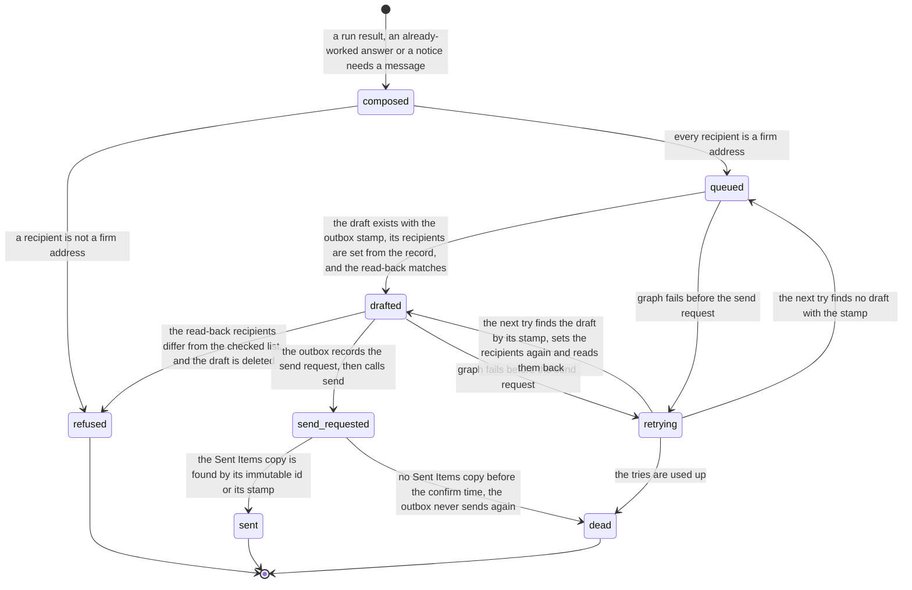

# Process 5: firm-internal message (reply in the thread and notice)

**Starts when** a run result, a duplicate forward, or a routing notice needs a message. **Ends when** the message is sent, refused, or its tries are used up. **Record object:** the outbound message. **Ticket:** [#222](https://github.com/flowleap-ai/flowleap-harness/issues/222). Method: [the atlas README](README.md#the-method-for-every-phase).

This sheet covers three kinds of message with one machine: the **reply** in the thread to the person who forwarded the letter, the **notice** to the routed attorney when that person is not the forwarder, and the **already-worked** answer to the forwarder of a duplicate. The [README](README.md#the-r1-processes) says why they are one machine.

## 1. The process today

| # | Fact | Label and source |
|---|---|---|
| 5.1 | The AI mailbox may reply only to firm addresses from a code allow-list. This amends ADR 0001 decision 21 | SOURCED: [ADR 0002](../adr/0002-system-of-record.md), decision F7 |
| 5.2 | The reply goes through an outbox with a fixed id, so a retry does not send twice, and it is sent from the AI mailbox, never in a person's name | SOURCED: ticket #222 acceptance criteria |
| 5.3 | Graph `reply` answers `202 Accepted` with no body, so the caller gets no id of the sent message. The reply goes to the addresses in the original's Reply-To header when it has one, not to its sender. The method saves the message in Sent Items. A caller can instead create a reply draft and send it later | SOURCED: [Graph message reply](https://learn.microsoft.com/en-us/graph/api/message-reply) |
| 5.4 | Application Mail.Send lets an app send mail as any user; RBAC for Applications limits it to a set of mailboxes, but only when the unscoped Entra grant is removed | SOURCED: [RBAC for Applications in Exchange Online](https://learn.microsoft.com/en-us/exchange/permissions-exo/application-rbac) |
| 5.5 | In the old way the colleague's answer to "bitte prüfen" is a mail from the attorney to the PAFA with the instruction | INFERRED from the research concept 1 ("Before") and section 2.4 |
| 5.6 | The mail and the letter are already in the firm's Exchange, so a reply to firm addresses moves no client data out of the firm | INFERRED in the research concept 1 |

**What follows from fact 5.3.** A reply that copies the thread's recipients, or that uses the Reply-To of the original, can reach an address that the allow-list must refuse: a forwarded client mail can carry the client's Reply-To. So the recipients come only from firm identities in the record (the forwarder, the routed person), never from the headers of the thread, and the allow-list check runs on the final list before the send [INFERRED]. Fact 5.3 also means a plain `reply` cannot be made idempotent by its result, so the outbox creates a reply draft first, keeps its id, and sends the draft [INFERRED].

## 2. Actors and roles

| Actor | Role in this process |
|---|---|
| Work router (system) | Composes the message from the Ticket: the summary, the drafts, the Records link |
| Outbox (system) | Checks the recipients, creates the draft, sends, retries; the only writer of outbound mail |
| Forwarder (PAFA or attorney) | Receives the reply in the thread |
| Routed attorney | Receives the notice and the result |
| Administrator | Receives the task when the tries are used up, or when a message is refused |

## 3. State machine

<!-- atlas:outbox -->
It has **8 states and 12 transitions**, plus the start.

| From | To | Event | Actor | Evidence in the record log |
|---|---|---|---|---|
| start | `composed` | A run result, an already-worked answer or a notice needs a message | Work router | Ticket, kind, recipients from the record |
| `composed` | `refused` | A recipient is not a firm address | outbox | The address, the allow-list version; a task for the administrator |
| `composed` | `queued` | Every recipient is a firm address | outbox | Allow-list version, outbox id |
| `queued` | `drafted` | The draft exists with the outbox stamp, its recipients are set from the record, and the read-back matches | outbox | Immutable draft id, stamp, read-back recipients |
| `drafted` | `refused` | The read-back recipients differ from the checked list, and the draft is deleted | outbox | Both lists; a task for the administrator |
| `drafted` | `send_requested` | The outbox records the send request, then calls send | outbox | Time of the request |
| `send_requested` | `sent` | The Sent Items copy is found by its immutable id or its stamp | outbox | Immutable message id, internet message id |
| `send_requested` | `dead` | No Sent Items copy before the confirm time; the outbox never sends again | outbox | Time; a task for the administrator |
| `queued`, `drafted` | `retrying` | Graph fails before the send request | outbox | Error |
| `retrying` | `queued` | The next try finds no draft with the stamp | outbox | Attempt |
| `retrying` | `drafted` | The next try finds the draft by its stamp, sets the recipients again and reads them back | outbox | Immutable draft id, read-back recipients |
| `retrying` | `dead` | The tries are used up | outbox | Errors; a task for the administrator |

End states: `refused`, `sent`, `dead`.


<!-- /atlas:outbox -->

A `refused` message is never sent in part: the outbox does not drop the bad address and send to the rest, because a refused address is a fault in the composer that a person must see [INFERRED].

**Error and timeout paths.**

- **External address:** `refused`, and the invariant `intake.reply-firm-addresses-only` (#222) has a test.
- **Crash between draft and send:** the next try finds the draft by its id and sends it, or finds the sent item and stops, so the message goes out once (design section 1.3, idempotent operations).
- **Graph down:** `retrying` with back-off, then `dead` with a task. The result stays in the Records app, so nothing is lost when the mail does not go [INFERRED].
- **A newer result for the same Ticket before the send:** the outbox sends one message per Ticket stage; a second run result on the same Ticket composes a new message that names the earlier one [INFERRED].

## 4. Firm variation points

| Setting | Type | Default | Why firms differ |
|---|---|---|---|
| `reply.allowedDomains` | list of domains, validated against the tenant's verified domains at load | the tenant's verified domains | Firms with several domains or a group domain |
| `reply.recipients` | `'forwarder' \| 'forwarder-and-routed'` | `'forwarder-and-routed'` | Some firms want the attorney in every reply; some want a separate notice |
| `reply.attachDrafts` | `'attach-and-link' \| 'link-only'` | `'attach-and-link'` (#222, design section 6.3) | A firm may not want copies of drafts in mailboxes [INFERRED] |
| `reply.language` | language code | the firm language | Firm practice |
| `outbox.retries` | count and back-off | 5 tries over 1 hour | Operations |
| `outbox.sender` | fixed: the AI mailbox | the AI mailbox | Not a setting; #222 forbids sending in a person's name |

## 5. AI-native redesign

**What disappears.** The attorney's mail back to the PAFA with "please docket and prepare", and the PAFA's search for the result. The result arrives in the thread where the work started (#222, AI-native test b).

**What becomes a proposal with evidence.** Nothing in this sheet: the message carries proposals of other sheets and links to them. It decides nothing and changes no record fact except its own state.

**What stays with a person, and why.** Any message to an address outside the firm, because nothing leaves the firm without a person (ADR 0002 decision 6); this sheet refuses such a message instead of asking a person to approve it, because F7 allows firm addresses only.

**The count:**

| | Old way | New way (R1) |
|---|---|---|
| Manual steps, typical letter | 1: the attorney writes back to the forwarder | 0 |
| Extra steps, exception | 1: ask "did you see my mail?" | 1: the administrator handles a `dead` or `refused` message |
| Person-to-person hand-offs | 1: attorney to PAFA | 0 |

The old count is INFERRED (fact 5.5).

## 6. Map to the code

**What exists:** nothing in R0. The harness has no mail sender; ADR 0001 decision 21 forbade one until F7.

**What is new:** the outbox table in the Firm Record or the intake service, the allow-list in code, and the Graph draft-and-send client.

```ts
type FirmAddress = Branded<'FirmAddress'>        // made only by the allow-list parser; a plain string does not type-check
type OutboxId = Branded<'OutboxId'>; type GraphDraftId = Branded<'GraphDraftId'>
type MessageKind = { kind: 'reply'; inReplyTo: GraphMessageId } | { kind: 'notice' } | { kind: 'already-worked'; first: TicketId }
type Outbound =
  | { s: 'composed'; id: OutboxId; ticket: TicketId; message: MessageKind; to: string[] }
  | { s: 'refused'; id: OutboxId; address: string; allowList: AllowListVersion }
  | { s: 'queued'; id: OutboxId; to: [FirmAddress, ...FirmAddress[]]; allowList: AllowListVersion }
  | { s: 'drafted'; id: OutboxId; draft: GraphDraftId }
  | { s: 'retrying'; id: OutboxId; attempt: number; draft: GraphDraftId | null; lastError: string }
  | { s: 'sent'; id: OutboxId; message: GraphMessageId }
  | { s: 'dead'; id: OutboxId; errors: string[] }
// The Graph send function takes only { s: 'drafted' }, whose recipients were FirmAddress values; an external address cannot reach it.
```

New record events: `outbox/composed`, `outbox/refused`, `outbox/queued`, `outbox/drafted`, `outbox/retrying`, `outbox/sent`, `outbox/dead`. Invariants: `intake.reply-firm-addresses-only` (#222), `outbox.send-once`, `outbox.recipients-from-record-only`.

## 7. Open questions for the pilot attorney

- **Q5.1** Should the reply go to the forwarder only, or also to the responsible attorney?
- **Q5.2** Do you want the drafts attached to the reply, or only a link to the Records app?
- **Q5.3** Does your firm use more than one mail domain, for example for an office abroad?
