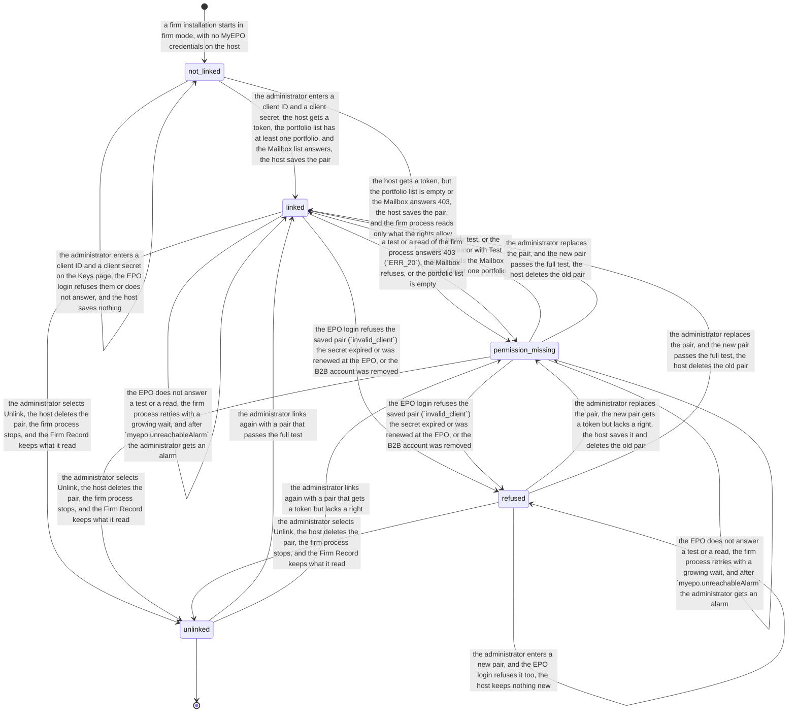

# Process 6: the firm's MyEPO link

**Status:** draft for the founder's approval, 2026-11-10. It encodes founder decision 4 of 2026-11-10 (the firm link) and the safety rules of [the MyEPO API study](../2026-11-09-myepo-api-study.md#safety-rules), which the founder approved on 2026-11-09. Method: [the atlas README](README.md#the-method-for-every-phase).

**Starts when** a firm installation runs in firm mode with no MyEPO credentials. **Ends when** the administrator unlinks MyEPO. Between these, the link is linked, has a missing permission, or is refused by the EPO. **Record object:** the firm's MyEPO link, one for each firm installation. **Tickets:** none yet; the [tickets](#9-tickets) section lists the proposed ones.

**What this sheet does not repeat.** What the firm process reads with the link: the docket ([sheet 7](07-import-ep-docket.md)) and the letters and due dates ([sheet 1](01-office-letter-intake.md#8-the-myepo-route), [sheet 2](02-office-event-to-deadline.md#8-the-myepo-route), [sheet 8](08-deadline-confirmation.md)).

## Contents

- [1. The process today](#1-the-process-today)
- [2. Actors and roles](#2-actors-and-roles)
- [3. State machine](#3-state-machine)
- [4. Firm variation points](#4-firm-variation-points)
- [5. AI-native redesign](#5-ai-native-redesign)
- [6. Map to the code](#6-map-to-the-code)
- [7. Security invariants](#7-security-invariants)
- [8. Failure cases](#8-failure-cases)
- [9. Tickets](#9-tickets)
- [10. Open questions for the pilot attorney](#10-open-questions-for-the-pilot-attorney)
- [11. Decisions for the founder](#11-decisions-for-the-founder)

## 1. The process today

| # | Fact | Label and source |
|---|---|---|
| 6.1 | The MyEPO API needs a B2B account. The company must already use MyEPO with at least one company administrator. The EPO creates the B2B account and sends an OAuth 2.0 client ID and client secret to the company administrator | SOURCED: [MyEPO feature guide, APIs](https://link.epo.org/web/understand-our-services/exchange-data-with-us-using-an-api/en-myepo-feature-guide-apis-for-exchanging-information-with-ip-management-systems.pdf) (March 2025) |
| 6.2 | The administrator must give the B2B account the Mailbox access right and permission on the portfolios. Without a portfolio permission the API cannot read or update the applications of that portfolio | SOURCED: the same guide |
| 6.3 | The guide says that the credentials give access to confidential company data, and that they must not go to people who must not see it | SOURCED: the same guide |
| 6.4 | The software gets a bearer token with `grant_type=client_credentials` and the scope `mailboxapi`. The spec shows no read-only scope, so the same token can mark letters handled, move them and set a file reference | SOURCED: the OpenAPI spec of the production API, read on 2026-11-09 ([study](../2026-11-09-myepo-api-study.md#how-a-firm-gets-access)). "No read-only scope" is INFERRED from its absence in the spec |
| 6.5 | An application read without a portfolio permission answers `403 ERR_20`. A new sandbox account answers `400 ERR_15` until a reset. The sandbox token lives 3,600 s, the sample production token 18,000 s | SOURCED: the spec and the sandbox probe of 2026-11-09 ([study](../2026-11-09-myepo-api-study.md#sandbox-results)) |
| 6.6 | A download of a letter through the API marks it as read in the firm's MyEPO | MEASURED: the sandbox probe of 2026-11-09 ([study](../2026-11-09-myepo-api-study.md#sandbox-results)). The EPO pages name only "handled" and "unhandled" for the API; the web Mailbox has an "Unread" folder. SOURCED: [MyEPO feature guide, handling Mailbox communications](https://link.epo.org/web/myepo-services/interact/en-myepo-feature-guide-handling-mailbox-communications.pdf) |
| 6.7 | An electronic document reaches its destination on the date it is made available in the Mailbox, and it is deemed delivered on the date it bears; earlier access does not change that date. So the read flag and a download have no legal effect | SOURCED for the delivery rule; the conclusion on the read flag is INFERRED, because the sources do not name reading or downloading: [OJ EPO 2026, A20](https://www.epo.org/en/legal/official-journal/2026/03/a20), Art. 2(2); [OJ EPO 2023, A29](https://www.epo.org/en/legal/official-journal/2023/03/a29); [Guidelines E-II, 2.3](https://www.epo.org/en/legal/guidelines-epc/2026/e_ii_2_3.html) |
| 6.8 | No EPO page gives rate limits, quotas or terms of use for a vendor that builds on the API. The sandbox sent no rate-limit headers | SOURCED (absence): [the API page](https://www.epo.org/en/applying/myepo-services/understand/api) and its [release notes](https://www.epo.org/en/applying/myepo-services/understand/api/release-notes), read on 2026-11-10; MEASURED for the headers in the sandbox |
| 6.9 | The Firm admin console has a Keys page. It shows each provider key only as not set, set, valid or failing; it tests a new key before it saves it; and the host tests each key every hour | SOURCED: flowleap-os `docs/admin/console.md` and the invariants `console.key-not-in-answer`, `console.key-refused-not-saved`, `console.key-not-logged` of `docs/security-invariants.md` (commit 035c2e8) |
| 6.10 | Today an attorney runtime can read the office keys: they are mounted read-only into each runtime until the vault (#31) and the egress proxy (#33) exist. So `keys.none-in-runtime` is `partial` | SOURCED: flowleap-os `docs/index.md` and the row `keys.none-in-runtime` (commit 035c2e8) |
| 6.11 | The merged MyEPO connector stores the pair as a credential record of the runtime (`flowleap-connectors/myepo`), and the card on Settings → Connectors tests it | SOURCED: PR 366, `packages/host/flowleap-connectors/src/myepo*.ts` ([study](../2026-11-09-myepo-api-study.md#the-myepo-plugin)) |

**What the sources leave open.** The EPO does not say how often a client secret expires, whether a company can hold two B2B accounts, or how the EPO tells the firm that it renewed a secret. The firm process must treat each of these as a refusal that it can see (state `refused`).

**The process today in a firm.** Most firms that use MyEPO today have no B2B account. A PAFA signs in to MyEPO in the browser and works the Mailbox by hand ([sheet 1, fact 1.13](01-office-letter-intake.md#1-the-process-today)) [INFERRED]. A firm docket such as PATORG imports EPO documents itself, so it holds its own MyEPO link [SOURCED: [PATORG productivity](https://www.patorg.com/de/features/productivity)]. Whether PATORG uses the B2B API or another route is not public [INFERRED].

## 2. Actors and roles

| Actor | Role in this process |
|---|---|
| Firm administrator | The only person who links, tests, replaces or unlinks the pair, on the Keys page of the Firm admin console (`console.admin-only`). Also the firm's MyEPO company administrator, or works with that person |
| MyEPO company administrator | Asks the EPO for the B2B account, gets the pair, and gives the B2B account its rights in MyEPO (fact 6.2). Often the same person as the firm administrator [INFERRED] |
| Host (link test) | Tests a new pair before it saves it, and tests the saved pair every hour. Runs on the host, outside every attorney runtime |
| Firm process (`myepo`) | One process for the firm, a sibling of `lib/mailbox`. It reads the portfolios, the applications, the Mailbox list, the letters and the due dates with the pair, read-only, and writes into the Firm Record with its own token. It does nothing while the link is not `linked` or `permission_missing` |
| Firm Record | Records what the firm process reads, behind the walls. Holds no secret |
| Attorney runtime | Reads only the Firm Record, inside the person's walls. Never calls MyEPO, and has no MyEPO secret |
| Attorney, PAFA | See the link state on the MyEPO card of the app ("Linked by your firm") and in the letters. Cannot link or unlink |
| Installer | Starts a firm installation in firm mode with no link |

## 3. State machine

<!-- atlas:myepoLink -->
It has **5 states and 19 transitions**, plus the start.

| From | To | Event | Actor | Evidence in the record log |
|---|---|---|---|---|
| start | `not_linked` | A firm installation starts in firm mode, with no MyEPO credentials on the host | installer | The firm mode of the installation, no MyEPO entry in the host key file |
| `not_linked` | `not_linked` | The administrator enters a client ID and a client secret on the Keys page; the EPO login refuses them or does not answer, and the host saves nothing | person (administrator) | Change log: who, when, the test result (`invalid_client`, a timeout); never a secret |
| `not_linked` | `linked` | The administrator enters a client ID and a client secret; the host gets a token, the portfolio list has at least one portfolio, and the Mailbox list answers; the host saves the pair | person (administrator) | Change log; test result: the portfolios that the account may read, the Mailbox answer |
| `not_linked` | `permission_missing` | The host gets a token, but the portfolio list is empty or the Mailbox answers 403; the host saves the pair, and the firm process reads only what the rights allow | person (administrator) | Change log; the missing right (Mailbox, portfolios) |
| `permission_missing` | `linked` | The hourly test, or the administrator with Test again, finds the Mailbox and at least one portfolio | host (link test) or person (administrator) | Test result |
| `linked` | `permission_missing` | A test or a read of the firm process answers 403 (`ERR_20`), the Mailbox refuses, or the portfolio list is empty | host (link test) or firm process | The failing operation, its status and its error code |
| `linked`, `permission_missing` | `refused` | The EPO login refuses the saved pair (`invalid_client`): the secret expired or was renewed at the EPO, or the B2B account was removed | host (link test) or firm process | Token answer status and error code, time |
| `refused` | `refused` | The administrator enters a new pair, and the EPO login refuses it too; the host keeps nothing new | person (administrator) | Change log; test result |
| `refused` | `permission_missing` | The administrator replaces the pair; the new pair gets a token but lacks a right; the host saves it and deletes the old pair | person (administrator) | Change log; the missing right |
| `permission_missing` | `permission_missing` | The EPO does not answer a test or a read; the firm process retries with a growing wait, and after `myepo.unreachableAlarm` the administrator gets an alarm | host (link test) or firm process | Each failed call with its time; the alarm |
| `refused`, `permission_missing` | `linked` | The administrator replaces the pair, and the new pair passes the full test; the host deletes the old pair | person (administrator) | Change log (old and new client ID, never a secret); test result |
| `linked` | `linked` | The administrator replaces the pair: a new pair that passes the full test replaces the old one, and a new pair that fails changes nothing | person (administrator) | Change log; test result |
| `linked` | `linked` | The EPO does not answer a test or a read; the firm process retries with a growing wait, and after `myepo.unreachableAlarm` the administrator gets an alarm | host (link test) or firm process | Each failed call with its time; the alarm |
| `linked`, `permission_missing`, `refused` | `unlinked` | The administrator selects Unlink; the host deletes the pair, the firm process stops, and the Firm Record keeps what it read | person (administrator) | Change log; the stop of the firm process |
| `unlinked` | `linked` | The administrator links again with a pair that passes the full test | person (administrator) | Change log; test result |
| `unlinked` | `permission_missing` | The administrator links again with a pair that gets a token but lacks a right | person (administrator) | Change log; the missing right |

End states: `unlinked`. Declared corrections out of an end state: `unlinked` to `linked`; `unlinked` to `permission_missing`.


<!-- /atlas:myepoLink -->

**The test.** A full test has three reads, each with the candidate pair, from the host: a token, `GET /portfolios`, and `GET /communications/unhandled`. The link is `linked` only when all three answer and at least one portfolio is listed. A token with an empty portfolio list or a Mailbox refusal is `permission_missing`, because the EPO says that the administrator must give these rights (fact 6.2). The page names the missing right and links the EPO guide.

**What the firm process may do in each state.**

| State | Reads | Writes into the Firm Record | Writes to MyEPO |
|---|---|---|---|
| `not_linked` | None | None | None |
| `linked` | The portfolios, the applications, the bibliographic data, the whole Mailbox list (`GET /communications`, handled and unhandled, so a letter that a person marks handled in MyEPO is still read), the downloads of the download mode ([sheet 1](01-office-letter-intake.md#8-the-myepo-route)), the due dates and the terms | Docket rows ([sheet 7](07-import-ep-docket.md)), letters and their office events, EPO due dates as evidence ([sheet 8](08-deadline-confirmation.md)) | None (decision D6.3) |
| `permission_missing` | Only what the rights allow: no Mailbox read without the Mailbox right, no application of a portfolio without its permission | The same, for what it read; the gap is visible on each page that depends on it | None |
| `refused` | None. The firm process stops each read at the first `invalid_client` | None | None |
| `unlinked` | None. The pair is deleted on the host | None. What the Firm Record holds stays | None |

**The single-user install.** A single-user install has no Firm Record and no firm admin console. It keeps the MyEPO card of Settings → Connectors as PR 366 built it: the person enters the pair, the card tests it, and the pair is a credential record of that one runtime. This sheet does not change it. In firm mode, the card shows the firm link state and refuses a link, and every operation of the `flowleapMyEpo` service in a runtime refuses with `myepo.firm-mode` (invariant `myepo.firm-mode-card-refuses`). The installer decides the mode, so a runtime cannot switch it [INFERRED from the install design].

**Why a firm link and not a card in each runtime.** On a firm, a pair in a runtime breaks `keys.none-in-runtime`, and a runtime that reads the whole Mailbox reads letters outside its person's walls. One firm process with one pair reads each letter one time for the firm, and the Firm Record files it behind the matter's wall. So no real MyEPO account may be linked on a firm until the firm route exists (founder decision 4).

## 4. Firm variation points

| Setting | Type | Default | Why firms differ |
|---|---|---|---|
| `myepo.mode` | `'firm' \| 'single-user'` | from the installer | Not a setting that a person changes; written here so that every consumer reads one value |
| `myepo.requestsPerSecond` | number | 2 [INFERRED; the EPO publishes no limit, fact 6.8] | Set from the first production run; the EPO may give a limit later |
| `myepo.testEvery` | duration | 1 hour, as for the provider keys (fact 6.9) | None known |
| `myepo.unreachableAlarm` | duration | 4 hours of failed reads | A firm with a daily Mailbox habit can wait longer; the safe value is short, because a lost day of letters shortens every period |
| `myepo.environment` | `'production' \| 'sandbox'` | `'production'` | The sandbox for the pilot's first test (study, next steps) |

## 5. AI-native redesign

**What disappears.** The PAFA's daily sign-in to the web Mailbox to see what arrived, and the copy of the letter into the docket. The firm process reads the list every few minutes and files each letter on its matter ([sheet 1](01-office-letter-intake.md#8-the-myepo-route)).

**What becomes a proposal with evidence.** Nothing in this sheet. The link is a security act, so it stays a person's act.

**What stays with a person, and why.** The link, the replacement and the unlink, because the pair opens confidential data of the firm (fact 6.3), and only the administrator may change firm keys (`console.admin-only`). The rights of the B2B account in MyEPO, because only the MyEPO company administrator can give them (fact 6.2).

**The count.**

| | Old way (PATORG with its EPO import) | Firm link, one time | Firm link, each year |
|---|---|---|---|
| Manual steps | 0 per letter after the setup of the vendor [INFERRED] | 3: ask the EPO for the B2B account, give its rights in MyEPO, enter and test the pair on the Keys page | 1 for each secret renewal (unknown frequency) |
| Hand-offs | 0 | 1: MyEPO company administrator to firm administrator, when they are two persons | 0 |

## 6. Map to the code

**What exists.** In the harness (PR 366): the `flowleapMyEpo` Service Definition with its reads and writes, the card on Settings → Connectors, and the credential record `flowleap-connectors/myepo`. In flowleap-os: the Keys page with its test before save, its hourly test and its key states (fact 6.9); `lib/mailbox` as the model of a firm process with its own record token (`record.command-senders`).

**What is new.**

- **flowleap-os:** a MyEPO card on the Keys page with two fields (client ID, client secret), the full test, the states of this sheet, Test again and Unlink; the pair in a root-only file of the host; the firm process `lib/myepo/` with its own record token and actor kind `myepo`; the link state as a typed record that the console reads, as for the System page (`console.system-unknown-not-good`).
- **Harness:** the card and the `flowleapMyEpo` operations read the mode; in firm mode they refuse with `myepo.firm-mode` and show the firm link state from the Firm Record.

```ts
type MyEpoClientId = Branded<'MyEpoClientId'>
type LinkTest =
  | { ok: true; portfolios: number; mailbox: 'answers' }
  | { ok: false; reason: 'invalid-client' | 'timeout' | 'epo-error'; status: number | null }
  | { ok: 'partial'; missing: Array<'mailbox' | 'portfolios'>; portfolios: number }
type MyEpoLink =
  | { s: 'not_linked' }
  | { s: 'linked'; client: MyEpoClientId; since: Instant; lastTest: Instant; portfolios: number }
  | { s: 'permission_missing'; client: MyEpoClientId; missing: Array<'mailbox' | 'portfolios'>; since: Instant }
  | { s: 'refused'; client: MyEpoClientId; since: Instant; status: number }
  | { s: 'unlinked'; by: AdministratorId; at: Instant }
// The firm process takes a Readable link; `refused`, `not_linked` and `unlinked` do not compile as its input.
type Readable = Extract<MyEpoLink, { s: 'linked' | 'permission_missing' }>
```

## 7. Security invariants

Proposed new rows for the flowleap-os register (`docs/security-invariants.md`). This sheet does not edit that repository; the build PR adds each row with its test.

| Id | Invariant | Stops |
|---|---|---|
| `myepo.secret-host-only` | The MyEPO client secret is only in a root-only file of the host and in the memory of the firm process and the link test; no attorney runtime, keys document, Firm Record event, page, log line, change log or request result holds it | A runtime, an injected prompt or a log reader that copies the firm's MyEPO secret |
| `myepo.no-runtime-call` | No attorney runtime calls `login.epo.org` or `api.apps.epo.org`; in firm mode each `flowleapMyEpo` operation in a runtime refuses with `myepo.firm-mode`, and the egress proxy refuses the hosts (when #33 exists) | A runtime that reads the whole firm Mailbox past its person's walls |
| `myepo.firm-mode-card-refuses` | In firm mode the MyEPO card of the app takes no pair and shows only the firm link state | An attorney who links a personal or the firm's pair into a runtime |
| `myepo.admin-only-link` | Only an administrator links, replaces, tests or unlinks the pair, on the console; the record of each act names the person and never the secret | A person without the role who changes where the firm's letters come from |
| `myepo.tested-before-saved` | A new pair is saved only after the test gets a token with it; a refused pair (`invalid_client`) or a pair that the test cannot reach is never saved; a pair with a token and a missing right is saved as `permission_missing` (D6.2); a replacement that gets no token keeps the old pair in use | An administrator who replaces a working pair with a wrong one and stops the firm's letters |
| `myepo.read-only` | The firm process calls only the read operations and the download; it never calls `handle`, `move` or the `PATCH` of an application | A fault or a forged request that marks letters handled or changes file references in the firm's MyEPO |
| `myepo.download-by-mode` | The firm process downloads a letter only as the download mode of the firm allows (sheet 1, section 8), and logs each download with what caused it | A silent change of the read flags that the firm's old docket or its PAFA rely on during shadow mode |
| `myepo.writes-as-myepo` | The firm process writes into the Firm Record only with its own token and actor kind `myepo`; it cannot confirm, reject or decide (`record.command-senders`) | A MyEPO process that decides in a person's name |
| `myepo.unfiled-inside-intake` | A letter that the firm process cannot file on a matter is readable only by the intake persons, as `intake.unfiled-letter-readers` says for the AI mailbox | A letter of a walled matter that a person outside the wall reads before the filing |
| `myepo.stops-when-not-readable` | The firm process makes no call while the link is `not_linked`, `refused` or `unlinked`, and stops at the first `invalid_client` | A loop of refused logins that the EPO could read as an attack and block |

`keys.none-in-runtime` stays `partial` until the vault and the egress proxy exist; the MyEPO rows above do not depend on them, because the pair never enters a runtime.

## 8. Failure cases

- **The administrator enters a wrong pair.** The test refuses it, and nothing is saved (`myepo.tested-before-saved`).
- **The B2B account has no portfolio permission.** `permission_missing`; the Import your EP docket button says why and waits ([sheet 7](07-import-ep-docket.md)).
- **The EPO renews or revokes the secret.** `refused` at the next read or hourly test; the administrator gets the task Fix the MyEPO link, and every page that lists letters says since when no letter was read. The letters stay in the EPO Mailbox and are not lost, and their legal date does not depend on the read (fact 6.7), so the risk is time: each hour without a read is an hour less of each period [INFERRED].
- **The EPO does not answer.** The firm process retries with a growing wait. After `myepo.unreachableAlarm` the administrator gets an alarm, and the morning brief names the gap [INFERRED].
- **Two administrators change the pair at the same time.** The console applies one change at a time (`console.changes-checked`); the second test runs against the new state [INFERRED from the console design].
- **The firm process crashes during a read.** Each read is idempotent by the EPO id (communication id, application number), so a restart gives no second record (`intake.mail-idempotent` is the model) [INFERRED].

## 9. Tickets

Proposed, after the founder approves this sheet: (1) flowleap-os, the MyEPO card on the Keys page with the full test and the link states; (2) flowleap-os, the firm process `lib/myepo/` with its token, its rate and its stop rules; (3) harness, the firm-mode refusal of the card and of the `flowleapMyEpo` operations; (4) flowleap-os, the ten invariant rows with their tests.

## 10. Open questions for the pilot attorney

- **Q6.1** Who is the MyEPO company administrator of your firm, and is that person also the FlowLeap administrator?
- **Q6.2** Does your firm docket already use a B2B account? Can the EPO give a second one, or must the firm share one pair between the old docket and FlowLeap during shadow mode?
- **Q6.3** Does your firm want FlowLeap to read every portfolio, or only some (for example only the EP portfolio of the patent team)?

## 11. Decisions for the founder

- **D6.1 The link lives only on the Keys page of the Firm admin console.** Recommended: yes, as founder decision 4 says. It reuses the tested key flow and its invariants.
- **D6.2 `permission_missing` saves the pair.** The firm process then reads what it may, and the gap is visible. Recommended: yes, because the rights often come a day later from the MyEPO company administrator, and a refused save makes the administrator enter the secret two times. The alternative is to refuse the save until both rights exist.
- **D6.3 The firm process never writes to MyEPO in v1.** No `handle`, no `move`, no file reference. Recommended: yes. The study already says that writes are a person's act; this sheet goes further and keeps them out of the firm process until a sheet for them exists.
- **D6.4 A pair that the test cannot reach (a timeout) is not saved.** The provider keys allow "Save anyway". Recommended: no "Save anyway" for MyEPO, because a pair that was never tested can stop the letters without a visible cause.
- **D6.5 The request rate starts at 2 requests per second.** Recommended: yes, until the EPO names a limit or the pilot measures one (fact 6.8). At this rate the first import of 1,000 applications takes about 9 minutes ([sheet 7](07-import-ep-docket.md#5-ai-native-redesign)).
