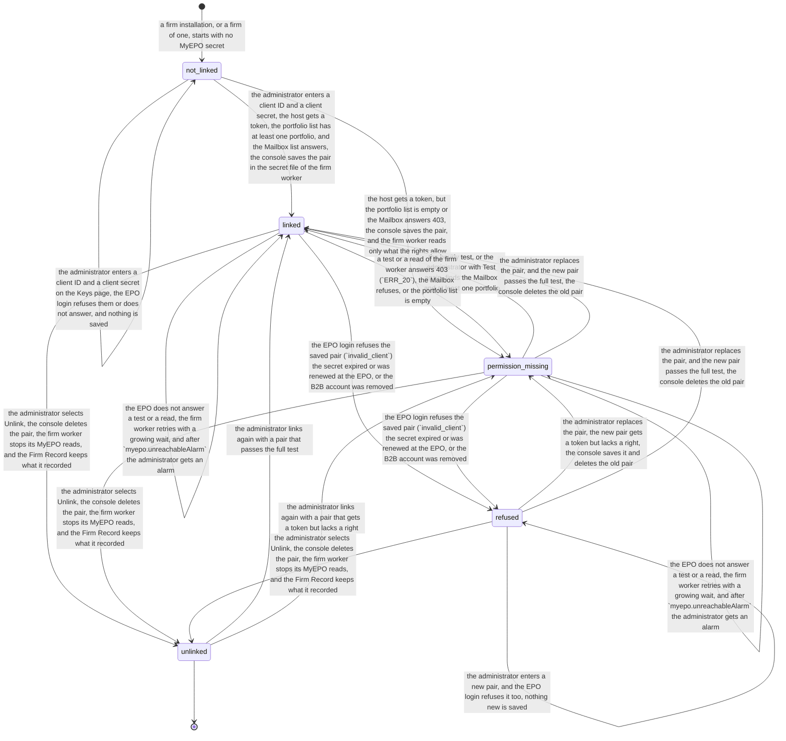

# Process 6: the firm's MyEPO link

**Status:** approved by the founder on 2026-11-10 ("I accept"), with the decisions of [section 11](#11-decisions-for-the-founder). It encodes founder decision 4 of 2026-11-10 (the firm link), the safety rules of [the MyEPO API study](../2026-11-09-myepo-api-study.md#safety-rules), and [ADR 0003](../adr/0003-firm-state-rule.md) with [the firm organisation design](../2026-11-10-firm-organisation-design.md), which win where they differ. The build waits for migration steps 1, 5, 6 and 7 of that design ([section 9](#9-tickets)); until step 7 lands, no real MyEPO account is linked on a firm. Method: [the atlas README](README.md#the-method-for-every-phase).

**Starts when** a firm installation, or a firm of one, has no MyEPO secret. **Ends when** the administrator unlinks MyEPO. Between these, the link is linked, has a missing permission, or is refused by the EPO. **Record object:** the firm's MyEPO link, one for each firm. Its secret is a firm secret, and its state is a fact that the Firm Record shows (design, section 2). **Tickets:** none yet; the [tickets](#9-tickets) section lists the proposed ones.

**Terms.** The **firm worker** is the harness image with the profile `flowleap-firm-worker`: no model, no shell, no chats and no inbound port; it is person `worker`, which no read policy of the Firm Record admits, and it sends only insert-only observations; the Firm Record resolves their matter and makes tasks from their typed fields (ADR 0003 decision 4). The **Firm admin console** and every Record command that needs the administrator or partner role are on the second browser origin (decision 3). The roles administrator, partner, attorney and formalities come from the one role function of the Firm Record (decision 5).

**What this sheet does not repeat.** What the firm worker reads with the link: the docket ([sheet 7](07-import-ep-docket.md)) and the letters and due dates ([sheet 1](01-office-letter-intake.md#8-the-myepo-route), [sheet 2](02-office-event-to-deadline.md#8-the-myepo-route), [sheet 8](08-deadline-confirmation.md)).

## Contents

- [1. The process today](#1-the-process-today)
- [2. Actors and roles](#2-actors-and-roles)
- [3. State machine](#3-state-machine)
- [4. Firm variation points](#4-firm-variation-points)
- [5. AI-native redesign](#5-ai-native-redesign)
- [6. Map to the code](#6-map-to-the-code)
- [7. Security invariants](#7-security-invariants)
- [8. Failure cases](#8-failure-cases)
- [9. Tickets](#9-tickets)
- [10. Open questions for the pilot attorney](#10-open-questions-for-the-pilot-attorney)
- [11. Decisions for the founder](#11-decisions-for-the-founder)

## 1. The process today

| # | Fact | Label and source |
|---|---|---|
| 6.1 | The MyEPO API needs a B2B account. The company must already use MyEPO with at least one company administrator. The EPO creates the B2B account and sends an OAuth 2.0 client ID and client secret to the company administrator | SOURCED: [MyEPO feature guide, APIs](https://link.epo.org/web/understand-our-services/exchange-data-with-us-using-an-api/en-myepo-feature-guide-apis-for-exchanging-information-with-ip-management-systems.pdf) (March 2025) |
| 6.2 | The administrator must give the B2B account the Mailbox access right and permission on the portfolios. Without a portfolio permission the API cannot read or update the applications of that portfolio | SOURCED: the same guide |
| 6.3 | The guide says that the credentials give access to confidential company data, and that they must not go to people who must not see it | SOURCED: the same guide |
| 6.4 | The software gets a bearer token with `grant_type=client_credentials` and the scope `mailboxapi`. The spec shows no read-only scope, so the same token can mark letters handled, move them and set a file reference | SOURCED: the OpenAPI spec of the production API, read on 2026-11-09 ([study](../2026-11-09-myepo-api-study.md#how-a-firm-gets-access)). "No read-only scope" is INFERRED from its absence in the spec |
| 6.5 | An application read without a portfolio permission answers `403 ERR_20`. A new sandbox account answers `400 ERR_15` until a reset. The sandbox token lives 3,600 s, the sample production token 18,000 s | SOURCED: the spec and the sandbox probe of 2026-11-09 ([study](../2026-11-09-myepo-api-study.md#sandbox-results)) |
| 6.6 | A download of a letter through the API marks it as read in the firm's MyEPO | MEASURED: the sandbox probe of 2026-11-09 ([study](../2026-11-09-myepo-api-study.md#sandbox-results)). The EPO pages name only "handled" and "unhandled" for the API; the web Mailbox has an "Unread" folder. SOURCED: [MyEPO feature guide, handling Mailbox communications](https://link.epo.org/web/myepo-services/interact/en-myepo-feature-guide-handling-mailbox-communications.pdf) |
| 6.7 | An electronic document reaches its destination on the date it is made available in the Mailbox, and it is deemed delivered on the date it bears; earlier access does not change that date. So the read flag and a download have no legal effect | SOURCED for the delivery rule; the conclusion on the read flag is INFERRED, because the sources do not name reading or downloading: [OJ EPO 2026, A20](https://www.epo.org/en/legal/official-journal/2026/03/a20), Art. 2(2); [OJ EPO 2023, A29](https://www.epo.org/en/legal/official-journal/2023/03/a29); [Guidelines E-II, 2.3](https://www.epo.org/en/legal/guidelines-epc/2026/e_ii_2_3.html) |
| 6.8 | No EPO page gives rate limits, quotas or terms of use for a vendor that builds on the API. The sandbox sent no rate-limit headers | SOURCED (absence): [the API page](https://www.epo.org/en/applying/myepo-services/understand/api) and its [release notes](https://www.epo.org/en/applying/myepo-services/understand/api/release-notes), read on 2026-11-10; MEASURED for the headers in the sandbox |
| 6.9 | The Firm admin console has a Keys page. It shows each provider key only as not set, set, valid or failing; it tests a new key before it saves it; and the host tests each key every hour | SOURCED: flowleap-os `docs/admin/console.md` and the invariants `console.key-not-in-answer`, `console.key-refused-not-saved`, `console.key-not-logged` of `docs/security-invariants.md` (commit 035c2e8) |
| 6.10 | Today an attorney runtime can read the office keys: they are mounted read-only into each runtime until the vault (#31) and the egress proxy (#33) exist. So `keys.none-in-runtime` is `partial` | SOURCED: flowleap-os `docs/index.md` and the row `keys.none-in-runtime` (commit 035c2e8) |
| 6.11 | The merged MyEPO connector stores the pair as a credential record of the runtime (`flowleap-connectors/myepo`), and the card on Settings → Connectors tests it. The firm state audit lists this as fault K1, and the gate of migration step 4 refuses it | SOURCED: PR 366, `packages/host/flowleap-connectors/src/myepo*.ts`; [the firm organisation design](../2026-11-10-firm-organisation-design.md), sections 2 and 8 |

**What the sources leave open.** The EPO does not say how often a client secret expires, whether a company can hold two B2B accounts, or how the EPO tells the firm that it renewed a secret. The firm worker must treat each of these as a refusal that it can see (state `refused`).

**The process today in a firm.** Most firms that use MyEPO today have no B2B account. A formalities person (PAFA) signs in to MyEPO in the browser and works the Mailbox by hand ([sheet 1, fact 1.13](01-office-letter-intake.md#1-the-process-today)) [INFERRED]. A firm docket such as PATORG imports EPO documents itself, so it holds its own MyEPO link [SOURCED: [PATORG productivity](https://www.patorg.com/de/features/productivity)]. Whether PATORG uses the B2B API or another route is not public [INFERRED].

## 2. Actors and roles

| Actor | Role in this process |
|---|---|
| Firm administrator (role administrator) | The only person who links, tests, replaces or unlinks the pair, on the Keys page of the Firm admin console, on the second origin (`console.admin-only`). Also the firm's MyEPO company administrator, or works with that person |
| MyEPO company administrator | Asks the EPO for the B2B account, gets the pair, and gives the B2B account its rights in MyEPO (fact 6.2). Often the same person as the firm administrator [INFERRED] |
| Firm worker (person `worker`) | Holds the MyEPO secret in a host file that only it can read. Runs the link test for the console, tests the saved pair every hour, and reads the portfolios, the applications, the Mailbox list, the letters and the due dates one time for the firm, read-only. It sends only insert-only observations to the Firm Record. It does nothing while the link is not `linked` or `permission_missing` |
| Firm Record | Records the observations behind the walls, resolves the matter of each letter, and makes tasks from typed fields. Holds no secret |
| Person runtime | Reads only the Firm Record, inside the person's walls, and can only read or propose. Never calls MyEPO, and has no MyEPO secret |
| Attorney, formalities person | See the link state and the time of the last successful read on the MyEPO card of the app ("Linked by your firm") and on each page that lists letters. Cannot link or unlink |
| Installer | Starts a firm, or a firm of one, with no link |

## 3. State machine

<!-- atlas:myepoLink -->
It has **5 states and 19 transitions**, plus the start.

| From | To | Event | Actor | Evidence in the record log |
|---|---|---|---|---|
| start | `not_linked` | A firm installation, or a firm of one, starts with no MyEPO secret | installer | No MyEPO entry in the secret file of the firm worker |
| `not_linked` | `not_linked` | The administrator enters a client ID and a client secret on the Keys page; the EPO login refuses them or does not answer, and nothing is saved | person (administrator) | Change log: who, when, the test result (`invalid_client`, a timeout); never a secret |
| `not_linked` | `linked` | The administrator enters a client ID and a client secret; the host gets a token, the portfolio list has at least one portfolio, and the Mailbox list answers; the console saves the pair in the secret file of the firm worker | person (administrator) | Change log; test result: the portfolios that the account may read, the Mailbox answer |
| `not_linked` | `permission_missing` | The host gets a token, but the portfolio list is empty or the Mailbox answers 403; the console saves the pair, and the firm worker reads only what the rights allow | person (administrator) | Change log; the missing right (Mailbox, portfolios) |
| `permission_missing` | `linked` | The hourly test, or the administrator with Test again, finds the Mailbox and at least one portfolio | firm worker (link test) or person (administrator) | Test result |
| `linked` | `permission_missing` | A test or a read of the firm worker answers 403 (`ERR_20`), the Mailbox refuses, or the portfolio list is empty | firm worker (link test or read) | The failing operation, its status and its error code |
| `linked`, `permission_missing` | `refused` | The EPO login refuses the saved pair (`invalid_client`): the secret expired or was renewed at the EPO, or the B2B account was removed | firm worker (link test or read) | Token answer status and error code, time |
| `refused` | `refused` | The administrator enters a new pair, and the EPO login refuses it too; nothing new is saved | person (administrator) | Change log; test result |
| `refused` | `permission_missing` | The administrator replaces the pair; the new pair gets a token but lacks a right; the console saves it and deletes the old pair | person (administrator) | Change log; the missing right |
| `permission_missing` | `permission_missing` | The EPO does not answer a test or a read; the firm worker retries with a growing wait, and after `myepo.unreachableAlarm` the administrator gets an alarm | firm worker (link test or read) | Each failed call with its time; the alarm |
| `refused`, `permission_missing` | `linked` | The administrator replaces the pair, and the new pair passes the full test; the console deletes the old pair | person (administrator) | Change log (old and new client ID, never a secret); test result |
| `linked` | `linked` | The administrator replaces the pair: a new pair that passes the full test replaces the old one, and a new pair that fails changes nothing | person (administrator) | Change log; test result |
| `linked` | `linked` | The EPO does not answer a test or a read; the firm worker retries with a growing wait, and after `myepo.unreachableAlarm` the administrator gets an alarm | firm worker (link test or read) | Each failed call with its time; the alarm |
| `linked`, `permission_missing`, `refused` | `unlinked` | The administrator selects Unlink; the console deletes the pair, the firm worker stops its MyEPO reads, and the Firm Record keeps what it recorded | person (administrator) | Change log; the stop of the firm worker |
| `unlinked` | `linked` | The administrator links again with a pair that passes the full test | person (administrator) | Change log; test result |
| `unlinked` | `permission_missing` | The administrator links again with a pair that gets a token but lacks a right | person (administrator) | Change log; the missing right |

End states: `unlinked`. Declared corrections out of an end state: `unlinked` to `linked`; `unlinked` to `permission_missing`.


<!-- /atlas:myepoLink -->

**The test.** A full test has three reads, each with the candidate pair, from the firm worker: a token, `GET /portfolios`, and `GET /communications/unhandled`. The link is `linked` only when all three answer and at least one portfolio is listed. A token with an empty portfolio list or a Mailbox refusal is `permission_missing`, because the EPO says that the administrator must give these rights (fact 6.2). The page names the missing right and links the EPO guide.

**What the firm worker may do in each state.**

| State | Reads | Writes into the Firm Record | Writes to MyEPO |
|---|---|---|---|
| `not_linked` | None | None | None |
| `linked` | The portfolios, the applications, the bibliographic data, the whole Mailbox list (`GET /communications`, handled and unhandled, so a letter that a person marks handled in MyEPO is still read), the downloads of the download mode ([sheet 1](01-office-letter-intake.md#8-the-myepo-route)), the due dates and the terms | Observations only: docket rows ([sheet 7](07-import-ep-docket.md)), letters ([sheet 1](01-office-letter-intake.md#8-the-myepo-route)), EPO due dates as evidence ([sheet 8](08-deadline-confirmation.md)) | None (decision D6.3) |
| `permission_missing` | Only what the rights allow: no Mailbox read without the Mailbox right, no application of a portfolio without its permission | The same, for what it read; the gap is visible on each page that depends on it | None |
| `refused` | None. The firm worker stops each read at the first `invalid_client` | None | None |
| `unlinked` | None. The pair is deleted on the host | None. What the Firm Record holds stays | None |

**The single-user install** (changed by ADR 0003 decision 6). A single-user install is a firm of one: the local administrator `admin` holds every role, and it runs the same plugins and the same Firm Record (PGlite on the desktop). A desktop has no console, so the person enters the pair on the MyEPO card of the app, and the pair goes to the store of the firm half in the same process; the same states and the same test apply. In a firm composition the same card shows only the state and the time of the last read. No package branches on the composition: only the provider behind the seam differs (design, section 7). Founder decision 4 said that a single-user install keeps the card as PR 366 built it, with the pair as a credential record of the runtime; the ADR replaces that.

**Why a firm link and not a card in each runtime.** On a firm, a pair in a runtime breaks `keys.none-in-runtime`, and a runtime that reads the whole Mailbox reads letters outside its person's walls. One firm worker with one pair reads each letter one time for the firm, and the Firm Record files it behind the matter's wall. So no real MyEPO account may be linked on a firm until the firm route exists (founder decision 4; migration step 7 of the design).

**The request limiter (decided, D6.6).** The firm worker has one limiter for all MyEPO requests of the firm: the reads of this sheet, the letters of [sheet 1](01-office-letter-intake.md#8-the-myepo-route), the due dates of [sheet 8](08-deadline-confirmation.md) and the docket import of [sheet 7](07-import-ep-docket.md). It starts at `myepo.requestsPerSecond` (2). It slows down by itself on a `429` answer or an error answer, and waits at least the time that the EPO names in its answer (`Retry-After`) [INFERRED: the EPO publishes no limit and the sandbox sent no such header, fact 6.8]. It serves the requests in this order: new letters (the unhandled read, a download that a person asked for, the due dates of a new event), then the link test, then the nightly reconcile, then a bulk import. A bulk import is resumable from its last stored page and idempotent ([sheet 7](07-import-ep-docket.md)). **Why one limiter:** the EPO sees one B2B account, so two limiters in two places could exceed the limit together, and only one limiter can put new letters before an import.

**The reading schedule (decided, D6.7).**

- The unhandled-letters read (`GET /communications/unhandled`) runs every `myepo.unhandledEvery` (15 minutes).
- One full reconcile each night reads the complete letter list of the last `myepo.reconcileWindow` (30 days) with `GET /communications` and compares it with the Firm Record. **Why:** a letter that a person marks as handled on the MyEPO website before the next read is not in the unhandled list.
- A letter is recorded by its EPO communication id, so a repeated read makes no duplicate.
- A **Check now** act starts one unhandled read at once; it takes the place of the next scheduled read in the limiter.
- Each page that lists letters shows the time of the last successful read. The alarm after `myepo.unreachableAlarm` (4 hours) with no successful read stays.

**The requests per day.** With L new letters a day, D applications in the index, and a page size P of the letter and application lists (not known; 100 is assumed here):

| Source | Requests per day | 1,000 applications, 20 letters a day | 5,000 applications, 100 letters a day |
|---|---|---|---|
| Unhandled read, every 15 minutes | 96 | 96 | 96 |
| Hourly link test (token, portfolios, Mailbox) | 72 | 72 | 72 |
| Nightly reconcile, 30 days | 30 × L / P | 6 | 30 |
| Downloads (at most one for each letter) and due dates (one for each new event) | 2 × L | 40 | 200 |
| Daily docket refresh: list pages and new rows ([sheet 7](07-import-ep-docket.md)) | D / P + new rows | about 12 | about 55 |
| Weekly bibliographic cycle, one seventh each day | D / 7 | 143 | 715 |
| **Total** | | **about 370** | **about 1,170** |

At 2 requests per second that is about 3 and 10 minutes of request time a day [INFERRED from the settings; the letter counts are assumptions, and the pilot measures them]. Token requests are in the link test count only, because a production token lives 5 hours (fact 6.5).

## 4. Firm variation points

| Setting | Type | Default | Why firms differ |
|---|---|---|---|
| `myepo.unhandledEvery` | duration | 15 minutes (D6.7) | A firm can read more often; each read costs one request |
| `myepo.reconcileWindow` | days | 30 (D6.7) | How far back the nightly reconcile compares |
| `myepo.reconcileAt` | time of day | 02:00 | A time with no work in the firm |
| `myepo.requestsPerSecond` | number | 2 [INFERRED; the EPO publishes no limit, fact 6.8] | Set from the first production run; the EPO may give a limit later |
| `myepo.testEvery` | duration | 1 hour, as for the provider keys (fact 6.9) | None known |
| `myepo.unreachableAlarm` | duration | 4 hours of failed reads | A firm with a daily Mailbox habit can wait longer; the safe value is short, because a lost day of letters shortens every period |
| `myepo.environment` | `'production' \| 'sandbox'` | `'production'` | The sandbox for the pilot's first test (study, next steps) |

## 5. AI-native redesign

**What disappears.** The formalities person's daily sign-in to the web Mailbox to see what arrived, and the copy of the letter into the docket. The firm worker reads the list every 15 minutes, and the Firm Record files each letter on its matter ([sheet 1](01-office-letter-intake.md#8-the-myepo-route)).

**What becomes a proposal with evidence.** Nothing in this sheet. The link is a security act, so it stays a person's act.

**What stays with a person, and why.** The link, the replacement and the unlink, because the pair opens confidential data of the firm (fact 6.3), and only the administrator may change firm keys (`console.admin-only`). The rights of the B2B account in MyEPO, because only the MyEPO company administrator can give them (fact 6.2).

**The count.**

| | Old way (PATORG with its EPO import) | Firm link, one time | Firm link, each year |
|---|---|---|---|
| Manual steps | 0 per letter after the setup of the vendor [INFERRED] | 3: ask the EPO for the B2B account, give its rights in MyEPO, enter and test the pair on the Keys page | 1 for each secret renewal (unknown frequency) |
| Hand-offs | 0 | 1: MyEPO company administrator to firm administrator, when they are two persons | 0 |

## 6. Map to the code

**What exists.** In the harness (PR 366): the `flowleapMyEpo` Service Definition with its reads and writes, the card on Settings → Connectors, and the credential record `flowleap-connectors/myepo`. In flowleap-os: the Keys page with its test before save, its hourly test and its key states (fact 6.9); the closed list of sender kinds of the Record (`record.command-senders`).

**What is new.**

- **flowleap-os:** a MyEPO card on the Keys page of the console (second origin) with two fields (client ID, client secret), the full test through the firm worker, the states of this sheet, Test again, Check now and Unlink; the pair in a host file that only the firm worker can read; the sender kind `worker` with its insert-only observation commands (`worker.writes-observations-only`); the link state as a typed record that the console reads, as for the System page (`console.system-unknown-not-good`). Migration steps 5 (roles, second origin), 6 (worker) and 7 (MyEPO firm route) of the design.
- **Harness:** `flowleap-connectors` splits into a firm half (the MyEPO client, the limiter and the schedule, in the firm worker) and a person half (the card, which shows the state, and the read tools on the Firm Record). Migration steps 1 (the card refuses a write in a firm composition), 4 (the gate refuses `myepo.ts:131`) and 6.

```ts
type MyEpoClientId = Branded<'MyEpoClientId'>
type LinkTest =
  | { ok: true; portfolios: number; mailbox: 'answers' }
  | { ok: false; reason: 'invalid-client' | 'timeout' | 'epo-error'; status: number | null }
  | { ok: 'partial'; missing: Array<'mailbox' | 'portfolios'>; portfolios: number }
type MyEpoLink =
  | { s: 'not_linked' }
  | { s: 'linked'; client: MyEpoClientId; since: Instant; lastTest: Instant; portfolios: number }
  | { s: 'permission_missing'; client: MyEpoClientId; missing: Array<'mailbox' | 'portfolios'>; since: Instant }
  | { s: 'refused'; client: MyEpoClientId; since: Instant; status: number }
  | { s: 'unlinked'; by: AdministratorId; at: Instant }
// The firm worker takes a Readable link; `refused`, `not_linked` and `unlinked` do not compile as its input.
type Readable = Extract<MyEpoLink, { s: 'linked' | 'permission_missing' }>
```

## 7. Security invariants

Proposed new rows for the flowleap-os register (`docs/security-invariants.md`). This sheet does not edit that repository; the build PR adds each row with its test.

| Id | Invariant | Stops |
|---|---|---|
| `myepo.secret-host-only` | The MyEPO client secret is only in a host file that only the firm worker can read and in the firm worker's memory; no person runtime, keys document, Firm Record event, page, log line, change log or request result holds it | A runtime, an injected prompt or a log reader that copies the firm's MyEPO secret |
| `myepo.no-runtime-call` | No person runtime calls `login.epo.org` or `api.apps.epo.org`; in a firm composition the person half of `flowleap-connectors` has no MyEPO client, and the office proxy does not forward these hosts | A runtime that reads the whole firm Mailbox past its person's walls |
| `myepo.card-state-only-on-a-firm` | In a firm composition the MyEPO card of the app takes no pair and shows only the link state and the last read; on a firm of one it writes to the firm half in the same process (ADR 0003 decision 6) | An attorney who links a personal or the firm's pair into a runtime |
| `myepo.admin-only-link` | Only an administrator links, replaces, tests or unlinks the pair, on the console; the record of each act names the person and never the secret | A person without the role who changes where the firm's letters come from |
| `myepo.tested-before-saved` | A new pair is saved only after the test gets a token with it; a refused pair (`invalid_client`) or a pair that the test cannot reach is never saved; a pair with a token and a missing right is saved as `permission_missing` (D6.2); a replacement that gets no token keeps the old pair in use | An administrator who replaces a working pair with a wrong one and stops the firm's letters |
| `myepo.read-only` | The firm worker calls only the read operations and the download; it never calls `handle`, `move` or the `PATCH` of an application | A fault or a forged request that marks letters handled or changes file references in the firm's MyEPO |
| `myepo.download-by-mode` | The firm worker downloads a letter only as the download mode of the firm allows (sheet 1, section 8), and logs each download with what caused it | A silent change of the read flags that the firm's old docket or its PAFA rely on during shadow mode |
| `myepo.observations-only` | The firm worker sends MyEPO facts only as insert-only observations of sender kind `worker`; it never names a matter, a team or a person, and cannot confirm, reject or decide (`worker.writes-observations-only` of ADR 0003) | A MyEPO read that decides in a person's name or files a letter outside its wall |
| `myepo.unfiled-inside-intake` | A letter whose matter the Firm Record cannot resolve is readable only by the intake persons until a person files it, as `intake.unfiled-letter-readers` says for the AI mailbox | A letter that the firm worker cannot file on a matter is readable only by the intake persons, as `intake.unfiled-letter-readers` says for the AI mailbox | A letter of a walled matter that a person outside the wall reads before the filing |
| `myepo.one-limiter` | Every MyEPO request of the firm goes through the one limiter of the firm worker, which honours the EPO's wait time and serves new letters before a bulk import (D6.6) | Two readers that exceed the EPO's limit together, or an import that delays a new letter |
| `myepo.stops-when-not-readable` | The firm worker makes no call while the link is `not_linked`, `refused` or `unlinked`, and stops at the first `invalid_client` | A loop of refused logins that the EPO could read as an attack and block |

ADR 0003 names the related firm-wide invariants (`worker.writes-observations-only`, a runtime can only read or propose, each Record command has a role entry, no firm secret in a keys document). The MyEPO rows above are the MyEPO part of them.

## 8. Failure cases

- **The administrator enters a wrong pair.** The test refuses it, and nothing is saved (`myepo.tested-before-saved`).
- **The B2B account has no portfolio permission.** `permission_missing`; the Import your EP docket button says why and waits ([sheet 7](07-import-ep-docket.md)).
- **The EPO renews or revokes the secret.** `refused` at the next read or hourly test; the administrator gets the task Fix the MyEPO link, and every page that lists letters says since when no letter was read. The letters stay in the EPO Mailbox and are not lost, and their legal date does not depend on the read (fact 6.7), so the risk is time: each hour without a read is an hour less of each period [INFERRED].
- **The EPO does not answer.** The firm worker retries with a growing wait. After `myepo.unreachableAlarm` the administrator gets an alarm, and the morning brief names the gap [INFERRED].
- **Two administrators change the pair at the same time.** The console applies one change at a time (`console.changes-checked`); the second test runs against the new state [INFERRED from the console design].
- **The firm worker crashes during a read.** Each observation is idempotent by the EPO id (communication id, application number), so a restart gives no second record (`intake.mail-idempotent` is the model) [INFERRED].
- **The firm worker is down.** No read runs; the pages show the time of the last successful read, and the alarm comes after `myepo.unreachableAlarm`. A person's call that needs the worker gets the typed result `firm-unreachable` (design, section 4).
- **The EPO answers `429`.** The limiter waits at least the time that the answer names, and new letters keep their place before an import.
- **A person marks a letter handled on the MyEPO website before the next read.** The unhandled list misses it, and the nightly reconcile records it by its communication id.

## 9. Tickets

The build is migration step 7 of [the firm organisation design](../2026-11-10-firm-organisation-design.md#9-the-migration), after steps 1, 5 and 6. Proposed tickets: (1) flowleap-os, the MyEPO card on the Keys page of the console with the full test, the link states, Check now and the time of the last read; (2) harness, the firm half of `flowleap-connectors` in the firm worker: the MyEPO client, the one limiter, the reading schedule and the stop rules; (3) flowleap-os, the observation commands of sender kind `worker` for MyEPO, with their role entries; (4) harness, the person half: the card shows the state only in a firm composition; (5) flowleap-os, the invariant rows of section 7 with their tests, and the two-person case of step 7.

## 10. Open questions for the pilot attorney

- **Q6.1** Who is the MyEPO company administrator of your firm, and is that person also the FlowLeap administrator?
- **Q6.2** Does your firm docket already use a B2B account? Can the EPO give a second one, or must the firm share one pair between the old docket and FlowLeap during shadow mode?
- **Q6.3** Does your firm want FlowLeap to read every portfolio, or only some (for example only the EP portfolio of the patent team)?

## 11. Decisions for the founder

All decisions of this section were decided by the founder on 2026-11-10. D6.1 to D6.5 were accepted as recommended. The founder asked the planning session to decide D6.6 and D6.7 "from architecture point of view", and accepted the sheet with them.

- **D6.1 The link lives only on the Keys page of the Firm admin console.** Decided 2026-11-10: yes, as founder decision 4 says. It reuses the tested key flow and its invariants.
- **D6.2 `permission_missing` saves the pair.** The firm worker then reads what it may, and the gap is visible. Decided 2026-11-10, as recommended: yes, because the rights often come a day later from the MyEPO company administrator, and a refused save makes the administrator enter the secret two times. The alternative is to refuse the save until both rights exist.
- **D6.3 The firm worker never writes to MyEPO in v1.** No `handle`, no `move`, no file reference. Decided 2026-11-10, as recommended: yes. The study already says that writes are a person's act; this sheet goes further and keeps them out of the firm worker until a sheet for them exists.
- **D6.4 A pair that the test cannot reach (a timeout) is not saved.** The provider keys allow "Save anyway". Decided 2026-11-10, as recommended: no "Save anyway" for MyEPO, because a pair that was never tested can stop the letters without a visible cause.
- **D6.5 The request rate starts at 2 requests per second.** Decided 2026-11-10, as recommended: yes, until the EPO names a limit or the pilot measures one (fact 6.8). At this rate the first import of 1,000 applications takes about 9 minutes ([sheet 7](07-import-ep-docket.md#5-ai-native-redesign)).
- **D6.6 The request limiter.** Decided 2026-11-10: one shared limiter in the firm worker for all MyEPO requests of the firm; it starts at 2 requests per second (a setting), slows down by itself on a "too many requests" or error answer and honours the EPO's wait time; new letters have priority over a bulk import; a bulk import is resumable and idempotent ([section 3](#3-state-machine)).
- **D6.7 The reading schedule.** Decided 2026-11-10: the unhandled-letters read every 15 minutes (a setting of the firm); one full reconcile each night over the letter list of the last 30 days; each letter recorded by its EPO communication id; a Check now act; the time of the last successful read on each page; the alarm after 4 hours with no successful read. About 370 requests a day for a firm with 1,000 applications and 20 letters a day ([section 3](#3-state-machine)).
