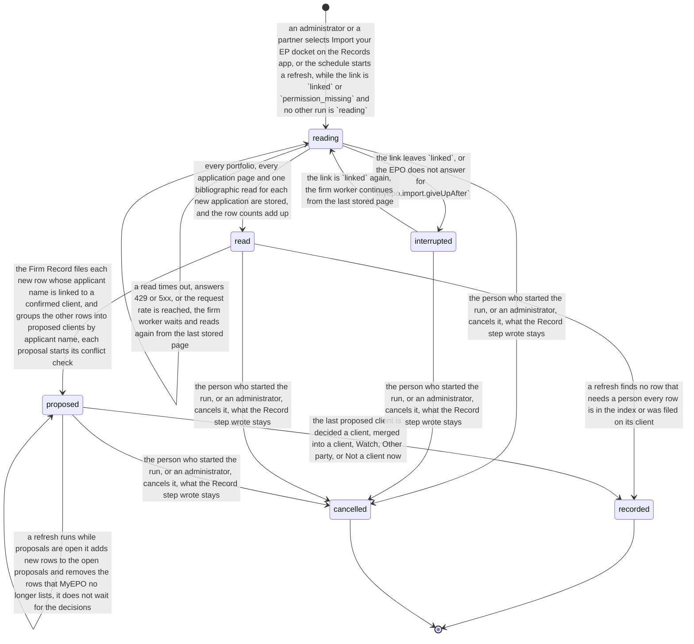
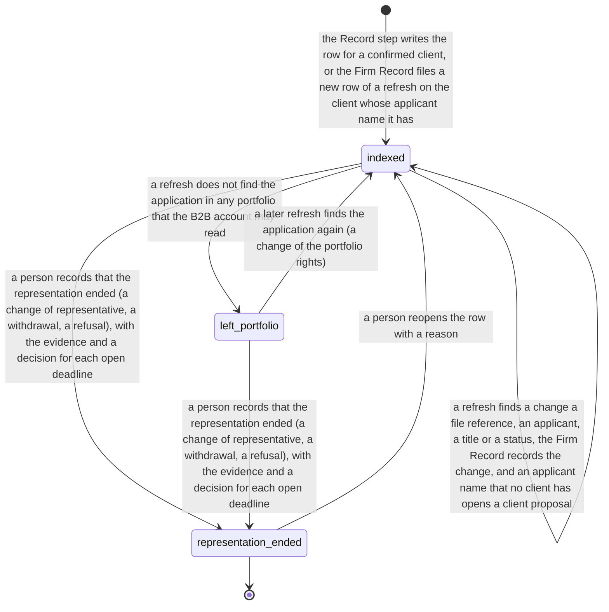
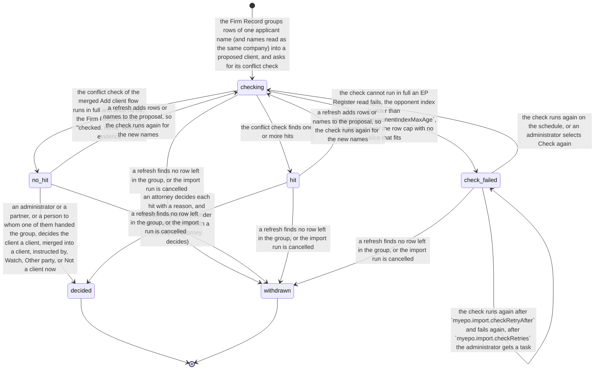

# Process 7: Import your EP docket

**Status:** approved by the founder on 2026-11-10 ("I accept"), with the decisions of [section 11](#11-decisions-for-the-founder); D7.5 was changed by the founder. [ADR 0003](../adr/0003-firm-state-rule.md) and [the firm organisation design](../2026-11-10-firm-organisation-design.md) win where they differ. The build waits for migration steps 3, 5, 6 and 7 of that design ([section 9](#9-tickets)); until then no outside firm uses the import on a firm installation. It encodes founder decision 5 of 2026-11-10 and decision 5 of [the MyEPO API study](../2026-11-09-myepo-api-study.md#decisions-for-the-founder): with MyEPO, the first run is **Import your EP docket**, the applications become the application index through the Record step of the merged Add client flow, FlowLeap proposes clients from the applicant names, and a person confirms them. It keeps [the client model](../2026-11-09-client-model.md) (a record and a memory, not a drive) and the conflict check of [Add client for large clients](../2026-11-09-add-client-large-clients.md#the-conflict-check). Method: [the atlas README](README.md#the-method-for-every-phase).

**Starts when** a person starts Import your EP docket, or the schedule starts a refresh, while the firm's MyEPO link is `linked` ([sheet 6](06-firm-myepo-link.md)). **Ends when** every proposed client of the run is decided, or the run is cancelled. **Record objects:** the import run, which owns its client proposals, and each row of the application index that came from MyEPO. **Tickets:** none yet; see [section 9](#9-tickets).

## Contents

- [1. The process today](#1-the-process-today)
- [2. Actors and roles](#2-actors-and-roles)
- [3. State machines](#3-state-machines)
- [4. Firm variation points](#4-firm-variation-points)
- [5. AI-native redesign](#5-ai-native-redesign)
- [6. Map to the code](#6-map-to-the-code)
- [7. Walls and security invariants](#7-walls-and-security-invariants)
- [8. Failure cases](#8-failure-cases)
- [9. Tickets](#9-tickets)
- [10. Open questions for the pilot attorney](#10-open-questions-for-the-pilot-attorney)
- [11. Decisions for the founder](#11-decisions-for-the-founder)

## 1. The process today

| # | Fact | Label and source |
|---|---|---|
| 7.1 | `GET /portfolios` lists the portfolios that the B2B account may read; `GET /applications` lists the applications with the filters `portfolioId`, `applicationNumber`, `applicantFileReference` and `procedure`, in pages | SOURCED: the OpenAPI spec of the production API ([study](../2026-11-09-myepo-api-study.md#the-operations)) |
| 7.2 | An application row has the procedure (`EPC` or `UPP`), the application number with and without the check digit, the filing date, `applicantFileReference` and the portfolio. It has no title, applicant or status; these need one `GET /biblio-data/{procedure}/applications/{application}` for each application (title in three languages, applicants, inventors, representative, priorities, IPC and CPC) | MEASURED: sandbox probe of 2026-11-09, 6 portfolios and 8 rows ([study](../2026-11-09-myepo-api-study.md#sandbox-results)) |
| 7.3 | Each sandbox read took 150 to 550 ms, with no rate-limit headers. No EPO page gives a rate limit | MEASURED in the sandbox; SOURCED (absence): [the API page](https://www.epo.org/en/applying/myepo-services/understand/api) |
| 7.4 | Whether `GET /applications` lists unpublished applications, and whether it lists PCT applications, is not known. The sandbox rows have no publication data | NOT VERIFIED: open points 1 and 2 of the [study](../2026-11-09-myepo-api-study.md#what-the-sources-do-not-say) |
| 7.5 | Without a portfolio permission, an application read answers `403 ERR_20` | SOURCED: the spec ([study](../2026-11-09-myepo-api-study.md#how-a-firm-gets-access)) |
| 7.6 | An applicant is not always the client: the instructing party can be a foreign associate, a parent company or a licensee. The client is the firm's decision | SOURCED: [study, Add client with MyEPO](../2026-11-09-myepo-api-study.md#add-client-with-myepo), from the approved Add client design |
| 7.7 | MyEPO shows only the firm's own applications. The conflict check needs the other side (opponents, other companies), which comes from the EP Register and the opponent index | SOURCED: the same section; [Add client for large clients, the conflict check](../2026-11-09-add-client-large-clients.md#the-conflict-check) |
| 7.8 | The Firm Record records a client's applications in one command: `POST clients/<clientId>/applications/batch` | SOURCED: flowleap-os commit 24303b0 ("records applications and their roles in one command") |
| 7.9 | A row with a file number can open as a matter at once; FlowLeap does not invent file numbers | SOURCED: [Add client, decision 1](../2026-11-08-add-client.md) and the [study](../2026-11-09-myepo-api-study.md#what-it-changes-for-flowleap) |
| 7.10 | A large German firm has over a thousand EP publications a year; a small firm has some tens of EP applications | SOURCED: [the firm map](firm-map.md#the-procedures), from the EP Register, read on 2026-11-08 |
| 7.11 | The EP Register shows outgoing EPO communications the day after their despatch, and only for public files | SOURCED: [EP Register FAQ](https://www.epo.org/en/service-support/faq/searching-patents/european-patent-register-and-federated-register/european-4), read on 2026-11-10 |

**The process today in a firm.** A firm that moves to a new docket imports its old docket by an export of the vendor, or types it again [INFERRED]. A firm without an export builds the client list by hand from its records. No public source describes either way.

## 2. Actors and roles

| Actor | Role in this process |
|---|---|
| Administrator or partner (roles of the Firm Record) | Starts the first import on the Records app (second origin); decides the proposed clients with no conflict hit, or hands groups to colleagues (D7.6) |
| Attorney | Decides every proposed client with a conflict hit, with a reason for each hit (D7.5); records that a representation ended |
| Formalities person | Decides the proposed clients with no hit that a partner hands to them; records that a representation ended |
| Firm worker (person `worker`) | Reads the portfolios, the application pages and the bibliographic data through the one limiter of [sheet 6](06-firm-myepo-link.md#3-state-machine), and the EP Register reads of the conflict check; sends them as insert-only observations. It keeps the stored pages and the resume point as its job state |
| Firm Record | Compares the observations with the index, files the rows of known applicants, groups the rest into proposed clients, records each conflict check, and writes the client records and the index rows through the Record step; refuses a command whose sender kind or role the command table does not allow |
| Schedule | Starts a refresh (`myepo.import.refreshEvery`) |
| Conflict check | The check of the merged Add client flow, with the `op=` reads and the opponent index; it runs automatically for each proposed client (D7.5) |

## 3. State machines

**The import run.** One run is a first import or a refresh. Only one run reads at a time. A run that waits in `proposed` does not stop a refresh: the refresh adds its new rows to the open proposals and removes the rows that MyEPO no longer lists [INFERRED; decision D7.4].

<!-- atlas:docketImport -->
It has **6 states and 13 transitions**, plus the start.

| From | To | Event | Actor | Evidence in the record log |
|---|---|---|---|---|
| start | `reading` | An administrator or a partner selects Import your EP docket on the Records app, or the schedule starts a refresh, while the link is `linked` or `permission_missing` and no other run is `reading` | person or schedule | Run id, kind (first or refresh), who or which schedule, the link state |
| `reading` | `reading` | A read times out, answers 429 or 5xx, or the request rate is reached; the firm worker waits and reads again from the last stored page | firm worker | Each failed call, the wait, the last stored page |
| `reading` | `interrupted` | The link leaves `linked`, or the EPO does not answer for `myepo.import.giveUpAfter` | firm worker | The link event or the failed calls; the pages and the bibliographic reads stored so far |
| `interrupted` | `reading` | The link is `linked` again; the firm worker continues from the last stored page | firm worker | Run id, the resume point |
| `reading` | `read` | Every portfolio, every application page and one bibliographic read for each new application are stored, and the row counts add up | firm worker | Counts per portfolio, read time, the changes against the last run |
| `read` | `proposed` | The Firm Record files each new row whose applicant name is linked to a confirmed client, and groups the other rows into proposed clients by applicant name; each proposal starts its conflict check | Firm Record | The rows filed automatically; the groups with their name matches and scores; the conflict check of each group |
| `read` | `recorded` | A refresh finds no row that needs a person: every row is in the index or was filed on its client | firm worker | The changes against the last run |
| `proposed` | `proposed` | A person confirms, changes, merges or defers one proposed client; the Record step writes its client record and its index rows in batches | person | `client/added`, `client/name-linked`, `client/conflict-checked`, the batch of `client/application-recorded`, the reason for each conflict hit |
| `proposed` | `proposed` | A refresh runs while proposals are open: it adds new rows to the open proposals and removes the rows that MyEPO no longer lists; it does not wait for the decisions | firm worker | The rows added and removed, the refresh run |
| `proposed` | `recorded` | The last proposed client is decided: a client, merged into a client, Watch, Other party, or Not a client now | person | The decisions, the counts of the run |
| `reading`, `interrupted`, `read`, `proposed` | `cancelled` | The person who started the run, or an administrator, cancels it; what the Record step wrote stays | person | Reason, the counts written |

End states: `recorded`, `cancelled`.


<!-- /atlas:docketImport -->

**A row of the application index.** The row exists for each application of a confirmed client, from the Record step or from a refresh. Its states say whether MyEPO still lists it.

<!-- atlas:indexRow -->
It has **3 states and 6 transitions**, plus the start.

| From | To | Event | Actor | Evidence in the record log |
|---|---|---|---|---|
| start | `indexed` | The Record step writes the row for a confirmed client, or the Firm Record files a new row of a refresh on the client whose applicant name it has | person or Firm Record | `client/application-recorded` with the source MyEPO, the portfolio and the read time |
| `indexed` | `indexed` | A refresh finds a change: a file reference, an applicant, a title or a status; the Firm Record records the change, and an applicant name that no client has opens a client proposal | firm worker and Firm Record | Old and new value, the read that gave it |
| `indexed` | `left_portfolio` | A refresh does not find the application in any portfolio that the B2B account may read | firm worker | The last run that found it and the run that did not |
| `left_portfolio` | `indexed` | A later refresh finds the application again (a change of the portfolio rights) | firm worker | The run that found it again |
| `indexed`, `left_portfolio` | `representation_ended` | A person records that the representation ended (a change of representative, a withdrawal, a refusal), with the evidence and a decision for each open deadline | person | Reason from the list, evidence (an EP Register entry or the client mail), each open deadline and its decision |
| `representation_ended` | `indexed` | A person reopens the row with a reason | person | Reason |

End states: `representation_ended`. Declared corrections out of an end state: `representation_ended` to `indexed`.


<!-- /atlas:indexRow -->

**The proposed client.** The Firm Record groups the rows of one applicant name, and of other names that FlowLeap reads as the same company (for example "Siemens AG" and "Siemens Aktiengesellschaft"), with the evidence of each match. The person can:

| Choice | What the Record step writes |
|---|---|
| **Add as client** | `client/added` (role client), `client/name-linked` for each name, the `client/conflict-checked` of the check (no hit, or the attorney's reason for each hit), and the rows in batches |
| **Add to a client** | The names and the rows to an existing client, for example a subsidiary to its group |
| **Instructed by** | The rows to the instructing client (a foreign associate, a parent company), with the applicant names as parties of the matters (fact 7.6) |
| **Watch** or **Other party** | `client/added` with that role and no rows as the firm's matters |
| **Not a client now** | `myepo-import/deferred` with the person, the time and the rows; no client record. The rows stay in the import list, and the next refresh proposes them again only when they change (D7.3, changed by ADR 0003: a person's choice is a fact of the Firm Record, not job state of the worker) |

**The conflict check (D7.5, decided 2026-11-10).** The check runs automatically for every proposed client, also for a client that the firm already has in its old system. A client with no hit is recorded with "checked, no hit" and its evidence (each query, its data edition, the edition of the opponent index), and the person who decides it sees no conflict step. A person sees the conflict step only for a client with a hit, and with a hit only an attorney decides (founder rule of 2026-11-08). A check that cannot run in full records nothing as checked, and the client cannot be added until it runs.

<!-- atlas:proposedClient -->
It has **6 states and 13 transitions**, plus the start.

| From | To | Event | Actor | Evidence in the record log |
|---|---|---|---|---|
| start | `checking` | The Firm Record groups rows of one applicant name (and names read as the same company) into a proposed client, and asks for its conflict check | Firm Record | The rows, the names with their match evidence, the check request |
| `checking` | `no_hit` | The conflict check of the merged Add client flow runs in full and finds no hit; the Firm Record records "checked, no hit" with its evidence | firm worker and Firm Record | `client/conflict-checked` with no hit: each query, its data edition, the edition of the opponent index |
| `checking` | `hit` | The conflict check finds one or more hits | firm worker and Firm Record | Each hit with its source and edition |
| `checking` | `check_failed` | The check cannot run in full: an EP Register read fails, the opponent index is older than `myepo.import.opponentIndexMaxAge`, or a query is over the row cap with no slice that fits | firm worker and Firm Record | The failed part and its error; nothing is recorded as checked |
| `check_failed` | `check_failed` | The check runs again after `myepo.import.checkRetryAfter` and fails again; after `myepo.import.checkRetries` the administrator gets a task | Firm Record | Each try, the task |
| `check_failed` | `checking` | The check runs again on the schedule, or an administrator selects Check again | Firm Record or person (administrator) | The new check request |
| `no_hit`, `hit` | `checking` | A refresh adds rows or names to the proposal, so the check runs again for the new names | Firm Record | The rows and names added |
| `no_hit` | `decided` | An administrator or a partner, or a person to whom one of them handed the group, decides the client: a client, merged into a client, instructed by, Watch, Other party, or Not a client now | person | The choice and the Record step events; for Not a client now, `myepo-import/deferred` |
| `hit` | `decided` | An attorney decides each hit with a reason, and decides the client (founder rule of 2026-11-08: with a hit only an attorney decides) | person (attorney) | `client/conflict-checked` with the attorney and the reason for each hit, and the Record step events |
| `checking`, `no_hit`, `hit`, `check_failed` | `withdrawn` | A refresh finds no row left in the group, or the import run is cancelled | Firm Record or person | The refresh or the cancel |

End states: `decided`, `withdrawn`.


<!-- /atlas:proposedClient -->

**The refresh, step by step.**

1. Read all application pages of each portfolio (the list is cheap: one read for each page).
2. Compare with the index by application number. A new number gets a bibliographic read. A known number gets one only when its slice of the weekly cycle is due (`myepo.import.biblioCycle`), because a list row does not show a change of the applicant, the title or the status (fact 7.2).
3. The Firm Record files a new row whose applicant name is linked to exactly one confirmed client, and whose other applicants are linked to the same client or to none, is filed on that client without a person (decision D7.1). A row whose applicant names are linked to two clients, or whose co-applicant is a client of another team, opens a proposal. A row with a changed applicant opens a proposal for the new name. A row that no portfolio lists any more becomes `left_portfolio`.
4. The run ends `recorded` when nothing needs a person; else it waits `proposed`.

The refresh is idempotent: each write has the key `myepo-import:<client>:<application>` with the read values, so a run that reads the same data again writes nothing new (`intake.mail-idempotent` is the model).

**An application that leaves a portfolio.** It is not deleted. MyEPO can stop listing it for a reason that is not legal: an administrator changed the portfolio rights (sheet 6, `permission_missing`) [INFERRED]. So the row goes to `left_portfolio`, the person gets the task "Check why this application left MyEPO" with the last read, and every open deadline of the application stays active until the person decides. When the representation ended, the person decides each open deadline with the evidence (an EP Register entry, the client's mail). **A whole portfolio that MyEPO no longer lists** is a change of the rights, not of each application: the rows go to `left_portfolio`, but the firm worker opens one task "Fix the MyEPO link" for the administrator ([sheet 6](06-firm-myepo-link.md)), not one task for each row, and the row tasks open only when the link is fixed and the rows are still missing [INFERRED].

## 4. Firm variation points

| Setting | Type | Default | Why firms differ |
|---|---|---|---|
| `myepo.import.conflictWithin` | duration | 5 working days | How fast an attorney decides a conflict hit; the rows wait meanwhile |
| `myepo.import.opponentIndexMaxAge` | duration | 7 days, as the docket refresh of the large-client sheet | An older opponent index can miss a conflict |
| `myepo.import.checkRetryAfter`, `myepo.import.checkRetries` | duration, number | 1 hour, 6 | When a failed check goes to the administrator |
| `myepo.import.refreshEvery` | duration | 1 day for the application list | A firm with many new filings wants the index current for the letter filing of sheet 1 |
| `myepo.import.biblioCycle` | duration | 7 days: each day, one seventh of the known rows gets a bibliographic read | The read cost against how fast an applicant change shows |
| `myepo.import.autoFileKnownApplicant` | boolean | `true` | Founder decision 1 (automatic by default); a firm that wants every new row checked sets `false` |
| `myepo.import.giveUpAfter` | duration | 4 hours with no answer | Same as `myepo.unreachableAlarm` of sheet 6 |
| `myepo.leftCheckWithin` | duration | 5 working days; 1 working day when the row has an open deadline | An open deadline on an application that the firm may no longer represent is urgent |
| `myepo.import.nameMatch` | `'exact' \| 'normalized'` | `'normalized'`: legal-form words and case are ignored, and each merge shows its evidence | A firm that wants every name merge confirmed by hand sets `'exact'` |

## 5. AI-native redesign

**What disappears.** Typing the client list, typing each application, and the search of the EP Register for the firm's own matters (the `re=` docket of the large-client sheet stays only for a firm without MyEPO). The firm worker reads the docket; FlowLeap groups it.

**What becomes automatic.** The conflict check of each proposed client, and the record "checked, no hit" with its evidence.

**What becomes a proposal with evidence.** Each client group, with the applicant names, the rows and the conflict hits. A changed applicant (a possible transfer) is a proposal on its client.

**What stays with a person, and why.** The client decision, because the client is the firm's decision and not the applicant (fact 7.6). The decision on each conflict hit, by an attorney only, because a conflict is a professional duty [INFERRED] and the founder rule of 2026-11-08 says so. The end of a representation, because it can close a deadline.

**The number, for a firm with 1,000 applications.** The first import makes one list read for each page, one bibliographic read for each application, and a few portfolio reads: about 1,000 + 1,000 / page size + 10 reads [INFERRED; the page size is not known]. At the default rate of 2 requests per second (sheet 6, D6.5) the rate limits the run to about 500 s; at the slowest measured read of 550 ms and one read at a time, the latency limits it to about 550 s (fact 7.3). So the first import takes about 9 minutes, and the rate is the limit that the firm can change. A daily refresh of the list is about 10 reads plus the new rows; the weekly bibliographic cycle adds about 143 reads each day [INFERRED from the settings].

**The count.**

| | Old way (move to a new docket) | Import your EP docket |
|---|---|---|
| Manual steps, first run | One entry for each client and each application, or an export and a check [INFERRED] | 1 to start, and 1 decision for each proposed client (a small firm: some tens; a large firm with 312 applicant names: 312, fewer with merges) |
| Manual steps, each new application | 1: type it into the docket [INFERRED] | 0 for a known applicant; 1 decision for a new applicant |
| Hand-offs | Partner to PAFA for the typing [INFERRED] | 0, or 1 for each group that the starter hands to a colleague |

## 6. Map to the code

**What exists.** The merged Add client flow with its steps, its conflict check and the Record step; the Firm Record events `client/added`, `client/name-linked`, `client/application-recorded`, `client/conflict-checked`, `client/rules-recorded`, and the batch command (fact 7.8); the reads of `flowleapMyEpo` (PR 366); the MyEPO double with the seed firm's real EP files (PR 387).

**What is new.**

- **Harness, the firm worker:** the firm half of the docket read (migration step 6 moves the firm docket and the opponent index into the worker): the import reads, the stored pages and the resume point as job state, the EP Register reads of the conflict check, and their observations.
- **flowleap-os, the Firm Record:** the observation commands of sender kind `worker` (docket rows, conflict-check results); the compare, the rows filed on known clients and the proposals; `myepo-import/started`, `myepo-import/read`, `myepo-import/proposed`, `myepo-import/deferred`, `myepo-import/finished`, `myepo-import/cancelled`; `client/application-changed`, `client/application-left-portfolio`, `client/application-returned`, `client/representation-ended` (person); a field `source: 'myepo'` with the read time on `client/application-recorded`; a role entry for each command (step 5).
- **flowleap-os, the Records app:** the page Import your EP docket on the second origin, for the administrator and the partners, with the list of proposed clients as a table with sort, filters and pagination (the mockups of draft PR 388 move from a runtime page to this page).

```ts
type ImportRunId = Branded<'ImportRunId'>
type EpApplicationNumber = Branded<'EpApplicationNumber'>
type ImportRun =
  | { s: 'reading'; run: ImportRunId; kind: 'first' | 'refresh'; lastPage: PageCursor }
  | { s: 'interrupted'; run: ImportRunId; lastPage: PageCursor; cause: 'link' | 'unreachable' }
  | { s: 'read'; run: ImportRunId; rows: number; changes: ChangeSet }
  | { s: 'proposed'; run: ImportRunId; open: ProposalId[]; filed: number }
  | { s: 'recorded'; run: ImportRunId; counts: RunCounts }
  | { s: 'cancelled'; run: ImportRunId; by: PersonId; reason: string }
type IndexRow =
  | { s: 'indexed'; client: ClientId; application: EpApplicationNumber; lastSeen: ImportRunId }
  | { s: 'left_portfolio'; client: ClientId; application: EpApplicationNumber; lastSeen: ImportRunId; missingIn: ImportRunId }
  | { s: 'representation_ended'; client: ClientId; application: EpApplicationNumber; by: PersonId; reason: 'new-representative' | 'withdrawn' | 'refused' | 'other'; evidence: DocumentRef }
```

## 7. Walls and security invariants

**The walls.** The import list shows every applicant of the firm's EP docket at once, so it is firm-wide knowledge. Three rules keep the walls:

1. A row whose applicant name is linked to a confirmed client never shows in the list; the firm worker files it on that client, behind the client's wall.
2. The import list is a firm page of the Records app, not a page of a person's runtime: only the administrator and the partners see the list of unassigned rows and the proposals, as only the intake persons see an unfiled letter (`intake.unfiled-letter-readers`). No runtime reads it, whatever the roles of its person (ADR 0003 decision 4).
3. A person who decides a proposal sees only that group and its conflict hits.

Proposed new rows for the flowleap-os register:

| Id | Invariant | Stops |
|---|---|---|
| `myepo.import-list-firm-page` | The unassigned rows and the client proposals answer only the administrator and the partners on the Records app (second origin), and a person to whom one of them handed a group sees only that group; a runtime token gets no row | A person, or a runtime of a person, that reads the firm's whole EP docket, including clients behind a wall |
| `myepo.known-applicant-behind-wall` | A row whose applicant name is linked to a client is filed on that client by the firm worker and appears in no list outside the client's team | A screened person who sees a walled client's new application in the import list |
| `myepo.import-idempotent` | A run that reads the same MyEPO data again writes no new record event | A refresh that duplicates the index or opens a second matter |
| `myepo.row-never-deleted` | No run deletes an index row; a row that MyEPO no longer lists becomes `left_portfolio`, and its open deadlines stay active until a person decides | A permission change in MyEPO that silently drops an application with a running period |
| `myepo.record-step-by-person` | Only a person's act writes a new client or a name link, and only an attorney decides a conflict hit; the firm worker sends only observations, and the Firm Record files only rows of a client whose name is already linked and records "checked, no hit" only for a check that ran in full | A firm worker that makes a client decision |

## 8. Failure cases

- **The link breaks during the read.** `interrupted`; the run continues from the last stored page when the link is `linked` again.
- **The counts do not add up** (rows read differ from the rows that the pages announce). The run stays `reading` and reads the missing pages again; after the give-up time it is `interrupted` with the gap named [INFERRED].
- **A bibliographic read fails for one application.** The row is recorded with what the list gave and marked "details missing"; the next cycle reads it again [INFERRED].
- **The conflict check cannot run for a client** (an EP Register read fails, the opponent index is old, a query is over the row cap). The proposal is `check_failed`, nothing is recorded as checked, and the client cannot be added; the check runs again on the schedule, and after `myepo.import.checkRetries` the administrator gets the task "Run the conflict check again".
- **The check finds a hit, and no attorney decides it.** The proposal waits in `hit`, and its rows wait in the import list; the task escalates to the partner after `myepo.import.conflictWithin`. No other proposal waits for it.
- **Two names of one company are not merged.** The person merges them on the page; the merge is a decision with evidence.
- **Two companies get one merged group.** The person splits the group; the split is a decision with evidence.
- **A letter arrives for an application that the import has not filed yet.** [Sheet 1, the MyEPO route](01-office-letter-intake.md#8-the-myepo-route) reads that application into the index first.
- **The firm has applications in a portfolio that it does not want in FlowLeap.** The MyEPO company administrator removes the portfolio permission of the B2B account; the rows go to `left_portfolio`, and the person records why.

## 9. Tickets

The build is migration steps 6 (the docket and the opponent index move to the firm worker) and 7 (the MyEPO firm route) of [the firm organisation design](../2026-11-10-firm-organisation-design.md#9-the-migration), after steps 3 (firm identity as a Record fact) and 5 (roles, second origin). Proposed tickets: (1) harness, the firm half of the docket read in the firm worker, with its job state and its observations; (2) flowleap-os, the observation commands, the compare, the proposal and the automatic conflict check with its states, the index row states and their role entries; (3) flowleap-os, the Import your EP docket page of the Records app from the mockups of PR 388; (4) the two-person case of step 7, with the MyEPO double of PR 387 and, with the pilot's consent, the sandbox.

## 10. Open questions for the pilot attorney

- **Q7.1** Is the applicant usually your client, or does a foreign associate or a parent company instruct most of your EP work?
- **Q7.2** Who in your firm may see the whole EP docket?
- **Q7.3** When the EPO stops to list an application for your firm, what does your firm do today?
- **Q7.4** Does your old docket hold applications that are not in MyEPO (for example applications of another firm that you watch)?

## 11. Decisions for the founder

All decisions of this section were decided by the founder on 2026-11-10 ("I accept"). D7.5 was changed by the founder. D7.2 and D7.3 are changed by ADR 0003, which wins (listed in each).

- **D7.1 A new application of a known applicant is filed on its client without a person.** Decided 2026-11-10: yes, as founder decision 1 says; the client decision for that name was already made, and the client's activity shows the new row.
- **D7.2 The first run starts the Record step of Add client, and the list is a table with sort, filters and pagination.** Decided 2026-11-10, as recommended. Changed by ADR 0003: the page is a firm page of the Records app on the second origin, not a page of a person's runtime.
- **D7.3 "Not a client now" makes no client record.** Decided 2026-11-10, as recommended. Changed by ADR 0003: the choice is recorded as `myepo-import/deferred` in the Firm Record, because a person's choice is a fact and the firm worker's job state is never a fact.
- **D7.4 One reading run for a firm at a time, and open proposals do not stop a refresh.** Decided 2026-11-10: yes, so the compare is with one known state of the index, and one undecided client does not stop the daily refresh.
- **D7.5 The conflict check.** Decided 2026-11-10, changed by the founder: the check runs automatically for every proposed client, also an existing client; a person sees only the clients with a hit; a client with no hit is recorded with "checked, no hit" and its evidence; with a hit only an attorney decides (founder rule of 2026-11-08). The states are in [section 3](#3-state-machines).
- **D7.6 Who may start the import.** Decided 2026-11-10: the administrator and the partners, as roles of the Firm Record.
- **D7.7 The weekly bibliographic cycle.** Decided 2026-11-10: yes, one seventh of the rows each day, because the list rows do not show a change of the applicant.
