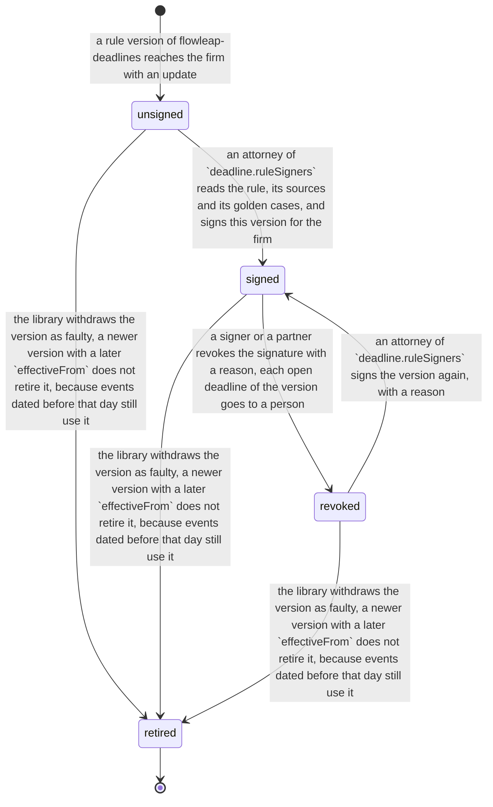

# Process 8: deadline confirmation

**Status:** approved by the founder on 2026-11-10 ("I accept"), with the decisions of [section 15](#15-decisions-for-the-founder). v1 runs the level `strict` with shadow mode; the level `evidence` is not offered to a real firm until a patent attorney has answered the open legal question (D8.9). [ADR 0003](../adr/0003-firm-state-rule.md) and [the firm organisation design](../2026-11-10-firm-organisation-design.md) win where they differ: the Firm Record runs the decision function, a partner and a rule signer act on the Records app (second origin) with roles from the one role function (migration step 5), and the EPO due dates come from the firm worker as observations (step 7). It writes out founder decision 6 of 2026-11-10, agreed in principle: the person moves from each deadline to each rule. An attorney signs a rule version one time; a deadline is confirmed automatically when its evidence agrees; otherwise a person gets it with the reason. This replaces decision F1 of 2026-11-04 ([README](README.md#founder-decision-the-independent-check-of-the-reading-f1-on-f3)) and amends [sheet 2](02-office-event-to-deadline.md). The level that allows automatic confirmation is a firm rule, and the strict level is the default. Method: [the atlas README](README.md#the-method-for-every-phase).

**This sheet is not legal advice.** It gives the sources and the open legal question for a patent attorney. It does not conclude that the design is permitted ([section 1](#1-the-law-and-the-process-today)).

**Starts when** the deadline engine proposes a deadline ([sheet 2](02-office-event-to-deadline.md), state `deadline_proposed`). **Ends when** the deadline is active, goes to one or two persons, or the decision function refuses it. **Record objects:** the evidence record and the decision of each deadline, and the firm's signature of each rule version. **Tickets:** none yet; see [section 13](#13-tickets).

## Contents

- [1. The law and the process today](#1-the-law-and-the-process-today)
- [2. Actors and roles](#2-actors-and-roles)
- [3. The evidence record](#3-the-evidence-record)
- [4. The decision function](#4-the-decision-function)
- [5. The levels](#5-the-levels)
- [6. The rule signature](#6-the-rule-signature)
- [7. The exceptions in My work](#7-the-exceptions-in-my-work)
- [8. Trust: shadow mode, the audit sample and the control list](#8-trust-shadow-mode-the-audit-sample-and-the-control-list)
- [9. The two-person rule and decision F1](#9-the-two-person-rule-and-decision-f1)
- [10. Known limits](#10-known-limits)
- [11. Firm variation points](#11-firm-variation-points)
- [12. AI-native redesign, map to the code and failure cases](#12-ai-native-redesign-map-to-the-code-and-failure-cases)
- [13. Tickets](#13-tickets)
- [14. Open questions for the pilot attorney](#14-open-questions-for-the-pilot-attorney)
- [15. Decisions for the founder](#15-decisions-for-the-founder)

## 1. The law and the process today

All facts were read on 2026-11-10. The source files list every fact with its URL and label: [60 EPC facts](sources/2026-11-10-epc-due-care.md), [39 German facts](sources/2026-11-10-de-fristenkontrolle.md) and [46 EPO and MyEPO facts](sources/2026-11-10-epo-myepo-sources.md). This table keeps the facts that the design touches.

### The EPC: "all due care" (Art. 122 EPC)

| # | Fact | Label and source |
|---|---|---|
| 8.1 | Rights are re-established when a time limit was missed "in spite of all due care required by the circumstances". The request is due two months from the removal of the cause, at the latest one year after the time limit | SOURCED: [Art. 122 EPC](https://www.epo.org/en/legal/epc/2020/a122.html), [R.136 EPC](https://www.epo.org/en/legal/epc/2020/r136.html) |
| 8.2 | Due care is met when the miss comes from exceptional circumstances or from an isolated mistake in a monitoring system that normally works well. Such a system "must include an independent, effective cross-check mechanism"; relatively small entities are exempt | SOURCED: [Guidelines 2026, E-VIII 3.2](https://www.epo.org/en/legal/guidelines-epc/2026/e_viii_3_2.html) |
| 8.3 | Assistants who note time limits must be "carefully selected, duly instructed and periodically supervised". E-VIII 3.2 does not name computers, software or automated systems | SOURCED: the same section; the absence is SOURCED (read by a summarising fetch over the section) |
| 8.4 | T 257/07 refused re-establishment because the system relied on one person's care and not on a cross-check that "must include either another person or an automated system alerting another person"; its computer system did not actively monitor and alert | SOURCED: [T 257/07](https://www.epo.org/boards-of-appeal/decisions/pdf/t070257eu1.pdf), decision text read |
| 8.5 | J 9/16 describes the cross-check as one database checked by two different persons, or two databases handled by two different persons, and expects a cross-check also when data is entered. Point 15: "it is not for the EPO to dictate how docketing" is organised | SOURCED: [J 9/16](https://www.epo.org/boards-of-appeal/decisions/pdf/j160009eu1.pdf), points 10, 11, 15, decision text read |
| 8.6 | T 1823/16 (an electronic docketing system): the cross-check must be at the data-entry phase, because a case with no data becomes invisible; the Board cannot prescribe one system | SOURCED: [T 1823/16](https://www.epo.org/boards-of-appeal/decisions/pdf/t161823eu1.pdf), points 6, 8, 10, decision text read |
| 8.7 | T 473/07: program faults are "a well-known part of that reality"; relying only on a time limit that a program computed, without a plausibility check by the representative, is not all due care | SOURCED: [T 473/07](https://www.epo.org/boards-of-appeal/decisions/pdf/t070473eu1.pdf), points 3.4 to 3.6, decision text read |
| 8.8 | The checking mechanism must be independent of the person who monitors time limits, in one system or in a second, redundant system (T 1962/08); a large firm needs a cross-check (J 9/86, T 1465/07, T 1726/08) | SOURCED (secondary): [Case Law Book, III.E.5.4.4 a](https://www.epo.org/en/legal/case-law/2025/clr_iii_e_5_4_4_a.html). The T 1962/08 decision page answered 404, so its text is NOT VERIFIED |
| 8.9 | Once a file is presented to the representative, responsibility passes to them, and they must check the time limits that the records department computed | SOURCED (secondary): T 439/06 in [Case Law Book, III.E.5.5.4 e](https://www.epo.org/en/legal/case-law/2025/clr_iii_e_5_5_4_e.html) |
| 8.10 | An electronic document is deemed delivered on the date it bears; earlier access does not change that date; a delivery more than seven days later extends the period by the excess days | SOURCED: [OJ EPO 2023, A29](https://www.epo.org/en/legal/official-journal/2023/03/a29), [Guidelines E-II 2.3](https://www.epo.org/en/legal/guidelines-epc/2026/e_ii_2_3.html). The current text of R.127(2) on its EPC page shows old and new wording together, so its exact wording is NOT VERIFIED |
| 8.11 | From 1 April 2027 Rules 126 to 128 are deleted, and a new Rule 125(2) keeps the date-it-bears rule with the seven-day extension, for documents dated from that day | SOURCED: [OJ EPO 2026, A27](https://www.epo.org/en/legal/official-journal/2026/04/a27) (CA/D 2/26) |

### Germany: Wiedereinsetzung and Fristenkontrolle

| # | Fact | Label and source |
|---|---|---|
| 8.12 | § 123 PatG re-establishes a person who missed a time limit before the DPMA or the BPatG "ohne Verschulden"; two months from the removal of the obstacle, at the latest one year. § 233 ZPO is the civil-procedure rule; § 85(2) ZPO counts the representative's fault as the party's | SOURCED: [§ 123 PatG](https://www.gesetze-im-internet.de/patg/__123.html), [§ 233 ZPO](https://www.gesetze-im-internet.de/zpo/__233.html), [§ 85 ZPO](https://www.gesetze-im-internet.de/zpo/__85.html) |
| 8.13 | X ZB 17/12 applies the ZPO standards under § 123 PatG to a "Rechts- oder Patentanwalt": routine deadlines may go to a well-trained, tested and supervised employee, with clear instructions and "zumindest stichprobenartige Kontrolle" (Rn. 10). The many deadlines of patent work can free the attorney from re-checking all of them at each file presentation, but not from the duty to stop unauthorised change or deletion (Rn. 14) | SOURCED: [BGH X ZB 17/12](https://www.bundesgerichtshof.de/SharedDocs/Entscheidungen/DE/Zivilsenate/X_ZS/2012/X_ZB__17-12.pdf?__blob=publicationFile&v=1), full text read |
| 8.14 | An electronic calendar needs a check of each entry by a printout of the entered items or an error log; else it is an organisational fault | SOURCED: [BGH XI ZB 23/08](https://www.bundesgerichtshof.de/SharedDocs/Entscheidungen/DE/Zivilsenate/XI_ZS/2008/XI_ZB__23-08.pdf?__blob=publicationFile&v=1), [VI ZB 55/11](https://www.bundesgerichtshof.de/SharedDocs/Entscheidungen/DE/Zivilsenate/VI_ZS/2011/VI_ZB__55-11.pdf?__blob=publicationFile&v=1), [III ZB 96/18](https://www.bundesgerichtshof.de/SharedDocs/Entscheidungen/DE/Zivilsenate/III_ZS/2018/III_ZB__96-18.pdf?__blob=publicationFile&v=1) (Leitsatz a), full texts read |
| 8.15 | III ZB 96/18 rejects a software dialog that re-reads the stored deadlines on screen: it is not as effective as a printout, because only the "Medienbruch" gives high security against a momentary failure of staff (Rn. 16 to 20) | SOURCED: the same decision, Leitsatz b, full text read |
| 8.16 | X ZB 2/20 (a ZPO case of the patent senate) leaves open whether "andere Maßnahmen" can replace the printout; it may be omitted "allenfalls" when other measures give "ein vergleichbares Maß an Sicherheit" (Rn. 10 to 13) | SOURCED: [BGH X ZB 2/20](https://www.bundesgerichtshof.de/SharedDocs/Entscheidungen/DE/Zivilsenate/X_ZS/2020/X_ZB___2-20.pdf?__blob=publicationFile&v=1), full text read |
| 8.17 | III ZB 82/23: the appellant argued that market-tested software and a "Vier-Augen-Prinzip" at entry were enough. The BGH held that this does not catch an error of the program, and that a lawyer may not assume correct data processing without a further control step. It again left open whether the control must be a paper printout | SOURCED: [BGH III ZB 82/23](https://www.bundesgerichtshof.de/SharedDocs/Entscheidungen/DE/Zivilsenate/III_ZS/2023/III_ZB__82-23.pdf?__blob=publicationFile&v=1), Rn. 4, 9, 10, full text read |
| 8.18 | Changed and struck deadlines must stay visible, also in an electronic calendar; software that cannot show them is "Organisationsverschulden bei der Auswahl der Software" | SOURCED: [BGH XII ZB 338/24](https://www.bundesgerichtshof.de/SharedDocs/Entscheidungen/DE/Zivilsenate/XII_ZS/2024/XII_ZB_338-24.pdf?__blob=publicationFile&v=1) (4 March 2026), Rn. 11 to 13, full text read |
| 8.19 | When the file is presented for the deadline-bound act, the lawyer checks the deadline personally, with a paper or an electronic file | SOURCED: [BGH XII ZB 483/21](https://www.bundesgerichtshof.de/SharedDocs/Entscheidungen/DE/Zivilsenate/XII_ZS/2021/XII_ZB_483-21.pdf?__blob=publicationFile&v=1), [IX ZB 17/18](https://www.bundesgerichtshof.de/SharedDocs/Entscheidungen/DE/Zivilsenate/IX_ZS/2018/IX_ZB__17-18.pdf?__blob=publicationFile&v=1) Rn. 10, full texts read |
| 8.20 | The outgoing check (Ausgangskontrolle) needs an end-of-day check against the calendar by a staff member, a "nochmalige, selbständige und abschließende Kontrolle"; a deadline is struck only after the act is done | SOURCED: [BGH I ZB 34/24](https://www.bundesgerichtshof.de/SharedDocs/Entscheidungen/DE/Zivilsenate/I_ZS/2024/I_ZB__34-24.pdf?__blob=publicationFile&v=1), Rn. 13, full text read |
| 8.21 | No BGH or BPatG decision was found on deadlines that firm software computes and enters by itself, or on AI in deadline control | NOT VERIFIED: absence after a web search; juris and beck-online were not searched. BPatG full texts (for example 10 W (pat) 16/12) were not reachable and are SOURCED (secondary) only |

### MyEPO due dates and the deadline library

| # | Fact | Label and source |
|---|---|---|
| 8.22 | MyEPO shows procedural actions with deadlines only for the replies under Rule 71(3), Art. 94(3), Rule 70a and Rules 62a/63; Rules 161/162 are not listed automatically | SOURCED: [MyEPO FAQ](https://epo.org/en/service-support/faq/myepo-services/myepo/applications-and-patents/one-my-applications-theres) and the [feature guide on replies](https://link.epo.org/web/myepo-services/interact/en-myepo-feature-guide-replying-to-communications-with-deadlines.pdf) |
| 8.23 | The API gives `dueDates` with `termKey`, `dueDate` and `actor` for each application, and `/terms` lists 82 terms. Whether production `dueDates` covers more than the four reply types of fact 8.22 is not known | MEASURED: sandbox probe of 2026-11-09 ([study](../2026-11-09-myepo-api-study.md#sandbox-results)), dummy data only; the coverage is NOT VERIFIED |
| 8.24 | No EPO page that we read calls the MyEPO deadlines binding, or "for information only". The only such clause found was for the email alerts (OJ EPO 2023, A89, Art. 6(3)), and the later decisions do not repeat it | SOURCED (absence), read on 2026-11-10; [OJ EPO 2023, A89](https://www.epo.org/en/legal/official-journal/2023/10/a89.html) |
| 8.25 | flowleap-deadlines computes the earliest safe date with a trace, refuses with a named error and never guesses. Each rule version has `reviewedBy`; today every rule has `reviewedBy: null`, and the README says that no date may be the only source for a real deadline | SOURCED: flowleap-deadlines README and `src/types.ts` (commit 2b92bef) |

### What the sources say, and what they do not say

**They say:** a large firm needs an independent, effective cross-check (facts 8.2, 8.8), also at data entry (8.5, 8.6); one person's care is not enough (8.4); a program's date needs a plausibility check (8.7); in Germany each electronic entry needs a control by printout or error log (8.14, 8.15), the program itself needs a control step (8.17), changes must stay visible (8.18), and the attorney checks the deadline when the file comes for the act (8.9, 8.19).

**They do not say** that a check by software may replace the second person. Each decision that dealt with a software control asked for a further check that a person makes (8.7, 8.15, 8.17). No source excludes every other form of check: the EPO does not dictate the organisation (8.5, point 15), and the BGH leaves open measures of comparable safety (8.16). T 257/07 names "an automated system alerting another person" as one form of cross-check, but as a description in a refusal, not as a holding that such a system was enough (8.4). In Germany the question whether measures of "vergleichbares Maß an Sicherheit" can replace the printout is open (8.16, 8.17). No source deals with a structured office source, two independent readers, a rule signed once by an attorney, or a second date source from the office (8.21).

**The open legal question for a patent attorney.** Does a firm meet "all due care" under Art. 122 EPC, and show an organisation of "vergleichbares Maß an Sicherheit" under § 123 PatG and § 233 ZPO, when the independent check of a deadline at entry is done by software in place of a second person, under these conditions: (a) the event comes from a structured office source or two independent readers agree, (b) an attorney signed the rule version, (c) the date agrees with a second, independent date source from the EPO, (d) a person gets every deadline where one of these fails, (e) a weekly random sample is checked by a person, and (f) a person checks a daily control list of the automatic entries? Sub-questions: is the EPO due date independent enough of the EPO list data, when both come from the EPO (section 10)? Does a software cross-check count as the "Kontrolle" that catches program errors (8.17), or does the BGH expect a step that a person perceives, with a "Medienbruch" (8.15)? Does a signed rule version meet the duty to supervise a delegated computation (8.13)? Which records must the system keep so that the firm can make the control credible for one deadline (§ 123(2) PatG)?

## 2. Actors and roles

| Actor | Role in this process |
|---|---|
| Deadline engine (flowleap-deadlines) | Computes the date with a trace from the event and the rule version; refuses with a named error |
| Firm Record | Builds the evidence record, runs the decision function, logs each decision with its evidence, and refuses a confirm that the decision does not allow |
| Rule signer (attorney of `deadline.ruleSigners`) | Signs a rule version for the firm one time; revokes a signature |
| Confirmer (PAFA, attorney or partner of `deadline.confirmerRoles`) | Confirms a deadline that goes to one or two persons; never a person who made its evidence |
| Auditor (`deadline.audit.person`) | Checks the weekly sample and records a result for each deadline |
| Control-list checker (`tasks.dayCheck.person`) | Checks the daily list of the deadlines that became active without a person (decision D8.6) |
| Partner | Sets the firm level; last person in the escalation chains |
| Attorney on the matter | Checks the deadline when the worked letter reaches them ([sheet 3](03-notify-and-run.md)), on every level (facts 8.9, 8.19) |

## 3. The evidence record

The Firm Record builds one evidence record for each deadline proposal, from record events only (the rule "model-visible ⟺ logged" applies to decisions too). The decision function reads nothing else.

| Field | What it holds | Where it comes from |
|---|---|---|
| `event` | The office event: code, the date the letter bears, the application, the matter | [Sheet 2](02-office-event-to-deadline.md) |
| `event.source` | `myepo-list` (document code and dispatch date of the MyEPO list), `register` (an EP Register entry), `two-readers` (form number and model reading agree), `person-decided` (a person decided the code), or `person-entered` (a person entered the event from a scan) | The `office-event/observed` or `office-event/recorded` event |
| `event.readings` | Each reading with its reader: the reader kind, its input (span, page-image hash, list fields) and its result; for a letter that states the period, the period that each reader read | `ModelReading`, the code span, the list fields |
| `rule` | Rule id, version, its golden-cases hash, its `reviewedBy`, its effective dates | flowleap-deadlines |
| `rule.signature` | `signed` (by whom, when, for which cases hash and code table version), `unsigned`, or `revoked` | `rule/signed`, `rule/signature-revoked` ([section 6](#6-the-rule-signature)) |
| `dates` | Each date with its source: `engine` (with the trace hash), `epo-due-date` (with the `termKey`, the read time), `person` (who entered it) | The engine, the MyEPO `dueDates` read, a manual entry |
| `agreement` | For each pair of dates: equal or different by how many days; whether the period that the letter states equals the rule's period | Computed by the Firm Record |
| `makers` | Every person who made a part of the evidence: the code decider, the event entrant, the date entrant | The record events |
| `level` | The firm level, and whether the rule is in `deadline.automaticRules` | Firm settings, with the record position of the last change |
| `near` | Whether the due date is past or within `deadline.nearDue` | Computed at decision time |
| `decision` | `automatic`, `one-person`, `two-persons` or `refuse`, with the reason codes and the version of the decision function | The decision function |

## 4. The decision function

One pure function: `decide(evidence: EvidenceRecord): Decision`. It has no clock, no network and no model; the Firm Record gives it `near` and `level` as inputs. Every row that matches adds its reasons, and the result is the strictest result of the matching rows, in the order refuse, two persons, one person, automatic. So a near deadline whose dates differ goes to two persons with both reasons, and it is an alarm. "One person" means one confirm by a person who is in no field of `makers`; "two persons" means two confirms by two such persons.

| # | Condition | Result | Reason in My work |
|---|---|---|---|
| 1 | A required field is missing, the rule version's signature is revoked, or the rule version is not effective for the event date | refuse: the deadline goes to `engine_refused`, and a person enters the date by hand | `evidence-incomplete`, `rule-revoked`, `rule-not-effective` |
| 2 | Two date sources differ (engine and EPO due date, or the period that the letter states and the rule's period) | two persons; the earlier date drives every alarm until the decision | `sources-differ` |
| 3 | A person entered the date (`manual_proposed`) | one person | `person-entered-date` |
| 4 | A person entered the event from a scan | one person | `person-entered-event` |
| 5 | A person decided the code: the code is unknown, the readers differ, or only one reader has a result | one person | `code-unknown`, `readers-differ`, `one-reader` |
| 6 | The due date is past or within `deadline.nearDue` | one person, at once, as an alarm | `due-soon` |
| 7 | The rule version is not signed by the firm | one person | `rule-not-signed` |
| 8 | No EPO due date exists for the deadline after `deadline.secondSourceWait` | one person | `no-second-source` |
| 9 | The level is not `evidence`, or the rule is not in `deadline.automaticRules` | one person | `level` |
| 10 | The event source is `register` (a register entry with no letter, [sheet 1](01-office-letter-intake.md#8-the-myepo-route)), or a `myepo-list` source before the date check of section 10 is done | one person | `register-only`, `list-date-unchecked` |
| 11 | No other row matches: the event source is `myepo-list` (checked) or `two-readers`; the rule version and the code table version are signed; the EPO due date equals the engine date; the due date is not near | automatic | none; the deadline is on the daily control list |

On the `four-eyes` level, each "one person" result is two persons.

**Why the strictest result wins.** A difference of dates (row 2) is the case where one of the sources is wrong, so it adds a second person to every other reason. A near date (row 6) leaves no time for the weekly audit, so it is an alarm whatever else matches. **The wait for the second source.** The firm worker reads `dueDates` after each new event and sends them as observations; the decision waits up to `deadline.secondSourceWait` (default 1 working day, never past the near date) for it before row 8 applies [INFERRED; the time that the EPO needs to show a due date is not known]. The test of the function is a table test of every row, plus a property: no evidence record with `sources-differ` or a `person-*` source ever gives `automatic` [INFERRED design rule; the build PR proves it].

**The letter confirms the rule, not the date.** An EPO letter usually states the period ("within four months"), not the due date. So a model reading of the period confirms that the engine chose the right rule (row 2 compares the periods), and it cannot confirm the date. The independent date is the EPO due date of MyEPO (fact 8.23). Without it, row 8 sends the deadline to a person.

## 5. The levels

The names are open for the founder (decision D8.1). The recommended set:

| Level | What it means | Default |
|---|---|---|
| `strict` | Every deadline needs at least one person: row 9 matches every deadline, so no deadline is automatic | **Yes** |
| `four-eyes` | Every deadline needs two persons, as the old setting `deadline.checkPolicy: 'always-second-person'` | No |
| `evidence` | Row 11 gives automatic, only for the rules in `deadline.automaticRules` | No |

A partner sets the level on the Records app (second origin; the role from the role function of the Firm Record). The change is a record event with the person and a reason, and the level holds from the next decision; open decisions keep the level that they were made with [INFERRED; decision D8.2]. On every level, shadow mode computes what `evidence` would give and logs it ([section 8](#8-trust-shadow-mode-the-audit-sample-and-the-control-list)). The level can move to `evidence` for a rule only when that rule's shadow numbers meet the threshold of decision D8.4.

## 6. The rule signature

A signature binds the firm to one rule version, its golden cases and the version of the code table of [sheet 2](02-office-event-to-deadline.md#8-the-myepo-route) that maps the document codes to its events: the attorney reads the rule, its legal sources, its golden cases and the code table entries of the rule, and signs. A new code table version that changes an entry of the rule needs a new signature. The signature is not FlowLeap's `reviewedBy`; it is the firm's own act.

<!-- atlas:ruleSignature -->
It has **4 states and 6 transitions**, plus the start.

| From | To | Event | Actor | Evidence in the record log |
|---|---|---|---|---|
| start | `unsigned` | A rule version of flowleap-deadlines reaches the firm with an update | installer (update) | Rule id, version, library version, the hash of its golden cases, its `reviewedBy` |
| `unsigned` | `signed` | An attorney of `deadline.ruleSigners` reads the rule, its sources and its golden cases, and signs this version for the firm | person (attorney) | `rule/signed`: rule id, version, cases hash, the attorney, time, the text that they confirmed |
| `signed` | `revoked` | A signer or a partner revokes the signature with a reason; each open deadline of the version goes to a person | person (attorney) | `rule/signature-revoked`, reason, the deadlines that it reopened |
| `revoked` | `signed` | An attorney of `deadline.ruleSigners` signs the version again, with a reason | person (attorney) | `rule/signed`, the reason, the earlier revocation |
| `unsigned`, `signed`, `revoked` | `retired` | The library withdraws the version as faulty; a newer version with a later `effectiveFrom` does not retire it, because events dated before that day still use it | Firm Record | The withdrawal and its reason in the library |

End states: `retired`.


<!-- /atlas:ruleSignature -->

**What happens to deadlines when a rule version changes.**

| Change | A proposed deadline (`deadline_proposed`, `first_confirmed`) | An active deadline |
|---|---|---|
| A new version takes effect from a date (a change of the law) | No change for an event dated before that day: the old version stays its rule. An event dated from that day gets the new version | No change: an active deadline keeps the version of its event date |
| A new version corrects an old one for the same dates (a change of our reading) | `stale`, and the engine proposes again with the new version ([sheet 2](02-office-event-to-deadline.md)) | The engine computes again: the same date adds the new version to the evidence; another date makes it `disputed` |
| The new version is not signed yet | The new proposal goes to one person (row 7) | No change from the signature; a `disputed` deadline goes to a person anyway |
| A signature is revoked | Refused (row 1), so a person enters the date | Each deadline that became active automatically under that version goes to `disputed` with the reason `rule-revoked`, so a person decides each one |
| The library withdraws a version as faulty (`retired`) | Refused (row 1, `rule-not-effective`) | Each deadline of that version goes to `disputed`, and the trace stays reproducible |

**Who may sign** is open (decision D8.3). The recommended rule: an attorney named by a partner in `deadline.ruleSigners`, and only a version whose `reviewedBy` is set, so that FlowLeap's attorney and the firm's attorney both read it.

## 7. The exceptions in My work

Each result that needs a person opens the task "Confirm the deadline" of [sheet 0](00-connected-flow.md#3-the-task-model), with the reason codes of section 4 in the words of the page. Examples: "The EPO due date is 3 days earlier than the computed date", "You entered the code of this letter, so a colleague confirms it", "The rule Art. 94(3) EPC version 1 is not signed by your firm". A `sources-differ` task opens for two persons at once, and the page shows both dates side by side. When the EPO date is right, the first person enters it as the date (`manual_proposed` with the reason), and the second person confirms; when the engine date is right, the two persons confirm it (`first_confirmed`, then `active`). A `due-soon` task is an alarm in the morning brief. The same reasons go into the weekly report of the partner with their counts [INFERRED].

## 8. Trust: shadow mode, the audit sample and the control list

**Shadow mode.** On every level, the Firm Record runs the decision function also as if the level were `evidence` and logs `deadline/decision-shadowed` with the result that it would have given. Beside the firm's old docket, a person or an import records the old docket's date for the same event. The difference rate of a rule is the share of compared deadlines where FlowLeap's date differs from the old docket's date. Each difference gets a class from a person: FlowLeap wrong, old docket wrong, or a convention (for example a Vorfrist entered as the due date) [INFERRED]. How the old docket's dates come in is a question for the pilot (Q8.2).

**The threshold, as a number.** With no FlowLeap error in n compared deadlines of one rule, the upper 95 % bound of the error rate is about 3/n (the rule of three). So 300 deadlines with no error give a bound of about 1 %, and 3,000 give about 0.1 %. The recommendation is n ≥ 300 for each rule before `evidence` can include it (decision D8.4). A small firm with tens of EP files reaches 300 deadlines of one rule only after years [INFERRED from fact 7.10 of sheet 7], so a small firm will not reach the threshold for years, and stays on `strict`. The threshold is the setting `deadline.shadow.threshold` (D8.4).

**The weekly audit sample.** Each week the Firm Record draws a random sample of the deadlines that became active automatically in the last week: at least 5, at least 5 %, and at least one of each rule, with the random seed logged. The auditor checks each one against the letter and the EPO due date and records a result. One error moves that rule out of `deadline.automaticRules` at once, opens an incident, and sends every automatic deadline of the rule from the last `deadline.audit.lookback` to a person [INFERRED; decision D8.5]. The sample is meant as the "stichprobenartige Kontrolle" of fact 8.13 for the computation that the firm delegates; whether it meets that duty is part of the open legal question.

**The daily control list.** Each working day, the person of the day check ([sheet 0](00-connected-flow.md#3-the-task-model), `day-check`) gets the list of the deadlines that became active without a person that day, with the letter, the rule, the engine date and the EPO due date in each row, and records one check of the list. The list can be printed. It is meant to give the person a printed control of the entries, as facts 8.14 to 8.16 describe, while the legal question is open; whether one checked list per day gives a comparable safety is part of that question. It costs one act per day, not one per deadline (decision D8.6).

**When a check is not done.** The audit and the control list are tasks of [sheet 0](00-connected-flow.md#3-the-task-model) with their escalation. When an audit is not recorded within `deadline.audit.within` plus the escalation, or a control list stays unchecked for `deadline.controlList.missedDays`, the Firm Record moves the firm to `strict` until a partner sets the level again [INFERRED; decision D8.10]. A new rule version starts its shadow count at zero, unless its golden cases give the same dates as the old version for every case [INFERRED].

**What stays visible.** The Firm Record log is append-only (`record.single-writer`), so every earlier date, every change and every decision of a deadline stays readable; the deadline page must show them, because fact 8.18 asks that changes stay visible.

## 9. The two-person rule and decision F1

**The rule today.** `docket.two-person` of flowleap-os: a deadline becomes active only when a person who did not record its office event confirms it and the engine computes the same trace hash again. Decision F1 of 2026-11-04 added two readers for the code and the date ([README](README.md#founder-decision-the-independent-check-of-the-reading-f1-on-f3)).

**What each result means for that rule.**

| Result | Who must act | `docket.two-person` |
|---|---|---|
| `refuse` | Nobody can confirm this proposal; a person enters a manual date, which then goes to one person | Holds: nothing becomes active |
| `one-person` | One person who made none of the evidence | Holds unchanged: one person and the engine are the two checks |
| `two-persons` | Two different persons who made none of the evidence | Holds and is stronger: two persons and the engine |
| `automatic` | No person | **Does not hold.** The two checks become two independent sources (a structured or two-reader event and the EPO due date) and the engine, under a signed rule. The rule must change, see the proposed rows below |

**The states of sheet 2 under this sheet.** `deadline_proposed` waits for the decision; `first_confirmed` (new) holds the first of two confirms; `active` now has three origins (one person, two persons, automatic), and the evidence record names which. A deadline that became active automatically is on the daily control list and can be in the audit sample; a failed audit makes it `disputed`.

**How this replaces F1.** F1 made the AI a second reader of the code and the date, and kept one person to confirm each deadline. Decision 6 keeps the two readers as one form of event evidence (`two-readers`), adds the MyEPO list as a structured source, and moves the person from each deadline to each rule. The setting `deadline.readingCheck` stays for the event; `deadline.checkPolicy` is replaced by the level. The README section of F1 and section 3 of sheet 2 carry a marked amendment that points here.

**Proposed rows for the flowleap-os register.**

| Id | Invariant | Stops |
|---|---|---|
| `docket.two-person` (amended) | A deadline becomes active only with two independent checks: a person who made none of its evidence and the engine's trace; or, on the `evidence` level only, the conditions of `docket.automatic-needs-agreeing-evidence` | One person, one agent or one source that makes a wrong deadline count |
| `docket.automatic-needs-agreeing-evidence` | The Firm Record makes a deadline active without a person only when its logged evidence record has a `myepo-list`, `register` or `two-readers` event, a signed and effective rule version, the engine's trace recomputed by the Firm Record, an EPO due date equal to the engine date, a due date that is not near, and the firm level `evidence` with the rule enabled | A software path that activates a deadline on partial evidence |
| `docket.decision-pure-and-logged` | The decision is a pure function of the logged evidence record; each decision is a record event with the evidence and the function version, and a replay of the log gives the same decision | A decision that no one can reconstruct for a re-establishment request |
| `docket.makers-not-confirmers` | A person in `makers` of a deadline cannot confirm it, and the two confirms of `two-persons` come from two different persons | A person who checks their own entry |
| `docket.revoke-reopens` | A revoked signature sends every automatic deadline of that version to `disputed` | A rule that the firm no longer trusts and that still holds active deadlines |
| `docket.audit-failure-stops-rule` | A failed audit removes the rule from `deadline.automaticRules` in the same record transaction as the result | A known faulty rule that keeps confirming |

## 10. Known limits

- **The letter states the period, not the date** ([section 4](#4-the-decision-function)). The independent date source is the EPO due date.
- **The dispatch date is not yet checked as the date the letter bears** ([sheet 1, fact 1.21](01-office-letter-intake.md#8-the-myepo-route)). Until the pilot compares the list date with the printed date on the letters of its first month, a `myepo-list` event is not a checked source (row 10). The check needs the downloaded letters, so the pilot runs it on letters that persons open in that month, or with `on-arrival` on a test account (decision D8.11).
- **The second date source is not fully independent.** The EPO list data and the EPO due date both come from the EPO's records. A fault in the EPO's own record of an event can give the same wrong date in both. The two readers of a letter are the source that does not depend on the EPO's records [INFERRED].
- **The EPO due dates need production data.** The sandbox has dummy rows (fact 8.23), and MyEPO lists deadlines for only four reply types (fact 8.22). For every other rule, row 8 sends each deadline to a person until production shows the due dates.
- **The MyEPO list of 82 terms is the checklist** of the EPO terms that the rule set must cover; each `termKey` needs a mapping to a rule id, and a `termKey` with no rule is a gap that the weekly report names [INFERRED from fact 8.23].
- **Responsibility stays with the attorney** (facts 8.9, 8.13, 8.19). The level is a firm rule with the partner's name on it, and `strict` is the default. The attorney's own check when the worked letter reaches them ([sheet 3](03-notify-and-run.md)) stays on every level.
- **The legal question is open** ([section 1](#what-the-sources-say-and-what-they-do-not-say)). Until a patent attorney answers it for the pilot firm, `evidence` is a setting that FlowLeap does not recommend for production.
- **In R1 the firm's old docket is the authority** (docket observe mode), so a FlowLeap `active` changes nothing that the firm relies on, and shadow mode is the only effect [SOURCED: [README](README.md#the-count-r1-and-after-the-cut-over)].

## 11. Firm variation points

| Setting | Type | Default | Why firms differ |
|---|---|---|---|
| `deadline.level` | `'strict' \| 'four-eyes' \| 'evidence'` | `'strict'` | The firm's written deadline instruction and its insurer |
| `deadline.automaticRules` | list of rule ids | empty | A rule enters only after its shadow threshold and its signature |
| `deadline.ruleSigners` | list of persons | empty: no signature possible until a partner names one | Who answers for the rules in the firm |
| `deadline.nearDue` | working days | 10 | How much time the firm wants for a person before a due date |
| `deadline.secondSourceWait` | working days | 1, never past the near date | How long the decision waits for the EPO due date |
| `deadline.controlList.missedDays` | working days | 2 | After how many unchecked days the firm falls back to `strict` |
| `deadline.audit.person` | person or role | the partner | Who checks the sample |
| `deadline.audit.within` | duration | 2 working days | How fast an error must surface |
| `deadline.audit.lookback` | duration | 4 weeks | How far back an audit error reopens automatic deadlines |
| `deadline.shadow.threshold` | number of compared deadlines with no FlowLeap error | 300 for each rule | The bound of the error rate that the firm accepts (section 8) |
| `deadline.controlList` | boolean | `true` when the level is `evidence` | The open German question (facts 8.14 to 8.16) |
| `deadline.checkPolicy` | removed | replaced by `deadline.level` | `'always-second-person'` is the level `four-eyes` |

## 12. AI-native redesign, map to the code and failure cases

**What disappears** on the `evidence` level: the confirm of each deadline whose evidence agrees. The person's work moves to the rule (one signature for each version), the exceptions, the weekly sample and the daily list.

**The count**, for a typical EPO letter with a signed rule and an EPO due date:

| | Old way (PATORG) | `strict` | `evidence` |
|---|---|---|---|
| Steps for each deadline | 3: pick the type, enter the date, a second person checks (2 with the PATORG AI) | 1: confirm | 0 |
| Steps for the firm | none | none | 1 signature for each rule version; 1 control-list check each day; the weekly sample (at least 5 checks) |
| Steps for each exception | 1 to 2 | 1 or 2 by the result of section 4 | 1 or 2 by the result of section 4 |

The old count is INFERRED, as in [sheet 2](02-office-event-to-deadline.md#5-ai-native-redesign).

**The process today in a firm.** The PAFA reads the letter, picks the deadline type, enters the date, and a second person or the partner checks ([sheet 2, fact 2.11](02-office-event-to-deadline.md#1-the-process-today)) [INFERRED]. No firm that we know confirms a deadline without a person.

**What exists.** The engine with its trace and its refusals; `deadline/proposed`, `deadline/confirmed`, `deadline/rejected`; `docket.two-person`, `docket.confirm-names-seen-seq`; the two readers of F1 (`readers.misread-never-agree`, `readers.model-sees-picture-only`); `reviewedBy` in the rule type.

**What is new:** `deadline/decided` (actor record, with the evidence record and the function version), `deadline/first-confirmed`, `deadline/decision-shadowed`, `rule/signed`, `rule/signature-revoked`, `deadline/level-set`, `deadline/audit-drawn`, `deadline/audit-result`, `deadline/control-list-checked`; the MyEPO `dueDates` read into the evidence; the `termKey` map.

```ts
type EventSource =
  | { kind: 'myepo-list'; communication: MyEpoCommunicationId; documentCode: string; dispatchDate: LocalDate }
  | { kind: 'register'; entry: RegisterEventRef; read: Instant }
  | { kind: 'two-readers'; code: Span; model: ModelReading }
  | { kind: 'person-decided'; by: PersonId; proposal: ProposalId }
  | { kind: 'person-entered'; by: PersonId; pageImage: Sha256 }
type DateSource =
  | { kind: 'engine'; rule: RuleRef; trace: TraceHash }
  | { kind: 'epo-due-date'; termKey: string; read: Instant }
  | { kind: 'person'; by: PersonId; reason: string }
type Signature = { s: 'signed'; by: AttorneyId; at: Instant; cases: Sha256; codeTable: CodeTableVersion } | { s: 'unsigned' } | { s: 'revoked'; by: AttorneyId; reason: string }
type EvidenceRecord = {
  event: { source: EventSource; readings: Reading[] }
  rule: { ref: RuleRef; signature: Signature; effective: boolean }
  dates: [Extract<DateSource, { kind: 'engine' | 'person' }>, ...DateSource[]]
  makers: PersonId[]
  level: { level: 'strict' | 'four-eyes' | 'evidence'; ruleEnabled: boolean; seq: RecordSeq }
  near: boolean
}
type Reason = 'evidence-incomplete' | 'rule-revoked' | 'rule-not-effective' | 'sources-differ' | 'person-entered-date'
  | 'person-entered-event' | 'code-unknown' | 'readers-differ' | 'one-reader' | 'due-soon' | 'rule-not-signed' | 'no-second-source' | 'level'
  | 'register-only' | 'list-date-unchecked'
type Decision =
  | { d: 'automatic'; fn: DecisionFnVersion }
  | { d: 'one-person'; reasons: [Reason, ...Reason[]]; fn: DecisionFnVersion }
  | { d: 'two-persons'; reasons: [Reason, ...Reason[]]; fn: DecisionFnVersion }
  | { d: 'refuse'; reasons: [Reason, ...Reason[]]; fn: DecisionFnVersion }
// automatic carries no reasons, and every other result carries at least one, so a person always sees why.
declare function decide(evidence: EvidenceRecord): Decision
```

**Failure cases.**

- **The EPO due date arrives after the decision.** A later `dueDates` read that differs from an active deadline makes it `disputed` ([sheet 2](02-office-event-to-deadline.md)); one that agrees adds it to the evidence.
- **The EPO due date changes** (for example after a further-processing request). The same as above [INFERRED].
- **The MyEPO link is `refused` for days.** No EPO due dates, so row 8 sends new deadlines to a person; nothing becomes automatic.
- **The decision function has a fault.** A new function version is a new version, as a rule is: the log names the version of each decision, and a replay with the corrected version lists every deadline whose result changes [INFERRED].
- **Two persons confirm the same deadline at the same time.** The seen seq of each confirm (`docket.confirm-names-seen-seq`) refuses the second when the first changed the state.

## 13. Tickets

The build follows migration steps 5 (roles and the second origin, for the level and the rule signature) and 7 (the EPO due dates from the firm worker) of [the firm organisation design](../2026-11-10-firm-organisation-design.md#9-the-migration). Proposed tickets, in order: (1) flowleap-os, the evidence record, the pure decision function with its table test, and `deadline/decided`, on `strict` and in shadow mode only, so it changes no confirmation; (2) flowleap-os, the rule signature: the commands `rule/signed` and `rule/signature-revoked` with their role entries, and the rule review screen of the Records app, which exists as a mockup in draft PR 388; (3) flowleap-os, the level setting for a partner with its reason; (4) flowleap-os, shadow mode with the import of the old docket's dates and the difference report; (5) flowleap-os, the audit sample and the control list; (6) the invariant rows of section 9. No ticket builds the level `evidence` for a real firm before the legal question has an answer (D8.9).

## 14. Open questions for the pilot attorney

- **Q8.1** Does your firm's insurer or your written deadline instruction allow a deadline that no person confirmed? Under which conditions?
- **Q8.2** Can your old docket export its deadlines with the application number, the event and the date, so that FlowLeap can measure the difference rate?
- **Q8.3** Who in your firm would sign a rule version, and who checks a weekly sample?
- **Q8.4** Do you print a control list of new deadline entries today (facts 8.14, 8.15)?
- **Q8.5** The legal question of [section 1](#what-the-sources-say-and-what-they-do-not-say): would you answer it for your firm, or ask your chamber or your insurer?

## 15. Decisions for the founder

All decisions of this section were decided by the founder on 2026-11-10 ("I accept"), as recommended unless a line says otherwise.

- **D8.1 The names and conditions of the levels.** Decided 2026-11-10: `strict` (default), `four-eyes`, `evidence`, as in section 5, and `evidence` only per rule. Another reading of decision 6 is that the strict level already allows automatic confirmation, with the strictest conditions (for example two readers and the EPO due date and a near-date limit of 20 days). This sheet reads "strict" as "a person confirms each deadline", because responsibility stays with the attorney and the legal question is open.
- **D8.2 Who sets the level.** Decided 2026-11-10: a partner, on the Records app, as a record event with a reason; open decisions keep their level.
- **D8.3 Who may sign a rule version.** Decided 2026-11-10: an attorney that a partner names in `deadline.ruleSigners`, and only a version that FlowLeap reviewed first (`reviewedBy` set). No signature until both reviews exist.
- **D8.4 The shadow threshold.** Decided 2026-11-10: at least 300 compared deadlines of the rule with no FlowLeap error (an error bound of about 1 %), as the setting `deadline.shadow.threshold`, and no automatic confirmation of that rule before. A small firm with tens of EP files will not reach it for years.
- **D8.5 What a failed audit does.** Decided 2026-11-10: the rule leaves `deadline.automaticRules` at once, and every automatic deadline of the rule from the last 4 weeks goes to a person.
- **D8.6 The daily control list on the `evidence` level.** Decided 2026-11-10: yes, one checked list per day, printable, until a patent attorney answers the German question; it costs one step per day, not one per deadline.
- **D8.7 Which EPO terms come first after Rule 71(3).** Decided 2026-11-10: the other three replies that MyEPO lists with deadlines (fact 8.22): Art. 94(3), then Rule 70a, then Rules 62a/63. For these the EPO due date can exist, so row 8 does not stop them. Renewal fees (R.51) and Rules 161/162 come after production data shows their due dates (fact 8.23). An Art. 94(3) letter sets its period in the text (R.132), so it also needs the period reading of the two readers ([sheet 2](02-office-event-to-deadline.md)).
- **D8.8 A difference of dates goes to two persons.** Decided 2026-11-10: yes (row 2), because a difference means that one source is wrong; the earlier date drives the alarms until the decision.
- **D8.9 `evidence` is not offered to a real firm until a patent attorney has answered the open legal question.** Decided 2026-11-10: yes. v1 runs `strict` with shadow mode.
- **D8.10 A missed audit or control list moves the firm back to `strict`.** Decided 2026-11-10: yes; a control that nobody does is no control.
- **D8.11 A MyEPO list event counts as a checked source only after the date check.** Decided 2026-11-10: yes; the pilot compares the list date with the printed date on every letter that a person opens in its first month, and a single difference keeps row 10 for all list events.
