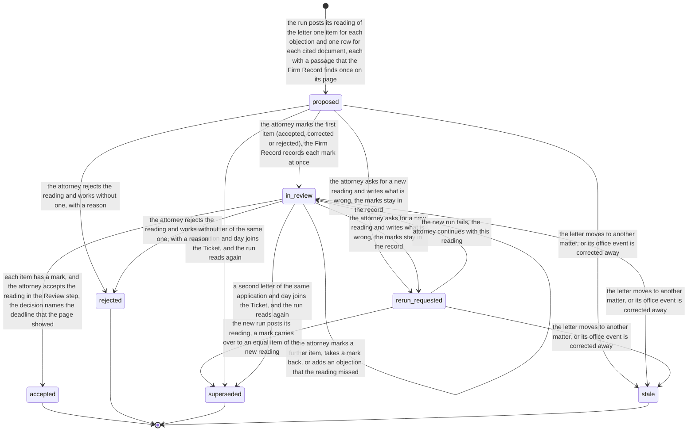
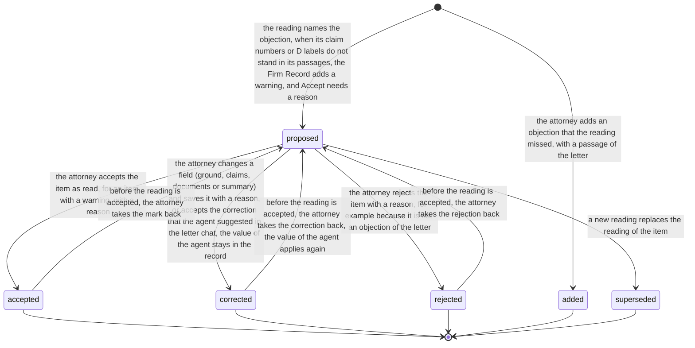

# Process 9: an Art. 94(3) letter arrives

**Status:** draft for the founder's decision, 2026-11-13. No code changes with this sheet. The office action board is built to it after the founder decides [section 13](#13-decisions-for-the-founder). Method: [the atlas README](README.md#the-method-for-every-phase).

**Why this sheet.** The chain for an Art. 94(3) communication works with no person up to a task (harness `e4c10045e1`, flowleap-os `c55a95b`). The founder then worked one letter as the attorney and said: "as a user I want an understandable process" (ticket [#399](https://github.com/flowleap-ai/flowleap-harness/issues/399), comment of 2026-11-13). The defects follow one cause: the person's path follows the Firm Record objects (office event, deadline, Ticket, reading), not the one piece of work that a person knows, "the letter". This sheet designs the path of the formalities person and of the attorney for one letter. It reuses sheets 0, 2, 3 and 8 and changes none of their rules.

**Starts when** the Firm Record records the office event of an Art. 94(3) communication on a matter (code `EPO:A94(3)`, [sheet 2](02-office-event-to-deadline.md)). **Ends when** the deadline is active, rejected or stale ([sheet 8](08-deadline-confirmation.md)), and the reading of the letter is accepted, rejected, replaced or stale, or the attorney works by hand ([sheet 3](03-notify-and-run.md)). The reply and the client report are later processes; this sheet keeps a named place for them. **Record objects:** the reading and its items (new states, [section 4](#4-state-machines)); the deadline, the Ticket and the task are the objects of sheets 8, 3 and 0. **Walkthrough:** [a94-letter walkthrough](../mockups/a94-letter/a94-letter-walkthrough.html) (one file, opens with no server).

## Contents

- [1. The process today](#1-the-process-today)
- [2. Actors and roles](#2-actors-and-roles)
- [3. The path of one letter](#3-the-path-of-one-letter)
- [4. State machines](#4-state-machines)
- [5. The design questions](#5-the-design-questions)
- [6. What the system does alone, failures and time limits](#6-what-the-system-does-alone-failures-and-time-limits)
- [7. Security invariants](#7-security-invariants)
- [8. Firm variation points](#8-firm-variation-points)
- [9. AI-native redesign and the count](#9-ai-native-redesign-and-the-count)
- [10. Map to the code](#10-map-to-the-code)
- [11. German strings](#11-german-strings)
- [12. Open questions for the pilot attorney](#12-open-questions-for-the-pilot-attorney)
- [13. Decisions for the founder](#13-decisions-for-the-founder)
- [14. What the steps after the reading need](#14-what-the-steps-after-the-reading-need)
- [15. What must be built, in which order](#15-what-must-be-built-in-which-order)

## 1. The process today

The facts were read on 2026-11-13. [The source file](sources/2026-11-13-examination-communication-practice.md) lists 47 facts with their URLs and labels; it reuses the facts of [the German](sources/2026-11-10-de-fristenkontrolle.md) and [the EPC](sources/2026-11-10-epc-due-care.md) source files. A patent attorney must review this section before a pilot.

| # | Fact | Label and source |
|---|---|---|
| 9.1 | The EPO puts the communication in the firm's MyEPO Mailbox. It is deemed notified on the date it bears (since 1 November 2023); for the Mailbox the document reaches its destination when it is made available, and nobody must open it first | SOURCED: facts 2 and 38 of the source file (Rule 127(2) EPC, OJ EPO 2023 notices) |
| 9.2 | An Art. 94(3) communication sets its own period in the text, usually 4 months (Rule 132 EPC). Before expiry the applicant can get an extension of up to 2 months, with a total of 6 months, without reasons; after expiry, further processing (Rule 135 EPC) applies | SOURCED: fact 30 and following of the source file (Guidelines E-VIII 1.6.1) |
| 9.3 | In a small firm the PAFA opens the Mailbox item, matches it to the file, and enters the deadline and a Vorfrist in the docket | INFERRED: fact 7 of the source file, from the training rules (ReNoPat-AusbV, SOURCED) and research section 2.4 |
| 9.4 | The BGH asks for a control of each calendar entry (a printout or an error log); two persons who enter under the "Vier-Augen-Prinzip" do not replace it, and no BGH decision read asks for a second person on each entry | SOURCED (REPO): facts 10 and 11 of the source file (III ZB 96/18, III ZB 82/23) |
| 9.5 | When the file is presented to the attorney for the deadline-bound act, the attorney must check the deadline personally; for the EPO, responsibility "passes over to him in all respects" when the file is presented | SOURCED (REPO): fact 13 of the source file (IX ZB 17/18, XII ZB 483/21, T 439/06) |
| 9.6 | The substantive reading of the communication and the reply strategy are the attorney's own work; the attorney cannot delegate the interpretation of the law | SOURCED (REPO) for the rule, INFERRED for the Art. 94(3) reading: fact 18 of the source file (T 2450/16) |
| 9.7 | The attorney reports the communication to the client with a recommendation and asks for instructions | SOURCED for the duty (epi Code Art. 4(a)), not verified for the timing: fact 20 and following of the source file |
| 9.8 | An absence of more than two weeks needs a deputy, preferably another patent attorney (§ 46 PAO); the Vorfrist files of the absent person must go to the deputy | SOURCED: facts 41 and 43 of the source file (§ 46 PAO, BGH XII ZB 31/23 Rn. 20 to 22) |
| 9.9 | The Vorfrist length for a 4-month EPO period is not in any source read; the one-week figure is from a ZPO appeal case | INFERRED (absence): facts 15 and 16 of the source file |
| 9.10 | In the FlowLeap path today, one letter gives two tasks for two persons on two pages (Confirm the deadline on the deadline page; Review the work on the work page), and the work page asks a tick "I checked the deadline against the letter" that does not confirm the deadline | SOURCED: ticket #399, comment of 2026-11-13; `decideTicket` in flowleap-os `lib/record/tickets.mjs` (refusal `deadline-check-missing`) |
| 9.11 | A reading decision today is accept or reject of the whole reading, inside the Ticket's decision; a reject closes the work with no new reading | SOURCED: `decideReadings` in flowleap-os `lib/record/readings.mjs` |
| 9.12 | The Firm Record already keeps, for each passage of a reading, its page and its start and end offsets in the stored text layer | SOURCED: `locateQuote` in flowleap-os `lib/record/tickets.mjs` |
| 9.13 | An escalated task keeps the earlier owner in its watchers; My work does not show watched tasks | SOURCED: `escalateTasks` in flowleap-os `lib/record/tasks.mjs`; ticket #399, comment of 2026-11-11 |

**Not verified** (for the patent attorney): whether the presentation of the letter for reading is a "presentation for the deadline-bound act" (fact 9.5), or only the presentation of the reply is; the days to the client report; the Vorfrist length; whether a firm lets a Patentanwaltskandidat prepare the reading.

## 2. Actors and roles

The roles are the two marks of the Firm Record (administrator and attorney) and the firm role of each person (formalities, attorney, partner). All persons see all matters inside the wall.

| Actor | Role in this process | Seed person in the walkthrough |
|---|---|---|
| Formalities person (PAFA) of the matter | Confirms the deadline, unless they made its evidence; files and enters a scan | Sabine Wolf |
| Second formalities person | Confirms when the first one made the evidence (scan path) | Tobias Schmitt |
| Responsible attorney | Reviews the reading item by item, corrects or asks for a new reading, accepts or rejects it; checks the deadline at the same time | Jonas Weber |
| Deputy | Gets the review when the responsible attorney is absent or the decide-by time passes | Lena Hoffmann |
| Partner | Last person of the chains | Dr. Martin Krüger |
| MyEPO firm worker | Lists and downloads the letter ([sheet 1](01-office-letter-intake.md#8-the-myepo-route)) | |
| Intake and readers | Read the code, the date and the period from page 1 ([sheet 2](02-office-event-to-deadline.md)) | |
| Deadline engine | Computes 18 Sep 2026 + 4 months = 18 Jan 2027 with its trace | |
| Agent | Reads the letter as the attorney and proposes the reading; never decides, files, sends or pays | |
| Firm Record | The one writer: the states, the tasks, the checks of each passage, the item warnings | |

## 3. The path of one letter

One letter is one piece of work for the person: **the letter board** of that letter. Each person has one task and one act on it. The walkthrough shows each row.

| # | Who | What the person sees | The person's act | Record events (existing; **new** in bold) |
|---|---|---|---|---|
| 1 | Nobody | The letter arrives in MyEPO, is filed by its application number, the readers read the period ("von 4 Monaten", page 1), the engine proposes 18 Jan 2027, the run reads the letter | None | `document/listed`, `document/filed`, `office-event/observed`, `office-event/period-read`, `deadline/proposed`, `ticket/opened`, `ticket/routed`, `ticket/wake-started`, `ticket/run-started`, `reading/proposed`, `ticket/proposals-ready`, `task/opened` (two tasks) |
| 2 | Sabine | My work: "Confirm the deadline · SF-2024-0007 · Art. 94(3) communication · 18 Jan 2027" | Opens the row; the board opens at its Deadline section, with page 1 of the letter beside it and "von 4 Monaten" marked | none |
| 3 | Sabine | Deadline section: the date, the rule, and where each value came from in one place: "Type and date: MyEPO list. Period: FlowLeap read 4 months on page 1." | **Confirm deadline** in the form footer | `deadline/confirmed`, `task/done` |
| 4 | Jonas | My work: "Review the reading · SF-2024-0007 · 5 objections" | Opens the row; the board opens at the Reading section, with the letter beside it | none |
| 5 | Jonas | Step 1 of 3, Objections: a table of 5 items; item 3 has a warning: "Claims 2–14 differ from the passage: 'Ansprüche 2-15'" | Marks each item: Accept, Correct or Reject; each mark is recorded at once; a passage opens its place in the letter | **`reading/item-reviewed`** (one per mark) |
| 6 | Jonas | Item 3 open: the agent's value and the field to correct | Corrects claims to 2–15 with a reason | **`reading/item-reviewed`** (mark corrected, before and after) |
| 7 | Jonas | Step 2 of 3, Cited documents D1 to D5, each with its passage and the objections that use it | Next | none |
| 8 | Jonas | Step 3 of 3, Review: 4 accepted, 1 corrected; the deadline line "18 Jan 2027 · Active · confirmed by Sabine Wolf" with the check "I checked this date against the letter"; the later places Reply and Other offices | **Accept the reading** | `reading/accepted`, `ticket/decided` (with the deadline seen), `task/done` |
| 9 | Both | The board shows "All decided": deadline active, reading accepted; Activity in sentences | none | none |

**The paths besides the typical one.** The walkthrough has each of them.

- **New reading.** In step 5 Jonas chooses **Ask for a new reading** and writes what is wrong. The run reads again (a second pass of the Ticket); the marks stay in the record; a mark carries over to an equal item. The board shows "Reading 2 · reading 1 replaced: <reason>". **`reading/rerun-requested`**, `ticket/wake-started`, `reading/proposed`, `reading/superseded`.
- **Reject.** Jonas chooses **Reject the reading** and works without one, with a reason. `reading/rejected`, `ticket/decided`; the Ticket's work continues by hand.
- **The task moved.** Jonas is absent; the decide-by time passes in working hours; the task moves to Lena Hoffmann. Jonas's My work shows the row under **Moved to others** with "Lena Hoffmann has it since 08:00 · the decide-by time passed" and **Take back**. `task/escalated`, `task/taken`.
- **Ask the agent.** In the Agent tab beside the form, Jonas asks why objection 3 names claim 15. The answer stays on the board with its passages; the agent proposes to correct claims 2–14 to 2–15, and Jonas accepts it. When Jonas asks the agent to accept the rest, it says that this act is his. **`letter-chat/opened`**, **`reading/item-suggested`**, **`reading/item-reviewed`**.
- **Scan.** A letter with no text layer comes by scan-to-email. Sabine files it and enters the type, the date and the period from the page image in one act; Tobias confirms the deadline, because Sabine made its evidence. FlowLeap cannot quote a scan, so there is no reading: Jonas's board says so, shows the page images, and offers **Work by hand**. `intake.file-by-hand`, `office-event/period-entered`, `deadline/proposed`, `deadline/confirmed`, `ticket/by-hand` with the **new reason `no-text-layer`**.

## 4. State machines

The deadline (sheet 8), the Ticket (sheet 3) and the task (sheet 0) keep their machines. This sheet adds the reading and its item; today the reading uses the report machine of sheet 4 (`proposed`, `approved`, `rejected`, `stale`), which has no item and no new reading.

**What the person sees, and the record state under it.**

| Board line | Shows | Record state |
|---|---|---|
| Deadline | Proposed, Active, Rejected | deadline `deadline_proposed`, `manual_proposed`, `first_confirmed`, `active`, `rejected` |
| Reading | Ready for review, In review (3 of 5), New reading requested, Accepted, Rejected | reading `proposed`, `in_review`, `rerun_requested`, `accepted`, `rejected` |
| The work of the letter | Waits for you, Waits for Sabine Wolf, All decided, By hand | Ticket `proposals_ready`, `decided`, `by_hand`, and the open tasks |

### The reading

<!-- atlas:reading -->
It has **7 states and 14 transitions**, plus the start.

| From | To | Event | Actor | Evidence in the record log |
|---|---|---|---|---|
| start | `proposed` | The run posts its reading of the letter: one item for each objection and one row for each cited document, each with a passage that the Firm Record finds once on its page | agent | `reading/proposed`: the items and documents with their located spans, the SessionRef and the tool call |
| `proposed` | `in_review` | The attorney marks the first item (accepted, corrected or rejected); the Firm Record records each mark at once | person (attorney) | `reading/item-reviewed` (new): the item, the mark, the field with its value before and after, the reason |
| `in_review` | `in_review` | The attorney marks a further item, takes a mark back, or adds an objection that the reading missed | person (attorney) | `reading/item-reviewed` or `reading/item-added` (new) |
| `in_review` | `accepted` | Each item has a mark, and the attorney accepts the reading in the Review step; the decision names the deadline that the page showed | person (attorney) | `reading/accepted` with the marks, `ticket/decided` with the deadline seen (date, state, record position) |
| `proposed`, `in_review` | `rerun_requested` | The attorney asks for a new reading and writes what is wrong; the marks stay in the record | person (attorney) | `reading/rerun-requested` (new) with the reason; the Ticket starts a second pass |
| `rerun_requested` | `superseded` | The new run posts its reading; a mark carries over to an equal item of the new reading | agent | `reading/proposed` of the new pass, `reading/superseded` with the reason of the request |
| `rerun_requested` | `in_review` | The new run fails; the attorney continues with this reading | Firm Record | `ticket/run-failed`; the reading is in review again |
| `proposed`, `in_review` | `superseded` | A second letter of the same application and day joins the Ticket, and the run reads again | agent | `ticket/event-joined`, `reading/proposed`, `reading/superseded` |
| `proposed`, `in_review` | `rejected` | The attorney rejects the reading and works without one, with a reason | person (attorney) | `reading/rejected` with the reason, `ticket/decided` |
| `proposed`, `in_review`, `rerun_requested` | `stale` | The letter moves to another matter, or its office event is corrected away | person | The correction event; the open task is cancelled |

End states: `accepted`, `rejected`, `superseded`, `stale`.


<!-- /atlas:reading -->

### The item of a reading

<!-- atlas:readingItem -->
It has **6 states and 7 transitions**, plus the start.

| From | To | Event | Actor | Evidence in the record log |
|---|---|---|---|---|
| start | `proposed` | The reading names the objection; when its claim numbers or D labels do not stand in its passages, the Firm Record adds a warning, and Accept needs a reason | agent | The item of `reading/proposed`; the warning is computed from the item and its passages |
| start | `added` | The attorney adds an objection that the reading missed, with a passage of the letter | person (attorney) | `reading/item-added` (new) with the located passage |
| `proposed` | `accepted` | The attorney accepts the item as read; for an item with a warning, with a reason | person (attorney) | `reading/item-reviewed`: mark accepted, the reason when there is a warning |
| `proposed` | `corrected` | The attorney changes a field (ground, claims, documents or summary) and saves it with a reason, or accepts the correction that the agent suggested in the letter chat; the value of the agent stays in the record | person (attorney) | `reading/item-reviewed`: mark corrected, the field, the value before and after, the reason, and the `reading/item-suggested` it accepts |
| `proposed` | `rejected` | The attorney rejects the item with a reason, for example because it is not an objection of the letter | person (attorney) | `reading/item-reviewed`: mark rejected, the reason |
| `proposed` | `superseded` | A new reading replaces the reading of the item | agent | `reading/superseded` |
| `accepted` | `proposed` | Before the reading is accepted, the attorney takes the mark back | person (attorney) | `reading/item-reviewed`: mark removed |
| `corrected` | `proposed` | Before the reading is accepted, the attorney takes the correction back; the value of the agent applies again | person (attorney) | `reading/item-reviewed`: mark removed |
| `rejected` | `proposed` | Before the reading is accepted, the attorney takes the rejection back | person (attorney) | `reading/item-reviewed`: mark removed |

End states: `accepted`, `corrected`, `rejected`, `added`, `superseded`. Declared corrections out of an end state: `accepted` to `proposed`; `corrected` to `proposed`; `rejected` to `proposed`.


<!-- /atlas:readingItem -->

**Why an item has its own states.** The fault that the founder met was one field of one item (claims 2 to 14 where the passage says "Ansprüche 2-15"). A decision on the whole reading loses four good items for one fault. With a mark on each item, the attorney corrects the one field, and the record keeps the agent's value and the attorney's value side by side.

## 5. The design questions

### a. One piece of work or two

**Recommendation: one page, two tasks, one act for each person.** The letter board is the one page of the letter. The formalities person's task "Confirm the deadline" and the attorney's task "Review the reading" both open the board, each at its own section, with its own form and footer. The deadline confirmation stays the act of a person who made none of its evidence (`docket.two-person`, `docket.code-decider-not-confirmer`, `deadline.entered-period-two-person`, the third person of decision [A94(3) period](08-deadline-confirmation.md)). The attorney's tick stops being a second act on the date: it becomes one line of the attorney's Review step, worded as the attorney's own check (fact 9.5), "I checked this date against the letter", with the confirmer named beside it. When the deadline is still proposed and the attorney may confirm it, that line is **Confirm the deadline** instead: the attorney's one act confirms it, and the formalities task closes with it (`task/done` from the same `deadline/confirmed`).

**Why.** Two persons do two different duties: the entry and its control (fact 9.4) and the attorney's check when the file is presented (fact 9.5). One page removes the jump between pages (defect 3); one act for each person removes "two acts for one date" (defect 2). The attorney's first look does not wait for the confirmation (sheet 0).

**Rejected: one task for the attorney, who confirms the deadline and decides the reading in one act.** It moves the PAFA's entry work to the attorney, it makes the deadline wait for the reading (the Vorfrist must be in the docket at once), and an attorney who is a maker of the evidence cannot confirm, so the second task comes back for that case. **Also rejected: no attorney check at all** (the decision only records the deadline that the page showed). It is the smaller change, but the reply step that would carry the check does not exist yet, and fact 9.5 is not verified for a reading (decision D9.1).

### b. After a fault in the reading

**Recommendation: both, on each item.** The attorney marks each item Accept, Correct or Reject. **Correct** changes one field with a reason; the record keeps the agent's value. **Ask for a new reading** is for a reading that is wrong as a whole (missed objections, the wrong part of the letter); the attorney writes what is wrong, the run reads again with that reason in its Mandate, and a mark carries over to an item that is equal in ground, claims, documents and passages. **Reject the reading** stays for "work without a reading". Before the attorney sees the reading, the Firm Record compares the claim numbers and D labels of each item with its passages and shows a warning where they differ; Accept on an item with a warning needs a reason.

**What the Firm Record keeps.** Everything: the log is append-only (`record.single-writer`). `reading/proposed` of each pass, each mark with the value before and after, the request with its reason, and `reading/superseded`. The board shows the current reading and one line "Reading 1 replaced: <reason>" that opens the earlier one.

**Why.** A one-field fault costs one correction, not a new run or a lost reading (defect 5). The warning finds this class of fault (the agent wrote what its own passage contradicts) before the attorney does. **Rejected: only a new reading.** It costs a run and minutes for each small fault, and a new reading can make a new fault. **Rejected: only a correction by hand.** A reading that missed an objection needs the agent again.

### c. Where the letter is

**Recommendation: the letter is a pane of the board.** From 1366 px, the board has two columns: the form on the left, the letter on the right (the stored text layer, page by page, with the page number; the PDF page image for a scan). Each passage in the form is a link "p. 8" with the first words; a click scrolls the letter pane to its page and marks the span with the stored offsets (fact 9.12). The letter pane opens at the passage of the open section: page 1 and the period for the deadline, the passage of the first item for the reading. Below 1366 px, the letter opens as a sheet over the form, and the form keeps its marks. `O` (Open the letter) shows or hides it.

**Why.** The person compares the reading with the letter; a grey box or "11 pages" makes them leave the page (defects 6, 7 of #399). The offsets exist, so the mark is exact. **Rejected: a link that opens the PDF in a new tab.** The PDF cannot mark the span, and the person leaves the form.

### d. What replaces the fixed "Your decision" card

**Recommendation: a page form with a wizard footer.** The attorney's review is a stepper of three steps: **Objections**, **Cited documents**, **Review**. The footer is one slim line docked at the bottom of the form column: on the left the save state ("3 of 5 reviewed · saved"; "Not accepted yet"), on the right **Back**, **Cancel review** and one primary act (**Next**, then **Accept the reading** `⇧⌘↵` in the Review step). Each mark is recorded at once, so nothing waits unrecorded (defect 4), and the save state says so. The Review step lists every mark with **Edit**, the deadline line of question a, and the later places. The formalities person's form is one step: the deadline facts and **Confirm deadline** in the same footer. Nothing in the footer opens another page (defect 3): the calculation opens as a section of the board.

**Why.** The founder's rule of 2026-11-09 for Add client: decisions are page forms with a stepper and a Review step. A form section shows the five objections in full; the card covered half of the page and showed 1.5 of them (defect 1). The client report line goes (defect 7): an Art. 94(3) reading has no report, so the Review step names "Client report: later" as a place. **Rejected: keep the docked decision bar of rule R13 with a smaller height.** It still holds the parts of the decision in a card, apart from the content they decide. The skill's rules R13 and component "decision bar" need a change; a skill change needs the founder's yes and an independent Opus check (decision D9.4).

### e. A task that moved to another person

**Recommendation: the task stays in sight, and it does not move at night.** (1) The due time of a task counts in the firm's working hours (new setting `tasks.workingHours`, default Monday to Friday, 08:00 to 18:00, the firm's time zone): a task never moves between 18:00 and 08:00 or on a weekend, except an alarm of a deadline that falls due before the next working hour. (2) When a task moves, the first owner's My work shows it for two working days in a last group **Moved to others**: the words of the task, who has it now, since when, and why ("the decide-by time passed", "you were absent"), with **Take back** (`task/taken`). (3) The due time of a task starts when the task opens, not at the letter's date, so an old letter does not escalate in its first minute (#399, comment of 2026-11-11).

**Why.** The data exists (the watchers of `task/escalated`); only the projection is missing (fact 9.13). A move at night gives a task to a person who is not there either. **Rejected: a notice only.** A notice in Outlook is not My work, and it does not let the person take the task back.

### f. Where the raw audit list goes

**Recommendation: off the page.** The board shows **Activity** only: the sentences of `activity-words.mjs`, with the person and the time. The raw record events go to the matter's **Record log** (a tab of the matter, for every person who may read the matter), and each Activity sentence has **Show record event** in its menu. **Why.** The attorney needs the sentences (defect 10); an auditor needs the events, and one place keeps them complete. **Rejected: an Audit section folded at the end of each page.** It keeps the raw words one click from every person, and it repeats the log on each page.

### g. What the board for one letter shows

From top to bottom, in the form column:

1. **Header.** The matter key and title, the client, the application number, "Art. 94(3) communication of 18 Sep 2026", the status of the work of the letter, the responsible attorney and the formalities person.
2. **Key fact.** The deadline, 24 px: "18 Jan 2027" with its state, who confirmed it, and "4 months from 18 Sep 2026".
3. **Reviews.** One line for each review with its state and its person: "Deadline · Active · Sabine Wolf", "Reading · In review · 3 of 5 · Jonas Weber". A line opens its section.
4. **Deadline.** The date, the rule and its version, each source in one sentence (type and date from the MyEPO list; the period with its passage; the engine's computation), and the internal date (Vorfrist).
5. **Objections.** A table: number, ground, claims, documents, the passage (page and first words), the mark. Sort by number, ground or mark; filter by mark.
6. **Claims.** A row of claims 1 to 15; each claim shows which objections name it. A claim that no objection names is "not objected".
7. **Cited documents.** A table: D label, publication, where the letter cites it (pages), the objections that use it.
8. **Other offices (later).** A named empty place: "What other offices said about this family. Later: EP and US only." No design now.
9. **Reply (later).** A named empty place: "The reply draft. Later." The attorney's check of the deadline moves here when the reply exists (decision D9.1). No design now.
10. **Activity.** The sentences.

The letter pane is beside the form (question c), with the Agent tab beside it (question h). Nothing on the board is a raw id, hash or form code (rule 4 of the skill).

### h. The agent beside the work

**Recommendation: the panel stays on the board, and the agent works on this letter there.** The right column of the board has two tabs, **Letter** and **Agent**. A question in the Agent tab never leaves the page: the answer comes in the same panel, beside the form, and the form keeps its marks and its step. The tab opens with one line of the run that made the reading ("FlowLeap read the letter at 07:05: 5 objections, 5 documents"), and then the person's conversation about this letter.

**Context.** The conversation is a chat of the person who asks, scoped to this matter and this letter, inside the matter's wall. Its first message names the matter, the letter and the reading as data (as the run message of a Ticket does, fact 3.7 of sheet 3); the agent reads the letter text, the current reading with its marks, the deadline and the matter through the record tools, so each read is in the session log. The agent reads as the person who asks (sheet 3, fact 3.8), and the client's AI wishes apply as for a run: with `ai-not-allowed` or `ai-wishes-not-recorded`, the Agent tab says so and offers no field.

**What the agent may do from the panel.**

- Explain an objection, a cited document or a passage, with each statement on a passage of the letter (page and quote, the rules of `reading.exact-evidence`); a passage link opens it in the Letter tab.
- Propose a correction of one field of one item of the reading, with a passage and a reason. The proposal shows in the panel and on the objection row as "Suggested by the agent"; the attorney accepts it (one click) or dismisses it. Accept writes the same `reading/item-reviewed` mark `corrected` as a correction by hand, with the attorney as the actor and the agent's proposal as its evidence.
- Propose an objection that the reading missed, with its passage; the attorney accepts it as `reading/item-added`.
- Draft the reason of a new reading (question b) when it finds the reading wrong as a whole; the attorney sends the request.
- Read public patent data (the cited documents, the family) through the firm's data tools, when the client's AI wishes allow it.

**What it may not do.** No mark, no accept or reject of an item or of the reading, no deadline confirm, no filing, no message to a client or to the EPO, no payment, no change of the matter record: the same rules as before (`record.command-senders`, `agent-cannot-decide`; the agent never files, sends or pays; only an attorney's act changes legal state). Asked to do one, the agent says that the act is the attorney's and names the control on the page. It reads nothing outside the matter's wall.

**How this relates to question b.** The panel is the path between the two answers of b. A small fault is corrected by hand, or by accepting the agent's proposal in the panel: both give the same `corrected` mark, and only the evidence differs. A reading that is wrong as a whole still needs a new reading, which is a second pass of the Ticket with the reason in its run message, not a chat answer; the panel can draft that reason. A chat answer never replaces the reading; only the attorney's marks change it.

**What the Firm Record keeps.** The conversation is a Session of the person's runtime, so its log holds everything that the model saw and said (the rule "model-visible ⟺ logged"). The Firm Record keeps what the firm needs from it: `letter-chat/opened` (new; the person, the matter, the letter, the SessionRef), and each proposal from the chat as a record event with its SessionRef and tool call (`reading/item-suggested`, new), as `reading/proposed` keeps them. Activity shows "Jonas Weber asked the agent about objection 3" and "Jonas Weber accepted the agent's correction of objection 3". The team of the matter can open the conversation read-only from Activity (a firm is an org: the work on a matter is the firm's, not one person's; decision D9.6).

**Why.** The founder's words: the panel stays here and the person works with the agent on the matter here. A jump to the main chat loses the form, the letter and the context, and the main chat has no matter wall or reading. **Rejected: open the main chat with the letter as context.** It is the behaviour that the founder met; the person leaves the decision. **Rejected: let the agent mark items itself.** A mark is the attorney's review; an agent's mark would be a decision by the agent.

## 6. What the system does alone, failures and time limits

**Alone.** The firm worker lists and downloads the letter; the Firm Record files it by the application number; the readers read the code, the date and the period; the engine proposes the deadline; the Work router opens and routes the Ticket and wakes the run; the agent posts the reading; the Firm Record finds each passage, adds the item warnings, and opens the two tasks. No person acts until row 2 of [section 3](#3-the-path-of-one-letter).

| Case | What happens | Who sees it |
|---|---|---|
| The period is not on page 1 or the readers differ | `office-event/period-missing`; the task "Enter the period" goes to the formalities person; a second person confirms (sheet 8, `deadline.entered-period-two-person`) | Sabine: "Enter the period" with page 1 beside the field |
| The code decider and the period enterer are two persons | A third person of the team confirms (founder decision of 2026-11-11) | The board names who may confirm and why |
| The run fails | `ticket/run-failed`; the task "Start the work again or take it by hand" | Jonas, on the board: what failed and **Try again** |
| A passage is not on its page | The Firm Record refuses the reading (`report.quote-not-in-letter`); the run quotes again or fails | Nobody, unless the run fails |
| The client allows no AI, or no wishes are recorded | `ticket/by-hand` with its reason | Jonas: "Work by hand" and the reason |
| The letter is a scan | No text layer; `ticket/by-hand` with the new reason `no-text-layer` | Jonas: the page images and **Work by hand** |
| A second letter of the same application arrives the same day | It joins the Ticket; the run reads again; the reading is superseded, and marks carry over to equal items | Jonas: "Reading 2 · a second letter joined" |
| The confirm-within time passes | The task moves along `deadline.escalation`, in working hours only (question e) | The first owner: Moved to others |
| The decide-by time passes | The task moves to the deputy, then along `ticket.noPersonChain`, in working hours only | Jonas: Moved to others, Take back |
| The last person of a chain passes the due time | `task/alarmed` to every person of the chain and the administrator | Morning brief |
| The deadline comes near (Vorfrist) and the reading is not accepted | The follow-up task of the deadline, as today | The responsible attorney |
| The letter moves to another matter | The reading and the deadline go stale; the open tasks are cancelled | Both owners: the task leaves My work with "the letter moved to SF-…" under Moved to others |

## 7. Security invariants

**Relied on** (flowleap-os `docs/security-invariants.md`): `docket.two-person`, `docket.code-decider-not-confirmer`, `deadline.entered-period-two-person`, `deadline.period-never-guessed`, `myepo.filer-not-confirmer`, `intake.file-by-hand`, `intake.page-images-inside-wall`, `deadline.text-layer-walled`, `record.wall-filters-reads`, `record.command-senders` (`agent-cannot-decide`), `reading.exact-evidence`, `report.quote-not-in-letter`, `report.quote-ambiguous`, `ticket.one-per-application-and-day`, `ticket.no-run-without-client-wishes`, `docket.view-states-command-rule`.

**Proposed rows** (gaps, not built):

| Id | Invariant | Stops |
|---|---|---|
| `reading.only-routed-person-marks` | Only the person to whom the Ticket is routed marks, corrects, adds or accepts; an agent's mark is refused (`agent-cannot-decide`) | An agent that accepts its own reading |
| `reading.correction-keeps-original` | A correction is an event with the value before and after; the item of `reading/proposed` never changes | A reading whose origin no one can tell |
| `reading.accept-needs-every-mark` | `reading/accepted` is refused while an item has no mark, or an item with a warning has no reason | An accepted reading with an unchecked item |
| `reading.rerun-reason-in-mandate` | A new reading starts only from a request with a reason, and the reason is in the run message, so the session log shows it | A second run whose cause no one can see |
| `letter-chat.proposes-only` | A letter chat writes only proposals (`reading/item-suggested`); a mark, a decision or any other command from its runtime token is refused | An agent that changes the reading or legal state from a chat |
| `letter-chat.inside-wall` | A letter chat reads only the matter of its letter, as the person who asks; a person outside the wall cannot open one or read its conversation | A chat that leaks another matter |
| `tasks.no-move-outside-working-hours` | The escalation timer moves no task outside `tasks.workingHours`, except a deadline alarm due before the next working hour | A task that moves to an absent person at night |
| `deadline.attorney-check-is-not-confirm` | The attorney's check line records what the attorney saw; it confirms only through `deadline/confirmed` with the confirm rules of sheet 8 | A tick that looks like a confirmation |

## 8. Firm variation points

| Setting | Default | Meaning |
|---|---|---|
| `tasks.workingHours` (new) | Mon to Fri, 08:00 to 18:00, firm time zone | When due times count and tasks may move |
| `tasks.movedVisibleDays` (new) | 2 working days | How long a moved task stays in the first owner's My work |
| `reading.attorneyCheck` (new) | `'check-line'` | `'check-line'`: the Review step asks the attorney's check; `'seen-only'`: the decision records the deadline seen with no line (decision D9.1) |
| `reading.carryMarks` (new) | `true` | A mark carries over to an equal item of a new reading |
| `letterChat.teamReads` (new) | `true` | The team of the matter can read a letter chat (decision D9.6) |
| `deadline.*`, `ticket.*` | As sheets 3 and 8 | Unchanged |

## 9. AI-native redesign and the count

**Test a (the AI does the reading work):** the agent reads and quotes; the Firm Record checks each passage and each claim number; the attorney checks, not types. **Test b (no person waits for a system):** both tasks open at once; neither person waits for the other.

| Steps for one typical letter | Old way (PATORG) | Today (e4c10045e1) | This design |
|---|---|---|---|
| Formalities person | 3 (open and match, enter the deadline, a second check) | 1 (confirm) | 1 (confirm) |
| Attorney | 3 (read and analyse, check the deadline, instruct the PAFA) | 2 (decide, tick) on 2 pages | 1 (accept, with the check line); plus 1 for each item to correct |
| Hand-offs | 2 | 0 | 0 |

The old count is INFERRED, as in [sheet 2](02-office-event-to-deadline.md#5-ai-native-redesign). A mark on each item is reading that leads to the decision, so the counting rule does not count it; the pilot measures the minutes.

## 10. Map to the code

**Exists** (flowleap-os `c55a95b`): `office-event/observed`, `office-event/period-read`, `office-event/period-missing`, `office-event/period-entered`, `deadline/proposed`, `deadline/confirmed`, `deadline/rejected`, `ticket/opened`, `ticket/routed`, `ticket/wake-started`, `ticket/run-started`, `ticket/event-joined`, `ticket/proposals-ready`, `ticket/run-failed`, `ticket/by-hand`, `ticket/decided`, `reading/proposed`, `reading/accepted`, `reading/rejected`, `reading/superseded`, `task/opened`, `task/escalated`, `task/alarmed`, `task/taken`, `task/handed-over`, `task/done`, `task/cancelled`; the routes `POST tickets/<id>/readings` and `POST tickets/<id>/decide`; the passage offsets; the page images inside the wall.

**Gaps of the Firm Record** (new, not built):

| Gap | Kind | For |
|---|---|---|
| `reading/item-reviewed` (mark accepted, corrected, rejected or removed; field, before, after, reason) and `POST tickets/<id>/readings/<rid>/items/<n>` | event, route | b, d |
| `reading/item-added` with a located passage | event, route | b |
| `reading/rerun-requested` with its reason, and the second pass from `proposals_ready` with the reason in the run message | event, route, Ticket row | b |
| The reading states `in_review` and `rerun_requested`, and the item states, in place of the report machine | machine | b |
| `reading/accepted` refused without a mark on each item; it names the marks | command rule | b |
| The item warning (claims and D labels against the passages) in the Ticket view | view field | b |
| The carry-over of marks to equal items | command rule | b |
| `ticket/by-hand` reason `no-text-layer` for a letter with no text layer | reason | scan path |
| `ticket/decided` with the check line (`check` or `confirmed`), and the attorney's confirm in the same command when allowed | payload, command | a |
| `tasks.workingHours`, the due time from the task's start, the escalation in working hours | setting, timer | e |
| My work: the watched tasks of the last `tasks.movedVisibleDays` with the new owner and the reason | view | e |
| The matter's Record log route | view | f |
| `letter-chat/opened` (person, matter, letter, SessionRef) and a route that starts a letter chat scoped by a Mandate | event, route | h |
| `reading/item-suggested` from a chat (item, field, value, passage, SessionRef, tool call) and the accept that turns it into `reading/item-reviewed` | event, route | h |
| The team's read-only view of a letter chat, through the Firm Record link | view | h |
| One board view for the letter: deadline, Ticket, reading, tasks and Activity in one answer | view | g |

**Gaps of the views** (`packages/client/ui-flowleap-records`): the letter board screen (replaces the work page and the deadline page for a letter); the letter pane with the marked span; the stepper and the wizard footer; the item table with marks and the correct form; the documents table; the claims row; the Review step; the deadline section with the sources in one place (defect 8); My work's Moved to others group with Take back; Activity only, the Record log tab; the scan state of the board.

**Gaps of the design skill** (need the founder's yes and an independent Opus check): R13 and the component "decision bar" become "form footer"; status words for the new states (below, in section 11).

**Type sketch.**

```ts
type ItemMark =
  | { mark: 'accepted'; reason: string | null } // reason required when the item has a warning
  | { mark: 'corrected'; field: 'ground' | 'claims' | 'documents' | 'reasoning'; before: string; after: string; reason: string }
  | { mark: 'rejected'; reason: string }
type ReadingState =
  | { s: 'proposed' }
  | { s: 'in_review'; marks: ReadonlyMap<ItemNo, ItemMark> }
  | { s: 'rerun_requested'; reason: string; marks: ReadonlyMap<ItemNo, ItemMark> }
  | { s: 'accepted'; marks: ReadonlyMap<ItemNo, ItemMark>; deadlineSeen: DeadlineSeen; check: 'check' | 'confirmed' }
  | { s: 'rejected'; reason: string }
  | { s: 'superseded'; by: ReadingId; reason: string }
  | { s: 'stale' }
```

## 11. German strings

The walkthrough is English. These are the German strings of the new copy, in sentence case. The words of existing states stay as in the status map.

| English | German |
|---|---|
| Letter board | Schreiben-Übersicht |
| Art. 94(3) communication of 18 Sep 2026 | Mitteilung nach Art. 94(3) EPÜ vom 18. Sep. 2026 |
| Confirm the deadline | Frist bestätigen |
| Review the reading | Auswertung prüfen |
| Reviews | Prüfungen |
| Objections | Einwände |
| Cited documents | Genannte Dokumente |
| Claims | Ansprüche |
| Not objected | Ohne Einwand |
| Review | Prüfen |
| Accept | Annehmen |
| Correct | Korrigieren |
| Reject | Ablehnen |
| Accept the reading | Auswertung annehmen |
| Reject the reading | Auswertung ablehnen |
| Ask for a new reading | Neue Auswertung anfordern |
| What is wrong? | Was ist falsch? |
| Reading 1 replaced: {reason} | Auswertung 1 ersetzt: {reason} |
| Claims {a} differ from the passage: "{quote}" | Ansprüche {a} weichen von der Fundstelle ab: „{quote}“ |
| {n} of {total} reviewed · saved | {n} von {total} geprüft · gespeichert |
| Not accepted yet | Noch nicht angenommen |
| Cancel review | Prüfung abbrechen |
| I checked this date against the letter | Ich habe dieses Datum mit dem Schreiben verglichen |
| Confirmed by {person} | Bestätigt von {person} |
| Type and date: MyEPO list | Art und Datum: MyEPO-Liste |
| Period: FlowLeap read {n} months on page {p} | Frist: FlowLeap hat {n} Monate auf Seite {p} gelesen |
| Period: entered by {person} from the page image | Frist: von {person} aus dem Seitenbild eingegeben |
| {person} made this deadline's evidence, so a colleague confirms | {person} hat die Grundlage dieser Frist erfasst, darum bestätigt eine Kollegin oder ein Kollege |
| Letter | Schreiben |
| Show letter | Schreiben anzeigen |
| Other offices (later) | Andere Ämter (später) |
| Reply (later) | Erwiderung (später) |
| Client report (later) | Mandantenbericht (später) |
| No reading: this letter is a scan with no text, so FlowLeap cannot quote it | Keine Auswertung: Dieses Schreiben ist ein Scan ohne Text, darum kann FlowLeap nicht daraus zitieren |
| Work by hand | Von Hand bearbeiten |
| Moved to others | An andere übergeben |
| Agent | Agent |
| Ask about this letter… | Fragen zu diesem Schreiben … |
| Suggested by the agent | Vom Agenten vorgeschlagen |
| Accept the suggestion | Vorschlag annehmen |
| Dismiss | Verwerfen |
| This is your act: use {control} on the page | Das ist Ihre Handlung: Nutzen Sie {control} auf der Seite |
| {person} asked the agent about objection {n} | {person} hat den Agenten zu Einwand {n} gefragt |
| {person} has it since {time} · {why} | {person} hat sie seit {time} · {why} |
| the decide-by time passed | die Entscheidungsfrist ist abgelaufen |
| you were absent | Sie waren abwesend |
| Take back | Zurücknehmen |
| All decided | Alles entschieden |
| Record log | Protokoll |
| Show record event | Protokolleintrag anzeigen |
| Status: Ready for review | Bereit zur Prüfung |
| Status: In review | In Prüfung |
| Status: New reading requested | Neue Auswertung angefordert |
| Status: Accepted | Angenommen |
| Status: Corrected | Korrigiert |
| Status: Added | Hinzugefügt |
| Status: Replaced | Ersetzt |

## 12. Open questions for the pilot attorney

- **Q9.1** When the letter is presented to you for reading, is that the presentation "for the deadline-bound act" at which you must check the deadline (fact 9.5), or is it the presentation of the reply?
- **Q9.2** Do you correct a reading item by hand, or do you want the agent to read again? How often do you expect each?
- **Q9.3** Which Vorfrist do you set for a 4-month EPO period?
- **Q9.4** Within how many days do you report an Art. 94(3) communication to the client, and does the report wait for your reading?
- **Q9.7** Besides the objections, how should a reading show what the examiner accepts (for example "claim 5 would be allowable") and what the examiner asks for (for example to adapt the description, or to state the problem and solution)? As items of their own kind, or as fields of the reading?
- **Q9.6** Should your colleagues on a matter read your questions to the agent about its letters?
- **Q9.5** Do your formalities persons work fixed hours? Should a task move to a deputy only in those hours?

## 13. Decisions for the founder

- **D9.1 The attorney's check of the deadline.** Recommended: one check line in the Review step ("I checked this date against the letter", or Confirm when the deadline is still proposed and the attorney may), not a second act; `reading.attorneyCheck: 'check-line'`. Alternative: no line, only the deadline seen, until the Reply exists, after the patent attorney answers Q9.1.
- **D9.2 A mark on each item, recorded at once.** Recommended: yes; a reading is accepted only with a mark on each item. Alternative: accept or reject of the whole reading, as today.
- **D9.3 A new reading by request.** Recommended: yes, with the reason in the run, and marks that carry over to equal items. Alternative: corrections by hand only.
- **D9.4 The form footer replaces the decision bar** of the design skill (R13) for every decision page, not only this board. Recommended: yes, through a skill PR with an independent Opus check.
- **D9.6 The agent beside the work.** Recommended: the Agent tab stays on the board; the agent explains and proposes corrections that the attorney accepts; the team of the matter can read each letter chat. Alternative: a letter chat stays private to the person who asks.
- **D9.7 How the attorney checks the examiner (open).** The founder's question of [section 14](#14-what-the-steps-after-the-reading-need): how does the attorney check that what the examiner said is correct, with the full matter and not only the letter in hand? No recommendation yet; the founder decides with the coordinator.
- **D9.5 Working hours for tasks.** Recommended: `tasks.workingHours` Monday to Friday, 08:00 to 18:00, and Moved to others for two working days. Alternative: tasks move at any hour, with the Moved to others group only.

## 14. What the steps after the reading need

The founder's order of 2026-11-13: the gaps that the steps after the reading (the check of the examiner's view, the reply draft, the client report) meet in today's system. These are facts of the code at harness `e4c10045e1` and flowleap-os `c55a95b`; this section designs nothing for them. The board keeps room for them in its named places (question g): **Reply (later)** and **Other offices (later)**, and the empty Claims row and documents table of the Reading section, which can take more than numbers and labels.

**Gap 1. No history of the matter in the run.** The task `epo-a94-3-reading` (harness `packages/experimental/flowleap-ticket/src/mandate.ts`) has five steps: read the matter with `record_read`, read every page of this office letter with `record_read_document_text`, find the objections, propose the reading, finish. Nothing in it reads another document.

- `record_read` (`packages/host/flowleap-record/src/tool.ts`) returns: the matter (file number, title, client, responsible attorney, application number, state); each deadline with its rule, due date, state and trace; the client's recorded rules; the office events (code, document date, application number, document hash, state); the Tickets (id, pass, state, routed person); and the documents of the e-file with only their hash, file name, media type and source. It returns no document kind, no claims, no reading and no result of an earlier run.
- So a run could read another document of the e-file by its hash, but the task text does not ask it to, and the list does not say which document is the search opinion or the applicant's reply.
- Each Ticket run is a new Session that starts from the run message (the Mandate, the steps and the Ticket delivery: the matter key and title, the office events, the deadline). A run has no memory of earlier runs, and `record_read` holds no earlier reading.
- The seed letter of SF-2024-0007 is not the first communication: it answers an earlier reply of the applicant ("doch ist die Prüfungsabteilung weiterhin der Ansicht", page 4). The seed folder of the matter holds four documents: this communication and its annex (rows 6 and 7), the European search report of 2024 (row 20) and a Rule 69 reminder (row 21). It holds no earlier communication and no reply of the applicant. Whether rows 20 and 21 are in the Firm Record's e-file depends on the rows that the loop sends (`acceptance/seed-letters.mjs --rows`) [not verified by a run]. A reply draft needs that history.

**Gap 2. No claims text.** A reading item holds claim numbers only (`readings.mjs` `parseReading`: a list of integers). No tool of the run and no field of `record_read` holds the claims on file, so the board cannot show the words of claim 1. The claims on file are in the EP Register and the publication, outside the Firm Record.

**Gap 3. The cited documents are not checked.** A cited document of a reading is a label (D1, D2…), a publication as the model read it in the letter (free text of up to 200 characters) and a passage of the letter (`readings.mjs`). Nothing looks the publication number up in patent data, so a misread number stays, and the text of D1 to D5 is not in the matter.

**Gap 4. No place for what the examiner accepts or asks.** An item of a reading has a ground, claims, documents, reasoning and passages; a reading with no item has a reason (`noItemsReason`). There is no field for what the examiner accepts (for example "claim 5 would be allowable") or asks for (for example to adapt the description to the claims, or to state the problem and its solution). In the seed letter, the request of section 5 (to name D1 to D5 in the description, to adapt it, and to mark amendments) is read as objection 5, and the request of section 4.1 (the problem and solution approach) is in the reasoning of objection 4. Open question Q9.7 asks the pilot attorney how a reading should show both.

**Open design question, not answered (decision D9.7).** The founder's question: "I am the attorney, I opened the letter, the examiner said this and this: how do I check if it is correct?" The founder's point: the agent has context only on the letter in hand, and an AI-native system must work with the full matter (the history of the prosecution, the claims on file, the cited documents themselves). The coordinator comes back with the founder's decision. Until then, the reading reports what the examiner said, and it does not check whether the examiner is right.

## 15. What must be built, in which order

Each step ends in a check; the views of a step wait for its Firm Record step.

**Firm Record changes** (flowleap-os):

1. The letter board view: one answer with the letter, its pages and offsets, the deadline with its sources, the Ticket, the reading, the tasks and the Activity sentences.
2. The reading item: `reading/item-reviewed`, `reading/item-added`, the item and reading states, the warning, and `reading/accepted` that needs a mark on each item; the invariants `reading.only-routed-person-marks`, `reading.correction-keeps-original`, `reading.accept-needs-every-mark`.
3. The attorney's check line in `ticket/decided`, and the attorney's confirm in the same command when the confirm rules allow it; `deadline.attorney-check-is-not-confirm`.
4. The new reading: `reading/rerun-requested`, the second pass with the reason, the carry-over; `reading.rerun-reason-in-mandate`. The harness Mandate of `epo-a94-3-reading` takes the reason.
5. Tasks: `tasks.workingHours`, the due time from the task's start, the moved tasks in the My work answer; `tasks.no-move-outside-working-hours`.
6. `ticket/by-hand` reason `no-text-layer`; the matter's Record log route.
7. The letter chat: `letter-chat/opened`, the scoped start route, `reading/item-suggested` and its accept; `letter-chat.proposes-only`, `letter-chat.inside-wall`. The harness side: a chat Mandate for one letter, and the agent tools that propose an item correction and an added item.

**View changes** (harness `packages/client/ui-flowleap-records`), after the design skill change of D9.4 and the founder's approval of the board mockups:

1. The letter board screen with the header, the key fact, the Reviews lines, the Deadline section (sources in one place), the later places, and Activity; the letter pane with the marked span. It replaces the work page and the deadline page for a letter.
2. The formalities form: Confirm deadline in the form footer.
3. The attorney's stepper: Objections with marks and the correct form, Cited documents, Claims, Review with the check line.
4. Ask for a new reading and Reject the reading.
5. My work: Moved to others with Take back.
6. The scan state of the board; the Record log tab and Show record event.
7. The Agent tab beside the Letter tab: the conversation in place, the suggestion on the objection row with Accept and Dismiss, the read-only view for the team. It replaces the composer of `AgentRun` that starts a new chat in the main window.
