# Process 10: the EP grant procedure

**Status:** draft for the founder's approval, 2026-11-08. This is the first deep procedure of [the firm map](firm-map.md#the-first-procedure-for-m1) and the sheet that step M2 of [the re-ordered roadmap](../2026-11-08-roadmap-reorder.md) names "sheet 2 (the EP grant procedure)". It serves principles 3 and 4 of [the problem and the product principles](../2026-11-08-problem-and-principles.md): the matter knows its state, and the lifecycle selects the context. Method: [the atlas README](README.md#the-method-for-every-phase).

**Starts when** a direct European application is filed, or a Euro-PCT application enters the European phase. **Ends when** the European patent is granted and the procedure hands off to validation, unitary effect, renewals and the opposition period; or the application is refused and the appeal period ends or an appeal starts; or the application is withdrawn or deemed withdrawn; or the client moves the case to another representative. **Record object:** the EP procedure state of one matter, computed from its office events. **Tickets:** none yet; M2 and M3 tickets come after the founder approves this sheet.

**What this sheet does not repeat.** One office letter becomes a filed document ([sheet 1](01-office-letter-intake.md)), an office event and a deadline ([sheet 2](02-office-event-to-deadline.md)), and a Ticket with proposals ([sheet 3](03-notify-and-run.md)). The delivery rules, the period computation and the deadline confirmation live there. This sheet adds the procedure around those letters: the state of the application, the facts that each next task needs, and the letter that the firm can expect next.

**Labels.** SOURCED means that we read the page and it says this. SOURCED (secondary) means that we read a summary. INFERRED means that we concluded it, and the line says from what. MEASURED means a PATSTAT query of this session, with its cohort in [section 5](#5-expected-next-events).

## Contents

- [1. The procedure today](#1-the-procedure-today)
- [2. Actors and roles](#2-actors-and-roles)
- [3. State machine](#3-state-machine)
- [4. The evidence per state](#4-the-evidence-per-state)
- [5. Expected next events](#5-expected-next-events)
- [6. Firm variation points](#6-firm-variation-points)
- [7. AI-native redesign](#7-ai-native-redesign)
- [8. Map to the code](#8-map-to-the-code)
- [9. Open questions](#9-open-questions)

## 1. The procedure today

All EPC pages are the EPC 2020 text on epo.org, and all Guidelines pages are the edition of April 2026, read on 2026-11-08.

**Filing, entry and formalities**

| # | Fact | Label and source |
|---|---|---|
| 10.1 | The EPO examines whether an application gets a date of filing, then the formal requirements. It gives the applicant a chance to correct a deficiency; an uncorrected deficiency leads to refusal unless the EPC sets another consequence | SOURCED: [Art. 90](https://www.epo.org/en/legal/epc/2020/a90.html) |
| 10.2 | The EPO invites the applicant to correct deficiencies in the application documents within two months | SOURCED: [R.58](https://www.epo.org/en/legal/epc/2020/r58.html) |
| 10.3 | The filing fee and the search fee are due within one month of filing | SOURCED: [R.38(1)](https://www.epo.org/en/legal/epc/2020/r38.html) |
| 10.4 | The designation fee is due within six months of the date on which the Bulletin mentions the publication of the search report; if it is not paid, the application is deemed withdrawn | SOURCED: [R.39](https://www.epo.org/en/legal/epc/2020/r39.html) |
| 10.5 | For a Euro-PCT application, the applicant performs the entry acts within 31 months from the filing or priority date: translation where needed, the documents on which the procedure is based, the filing fee, the search fee for a supplementary search, the designation fee and the request for examination if their periods expired earlier, and the third-year renewal fee if due | SOURCED: [R.159(1)](https://www.epo.org/en/legal/epc/2020/r159.html) |
| 10.6 | If the translation or the request for examination is not filed, or the filing, search or designation fee is not paid in time, the Euro-PCT application is deemed withdrawn, and the EPO communicates this | SOURCED: [R.160](https://www.epo.org/en/legal/epc/2020/r160.html) |
| 10.7 | Where the EPO was the ISA, it invites the applicant to comment on the written opinion or the IPER and to amend within six months; with no comment or compliance, the application is deemed withdrawn. Where the EPO draws up a supplementary European search report, the applicant may amend once within six months | SOURCED: [R.161](https://www.epo.org/en/legal/epc/2020/r161.html) |
| 10.8 | A reply to a negative WO-ISA, SISR or IPER of the EPO is mandatory; comments and amendments in other cases are voluntary | SOURCED: [Guidelines A-XIV 2.1.1](https://www.epo.org/en/legal/guidelines-epc/2026/a_xiv_2_1_1.html) |
| 10.9 | Claims fees are due for the sixteenth and each later claim; an unpaid claims fee means that the claim is deemed abandoned | SOURCED: [R.162](https://www.epo.org/en/legal/epc/2020/r162.html) |

**Search and publication**

| # | Fact | Label and source |
|---|---|---|
| 10.10 | The EPO draws up and publishes the European search report | SOURCED: [Art. 92](https://www.epo.org/en/legal/epc/2020/a92.html) |
| 10.11 | The search report comes with an opinion on whether the application seems to meet the EPC (the search opinion), unless a R.71(1) or R.71(3) communication can issue; the opinion is not published | SOURCED: [R.62](https://www.epo.org/en/legal/epc/2020/r62.html) |
| 10.12 | For a lack of unity, the EPO draws up a partial search report and asks for a further search fee for each further invention within two months; the report covers only the paid inventions. The same rule applies to the supplementary search | SOURCED: [R.64(1)](https://www.epo.org/en/legal/epc/2020/r64.html), [R.164(1)](https://www.epo.org/en/legal/epc/2020/r164.html) |
| 10.13 | Amended claims may not relate to unsearched subject-matter that does not form a single general inventive concept with the claimed invention, nor to subject-matter not searched under R.62a or R.63 | SOURCED: [R.137(5)](https://www.epo.org/en/legal/epc/2020/r137.html) |
| 10.14 | The EPO publishes the application as soon as possible after 18 months from the filing or priority date, or earlier on request | SOURCED: [Art. 93(1)](https://www.epo.org/en/legal/epc/2020/a93.html); [Guidelines A-VI 1.1](https://www.epo.org/en/legal/guidelines-epc/2026/a_vi_1_1.html) |
| 10.15 | The EPO informs the applicant of the date on which the Bulletin mentions the publication of the search report; a later date in that communication is decisive for the R.70(1) and R.70a(1) periods unless the error is obvious | SOURCED: [R.69](https://www.epo.org/en/legal/epc/2020/r69.html) |
| 10.16 | After publication, files can be inspected on request, and any third party may file observations on patentability; the third party is not a party | SOURCED: [Art. 128](https://www.epo.org/en/legal/epc/2020/a128.html), [Art. 115](https://www.epo.org/en/legal/epc/2020/a115.html) |

**Request for examination and the reply to the search opinion**

| # | Fact | Label and source |
|---|---|---|
| 10.17 | The applicant may request examination up to six months after the mention of the publication of the search report; the request cannot be withdrawn | SOURCED: [R.70(1)](https://www.epo.org/en/legal/epc/2020/r70.html) |
| 10.18 | The request is not filed until the examination fee is paid; with no request in time, the application is deemed withdrawn | SOURCED: [Art. 94(1), (2)](https://www.epo.org/en/legal/epc/2020/a94.html) |
| 10.19 | After an early request, the EPO invites the applicant to say within a set period whether it wishes to proceed; no reply means deemed withdrawal | SOURCED: [R.70(2), (3)](https://www.epo.org/en/legal/epc/2020/r70.html) |
| 10.20 | The applicant comments on the search opinion and amends within the R.70(1) period, or within the R.70(2) period; if it neither complies nor comments, the application is deemed withdrawn | SOURCED: [R.70a](https://www.epo.org/en/legal/epc/2020/r70a.html) |
| 10.21 | No reply is required when the search opinion is positive or absent. A procedural request alone, or a plain disagreement without comments on the objections, is not a valid reply | SOURCED: [Guidelines B-XI 8](https://www.epo.org/en/legal/guidelines-epc/2026/b_xi_8.html) |
| 10.22 | The examining division becomes responsible when the request for examination is filed, with two exceptions: after an early request, only when the EPO receives the reply to the R.70(2) invitation; after a waiver of that invitation, when the search report is sent | SOURCED: [Guidelines C-II 1](https://www.epo.org/en/legal/guidelines-epc/2026/c_ii_1.html) |
| 10.23 | The applicant cannot amend before the search report; it may amend of its own volition with the R.70a or R.161(1) reply; later amendments need the consent of the examining division | SOURCED: [R.137(1) to (3)](https://www.epo.org/en/legal/epc/2020/r137.html) |

**Examination**

| # | Fact | Label and source |
|---|---|---|
| 10.24 | When the application does not meet the EPC, the examining division invites the applicant, as often as necessary, to file observations and to amend; with no reply in time, the application is deemed withdrawn | SOURCED: [Art. 94(3), (4)](https://www.epo.org/en/legal/epc/2020/a94.html) |
| 10.25 | Each Art. 94(3) communication contains a reasoned statement of all grounds against the grant, where appropriate, and sets a period | SOURCED: [R.71(1), (2)](https://www.epo.org/en/legal/epc/2020/r71.html) |
| 10.26 | The R.161, R.162 and R.70a invitations and the search opinion do not count as the first communication of the examining division | SOURCED: [Guidelines C-III 4](https://www.epo.org/en/legal/guidelines-epc/2026/c_iii_4.html) |
| 10.27 | A period that the EPO sets is two to four months, up to six in some circumstances, and can be extended in special cases on a request before it ends. In practice, substantive communications of an examining division set four months, and minor matters two | SOURCED: [R.132(2)](https://www.epo.org/en/legal/epc/2020/r132.html); [Guidelines E-VIII 1.2](https://www.epo.org/en/legal/guidelines-epc/2026/e_viii_1_2.html) |
| 10.28 | Oral proceedings take place at the request of a party, or when the EPO finds them expedient. The summons gives at least two months notice; a party that does not appear can be heard without; the summons fixes a final date for written submissions, and later new facts need not be considered | SOURCED: [Art. 116(1)](https://www.epo.org/en/legal/epc/2020/a116.html), [R.115](https://www.epo.org/en/legal/epc/2020/r115.html), [R.116(1)](https://www.epo.org/en/legal/epc/2020/r116.html) |
| 10.29 | In examination the summons is normally sent "at least four months ahead of the scheduled date"; "Oral proceedings are held by videoconference" except for serious reasons | SOURCED: [Guidelines E-III 6](https://www.epo.org/en/legal/guidelines-epc/2026/e_iii_6.html), [E-III 1.2](https://www.epo.org/en/legal/guidelines-epc/2026/e_iii_1_2.html) |
| 10.30 | A refusal cannot issue without a first communication in examination or oral proceedings; a pending request for oral proceedings must be heard first; the decision rests only on grounds that the applicant could comment on | SOURCED: [Guidelines C-V 14](https://www.epo.org/en/legal/guidelines-epc/2026/c_v_14.html); [Art. 97(2)](https://www.epo.org/en/legal/epc/2020/a97.html), [Art. 113](https://www.epo.org/en/legal/epc/2020/a113.html) |
| 10.31 | The EPO decides only on the text that the applicant submitted or agreed | SOURCED: [Art. 113(2)](https://www.epo.org/en/legal/epc/2020/a113.html) |
| 10.32 | PACE accelerates only the examination phase from 1 February 2026. With PACE, the EPO tries to issue its next action within three months. The EPO says that its mean time to the extended or partial search report was five and a half months in 2024 | SOURCED: [OJ EPO 2025, A69](https://www.epo.org/en/legal/official-journal/2025/12/a69.html); [Guidelines C-VI 2](https://www.epo.org/en/legal/guidelines-epc/2026/c_vi_2.html), [E-VIII 4](https://www.epo.org/en/legal/guidelines-epc/2026/e_viii_4_1.html) |

**Rule 71(3) and grant**

| # | Fact | Label and source |
|---|---|---|
| 10.33 | Before the grant, the examining division sends the text in which it intends to grant and the bibliographic data, and invites the applicant to pay the fee for grant and publishing and to file the claims in the two other official languages within four months; claims fees are due for each claim above fifteen, unless they were paid already under R.45 or R.162 | SOURCED: [R.71(3), (4)](https://www.epo.org/en/legal/epc/2020/r71.html) |
| 10.34 | The period is "a non-extendable period of four months". The text can include amendments that the division made on its own initiative | SOURCED: [Guidelines C-V 1.1](https://www.epo.org/en/legal/guidelines-epc/2026/c_v_1_1.html) |
| 10.35 | Payment and the translations in time count as approval of the text and verification of the bibliographic data | SOURCED: [R.71(5)](https://www.epo.org/en/legal/epc/2020/r71.html); [Guidelines C-V 2](https://www.epo.org/en/legal/guidelines-epc/2026/c_v_2.html) |
| 10.36 | Reasoned amendments or corrections within the period, or a reply that keeps to the latest text that the applicant filed, lead to a new R.71(3) communication if the division consents; otherwise examination resumes. The same applies when the applicant reverses the examiner's amendments or asks for a higher-ranking request | SOURCED: [R.71(6)](https://www.epo.org/en/legal/epc/2020/r71.html); [Guidelines C-V 4](https://www.epo.org/en/legal/guidelines-epc/2026/c_v_4.html), [C-V 4.7](https://www.epo.org/en/legal/guidelines-epc/2026/c_v_4_7.html) |
| 10.37 | A plain disapproval, with no alternative, of a text that is the applicant's main request without amendments by the division, leads to resumed examination and then to refusal under Art. 113(2) (the path `grant_approval_due`, `examination`, `refused`) | SOURCED: [Guidelines C-V 4.9](https://www.epo.org/en/legal/guidelines-epc/2026/c_v_4_9.html) |
| 10.38 | With no fees or translations in time, the application is deemed withdrawn, unless the applicant requested amendments in the period; further processing is available | SOURCED: [R.71(7)](https://www.epo.org/en/legal/epc/2020/r71.html); [Guidelines C-V 3](https://www.epo.org/en/legal/guidelines-epc/2026/c_v_3.html) |
| 10.39 | The decision to grant issues when all fees are paid, the claims translations are filed and the text is agreed. Until then the division may resume examination. A designation fee that falls due after the R.71(3) communication, or a renewal fee that falls due before the next possible date of the mention, holds the decision and the mention until it is paid. The fee for grant and publishing is refunded if the application is refused, withdrawn or deemed withdrawn before the decision is notified | SOURCED: [R.71a](https://www.epo.org/en/legal/epc/2020/r71a.html); [Guidelines C-V 2](https://www.epo.org/en/legal/guidelines-epc/2026/c_v_2.html) |
| 10.40 | The decision to grant takes effect on the date of the mention in the Bulletin; the specification is published after that mention | SOURCED: [Art. 97(3)](https://www.epo.org/en/legal/epc/2020/a97.html), [Art. 98](https://www.epo.org/en/legal/epc/2020/a98.html) |

**Divisionals, withdrawal, renewal fees and remedies**

| # | Fact | Label and source |
|---|---|---|
| 10.41 | A divisional application can be filed for any pending earlier application, only for subject-matter within the earlier application as filed; it has the date of filing of the earlier application | SOURCED: [R.36(1)](https://www.epo.org/en/legal/epc/2020/r36.html), [Art. 76(1)](https://www.epo.org/en/legal/epc/2020/a76.html) |
| 10.42 | An application is "pending up to (but not on) the date that the European Patent Bulletin mentions" the grant. After a refusal it is pending until the appeal period ends. After a missed period it stops being pending when that period expires, except that it stays pending to the end of the six-month renewal grace period | SOURCED: [Guidelines A-IV 1.1.1](https://www.epo.org/en/legal/guidelines-epc/2026/a_iv_1_1_1.html) |
| 10.43 | The applicant may withdraw the application at any time while it is pending, unless a third party proves entitlement proceedings (R.14) | SOURCED: [Guidelines E-VIII 8.1](https://www.epo.org/en/legal/guidelines-epc/2026/e_viii_8_1.html) |
| 10.44 | Renewal fees are due for the third and each later year from the filing date, on the last day of the month of the anniversary; an unpaid fee can be paid within six months with an additional fee, and then the application is deemed withdrawn. The obligation to pay the EPO ends with the fee for the year of the mention of grant | SOURCED: [Art. 86](https://www.epo.org/en/legal/epc/2020/a86.html), [R.51(1), (2)](https://www.epo.org/en/legal/epc/2020/r51.html) |
| 10.45 | The EPO communicates a loss of rights that it notes. A party that thinks the finding is wrong may apply for a decision within two months | SOURCED: [R.112](https://www.epo.org/en/legal/epc/2020/r112.html) |
| 10.46 | The EPO advises filing the remedy for the loss of rights as an auxiliary request to the R.112(2) request, to keep its time limit | SOURCED: [Guidelines E-VIII 1.9.3](https://www.epo.org/en/legal/guidelines-epc/2026/e_viii_1_9_3.html) |
| 10.47 | Further processing is requested by paying the fee within two months of the communication of the missed period or the loss of rights, with the omitted act. It is ruled out for listed periods, among them R.51(2) to (5) (renewal fees), R.58, R.64 and R.112(2), and for the appeal periods of Art. 108 | SOURCED: [Art. 121](https://www.epo.org/en/legal/epc/2020/a121.html), [R.135](https://www.epo.org/en/legal/epc/2020/r135.html); [Guidelines E-VIII 2](https://www.epo.org/en/legal/guidelines-epc/2026/e_viii_2.html) |
| 10.48 | Re-establishment needs "all due care required by the circumstances"; the request with its fee, grounds and the omitted act is due within two months of the removal of the cause and at most one year after the missed period; it is ruled out where further processing is available | SOURCED: [Art. 122](https://www.epo.org/en/legal/epc/2020/a122.html), [R.136](https://www.epo.org/en/legal/epc/2020/r136.html). The cross-check that the EPO expects of the firm's deadline system is fact 2.5 of [sheet 2](02-office-event-to-deadline.md) |
| 10.49 | An appeal lies from the decisions of the examining division; the notice and the appeal fee are due within two months of the notification of the decision, the grounds within four months | SOURCED: [Art. 106(1)](https://www.epo.org/en/legal/epc/2020/a106.html), [Art. 108](https://www.epo.org/en/legal/epc/2020/a108.html) |

**After grant: the hand-off**

| # | Fact | Label and source |
|---|---|---|
| 10.50 | A Contracting State may require a translation of the granted patent within three months after the mention, unless it sets a longer period; without it, the patent can be void in that State from the start | SOURCED: [Art. 65](https://www.epo.org/en/legal/epc/2020/a65.html) |
| 10.51 | The request for unitary effect is due no later than one month after the mention of grant, with a translation of the specification | SOURCED: [Rule 6 of the Rules relating to Unitary Patent Protection](https://www.epo.org/en/legal/up-upc/2022/upr_6.html) |
| 10.52 | Any person may oppose within nine months of the mention of grant | SOURCED: [Art. 99(1)](https://www.epo.org/en/legal/epc/2020/a99.html) |

**The register and the firm**

| # | Fact | Label and source |
|---|---|---|
| 10.53 | The EP legal event codes in PATSTAT name these steps: 17P (request for examination filed), 17Q (first examination report despatched), INTG (intention to grant announced), GRAS (grant fee paid), 18D (deemed withdrawn), 18R (refused), 18W (withdrawn), 18RA and 18RR (re-establishment requested and granted), 26 and PLBI (opposition filed), U01 and U07 (unitary effect requested and registered) | SOURCED: the EP code book of PATSTAT 2026 Spring through the FlowLeap PATSTAT tools, read 2026-11-08 |
| 10.54 | No EP code marks a later Art. 94(3) communication, a summons, oral proceedings, a R.161 or R.70(2) communication, or a further processing request. 17Q, INTG, 17P and 18D carry the date of the act in `event_effective_date`; GRAS carries only the date of its register publication | INFERRED from a search of the EP code book by description (examination, summons, oral proceedings, further processing, rule 70, rule 161) and from the dates of six sample applications |
| 10.55 | The EPO delivers letters through the MyEPO Mailbox, and the firm reads them through the MyEPO API; the delivery and the period rules are in sheets 0 and 2 | SOURCED in [sheet 0](00-connected-flow.md), facts 0.1 and 0.2, and [sheet 2](02-office-event-to-deadline.md), facts 2.1 to 2.4 |
| 10.56 | The firm acts for the applicant through its attorney: it files, pays, replies, requests and withdraws. The PAFA pays fees and keeps the docket; the attorney decides each substantive act, and the client decides scope, budget, divisionals, validation and withdrawal | INFERRED from the research section 2.4 of the [augmented firm research](../2026-11-03-augmented-firm-research.md) and the actor table of [the firm map](firm-map.md#the-actors) |

## 2. Actors and roles

| Actor | Role in this procedure |
|---|---|
| Patent attorney | Decides and signs each substantive act: the reply to the search opinion, each Art. 94(3) reply, the submissions for oral proceedings, the approval of the text for grant, further processing, an appeal; asks the client for the decisions that are the client's |
| PAFA (formalities) | Records each letter and deadline (sheets 1 and 2); pays the fees; orders the claims translations; keeps the renewal fees |
| Trainee | Prepares first drafts and searches; the attorney checks each result |
| Client group | Instructs scope, budget, acceleration, divisionals, validation states, unitary effect and withdrawal; pays |
| Foreign associate | Reports the family's office actions and grants abroad; translates and validates after grant |
| EPO (Receiving Section, search division, examining division) | Sends each communication of the machine; decides grant, refusal and remedies |
| Intake (system) | Files each EPO letter on the matter (sheet 1) |
| Deadline engine (system) | Computes each period with its trace (sheet 2) |
| Firm Record (system) | Computes the procedure state from the office events; raises the late-letter alarm; closes a period at its end |
| Agent (system) | Prepares the facts of the next task from the evidence rules of section 4, with a source for each fact; never decides (principle 1) |
| Work router (system) | Opens the Ticket of each letter and routes it (sheet 3) |

## 3. State machine

The machine is the state of one EP application as the firm sees it. Each EPO letter moves it through an office event of sheet 2; each act of the firm moves it through a filing that the firm records. The Firm Record computes the state from these events, so a person never sets it by hand.

<!-- atlas:epGrant -->
It has **20 states and 80 transitions**, plus the start.

| From | To | Event | Actor | Evidence in the record log |
|---|---|---|---|---|
| start | `formalities` | A direct EP application is filed and gets a date of filing (Art. 90(1)), or a Euro-PCT application enters the European phase with the acts of R.159(1) | person (attorney) | Filing receipt or entry acts with their receipts; the application number (`matter/application-recorded`) |
| `formalities` | `formal_deficiency` | The Receiving Section notes a deficiency and invites the firm to correct it within two months (R.58) | EPO (Receiving Section) | Office letter, its event code and date (sheet 02) |
| `formal_deficiency` | `formalities` | The firm corrects the deficiency in time | person (attorney) | The filed correction and its receipt |
| `formal_deficiency` | `refused` | The deficiency is not corrected, and the EPO refuses the application (Art. 90(5)) | EPO (Receiving Section) | The decision (sheet 02) |
| `formalities` | `loss_of_rights_noted` | The filing fee or the search fee of a direct application is not paid within one month (R.38(1)), or an entry act of a Euro-PCT application is missing at 31 months (R.159(1), R.160); the EPO notes the loss of rights | EPO (Receiving Section) | The R.112(1) communication (sheet 02) |
| `formalities` | `searching` | A direct application passes the formal check, and the search division searches (Art. 92) | EPO (Receiving Section) | No letter for a clean check; the next office event shows it [INFERRED] |
| `formalities` | `r161_reply_due` | For a Euro-PCT application, the EPO sends the R.161 and R.162 communication with a six-month period | EPO (Receiving Section) | Office letter, its event code and date (sheet 02) |
| `r161_reply_due` | `searching` | The EPO was not the ISA: the six-month period for one amendment ends, and the supplementary European search starts (Art. 153(7), R.161(2)) | EPO (search division) | The period end; the amendment if filed |
| `r161_reply_due` | `examination` | The EPO was the ISA: the firm replies (mandatory after a negative WO-ISA, SISR or IPER), or the period ends with no reply needed, and the examining division takes over | person (attorney) | The filed reply and its receipt, or the period end |
| `r161_reply_due` | `loss_of_rights_noted` | The EPO was the ISA, its opinion was negative, and no reply comes within six months (R.161(1)) | EPO (Receiving Section) | The R.112(1) communication (sheet 02) |
| `searching` | `unity_fees_due` | The search division finds a lack of unity, sends a partial search report, and asks for further search fees within two months (R.64(1), R.164(1)) | EPO (search division) | Office letter, its event code and date (sheet 02) |
| `unity_fees_due` | `searching` | The firm pays further search fees for the inventions that the client chooses, or the two months pass; the search covers only the paid inventions | person (attorney) | Fee receipts, or the period end |
| `searching` | `search_opinion_received` | The EPO sends the European or supplementary European search report with the search opinion (R.62), and then the date of the mention of its publication (R.69) or, after an early request, the R.70(2) invitation | EPO (search division) | The search report and opinion; the R.69 or R.70(2) communication (sheet 02) |
| `searching` | `searching` | The search report is later than the late-letter alarm time; the Firm Record raises an alarm | Firm Record | Time, the expected event, the alarm percentile and its data edition |
| `search_opinion_received` | `examination` | The firm requests examination and pays the fee (Art. 94(1), R.70(1)), and replies to the search opinion where a reply is required (R.70a), within six months of the mention or within the R.70(2) period | person (attorney) | The filed request, the fee receipt and the reply |
| `search_opinion_received` | `loss_of_rights_noted` | No request for examination, no required reply, or no designation fee, in time (Art. 94(2), R.70(3), R.70a(3), R.39(2)) | EPO (Receiving Section) | The R.112(1) communication (sheet 02) |
| `examination` | `exam_reply_due` | The examining division sends an Art. 94(3) communication with a reasoned statement and a period (R.71(1), (2)), normally four months for substantive matters | EPO (examining division) | Office letter, its event code and date (sheet 02); the register code 17Q marks only the first one |
| `examination` | `grant_approval_due` | The examining division sends the R.71(3) communication with the text intended for grant | EPO (examining division) | Office letter, its event code and date (sheet 02); the text intended for grant; register code INTG |
| `examination` | `oral_proceedings` | The examining division summons to oral proceedings with at least two months notice and a final date for written submissions (R.115(1), R.116(1)) | EPO (examining division) | The summons and its annex (sheet 02) |
| `examination` | `refused` | After at least one Art. 94(3) communication, the objections stay and no oral proceedings are requested; the division refuses (Art. 97(2), Guidelines C-V 14) | EPO (examining division) | The decision (sheet 02); register code 18R |
| `examination` | `examination` | The next EPO letter is later than the late-letter alarm time; the Firm Record raises an alarm | Firm Record | Time, the expected event, the alarm percentile and its data edition |
| `exam_reply_due` | `examination` | The firm files observations or amendments in time | person (attorney) | The filed reply, the amended claims and the receipt |
| `exam_reply_due` | `exam_reply_due` | The firm requests an extension before the period ends, and the EPO grants it in a special case (R.132(2)) | EPO (examining division) | Office letter, its event code and date (sheet 02); the new due date |
| `exam_reply_due` | `loss_of_rights_noted` | No reply in time (Art. 94(4)) | EPO (examining division) | The R.112(1) communication (sheet 02) |
| `oral_proceedings` | `grant_approval_due` | The division accepts the written submissions or a request at the hearing, and sends the R.71(3) communication | EPO (examining division) | Office letter, its event code and date (sheet 02); the minutes |
| `oral_proceedings` | `refused` | The division refuses at the end of the oral proceedings; the written decision follows (Guidelines C-V 14) | EPO (examining division) | The minutes and the written decision (sheet 02) |
| `oral_proceedings` | `exam_reply_due` | The division cancels the hearing and sends a new Art. 94(3) communication | EPO (examining division) | Office letter, its event code and date (sheet 02) |
| `grant_approval_due` | `grant_approved` | The firm pays the fee for grant and publishing and any claims fees, and files the claims translations within four months; the text counts as approved (R.71(5)) | person (attorney) | Fee receipts, the filed translations, the attorney Decision on the text |
| `grant_approval_due` | `grant_approval_due` | The firm requests reasoned amendments or corrections, keeps to its latest text, rejects the examiner's amendments, or asks for a higher-ranking request, and the division consents with a new R.71(3) communication (R.71(6), Guidelines C-V 4) | EPO (examining division) | Office letter, its event code and date (sheet 02); the second text intended for grant |
| `grant_approval_due` | `examination` | The division does not admit the requested amendments, or the firm disapproves the text, and the division resumes examination (R.71(6), Guidelines C-V 4.7 and 4.9) | EPO (examining division) | Office letter, its event code and date (sheet 02) |
| `grant_approval_due` | `loss_of_rights_noted` | No fees or translations within four months, and no request for amendments or corrections (R.71(7), Guidelines C-V 3) | EPO (examining division) | The R.112(1) communication (sheet 02) |
| `grant_approved` | `granted` | The decision to grant issues (R.71a(1)) and takes effect on the date of the mention in the European Patent Bulletin (Art. 97(3)) | EPO (examining division) | The decision to grant; the B1 publication and the mention date |
| `grant_approved` | `examination` | The division resumes examination before the decision to grant (R.71a(2)) | EPO (examining division) | Office letter, its event code and date (sheet 02) |
| `grant_approved` | `grant_approved` | The decision to grant is later than the late-letter alarm time; the Firm Record raises an alarm | Firm Record | Time, the expected event, the alarm percentile and its data edition |
| `formalities`, `formal_deficiency`, `r161_reply_due`, `searching`, `unity_fees_due`, `search_opinion_received`, `examination`, `exam_reply_due`, `oral_proceedings`, `grant_approval_due`, `grant_approved`, `refused` | `loss_of_rights_noted` | A renewal fee is not paid on its due date nor, with the additional fee, within six months; further processing is ruled out (Art. 86(1), R.51(1), (2), R.135(2)). A renewal fee that falls due after the R.71(3) communication also holds the decision to grant (R.71a(4)) | EPO (Receiving Section) | The R.112(1) communication (sheet 02) |
| `refused` | `appealed` | The firm files the notice of appeal and pays the appeal fee within two months of the notification of the decision (Art. 108); the appeal procedure takes over | person (attorney) | The notice of appeal and the fee receipt |
| `refused` | `refusal_final` | The two-month appeal period ends with no appeal; the application stops being pending (Guidelines A-IV 1.1.1) | Firm Record | The decision date and the period end |
| `loss_of_rights_noted` | `formalities` | The firm requests further processing with the fee within two months and completes the omitted filing or search fee payment (R.135(1)), or the EPO agrees under R.112(2) that no loss occurred | person (attorney) | The request, the fee receipt and the omitted act |
| `loss_of_rights_noted` | `examination` | Further processing with the omitted act (R.135(1)) for a request for examination, a reply to the search opinion, a designation fee, a R.161 reply or an Art. 94(3) reply, or for amendments in the R.71(3) period, which the division then decides under R.71(6) (Guidelines C-V 3); or the EPO agrees under R.112(2) that no loss occurred | person (attorney) | The request, the fee receipt and the omitted act |
| `loss_of_rights_noted` | `grant_approved` | Further processing for the R.71(3) acts: the fees and the translations, with no amendments (Guidelines C-V 3) | person (attorney) | The request, the fee receipts and the translations |
| `loss_of_rights_noted` | `deemed_withdrawn` | Two months pass without further processing, or further processing is ruled out for the missed period (for example the renewal fee, R.135(2)) | Firm Record | The period end; register code 18D |
| `deemed_withdrawn` | `reestablishment_requested` | The firm requests re-establishment within two months of the removal of the cause and at most one year after the missed period, with the fee, the grounds and the omitted act (Art. 122, R.136(1), (2)) | person (attorney) | The request, its grounds and evidence, the fee receipt; register code 18RA |
| `reestablishment_requested` | `examination` | The EPO re-establishes the rights (R.136(4)); the Firm Record returns the application to its state before the loss (`lostFrom`); the table shows `examination`, and section 8 types the other targets | EPO (department of the omitted act) | The decision; register code 18RR |
| `reestablishment_requested` | `deemed_withdrawn` | The EPO rejects the request | EPO (department of the omitted act) | The decision |
| `formalities`, `formal_deficiency`, `r161_reply_due`, `searching`, `unity_fees_due`, `search_opinion_received`, `examination`, `exam_reply_due`, `oral_proceedings`, `grant_approval_due`, `grant_approved`, `refused` | `withdrawn` | The firm withdraws the application on the client's instruction while it is pending (Guidelines E-VIII 8.1) | person (attorney) | The client instruction with its source mail; the filed withdrawal; register code 18W |
| `formalities`, `formal_deficiency`, `r161_reply_due`, `searching`, `unity_fees_due`, `search_opinion_received`, `examination`, `exam_reply_due`, `oral_proceedings`, `grant_approval_due`, `grant_approved`, `refused`, `loss_of_rights_noted`, `reestablishment_requested` | `representation_ended` | The client moves the case to another representative, and the EPO records the change | person (attorney) | The client mail; the register change of representative |

End states: `granted`, `appealed`, `refusal_final`, `deemed_withdrawn`, `withdrawn`, `representation_ended`. Declared corrections out of an end state: `deemed_withdrawn` to `reestablishment_requested`.

```mermaid
stateDiagram-v2
    [*] --> formalities: a direct EP application is filed and gets a date of filing (Art. 90(1)), or a Euro-PCT application enters the European phase with the acts of R.159(1)
    formalities --> formal_deficiency: the Receiving Section notes a deficiency and invites the firm to correct it within two months (R.58)
    formal_deficiency --> formalities: the firm corrects the deficiency in time
    formal_deficiency --> refused: the deficiency is not corrected, and the EPO refuses the application (Art. 90(5))
    formalities --> loss_of_rights_noted: the filing fee or the search fee of a direct application is not paid within one month (R.38(1)), or an entry act of a Euro-PCT application is missing at 31 months (R.159(1), R.160), the EPO notes the loss of rights
    formalities --> searching: a direct application passes the formal check, and the search division searches (Art. 92)
    formalities --> r161_reply_due: for a Euro-PCT application, the EPO sends the R.161 and R.162 communication with a six-month period
    r161_reply_due --> searching: the EPO was not the ISA the six-month period for one amendment ends, and the supplementary European search starts (Art. 153(7), R.161(2))
    r161_reply_due --> examination: the EPO was the ISA the firm replies (mandatory after a negative WO-ISA, SISR or IPER), or the period ends with no reply needed, and the examining division takes over
    r161_reply_due --> loss_of_rights_noted: the EPO was the ISA, its opinion was negative, and no reply comes within six months (R.161(1))
    searching --> unity_fees_due: the search division finds a lack of unity, sends a partial search report, and asks for further search fees within two months (R.64(1), R.164(1))
    unity_fees_due --> searching: the firm pays further search fees for the inventions that the client chooses, or the two months pass, the search covers only the paid inventions
    searching --> search_opinion_received: the EPO sends the European or supplementary European search report with the search opinion (R.62), and then the date of the mention of its publication (R.69) or, after an early request, the R.70(2) invitation
    searching --> searching: the search report is later than the late-letter alarm time, the Firm Record raises an alarm
    search_opinion_received --> examination: the firm requests examination and pays the fee (Art. 94(1), R.70(1)), and replies to the search opinion where a reply is required (R.70a), within six months of the mention or within the R.70(2) period
    search_opinion_received --> loss_of_rights_noted: no request for examination, no required reply, or no designation fee, in time (Art. 94(2), R.70(3), R.70a(3), R.39(2))
    examination --> exam_reply_due: the examining division sends an Art. 94(3) communication with a reasoned statement and a period (R.71(1), (2)), normally four months for substantive matters
    examination --> grant_approval_due: the examining division sends the R.71(3) communication with the text intended for grant
    examination --> oral_proceedings: the examining division summons to oral proceedings with at least two months notice and a final date for written submissions (R.115(1), R.116(1))
    examination --> refused: after at least one Art. 94(3) communication, the objections stay and no oral proceedings are requested, the division refuses (Art. 97(2), Guidelines C-V 14)
    examination --> examination: the next EPO letter is later than the late-letter alarm time, the Firm Record raises an alarm
    exam_reply_due --> examination: the firm files observations or amendments in time
    exam_reply_due --> exam_reply_due: the firm requests an extension before the period ends, and the EPO grants it in a special case (R.132(2))
    exam_reply_due --> loss_of_rights_noted: no reply in time (Art. 94(4))
    oral_proceedings --> grant_approval_due: the division accepts the written submissions or a request at the hearing, and sends the R.71(3) communication
    oral_proceedings --> refused: the division refuses at the end of the oral proceedings, the written decision follows (Guidelines C-V 14)
    oral_proceedings --> exam_reply_due: the division cancels the hearing and sends a new Art. 94(3) communication
    grant_approval_due --> grant_approved: the firm pays the fee for grant and publishing and any claims fees, and files the claims translations within four months, the text counts as approved (R.71(5))
    grant_approval_due --> grant_approval_due: the firm requests reasoned amendments or corrections, keeps to its latest text, rejects the examiner's amendments, or asks for a higher-ranking request, and the division consents with a new R.71(3) communication (R.71(6), Guidelines C-V 4)
    grant_approval_due --> examination: the division does not admit the requested amendments, or the firm disapproves the text, and the division resumes examination (R.71(6), Guidelines C-V 4.7 and 4.9)
    grant_approval_due --> loss_of_rights_noted: no fees or translations within four months, and no request for amendments or corrections (R.71(7), Guidelines C-V 3)
    grant_approved --> granted: the decision to grant issues (R.71a(1)) and takes effect on the date of the mention in the European Patent Bulletin (Art. 97(3))
    grant_approved --> examination: the division resumes examination before the decision to grant (R.71a(2))
    grant_approved --> grant_approved: the decision to grant is later than the late-letter alarm time, the Firm Record raises an alarm
    formalities --> loss_of_rights_noted: a renewal fee is not paid on its due date nor, with the additional fee, within six months, further processing is ruled out (Art. 86(1), R.51(1), (2), R.135(2)). A renewal fee that falls due after the R.71(3) communication also holds the decision to grant (R.71a(4))
    formal_deficiency --> loss_of_rights_noted: a renewal fee is not paid on its due date nor, with the additional fee, within six months, further processing is ruled out (Art. 86(1), R.51(1), (2), R.135(2)). A renewal fee that falls due after the R.71(3) communication also holds the decision to grant (R.71a(4))
    r161_reply_due --> loss_of_rights_noted: a renewal fee is not paid on its due date nor, with the additional fee, within six months, further processing is ruled out (Art. 86(1), R.51(1), (2), R.135(2)). A renewal fee that falls due after the R.71(3) communication also holds the decision to grant (R.71a(4))
    searching --> loss_of_rights_noted: a renewal fee is not paid on its due date nor, with the additional fee, within six months, further processing is ruled out (Art. 86(1), R.51(1), (2), R.135(2)). A renewal fee that falls due after the R.71(3) communication also holds the decision to grant (R.71a(4))
    unity_fees_due --> loss_of_rights_noted: a renewal fee is not paid on its due date nor, with the additional fee, within six months, further processing is ruled out (Art. 86(1), R.51(1), (2), R.135(2)). A renewal fee that falls due after the R.71(3) communication also holds the decision to grant (R.71a(4))
    search_opinion_received --> loss_of_rights_noted: a renewal fee is not paid on its due date nor, with the additional fee, within six months, further processing is ruled out (Art. 86(1), R.51(1), (2), R.135(2)). A renewal fee that falls due after the R.71(3) communication also holds the decision to grant (R.71a(4))
    examination --> loss_of_rights_noted: a renewal fee is not paid on its due date nor, with the additional fee, within six months, further processing is ruled out (Art. 86(1), R.51(1), (2), R.135(2)). A renewal fee that falls due after the R.71(3) communication also holds the decision to grant (R.71a(4))
    exam_reply_due --> loss_of_rights_noted: a renewal fee is not paid on its due date nor, with the additional fee, within six months, further processing is ruled out (Art. 86(1), R.51(1), (2), R.135(2)). A renewal fee that falls due after the R.71(3) communication also holds the decision to grant (R.71a(4))
    oral_proceedings --> loss_of_rights_noted: a renewal fee is not paid on its due date nor, with the additional fee, within six months, further processing is ruled out (Art. 86(1), R.51(1), (2), R.135(2)). A renewal fee that falls due after the R.71(3) communication also holds the decision to grant (R.71a(4))
    grant_approval_due --> loss_of_rights_noted: a renewal fee is not paid on its due date nor, with the additional fee, within six months, further processing is ruled out (Art. 86(1), R.51(1), (2), R.135(2)). A renewal fee that falls due after the R.71(3) communication also holds the decision to grant (R.71a(4))
    grant_approved --> loss_of_rights_noted: a renewal fee is not paid on its due date nor, with the additional fee, within six months, further processing is ruled out (Art. 86(1), R.51(1), (2), R.135(2)). A renewal fee that falls due after the R.71(3) communication also holds the decision to grant (R.71a(4))
    refused --> loss_of_rights_noted: a renewal fee is not paid on its due date nor, with the additional fee, within six months, further processing is ruled out (Art. 86(1), R.51(1), (2), R.135(2)). A renewal fee that falls due after the R.71(3) communication also holds the decision to grant (R.71a(4))
    refused --> appealed: the firm files the notice of appeal and pays the appeal fee within two months of the notification of the decision (Art. 108), the appeal procedure takes over
    refused --> refusal_final: the two-month appeal period ends with no appeal, the application stops being pending (Guidelines A-IV 1.1.1)
    loss_of_rights_noted --> formalities: the firm requests further processing with the fee within two months and completes the omitted filing or search fee payment (R.135(1)), or the EPO agrees under R.112(2) that no loss occurred
    loss_of_rights_noted --> examination: further processing with the omitted act (R.135(1)) for a request for examination, a reply to the search opinion, a designation fee, a R.161 reply or an Art. 94(3) reply, or for amendments in the R.71(3) period, which the division then decides under R.71(6) (Guidelines C-V 3), or the EPO agrees under R.112(2) that no loss occurred
    loss_of_rights_noted --> grant_approved: further processing for the R.71(3) acts the fees and the translations, with no amendments (Guidelines C-V 3)
    loss_of_rights_noted --> deemed_withdrawn: two months pass without further processing, or further processing is ruled out for the missed period (for example the renewal fee, R.135(2))
    deemed_withdrawn --> reestablishment_requested: the firm requests re-establishment within two months of the removal of the cause and at most one year after the missed period, with the fee, the grounds and the omitted act (Art. 122, R.136(1), (2))
    reestablishment_requested --> examination: the EPO re-establishes the rights (R.136(4)), the Firm Record returns the application to its state before the loss (`lostFrom`), the table shows `examination`, and section 8 types the other targets
    reestablishment_requested --> deemed_withdrawn: the EPO rejects the request
    formalities --> withdrawn: the firm withdraws the application on the client's instruction while it is pending (Guidelines E-VIII 8.1)
    formal_deficiency --> withdrawn: the firm withdraws the application on the client's instruction while it is pending (Guidelines E-VIII 8.1)
    r161_reply_due --> withdrawn: the firm withdraws the application on the client's instruction while it is pending (Guidelines E-VIII 8.1)
    searching --> withdrawn: the firm withdraws the application on the client's instruction while it is pending (Guidelines E-VIII 8.1)
    unity_fees_due --> withdrawn: the firm withdraws the application on the client's instruction while it is pending (Guidelines E-VIII 8.1)
    search_opinion_received --> withdrawn: the firm withdraws the application on the client's instruction while it is pending (Guidelines E-VIII 8.1)
    examination --> withdrawn: the firm withdraws the application on the client's instruction while it is pending (Guidelines E-VIII 8.1)
    exam_reply_due --> withdrawn: the firm withdraws the application on the client's instruction while it is pending (Guidelines E-VIII 8.1)
    oral_proceedings --> withdrawn: the firm withdraws the application on the client's instruction while it is pending (Guidelines E-VIII 8.1)
    grant_approval_due --> withdrawn: the firm withdraws the application on the client's instruction while it is pending (Guidelines E-VIII 8.1)
    grant_approved --> withdrawn: the firm withdraws the application on the client's instruction while it is pending (Guidelines E-VIII 8.1)
    refused --> withdrawn: the firm withdraws the application on the client's instruction while it is pending (Guidelines E-VIII 8.1)
    formalities --> representation_ended: the client moves the case to another representative, and the EPO records the change
    formal_deficiency --> representation_ended: the client moves the case to another representative, and the EPO records the change
    r161_reply_due --> representation_ended: the client moves the case to another representative, and the EPO records the change
    searching --> representation_ended: the client moves the case to another representative, and the EPO records the change
    unity_fees_due --> representation_ended: the client moves the case to another representative, and the EPO records the change
    search_opinion_received --> representation_ended: the client moves the case to another representative, and the EPO records the change
    examination --> representation_ended: the client moves the case to another representative, and the EPO records the change
    exam_reply_due --> representation_ended: the client moves the case to another representative, and the EPO records the change
    oral_proceedings --> representation_ended: the client moves the case to another representative, and the EPO records the change
    grant_approval_due --> representation_ended: the client moves the case to another representative, and the EPO records the change
    grant_approved --> representation_ended: the client moves the case to another representative, and the EPO records the change
    refused --> representation_ended: the client moves the case to another representative, and the EPO records the change
    loss_of_rights_noted --> representation_ended: the client moves the case to another representative, and the EPO records the change
    reestablishment_requested --> representation_ended: the client moves the case to another representative, and the EPO records the change
    granted --> [*]
    appealed --> [*]
    refusal_final --> [*]
    deemed_withdrawn --> [*]
    withdrawn --> [*]
    representation_ended --> [*]
```


<!-- /atlas:epGrant -->

**History state.** A missed renewal fee is a loss of rights in every pending state, and further processing is ruled out for it (fact 10.47), so only re-establishment can remedy it. After re-establishment, the application returns to the state that it had before the loss. The Firm Record keeps that state as `lostFrom`; the table shows one row to `examination`, and the type sketch in section 8 allows each pending state.

**Not in this machine.** A stay for entitlement proceedings (R.14, register code 19A) and an interruption (R.142, code 19U) stop all periods and need their own rows; they are rare, so v1 records them as an office event and a person decides the state (question Q10.8). The invitations of R.62a and R.63 (two months, further processing ruled out, fact 10.47) in `searching`, and the R.164(2)(a) search fee invitation in `examination`, are letters inside those states; their consequences were not read for this sheet. A negative decision under R.112(2) can be appealed (Guidelines E-VIII 1.9.3); the appeal is its own sheet. A divisional application is a new matter with its own machine; on the parent, it is only an event. The appeal procedure and the opposition procedure are their own sheets (the [firm map](firm-map.md#the-procedures)).

## 4. The evidence per state

This table is the main result of the sheet. For each state, it names the next task and the facts that the attorney or the agent needs for it, with the route by which each fact reaches the firm (the [firm map](firm-map.md#how-facts-reach-the-firm)). In M2, the agent's context for a task is these facts and no others (principle 4); each fact carries its source (principle 2). The check generates the table from `evidence` in [`check/machines.mjs`](check/machines.mjs), and it fails when a state that is not an end state has no evidence.

<!-- atlas:epGrant-evidence -->
| State | Next task | Fact that the task needs | Where it lives |
|---|---|---|---|
| `formalities` | Check the filing receipt and pay the filing and search fees within one month (R.38(1)) | The filing receipt: application number and date of filing | firm filing (e-file or file server) |
|  |  | The request, description, claims and drawings as filed | firm filing (e-file or file server) |
|  |  | The priority claims and the priority documents | firm filing (e-file or file server) |
|  |  | The applicant, the inventors and the representative, each as a party in its role | Firm Record (docket, rules, fee table, settings) |
|  |  | The fee receipts | firm filing (e-file or file server) |
|  |  | The client's instruction to file, with its scope | client mail (Outlook) |
| `formal_deficiency` | Correct the formal deficiency within two months (R.58) | The invitation and each deficiency it names | office letter (MyEPO Mailbox, then the e-file) |
|  |  | The application as filed | firm filing (e-file or file server) |
|  |  | The documents that correct it, for example a signature or an inventor designation | client mail (Outlook) |
|  |  | The due date | Firm Record (docket, rules, fee table, settings) |
| `r161_reply_due` | Reply to the WO-ISA, SISR or IPER, amend, and pay the claims fees above fifteen claims (R.161, R.162) | The WO-ISA, SISR or IPER with each objection | register (EP Register, publications, family data) |
|  |  | The documents that it cites | register (EP Register, publications, family data) |
|  |  | The claims at entry and any PCT amendments (R.159(1)(b)) | firm filing (e-file or file server) |
|  |  | The claims count | firm filing (e-file or file server) |
|  |  | The claims and office actions of the family at other offices | register (EP Register, publications, family data) |
|  |  | The foreign associates' reports on those actions | associate mail (Outlook) |
|  |  | The client's instruction on scope, budget and acceleration (PACE, waiver of R.161) | client mail (Outlook) |
|  |  | The due date | Firm Record (docket, rules, fee table, settings) |
| `searching` | No firm task, except the reply to a R.62a or R.63 invitation within two months; the Firm Record watches for the search report | A R.62a or R.63 invitation and the claims it names | office letter (MyEPO Mailbox, then the e-file) |
|  |  | The date of the last firm filing | firm filing (e-file or file server) |
|  |  | The measured time to the search report and the alarm percentile | register (EP Register, publications, family data) |
| `unity_fees_due` | Choose the inventions to search and pay the further search fees within two months (R.64(1)) | The invitation, the EPO's groups of inventions and the partial search report | office letter (MyEPO Mailbox, then the e-file) |
|  |  | The claims as filed | firm filing (e-file or file server) |
|  |  | Which invention covers the client's product | client mail (Outlook) |
|  |  | The attorney's view of the inventions | people (a call or a note, recorded as a fact) |
|  |  | The fee per further search | Firm Record (docket, rules, fee table, settings) |
|  |  | That unsearched inventions can only go to a divisional (R.137(5)) | Firm Record (docket, rules, fee table, settings) |
| `search_opinion_received` | Request examination, pay the fees and reply to the search opinion within six months of the mention (R.70, R.70a), or advise the client to stop | The search report with the X, Y and A categories | office letter (MyEPO Mailbox, then the e-file) |
|  |  | The search opinion, objection by objection and claim by claim | office letter (MyEPO Mailbox, then the e-file) |
|  |  | The text of the cited documents | register (EP Register, publications, family data) |
|  |  | The claims as filed and any earlier amendments | firm filing (e-file or file server) |
|  |  | The search and examination results of the family at other offices | register (EP Register, publications, family data) |
|  |  | The foreign associates' reports | associate mail (Outlook) |
|  |  | The client's instruction to proceed, its scope and budget | client mail (Outlook) |
|  |  | The states that the client wants (designation, later validation) | client mail (Outlook) |
|  |  | The mention date (R.69), the due date and the renewal fee dates | Firm Record (docket, rules, fee table, settings) |
| `examination` | No firm task; the Firm Record watches for the next EPO letter | The date of the last firm filing | firm filing (e-file or file server) |
|  |  | Whether PACE is requested | firm filing (e-file or file server) |
|  |  | The measured time to the next coded event and the alarm percentile | register (EP Register, publications, family data) |
| `exam_reply_due` | Prepare the reply to the Art. 94(3) communication: the attorney writes it from the prepared facts (M3) | The communication: each objection, its legal basis and the claims it targets | office letter (MyEPO Mailbox, then the e-file) |
|  |  | Every earlier communication and the firm's reply to it, in order | office letter (MyEPO Mailbox, then the e-file) |
|  |  | The firm's earlier replies and claim sets | firm filing (e-file or file server) |
|  |  | The claims on file, and the application as filed as the basis for Art. 123(2) | firm filing (e-file or file server) |
|  |  | The cited documents, with the passages that the examiner names | register (EP Register, publications, family data) |
|  |  | The arguments, amendments and granted claims of the family at other offices | register (EP Register, publications, family data) |
|  |  | The foreign associates' reports | associate mail (Outlook) |
|  |  | The client's instruction on scope, products to cover, fall-back positions and cost limit | client mail (Outlook) |
|  |  | Why the firm argued earlier points as it did | people (a call or a note, recorded as a fact) |
|  |  | The due date, and whether an extension is possible | Firm Record (docket, rules, fee table, settings) |
|  |  | The firm setting for an auxiliary request for oral proceedings | Firm Record (docket, rules, fee table, settings) |
| `oral_proceedings` | Prepare the final written submissions and the auxiliary requests by the R.116 date, and the hearing | The summons: the date, the format and the final date for submissions | office letter (MyEPO Mailbox, then the e-file) |
|  |  | The annex with the preliminary opinion | office letter (MyEPO Mailbox, then the e-file) |
|  |  | The full file history | office letter (MyEPO Mailbox, then the e-file) |
|  |  | The claim requests on file | firm filing (e-file or file server) |
|  |  | The client's limits for auxiliary requests, and who may decide during the hearing | client mail (Outlook) |
|  |  | The client's decision on a divisional application before a possible refusal | client mail (Outlook) |
|  |  | The attorney's calendar and the client's wish to attend | Firm Record (docket, rules, fee table, settings) |
|  |  | What the attorney and the client agreed in calls | people (a call or a note, recorded as a fact) |
| `grant_approval_due` | Review the text intended for grant, ask the client about divisionals and validation, then approve the text or request amendments | The text intended for grant, with the examiner's own amendments marked | office letter (MyEPO Mailbox, then the e-file) |
|  |  | The last claims that the firm filed | firm filing (e-file or file server) |
|  |  | The examiner's last objections and the reasons for allowance | office letter (MyEPO Mailbox, then the e-file) |
|  |  | The bibliographic data (applicant, inventors, title) against the parties in the record | Firm Record (docket, rules, fee table, settings) |
|  |  | The client's decision on divisional applications; the application is pending until the mention (Guidelines A-IV 1.1.1) | client mail (Outlook) |
|  |  | The fees: grant and publishing, claims above fifteen, a renewal fee before the mention, the designation fee | Firm Record (docket, rules, fee table, settings) |
|  |  | The claims translations into the two other official languages | firm filing (e-file or file server) |
|  |  | The client's validation states and unitary effect wish | client mail (Outlook) |
|  |  | The claims of the family members | register (EP Register, publications, family data) |
|  |  | The due date | Firm Record (docket, rules, fee table, settings) |
| `grant_approved` | Pay a renewal fee that falls due before the mention; prepare validation and unitary effect | The expected mention date | office letter (MyEPO Mailbox, then the e-file) |
|  |  | A renewal fee that falls due before the mention | Firm Record (docket, rules, fee table, settings) |
|  |  | The client's validation states and unitary effect wish | client mail (Outlook) |
|  |  | The translation orders | associate mail (Outlook) |
| `refused` | Advise on an appeal or a divisional application within the two-month appeal period (Art. 108) | The decision and its grounds, and the minutes of the oral proceedings | office letter (MyEPO Mailbox, then the e-file) |
|  |  | The full file history | firm filing (e-file or file server) |
|  |  | The claim requests that the division refused | firm filing (e-file or file server) |
|  |  | The client's decision and budget | client mail (Outlook) |
|  |  | That a divisional application is possible until the appeal period ends (Guidelines A-IV 1.1.1) | Firm Record (docket, rules, fee table, settings) |
|  |  | The appeal fee and the periods | Firm Record (docket, rules, fee table, settings) |
| `loss_of_rights_noted` | Decide further processing within two months (R.135), a request for a decision (R.112(2)), or no action | The R.112(1) communication and the missed act | office letter (MyEPO Mailbox, then the e-file) |
|  |  | The firm's deadline for that act: its state, who closed it and why (sheet 02) | Firm Record (docket, rules, fee table, settings) |
|  |  | The client's instruction, which can be to let the application lapse | client mail (Outlook) |
|  |  | The further processing fee, and whether further processing is ruled out | Firm Record (docket, rules, fee table, settings) |
|  |  | The documents of the omitted act | firm filing (e-file or file server) |
| `reestablishment_requested` | Support the request with the grounds, the facts and the evidence of all due care (Art. 122(1), R.136(2)) | The cause of the missed period and the date when it ended | people (a call or a note, recorded as a fact) |
|  |  | The firm's deadline record and its independent check (Guidelines E-VIII 3.2, sheet 02) | Firm Record (docket, rules, fee table, settings) |
|  |  | The one-year limit and the fee | Firm Record (docket, rules, fee table, settings) |
|  |  | The omitted act | firm filing (e-file or file server) |
| `granted` | Hand off to validation, unitary effect, the opposition watch and renewals | The B1 specification and the mention date | register (EP Register, publications, family data) |
|  |  | The client's validation states and unitary effect wish | client mail (Outlook) |
|  |  | The translation rule of each state (Art. 65) | Firm Record (docket, rules, fee table, settings) |
|  |  | The next renewal fees, now national | Firm Record (docket, rules, fee table, settings) |
|  |  | The client's UPC opt-out wish | client mail (Outlook) |
<!-- /atlas:epGrant-evidence -->

**Selection rules that apply to every state** [INFERRED from the tasks above and from design section 4.4]:

1. **The whole exchange, in order.** For a reply, the agent reads every EPO communication and every firm reply of the matter, not only the last ones, because an argument that the firm gave up or an amendment that it filed limits what it can say now (Art. 123(2), fact 10.23).
2. **Claims by version.** The claims on file are the last set that the firm filed and the EPO received; the agent never takes them from the text intended for grant, because the examiner can amend that text (fact 10.34).
3. **Client instructions with their source.** An instruction is a fact only with its source mail or its call note, its date and its sender; a later instruction replaces an earlier one on the same point, and the agent shows both.
4. **Family facts inside the wall.** Facts of family members come from the register for any member, and from the e-file only for members inside the same wall (design section 4.4).
5. **Not selected.** Mail of other matters of the client, other clients' documents, and documents that a court or the client marked confidential to named persons, unless the person who runs the task is one of them.

## 5. Expected next events

**Level 1: the events that the law allows next.** The rows out of each state in the table of section 3 are level 1. The legal clock of each:

| State | The next EPO event | The legal clock of the firm's act | Register code that shows it |
|---|---|---|---|
| `formalities` | R.58 invitation, R.161 communication, or the search starts | A direct application: the fees within one month of filing (fact 10.3). A Euro-PCT application: the entry acts at 31 months (fact 10.5) | none |
| `formal_deficiency` | Refusal, if no correction | Two months (fact 10.2) | 18R |
| `r161_reply_due` | Supplementary search, or examination | Six months (fact 10.7) | A4 for the supplementary search report |
| `searching` | Search report and opinion; unity invitation | none | PUAL or A4 |
| `unity_fees_due` | The search report for the paid inventions | Two months (fact 10.12) | none |
| `search_opinion_received` | First examination action | Six months from the mention, or the R.70(2) period (facts 10.17 to 10.20); the designation fee (fact 10.4) | 17P for the request |
| `examination` | Art. 94(3) communication, R.71(3), summons, or refusal | none for the EPO's action | 17Q (first only), INTG, 18R |
| `exam_reply_due` | none until the firm replies | The period in the letter, normally four months (fact 10.27) | none |
| `oral_proceedings` | The hearing on the date of the summons; R.71(3) or refusal | The R.116 final date (fact 10.28) | INTG, 18R |
| `grant_approval_due` | Decision to grant, a second R.71(3), or resumed examination | Four months, not extendable (fact 10.34) | GRAS, INTG again |
| `grant_approved` | Decision to grant and the mention | A designation fee or a renewal fee that holds the decision (fact 10.39) | B1 publication |
| `refused` | none | Two months for the notice of appeal (fact 10.49) | none for the period end |
| `loss_of_rights_noted` | Decision on further processing or on R.112(2) | Two months (facts 10.45, 10.47) | 18D, published later |
| `reestablishment_requested` | Decision on the request | none | 18RR |

In every pending state, the renewal fee for the third and each later year is also due (fact 10.44); the deadline engine carries it as a rule of its own, and a missed fee leads to `loss_of_rights_noted`.

**Level 2: the measured time between states.** MEASURED with the FlowLeap PATSTAT tools (`patstat_query`, PATSTAT 2026 Spring), on 2026-11-08. Cohort A: the EP applications with a filing date from 1 to 14 March 2017; for a Euro-PCT application PATSTAT gives the international filing date. Of 6,744 rows, 280 have no EP event and no EP publication; the shares are of the other 6,464. Times are in months (30.44 days).

| Step | Codes | Reached | p25 | Median | p75 | p90 |
|---|---|---|---|---|---|---|
| Filing date to request for examination | to 17P | 6,129 (94.8 %) | 16.6 | 18.7 | 19.4 | |
| Request to the first examination report | 17P to 17Q | 3,403 (52.6 %) | 12.9 | 20.5 | 29.8 | 39.5 |
| Request to R.71(3), with no first examination report | 17P to INTG | 2,172 (33.6 %) | 9.9 | 15.5 | 24.3 | 34.1 |
| First examination report to R.71(3) | 17Q to INTG | 2,282 of 3,403 (67.1 %) | 9.1 | 16.9 | 28.1 | 41.2 |
| First R.71(3) to the B1 publication | INTG to B1 | 4,102 granted | 4.4 | 5.1 | 5.6 | 7.4 |
| Last R.71(3) to the published grant fee payment | INTG to GRAS | 3,984 | 2.8 | 3.6 | 4.0 | |
| First examination report, or last R.71(3), to refusal | 17Q or INTG to 18R | 176 refused | 16.8 | 23.4 | 32.3 | |
| Deemed withdrawal to its register publication | 18D effect to 18D publication | 1,406 | 5.0 | 5.3 | 5.7 | |
| Filing date to the B1 publication | to B1 | 4,102 | 37.7 | 49.9 | 68.3 | |

Outcomes of cohort A in the edition: granted 4,102 (63.5 %), deemed withdrawn 1,406 (21.8 %), withdrawn 331 (5.1 %), refused 176 (2.7 %), no end yet 455 (7.0 %). Of the deemed withdrawals, 300 came before a request for examination, 511 after a first examination report and before any R.71(3), and 258 after a R.71(3) (5.8 % of the 4,454 applications with a R.71(3)). 613 applications (13.8 % of those with a R.71(3)) received more than one R.71(3) communication. Of the grant fee payments, 2,791 of 3,984 (70.1 %) were published more than 91 days after the last R.71(3), so most firms pay in the last month of the four. 89 of the 4,102 grants (2.2 %) were opposed; 4 applications requested re-establishment; 5 were granted after a deemed withdrawal.

Cohort B: the 2,206 EP patents whose B1 was published from 1 to 7 March 2025. 601 (27.2 %) requested unitary effect (U01) and 598 got it (U07); the request came a median 16 days after the B1 date (p25 5, p75 27). 39 (1.8 %) were opposed by the edition date.

An earlier FlowLeap session measured, for first examination reports despatched in 2019, the time to the R.71(3): median 13.6 months (p25 8.0, p75 24.4), and 72 % reached it. This sheet did not run that query again.

**What limits these numbers.**

- Only the first Art. 94(3) communication has a code (fact 10.54). The number of examination rounds, the share with oral proceedings and the time from a reply to the next EPO letter cannot come from PATSTAT. The firm's own MyEPO letters give them for its own matters, so M2 can measure them from the Firm Record later [INFERRED].
- GRAS and the B1 date are publication dates, so the times to them are upper bounds. 17P, 17Q, INTG and 18D use the date of the act.
- Cohort A measures EPO times of 2018 to 2023. The EPO reports faster searches now (fact 10.32), so M2 must take level 2 from the newest edition and, where the sample allows, per technology field.
- PATSTAT gives Euro-PCT applications an EP A1 number, so a test on the A1 kind does not split direct filings from Euro-PCT entries; this sheet does not report the split.
- A deemed withdrawal reaches the register a median 5.3 months after it takes effect. So the register can never warn the firm in time; the firm's own deadline (sheet 2) is the only warning.

**What M2 does with this.** Level 1 opens the expected next event when a state starts. Level 2 sets the late-letter alarm on `searching`, `examination` and `grant_approved` at the percentile of `epGrant.lateAlarm`; for the rounds of examination, which have no code, v1 has level 1 only.

## 6. Firm variation points

| Setting | Type | Default | Why firms differ |
|---|---|---|---|
| `epGrant.clientInstructionLead` | duration | 6 weeks before the due date | When the firm asks the client for an instruction before a period ends [INFERRED]; the reminder chain is sheet 0's |
| `epGrant.auxiliaryOralProceedings` | `'always' \| 'case-by-case'` | `'always'` | A pending request for oral proceedings prevents a written refusal (fact 10.30); some attorneys prefer to decide per case |
| `epGrant.r71_3.divisionalQuestion` | `'always' \| 'when-family-open' \| 'never'` | `'always'` | The R.71(3) stage is the last time to file a divisional application before the mention (fact 10.42) |
| `epGrant.r71_3.payWhen` | `'on-approval' \| 'near-due-date'` | `'on-approval'` | 70.1 % of payments are published in the last month (section 5); some clients pay late on purpose |
| `epGrant.lateAlarm` | `{ percentile: 'p75' \| 'p90'; edition: string }` | `{ percentile: 'p90', edition: 'PATSTAT 2026 Spring' }` | An earlier alarm finds lost letters sooner but gives more false alarms |
| `epGrant.waivers` | `{ r161: boolean; r70_2: boolean }` | `{ r161: false, r70_2: false }` | A waiver starts examination earlier but gives up the chance to comment (Guidelines E-VIII 4); a client rule decides |
| `epGrant.pace` | `'never' \| 'client-rule' \| 'always'` | `'client-rule'` | Acceleration is a client choice (fact 10.32) |
| `epGrant.context.family` | `'matter' \| 'family-in-wall'` | `'matter'` | The safe value; design section 4.4 lets a run read the family only when its Mandate names it (question Q10.4) |
| `epGrant.context.history` | `'full-file' \| 'since-last-claims'` | `'full-file'` | Selection rule 1 of section 4; a firm with very long files can narrow it |
| `epGrant.withdrawalApproval` | `'client-instruction' \| 'client-instruction-and-partner'` | `'client-instruction-and-partner'` | A withdrawal cannot be undone; the safe value adds a second person (question Q10.6) |

## 7. AI-native redesign

The two tests of the design (section 1.1): (a) without the AI, would the feature make sense in the same way; (b) does a person still do work that the system could prepare.

**What disappears.** Finding the documents for a task: the last claims, the earlier replies, the cited documents, the client's instructions in Outlook, and the family status. The Firm Record knows the state, and the evidence rules of section 4 select the facts. Without the AI, a state list still helps a little, but the prepared facts with their sources do not exist, so the feature passes test (a).

**What becomes a proposal with evidence.** The comparison of the text intended for grant with the last filed claims; the list of the examiner's objections with the cited passages; the fee list; the open questions for the client (divisional, validation, unitary effect); the expected next letter and the alarm when it is late.

**What stays with a person, and why.** The attorney decides and writes each act to the EPO (principle 1); the client decides scope, divisionals, validation and withdrawal (fact 10.56); the deadline confirmation stays in sheet 2; a withdrawal needs the client's written instruction because it cannot be undone (fact 10.43).

**The count.** The counting rule of the [README](README.md#the-method-for-every-phase). The columns count the work on one R.71(3) letter and one Art. 94(3) letter after the deadline is recorded (sheets 1 and 2) and without the client report (sheet 4). "After cut-over" means FlowLeap with the matter memory of M1, the selection of M2 and the preparation of M3.

| | Old way (PATORG) | R1 (observe mode) | After cut-over |
|---|---|---|---|
| R.71(3), manual steps | 7: collect the text for grant, the last claims and the last objections (open and sort); compare the text with the claims (write); find the client's divisional and validation instructions in mail (open and sort); compute the fees and the translations (PAFA, type values); decide approve or amend; order the translations; pay | 7: R1 has only the letter, not the matter's documents or mail, so the run cannot prepare the comparison | 3: decide on the prepared review; order the translations (an agent proposal, one Decision); pay |
| Art. 94(3), manual steps | 7: collect the communication and the file history; get the cited documents; find the client's instructions; analyse the objections (write); decide the claims; write the reply; file it | 6: the R1 run analyses the letter, so the analysis becomes a review | 3: decide on the prepared objections, passages and candidate arguments; write the reply (principle 1); file it |
| Hand-offs per letter | 2: attorney to PAFA for the fees, PAFA back to the attorney | 2 | 0: the attorney's Decision opens the payment task for the PAFA without a person moving it |

All old and R1 counts are INFERRED from the research section 2.4 and the R1 scope of sheets 3 and 4; the pilot must measure them, and the minutes inside each step matter more than the count.

## 8. Map to the code

**What exists** (`lib/record/` of flowleap-os, `main`, read 2026-11-08): the event types `matter/opened`, `matter/application-recorded` (the application number), `matter/screen-recorded`, `document/*`, `office-event/recorded`, `office-event/observed`, `office-event/code-proposed`, `deadline/*`, `client/rules-recorded`, `ticket/*`, `report/*` and `outbox/*`. A matter has a file number, a title, a client as a plain name, a responsible person, a team, a screen and an application number. flowleap-deadlines has one rule, `ep.r71-3.grant-communication`.

**What M1 adds** (objects of the [firm map](firm-map.md#the-objects)):

- **Family:** the matters of one invention, linked by priority, PCT entry or division, with the register's family as a comparison.
- **Parties in roles:** applicant, inventor, instructing client, invoice recipient and foreign associate, each a party with a role on the matter, so that the R.71(3) check can compare the bibliographic data.
- **Client group with standing instructions:** the legal entities and contacts of a client, and its instructions as facts with their source mail (acceleration, waivers, divisional policy, validation states, unitary effect, cost limits).
- **Documents with confidentiality:** each e-file document with its kind (office letter, own filing, client mail, associate mail, note), its date, its version for claims, and its confidentiality.

**What M2 adds:** the procedure state of section 3 as a projection of the office events and the firm's filings, the evidence rules of section 4 read from `check/machines.mjs`, the level 1 table, the level 2 times per data edition, and new deadline rules for each legal clock of section 5.

New record events: `matter/family-linked`, `party/recorded`, `matter/role-recorded`, `client/instruction-recorded` (with its source mail), `document/classified` (kind, claims version, confidentiality), `procedure/state-changed` (Firm Record actor, with the office event or filing that caused it), `procedure/alarm-raised`.

```ts
type EpPending =
  | 'formalities' | 'formal_deficiency' | 'r161_reply_due' | 'searching' | 'unity_fees_due' | 'search_opinion_received'
  | 'examination' | 'exam_reply_due' | 'oral_proceedings' | 'grant_approval_due' | 'grant_approved' | 'refused'
type Cause = { kind: 'office-event'; seq: RecordSeq } | { kind: 'firm-filing'; document: DocumentSha256 } | { kind: 'period-end'; deadline: DeadlineId }
type EpProcedure =
  | { s: EpPending; matter: MatterId; since: LocalDate; cause: Cause }
  | { s: 'loss_of_rights_noted'; matter: MatterId; lostFrom: EpPending; missed: DeadlineId; cause: Cause }
  | { s: 'reestablishment_requested'; matter: MatterId; lostFrom: EpPending; request: DocumentSha256 }
  | { s: 'deemed_withdrawn'; matter: MatterId; lostFrom: EpPending; cause: Cause }
  | { s: 'granted'; matter: MatterId; mention: LocalDate; b1: EpPublicationNo }
  | { s: 'appealed' | 'refusal_final'; matter: MatterId; decision: DocumentSha256 }
  | { s: 'withdrawn'; matter: MatterId; instruction: ClientInstructionId; filed: DocumentSha256 }
  | { s: 'representation_ended'; matter: MatterId; evidence: DocumentSha256 }

// A re-establishment returns only to the state that the loss came from; any other target does not type-check.
type Reestablished<L extends EpPending> = { from: { s: 'reestablishment_requested'; lostFrom: L }; to: { s: L; matter: MatterId; since: LocalDate; cause: Cause } }
type EvidenceRule = { state: EpProcedure['s']; task: string; facts: { fact: string; route: 'office-letter' | 'own-filing' | 'register' | 'client-mail' | 'associate-mail' | 'people' | 'record' }[] }
type ClientInstruction = { id: ClientInstructionId; client: ClientGroupId; point: string; text: string; source: { mail: GraphMessageId } | { note: DocumentSha256 }; date: LocalDate; replaces: ClientInstructionId | null }
type Document = { sha256: DocumentSha256; matter: MatterId; kind: 'office-letter' | 'own-filing' | 'client-mail' | 'associate-mail' | 'note'; date: LocalDate; claimsVersion: number | null; confidentiality: 'firm' | 'matter-team' | { namedPersons: PersonId[] } }
```

Invariants: `procedure.state-from-events` (no person sets a state; only an office event, a filing or a period end moves it), `procedure.reestablish-to-lostFrom`, `procedure.withdrawal-needs-instruction`, `context.only-selected-facts` (a run receives the facts of the evidence rules of its state, and the Session log records each).

## 9. Open questions

- **Q10.1** Which of the evidence facts of section 4 does the attorney use today, and which are missing? Which fact would they add at R.71(3) and at an Art. 94(3) letter?
- **Q10.2** Where does the firm keep the client's instructions on divisionals, validation and unitary effect: in mail, in the docket, or in a person's head?
- **Q10.3** Does the firm compare the text intended for grant with its last filed claims by hand, or with a tool?
- **Q10.4** May the agent read the documents of the family members inside the same wall for a task (`epGrant.context.family`)? This is a founder decision, because it widens the Mandate of design section 4.4.
- **Q10.5** When does the firm ask the client for an instruction before a period ends, and who follows up (`epGrant.clientInstructionLead`)?
- **Q10.6** Who may withdraw an application, and does a partner approve it (`epGrant.withdrawalApproval`)?
- **Q10.7** Which late-letter alarm is useful, and to whom: the responsible attorney's brief, or the formalities queue (`epGrant.lateAlarm`)?
- **Q10.8** How often do stays (R.14) and interruptions (R.142) occur at the firm, and who handles them?
- **Q10.9** Which confidentiality marks does the firm use on documents of an EP matter, if any?

**Facts that this sheet could not source.** The time from a reply to the next EPO letter, the number of examination rounds and the share of applications with oral proceedings: PATSTAT has no code for them (fact 10.54). The split of the times between direct filings and Euro-PCT entries. The firm-side facts 10.56 and the old-way counts of section 7, which only a pilot firm can confirm.
