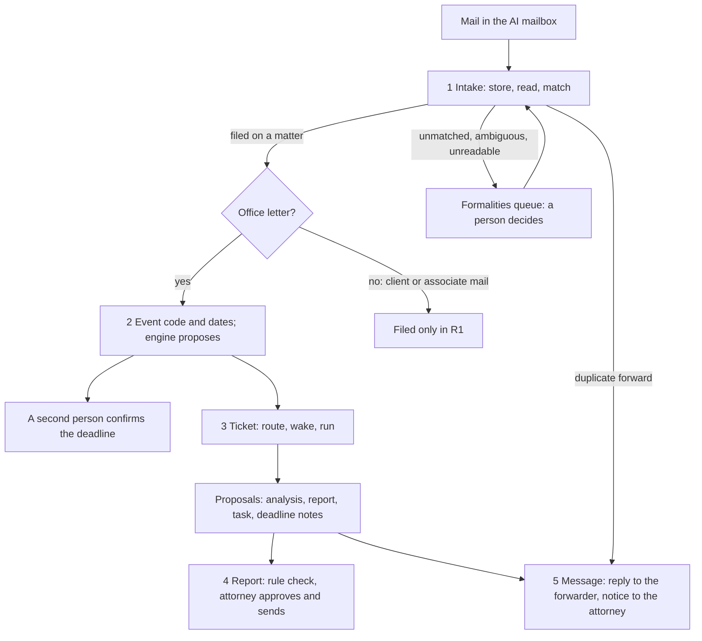
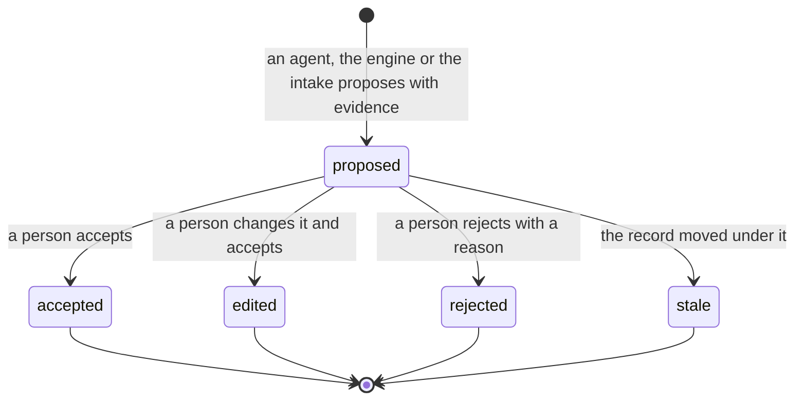

# The firm process atlas

**Status:** draft for the founder's approval, 2026-11-04. Part 1 covers phase R1, the AI mailbox.

**Goal.** The founder's words of 2026-11-04: "Each step, even a small step, is a process, and a process has a state machine." Each firm works differently, but FlowLeap must know each process before it builds it, and the AI-native way must do the work that people did by hand in the PATORG way. The atlas holds one sheet per process. Each sheet gives the process today from primary sources, the actors, the state machine, the firm variation points, the AI-native redesign, the map to the code, and the open questions for the pilot attorney.

## Contents

- [The R1 processes](#the-r1-processes)
- [One flow](#one-flow)
- [The shared states](#the-shared-states)
- [Processes and tickets](#processes-and-tickets)
- [The method for every phase](#the-method-for-every-phase)

## The R1 processes

| # | Sheet | Starts when | Ends when |
|---|---|---|---|
| 1 | [Office letter intake](01-office-letter-intake.md) | A mail arrives in the AI mailbox | Each document of the mail is filed on one matter, is a duplicate, or is not relevant |
| 2 | [Office event to deadline](02-office-event-to-deadline.md) | A filed document is an office letter | The deadline is active, rejected or stale, or the event has no period |
| 3 | [Notify and run](03-notify-and-run.md) | An office event is recorded on a matter | Every proposal of the run is decided, or a person takes the work by hand |
| 4 | [Report to the client](04-report-to-the-client.md) | The run reads the client rules for the event | The report is sent, not needed, rejected or stale |
| 5 | [Firm-internal message](05-firm-internal-message.md) | A run result, a duplicate forward or a notice needs a message | The message is sent, refused, or the tries are used up |

**Changes to the cut that the founder asked for.** The research changed two cuts:

- **Classification moves into two sheets.** "Is this an office letter, and for which matter?" is part of intake (sheet 1), because the match needs the document kind and the keys. "Which event is this, and which dates does it give?" is part of sheet 2, because the event code and the document date are the inputs of the deadline engine, and an error there gives a wrong deadline.
- **The notice to the attorney and the reply to the forwarder are one machine.** Both are a message from the AI mailbox to firm addresses only, with the same allow-list, the same outbox and the same retry rules. Two machines would repeat the same rules (principle-model-the-domain). So sheet 3 ends at the proposals, and sheet 5 sends the reply to the forwarder and the notice to the responsible attorney.

## One flow

The office event opens the Ticket at once. The run does not wait for the deadline confirmation, because the confirmation is a person's act and the attorney's first look must not wait for it. A later confirmation or correction moves the record, and a proposal that rests on an older record position becomes `stale` (design section 1.3) [INFERRED from the design].

## The shared states

Three record objects carry the state across the five sheets. Each sheet adds only its own states.

| Object | States | Owner | Used by sheets |
|---|---|---|---|
| **Document** | `stored`, `duplicate`, `unreadable`, `read`, `match_proposed`, `ambiguous`, `unmatched`, `matched`, `filed`, `replaced`, `not_relevant` | Intake (sheet 1) | 1, 2, 3, 4 (the sent copy of a report is a document) |
| **Office event** | `awaiting_code`, `code_proposed`, `recorded`, `no_period` | Sheet 2 | 2, 3 |
| **Proposal** | `proposed`, `accepted`, `edited`, `rejected`, `stale` (design section 1.3) | Firm Record | 1 (a match), 2 (an event code, a deadline), 3 (each work product), 4 (the report) |
| **Deadline** | `deadline_proposed`, `engine_refused`, `manual_proposed`, `active`, `rejected`, `stale`, `disputed`, `to_docket` | Sheet 2 | 2, 3 |
| **Ticket** | `opened`, `no_person`, `routed`, `observed`, `waking`, `running`, `run_failed`, `proposals_ready`, `decided`, `cancelled`, `failed` | Work router (sheet 3) | 3, 4, 5 |
| **Outbound message** | `composed`, `refused`, `queued`, `drafted`, `retrying`, `sent`, `dead` | Outbox (sheet 5) | 3, 5 |

A Decision is not a state of its own. It is the record event that moves a Proposal from `proposed` to `accepted`, `edited` or `rejected`, with the person, the time, the reason, and for a guarded change the independent check (design section 4.3).

## Processes and tickets

| Sheet | R1 ticket | Other tickets | What no ticket covers yet |
|---|---|---|---|
| 1 Office letter intake | [#220](https://github.com/flowleap-ai/flowleap-harness/issues/220) | #31 (vault for the Graph secret), #232 (e-file, R3) | The unreadable scan, the decide-within escalation, the move of a filed document to another matter |
| 2 Office event to deadline | [#220](https://github.com/flowleap-ai/flowleap-harness/issues/220) (engine proposes in observe mode) | #219 (R0 confirm), #226 (disputes, R2), #225 (DPMA delivery, R2) | Reading the event code and the dates with evidence; the manual deadline with a second person; `stale` and `disputed` after a move |
| 3 Notify and run | [#221](https://github.com/flowleap-ai/flowleap-harness/issues/221) | #135 to #138 (Decision, Ticket, Needs review, run limit) | Deputies and absence; the routing when nobody is present; the decide-by reminder |
| 4 Report to the client | [#223](https://github.com/flowleap-ai/flowleap-harness/issues/223) | #217 (letter tool), #233 (client rules and Outlook drafts, R3) | The proof that the report was sent; the send reminder |
| 5 Firm-internal message | [#222](https://github.com/flowleap-ai/flowleap-harness/issues/222) | none | The notice to the responsible attorney; the Reply-To rule of Microsoft Graph; the reply to a duplicate forward |

The PR that adds this atlas lists the proposed ticket changes.

## The method for every phase

Use this method for the processes of R2 and later. A sheet that does not follow it is not ready for approval.

1. **Name the process by its start event and its end states.** One sheet is one record object, or one object and the proposals that it owns. When two candidate processes repeat the same rules, merge them; when one process has two owners that change apart, split it. Say why in the README.
2. **Write the process today from primary sources.** Use, in this order: the law and the office texts (EPC, PCT, PatG, the EPO Guidelines, OJ EPO notices, DPMA notices and forms), court decisions, the professional rules (PAO, epi Code), the training rules of the staff (ReNoPat-AusbV), and the vendor documents (PATORG, agorum). Give each fact its URL and one label. **SOURCED** means we read the page and it says this. **SOURCED (secondary)** means we read a summary or a search extract, not the primary text. **INFERRED** means we concluded it, and the sheet says from what. Quotes are at most 15 words. A fact without a source is INFERRED, never SOURCED.
3. **Name the actors** from the roles of the research (section 2.1) and the system actors of the design (intake, engine, agent, Work router, Firm Record, outbox).
4. **Write the state machine as a transition table.** Each row has the state before, the state after, the event in the reader's words, the actor, and the evidence that the record log keeps. Then draw it as a Mermaid `stateDiagram-v2` from the table. Check the table against these rules: every state is reachable from the start; every state that is not an end state has a step out and can reach an end state; an end state has no step out, except a declared correction or escalation that keeps the state; every row names an actor and evidence. Include the error and timeout paths.
5. **Name the firm variation points as typed settings** with a default. A firm difference is a setting, never a code branch (design principle 6).
6. **Write the AI-native redesign.** Use the two tests of the design (section 1.1). Count the manual steps and the hand-offs, old and new, with the counting rule below.
7. **Map to the code.** Name the states and record events that exist, the ones that are new, and a type sketch in which an illegal transition does not compile.
8. **List the open questions** for the pilot attorney, where the sources disagree or firms differ.

**The counting rule.** A manual step is one act of one person that changes the state of the item or makes an artifact: open and sort, type a value, pick from a list, decide, write, send. Reading that leads to a decision is part of that decision. A hand-off is a move of the item from one person's queue to another person's queue; a system that moves the item without a person is not a hand-off. The old way counts the PATORG way for a firm that uses its EPO Mailbox import and its file-number recognition, because PATORG names both features [SOURCED: [PATORG productivity](https://www.patorg.com/de/features/productivity)]. The steps of the old way are INFERRED from the research's workflow table (section 2.4 of the [augmented firm research](../2026-11-03-augmented-firm-research.md)), which is itself INFERRED, so the pilot must measure them. The new way counts the typical path and names the extra steps of each exception.
