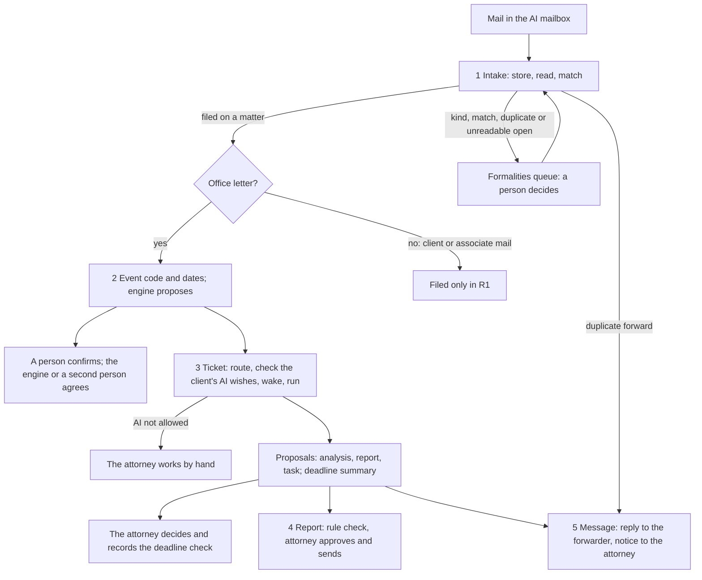
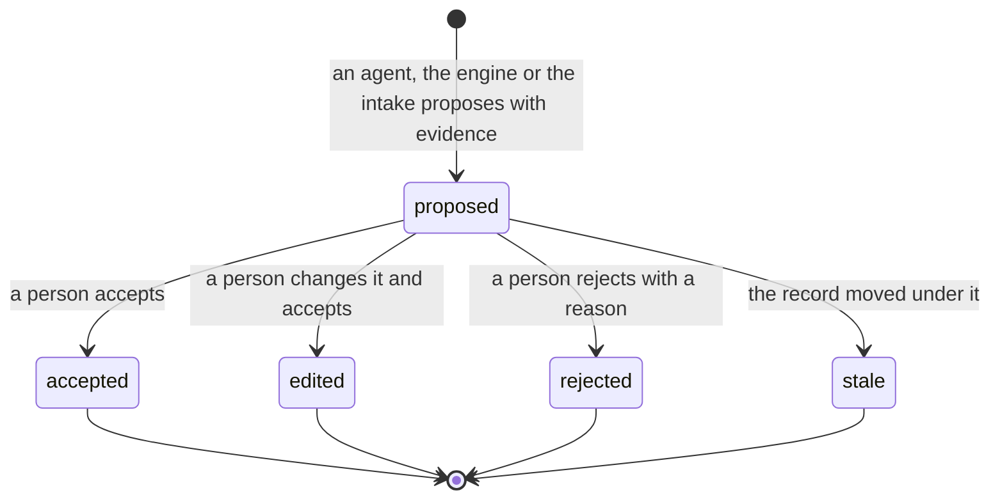

# The firm process atlas

**Status:** draft for the founder's approval, 2026-11-04. Part 1 covers phase R1, the AI mailbox. [Sheet 0, the connected flow](00-connected-flow.md) (2026-11-06, draft) connects the five sheets for the first demo of phase R1.5: one task model, My work and the matter dossier, and a letter that arrives without a person.

**Goal.** The founder's words of 2026-11-04: "Each step, even a small step, is a process, and a process has a state machine." Each firm works differently, but FlowLeap must know each process before it builds it, and the AI-native way must do the work that people did by hand in the PATORG way. The atlas holds one sheet per process. Each sheet gives the process today from primary sources, the actors, the state machine, the firm variation points, the AI-native redesign, the map to the code, and the open questions for the pilot attorney.

## Contents

- [The R1 processes](#the-r1-processes)
- [One flow](#one-flow)
- [The shared states](#the-shared-states)
- [The count, R1 and after the cut-over](#the-count-r1-and-after-the-cut-over)
- [Founder decision: the independent check of the reading (F1 on F3)](#founder-decision-the-independent-check-of-the-reading-f1-on-f3)
- [Founder decisions on the R1 settings (2026-11-04)](#founder-decisions-on-the-r1-settings-2026-11-04)
- [Processes and tickets](#processes-and-tickets)
- [The method for every phase](#the-method-for-every-phase)

## The R1 processes

| # | Sheet | Starts when | Ends when |
|---|---|---|---|
| 0 | [The connected flow](00-connected-flow.md) | An office letter for a matter arrives, or a schedule falls due | Every task that the item opened is done or cancelled |
| 1 | [Office letter intake](01-office-letter-intake.md) | A mail arrives in the AI mailbox | Each document of the mail is filed on one matter, is a duplicate, is replaced by a better scan, or is not relevant |
| 2 | [Office event to deadline](02-office-event-to-deadline.md) | A filed document is an office letter | The deadline is active, stale, or closed without its act; or an attorney decides that there is no event or no deadline; or the event has no period |
| 3 | [Notify and run](03-notify-and-run.md) | An office event is recorded on a matter | Every proposal of the run is decided, the task type is at observe, the Ticket is cancelled, or a person works by hand |
| 4 | [Report to the client](04-report-to-the-client.md) | The run reads the client rules for the event | The report is sent, withdrawn, not needed, written by hand, rejected or stale |
| 5 | [Firm-internal message](05-firm-internal-message.md) | A run result, a duplicate forward or a notice needs a message | The message is sent, refused, or dead |

**Changes to the cut that the founder asked for.** The research changed two cuts:

- **Classification moves into two sheets.** "Is this an office letter, and for which matter?" is part of intake (sheet 1), because the match needs the document kind and the keys. "Which event is this, and which dates does it give?" is part of sheet 2, because the event code and the document date are the inputs of the deadline engine, and an error there gives a wrong deadline.
- **The notice to the attorney and the reply to the forwarder are one machine.** Both are a message from the AI mailbox to firm addresses only, with the same allow-list, the same outbox and the same retry rules. Two machines would repeat the same rules (principle-model-the-domain). So sheet 3 ends at the proposals, and sheet 5 sends the reply to the forwarder and the notice to the responsible attorney.

## One flow

The office event opens the Ticket at once. The run does not wait for the deadline confirmation, because the confirmation is a person's act and the attorney's first look must not wait for it. The run result shows the deadline with its state (proposed, active, refused) and its trace, and the attorney's Decision records that they checked it (fact 2.14 of [sheet 2](02-office-event-to-deadline.md)). A later confirmation or correction moves the record, and a proposal that rests on an older record position becomes `stale` (design section 1.3) [INFERRED from the design].

## The shared states

Seven record objects carry the state across the sheets. Each sheet adds only its own states.

| Object | States | Owner | Used by sheets |
|---|---|---|---|
| **Document** | `stored`, `duplicate`, `unreadable`, `kind_proposed`, `read`, `duplicate_proposed`, `match_proposed`, `ambiguous`, `unmatched`, `matched`, `filed`, `replaced`, `not_relevant` | Intake (sheet 1) | 1, 2, 3, 4 (the sent copy of a report is a document) |
| **Office event** | `awaiting_code`, `code_proposed`, `recorded`, `no_event`, `no_period` | Sheet 2 | 2, 3 |
| **Proposal** | `proposed`, `accepted`, `edited`, `rejected`, `stale` (design section 1.3) | Firm Record | 1 (a kind, a match, a duplicate), 2 (an event code, a deadline), 3 (each work product), 4 (the report) |
| **Deadline** | `deadline_proposed`, `engine_refused`, `manual_proposed`, `active`, `rejected`, `stale`, `disputed`, `closed_without_act`, `to_docket` | Sheet 2 | 2, 3 |
| **Ticket** | `opened`, `no_person`, `routed`, `observed`, `by_hand`, `waking`, `running`, `run_failed`, `proposals_ready`, `decided`, `cancelled` | Work router (sheet 3) | 3, 4, 5 |
| **Outbound message** | `composed`, `refused`, `queued`, `drafted`, `retrying`, `send_requested`, `sent`, `dead` | Outbox (sheet 5) | 3, 5 |
| **Task** | `assigned`, `queued`, `escalated`, `alarm`, `done`, `cancelled` | Firm Record (sheet 0) | 0, and every waiting state of 1 to 5 |

A Decision is not a state of its own. It is the record event that moves a Proposal from `proposed` to `accepted`, `edited` or `rejected`, with the person, the time, the reason, the record position that the person saw, and for a guarded change the independent check (design section 4.3).

**The office event type.** The intake writes a new record event type, `office-event/observed`, with a new actor kind, `intake`. The design calls the intake's office event `observed` (design section 6.3), and R0's `EVENT_TYPES` binds one payload version and one actor kind to each type, so a new type fits better than a version 2 of `office-event/recorded`. R0's `office-event/recorded` stays the event of a person who records an office event, and R1 uses it when a person decides a code that the model read ([sheet 2](02-office-event-to-deadline.md#6-map-to-the-code)).

## The count, R1 and after the cut-over

In R1 the firm's PATORG docket stays the authority (docket observe mode, ADR 0002 decision 4). So the PAFA still keeps the docket in PATORG, and FlowLeap works beside it. Each sheet counts two new columns: **R1 (observe mode)** and **after cut-over** (FlowLeap is the docket, and the MyEPO source of R3, #154, replaces the forward). The old way is PATORG as its public pages describe it on 2026-11-04; the pages name no version. It has the EPO Mailbox import, the file-number recognition and the AI deadline search (fact 2.10 of sheet 2). The manual steps for a typical EPO letter with the default settings:

| Sheet | Old way (PATORG) | R1 (observe mode) | After cut-over |
|---|---|---|---|
| 1 Intake | 5 | 6 | 1 |
| 2 Deadline | 3 (2 with the PATORG AI) | 4 | 1 |
| 3 Notify and run (attorney) | 6 | 4 | 4 |
| 4 Report to the client | 6 | 3 | 2 |
| 5 Firm-internal message | 1 | 0 | 0 |
| **Total** | **21 (20)** | **17** | **8** |

All old counts are INFERRED and the pilot must measure them. R1 costs the PAFA two steps more per letter than today (sheets 1 and 2). The attorney and the secretary save six (sheets 3, 4 and 5). So the R1 total falls only because the attorney side falls. Two settings change the R1 PAFA count: `intake.exactKeyFiles: 'file-without-person'` and `deadline.observeModeConfirm: 'difference-only'` each save one step. Both are founder or pilot decisions, and both defaults are the safe value. The count rule does not measure the work inside a step: in sheet 3 the attorney reviews an analysis instead of writing it, so the minutes are the measure that the pilot must take.

## Founder decision: the independent check of the reading (F1 on F3)

**The finding.** F3 (ADR 0002 decision 4, design section 5.5) makes a deadline active only with two independent sources: a person confirms, and the engine or a second person agrees. In R0 the engine's check recomputes the date from the stored code and the stored document date (`decideDeadline` in `lib/record/commands.mjs`). So the engine checks the arithmetic, but it reads the same inputs as the proposal: a misread code or a misread date gives the same wrong date twice, and the engine agrees. The reading has only one check, the person who confirms. In the PATORG way the second person checks the whole entry, the reading too (fact 2.11 of sheet 2) [INFERRED].

**What this PR already does** (no decision needed): the Records app shows the code span and the date span beside the proposal; the person who decided a model-read code cannot confirm its deadline (`docket.code-decider-not-confirmer`); the confirm carries the record position that the person saw.

**The decision to take.** Which check of the reading does F3 require? Three options:

| Option | What it means | Steps per typical letter | Risk |
|---|---|---|---|
| A. The confirmer is the check (today's default, `confirmer-sees-spans`) | The person who confirms compares the spans with the letter | 1 | One person reads; the case law asks for an effective cross-check (fact 2.5). A tired confirmer can accept a misread date |
| B. Two independent readers | The intake reads the code and the date by code (form number, the date field of the form), and the model reads them again from the page image, not from the OCR text. The reading counts as checked when both agree; when they differ, or only one reader has a result, the reading is a proposal, and the confirmer cannot be the person who decides it | 1 when both agree; 2 when they differ | A common fault of both readers (for example a bad scan) must make them differ, not agree. Each reader must log its input. The insurer must accept a model as one of two readers (design question P5) |
| C. A second person for every reading (`always-second-person`) | A second person checks each entry, as in the PATORG way | 2 | Safe, but it keeps the old work, so it fails the AI-native test b (design section 1.1) |

**Decision (founder, 2026-11-04): B, with A as the fallback for letters without a form.** B makes the AI a second, independent reader, so the check of the reading becomes stronger than one person's look, and the typical letter keeps one step. It needs a new value, `deadline.readingCheck: 'two-readers'` (the default), a new evidence type (`ReadingCheck = { kind: 'two-readers'; code: Span; model: ModelReading } | { kind: 'person'; by: PersonId }`, where `ModelReading` is the logged model call of the intake: the model, the prompt version, the hash of the page image and the raw answer), and a test set of misread letters that shows that the readers differ on them. The pilot still answers question Q2.2 for its insurer.

## Founder decisions on the R1 settings (2026-11-04)

| Setting or rule | Decision | Why |
|---|---|---|
| `deadline.readingCheck` | `'two-readers'` (option B above); `'confirmer-sees-spans'` for letters without a form | The AI is a second, independent reader of the code and the date |
| `intake.exactKeyFiles` | `'person-confirms'` in R1 | Switch to `'file-without-person'` only after the shadow period shows no wrong filing |
| `deadline.observeModeConfirm` | `'confirm'` in R1 | The confirm costs one step but collects the evidence for F3 before the cut-over |
| Ticket grouping (#136) | One Ticket per application and day; a later event restarts the run from `running` or adds a second pass from `proposals_ready` | Keeps one analysis per application and day without losing a late letter |
| AI preconditions | A run needs the client's recorded AI wishes (`'not-recorded'` means no run) and, for a cloud model, a § 39c PAO contract in `firm.modelProviders` | epi guidelines and § 39c PAO (sheet 3) |

## Processes and tickets

| Sheet | R1 ticket | Other tickets | What no ticket covers yet |
|---|---|---|---|
| 0 The connected flow | none yet (phase R1.5) | #227 (People service), #325 (scan filing), #326 (calendar), #294 (seed dates), #154 (MyEPO source, later) | The task; My work and the dossier; scan-to-email and OCR; the Graph name sync; sign-out and the account picker; search |
| 1 Office letter intake | [#220](https://github.com/flowleap-ai/flowleap-harness/issues/220) | #31 (vault for the Graph secret), #232 (e-file, R3) | The unreadable scan, the kind proposal, the content duplicate, the decide-within escalation and its end alarm, the move of a filed document with the wall incident, the sender authentication |
| 2 Office event to deadline | [#220](https://github.com/flowleap-ai/flowleap-harness/issues/220) (engine proposes in observe mode) | #219 (R0 confirm), #226 (disputes, R2), #225 (DPMA delivery, R2) | `office-event/observed` and the intake actor; the manual deadline with a second person; the attorney-only end without a deadline; `stale`, `disputed` and `closed_without_act`; the seen seq; the F1 decision |
| 3 Notify and run | [#221](https://github.com/flowleap-ai/flowleap-harness/issues/221) | #135 to #138 (Decision, Ticket, Needs review, run limit) | The client's AI wishes and the provider contract before a run; deputies, the wall check and absence; the routing when nobody is present and its end alarm; the second-pass run; the attorney's recorded deadline check |
| 4 Report to the client | [#223](https://github.com/flowleap-ai/flowleap-harness/issues/223) | #217 (letter tool), #233 (client rules and Outlook drafts, R3) | The proof that the report was sent; the send reminder; the withdraw; `stale` after approval |
| 5 Firm-internal message | [#222](https://github.com/flowleap-ai/flowleap-harness/issues/222) | none | The notice to the responsible attorney; the Reply-To rule of Microsoft Graph; the immutable id, the stamp and the send request that never sends twice; the reply to a duplicate forward |

The PR that adds this atlas lists the proposed ticket changes.

## The method for every phase

Use this method for the processes of R2 and later. A sheet that does not follow it is not ready for approval.

1. **Name the process by its start event and its end states.** One sheet is one record object, or one object and the proposals that it owns. When two candidate processes repeat the same rules, merge them; when one process has two owners that change apart, split it. Say why in the README.
2. **Write the process today from primary sources.** Use, in this order: the law and the office texts (EPC, PCT, PatG, the EPO Guidelines, OJ EPO notices, DPMA notices and forms), court decisions, the professional rules (PAO, epi Code), the training rules of the staff (ReNoPat-AusbV), and the vendor documents (PATORG, agorum). Give each fact its URL and one label. **SOURCED** means we read the page and it says this. **SOURCED (secondary)** means we read a summary or a search extract, not the primary text. **INFERRED** means we concluded it, and the sheet says from what. Quotes are at most 15 words. A fact without a source is INFERRED, never SOURCED.
3. **Name the actors** from the roles of the research (section 2.1) and the system actors of the design (intake, engine, agent, Work router, Firm Record, outbox).
4. **Write the state machine as a transition table** in [`check/machines.mjs`](check/machines.mjs). Each row has the state before, the state after, the event in the reader's words, the actor, and the evidence that the record log keeps. Run `node flowleap/docs/process-atlas/check/check.mjs --write`: it checks the table and writes the table and its Mermaid `stateDiagram-v2` chart into the sheet, between the `atlas:` markers. `node flowleap/docs/process-atlas/check/check.mjs` without `--write` fails when a sheet differs from the table. The check rules: every state is reachable from the start; every state that is not an end state has a step out and can reach an end state; an end state has no step out, except a declared escalation or correction; every row names an actor and evidence. Include the error and timeout paths, and a cancel path from every live state.
5. **Name the firm variation points as typed settings** with a default. A firm difference is a setting, never a code branch (design principle 6). When a choice belongs to the founder or the pilot attorney, the default is the safe value, and an open question names the choice.
6. **Write the AI-native redesign.** Use the two tests of the design (section 1.1). Count the manual steps and the hand-offs with the counting rule below, in three columns: old way, R1 (observe mode) and after cut-over.
7. **Map to the code.** Name the states and record events that exist, the ones that are new, and a type sketch in which an illegal transition does not compile.
8. **List the open questions** for the pilot attorney, where the sources disagree or firms differ.

**The counting rule.** A manual step is one act of one person that changes the state of the item or makes an artifact: open and sort, type a value, pick from a list, decide, write, send. Reading that leads to a decision is part of that decision. Each Decision on a proposal is one step. A hand-off is a move of the item from one person's queue to another person's queue; a system that moves the item without a person is not a hand-off. The old way counts the PATORG way for a firm that uses its EPO Mailbox import, its file-number recognition and its AI deadline search, because PATORG names these features [SOURCED: [PATORG productivity](https://www.patorg.com/de/features/productivity), [PATORG AI](https://www.patorg.com/de/features/ai)]. The steps of the old way are INFERRED from the research's workflow table (section 2.4 of the [augmented firm research](../2026-11-03-augmented-firm-research.md)), which is itself INFERRED, so the pilot must measure them. The new way counts the typical path and names the extra steps of each exception. While the firm's docket is in observe mode, the R1 column counts the PATORG steps that stay.
